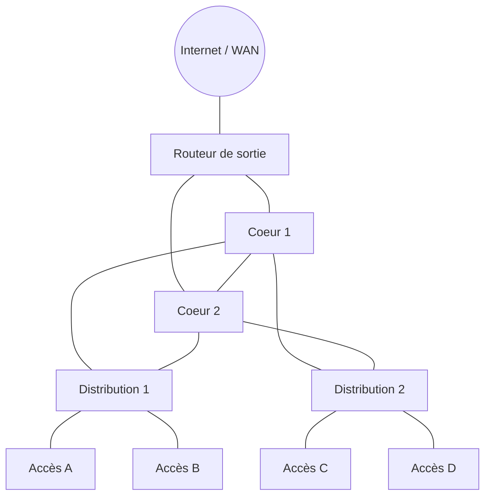

# 📖 Cours – Équipements et architectures

*Parcours CCNA – Domaine 1 – module 1-01 (sujets 1.1 et 1.2 de l'examen)*

> [!EXAMPLE] 🚀 Pour aller plus loin
> Module du parcours CCNA, **hors programme E31**. Réponds à chaque question **avant** de déplier la réponse.

## 🎯 À la fin de ce cours, tu sauras

- [ ] dire **à quoi sert** chaque équipement (routeur, switch L2/L3, pare-feu, IPS, point d'accès, contrôleur, PoE) ;
- [ ] reconnaître une architecture **2 niveaux**, **3 niveaux**, **SOHO**, **WAN**, **cloud** ;
- [ ] expliquer pourquoi on découpe un réseau en **niveaux**.

---

## 1. Les équipements : qui fait quoi ?

### 🤔 Avant de lire : à ton avis ?

Un **switch** et un **routeur** ont des prises RJ45. Quelle est la différence **de travail** ?

Voir la réponse

Le **switch** relie des appareils **d'un même réseau** (il décide d'après les **adresses MAC**). Le **routeur** relie **des réseaux différents** (il décide d'après les **adresses IP**).

| Équipement | Rôle | Il décide d'après… | Anglais |
|---|---|---|---|
| **Switch de couche 2** | Relie les postes d'un même réseau local | adresse MAC | *Layer 2 switch* |
| **Switch de couche 3** | Switch qui sait aussi **router** entre VLAN | MAC **et** IP | *Layer 3 switch* |
| **Routeur** | Relie des réseaux (LAN ↔ WAN) | adresse IP | *router* |
| **Pare-feu** | Autorise ou bloque le trafic selon des règles | IP, ports, applications | *firewall (next-generation firewall)* |
| **IPS** | Détecte **et bloque** les attaques connues | contenu du trafic | *Intrusion Prevention System* |
| **Point d'accès (AP)** | Donne le Wi-Fi aux appareils | trame Wi-Fi → câble | *Access Point* |
| **Contrôleur Wi-Fi (WLC)** | Gère **toutes** les bornes depuis un seul endroit | – | *Wireless LAN Controller* |
| **Terminaux et serveurs** | Utilisent le réseau (postes, caméras, téléphones, serveurs) | – | *endpoints, servers* |

### 💡 Le PoE

Le **PoE** (*Power over Ethernet*) alimente un appareil **par le câble réseau** : une borne Wi-Fi, un téléphone IP ou une caméra n'ont pas besoin de prise secteur. C'est le **switch** (ou un injecteur) qui fournit le courant.

### ✅ Vérifie que tu as compris

Une caméra IP est installée au plafond, sans prise électrique à proximité. Que faut-il vérifier sur le switch ?

Voir la réponse

Que le switch fournisse du **PoE** (et que sa puissance totale suffise pour toutes les caméras).

---

## 2. Les architectures

### 💡 Architecture à 3 niveaux (*three-tier*)

Un grand réseau (campus, usine) est découpé en **trois niveaux** :

| Niveau | Rôle | Anglais |
|---|---|---|
| **Accès** | Branche les postes, les bornes, les imprimantes | *access* |
| **Distribution** | Regroupe les switchs d'accès, applique les règles (VLAN, ACL, routage) | *distribution* |
| **Cœur** | Transporte **très vite** le trafic entre bâtiments, sans règle compliquée | *core* |

Les liaisons **en double** assurent la **redondance** : si un câble ou un switch tombe, un autre chemin existe.

### 💡 Architecture à 2 niveaux (*collapsed core*)

Pour un réseau **moyen** (un bâtiment), on **fusionne** distribution et cœur : il ne reste que **accès** et **cœur réduit**. Moins de matériel, moins cher.

### 💡 Spine-leaf

Dans un **centre de données**, chaque switch « *leaf* » est relié à **tous** les switchs « *spine* ». Résultat : le chemin entre deux serveurs a **toujours la même longueur**. Ce n'est pas l'architecture d'un bureau.

### 💡 Les autres architectures

| Architecture | Description |
|---|---|
| **SOHO** (*Small Office / Home Office*) | Une **box** ou un petit routeur fait tout : routeur, switch, Wi-Fi, pare-feu |
| **WAN** | Relie des **sites éloignés** (liaison louée, Internet + VPN) |
| **On-premises** | Les serveurs sont **dans les locaux** de l'entreprise |
| **Cloud** | Les serveurs sont **chez un fournisseur** (location à la demande) |

### ✅ Vérifie que tu as compris

1. Une agence de 20 postes a besoin de la redondance d'un cœur dédié ? Quelle architecture ?
2. Dans une architecture à 3 niveaux, où branche-t-on un poste ?

Voir la réponse

1. Non : **2 niveaux** suffisent (accès + cœur réduit).
2. Au niveau **accès**.

---

## 🧠 Quiz de fin

**1.** Quel équipement décide d'après l'**adresse IP** ?

Voir la réponse

Le **routeur** (ou le switch de couche 3).

**2.** Quelle différence entre un pare-feu et un IPS ?

Voir la réponse

Le pare-feu applique des **règles** (qui a le droit de passer). L'IPS **analyse le contenu** et bloque les **attaques connues**.

**3.** Pourquoi relier chaque switch de distribution à **deux** switchs de cœur ?

Voir la réponse

Pour la **redondance** : si un équipement ou un câble tombe, le trafic passe par l'autre.

**4.** Que fait un contrôleur Wi-Fi (WLC) ?

Voir la réponse

Il **gère toutes les bornes** depuis un point central (configuration, canaux, sécurité).

> [!NOTE]
> **Ce qui tombe à l'examen :** associer un équipement à son rôle, reconnaître le schéma d'une architecture, choisir 2 ou 3 niveaux selon la taille.

➡️ Suite : [le TP du module](02-tp.md).
