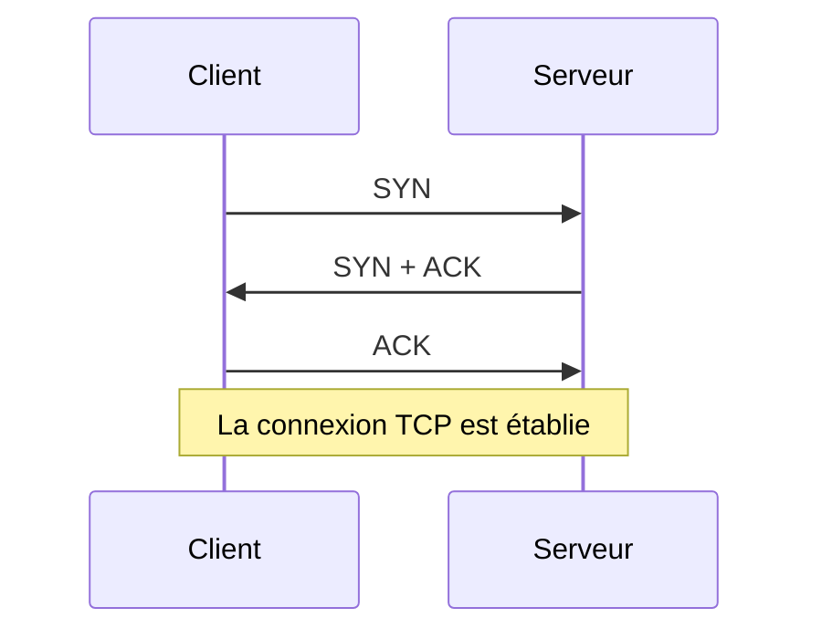

# 📖 Cours – TCP, UDP et outils des postes

*Parcours CCNA – Domaine 1 – module 1-03 (sujets 1.5, 1.10 et 1.12)*

> [!EXAMPLE] 🚀 Pour aller plus loin
> Module du parcours CCNA, **hors programme E31**.

## 🎯 À la fin de ce cours, tu sauras

- [ ] **comparer** TCP et UDP et choisir lequel convient ;
- [ ] relier un **service** à son **numéro de port** ;
- [ ] **vérifier** l'adressage IP d'un poste sous Windows, Linux et macOS ;
- [ ] expliquer ce qu'est une **machine virtuelle**, un **conteneur** et un **VRF**.

---

## 1. TCP et UDP

### 🤔 Avant de lire : à ton avis ?

Pour un **virement bancaire** et pour un **appel vidéo**, vaut-il mieux « ne rien perdre » ou « aller vite » ?

Voir la réponse

Virement : **ne rien perdre**. Appel vidéo : **aller vite** (une image perdue vaut mieux qu'une image en retard).

| | **TCP** | **UDP** |
|---|---|---|
| Connexion | **Oui** (poignée de main en 3 temps) | Non |
| Fiabilité | Accusés de réception, **retransmission** des segments perdus | Aucune garantie |
| Ordre | Segments **remis dans l'ordre** | Pas garanti |
| Contrôle de flux | **Oui** (fenêtre) | Non |
| Vitesse | Plus lent | Plus rapide, léger |
| Exemples | HTTP/HTTPS, SSH, FTP, SMTP | DNS, DHCP, VoIP, vidéo, TFTP, SNMP |

### 💡 La poignée de main en 3 temps (*three-way handshake*)

### 💡 Les ports

Un **port** désigne le **service** visé sur une machine (l'IP désigne la machine, le port le programme).

| Port | Protocole | Service |
|---|---|---|
| 20/21 | TCP | FTP (données / contrôle) |
| 22 | TCP | **SSH** |
| 23 | TCP | Telnet (non sécurisé) |
| 25 | TCP | SMTP (envoi de courrier) |
| 53 | TCP/UDP | **DNS** |
| 67/68 | UDP | **DHCP** (serveur / client) |
| 69 | UDP | TFTP |
| 80 | TCP | HTTP |
| 110 | TCP | POP3 |
| 123 | UDP | **NTP** |
| 143 | TCP | IMAP |
| 161/162 | UDP | **SNMP** |
| 443 | TCP | **HTTPS** |
| 514 | UDP | Syslog |

> [!TIP]
> **À connaître par cœur** pour l'examen : 22, 23, 25, 53, 67/68, 80, 123, 161, 443.

### ✅ Vérifie que tu as compris

Une application de visioconférence choisit UDP. Quelle est la conséquence si un paquet est perdu ?

Voir la réponse

Il **n'est pas retransmis** : on perd un petit morceau d'image ou de son, mais la conversation reste fluide.

---

## 2. Vérifier l'adressage IP d'un poste

| Système | Commande | Remarque |
|---|---|---|
| **Windows** | `ipconfig /all` | adresse IP, masque, passerelle, DNS, MAC, DHCP |
| **Linux** | `ip addr` (ou `ip a`) puis `ip route` | `ip route` montre la passerelle |
| **macOS** | `ifconfig` ou `networksetup -getinfo Wi-Fi` | |
| Tous | `ping`, `traceroute` (Windows : `tracert`) | tester la joignabilité |

Une adresse commençant par **169.254.x.x** (APIPA) signifie que le poste **n'a pas trouvé de serveur DHCP**.

---

## 3. Virtualisation

| Notion | Principe |
|---|---|
| **Machine virtuelle (VM)** | Un « faux ordinateur » avec **son propre système**, hébergé sur un vrai |
| **Hyperviseur** | Logiciel qui crée et fait tourner les VM (type 1 : directement sur le matériel ; type 2 : sur un système, comme VirtualBox) |
| **Conteneur** | Application isolée qui **partage le noyau** de l'hôte : plus léger qu'une VM |
| **VRF** | *Virtual Routing and Forwarding* : **plusieurs tables de routage** indépendantes dans **un seul** routeur |

---

## 🧠 Quiz de fin

**1.** Quel protocole de transport utilise le DNS pour une requête simple ?

Voir la réponse

**UDP** port 53 (TCP 53 pour les gros transferts de zone).

**2.** Un poste affiche `169.254.12.7`. Que peut-on en conclure ?

Voir la réponse

Le DHCP n'a pas répondu : le poste s'est donné une adresse **APIPA**.

**3.** Quelle commande Linux montre la passerelle par défaut ?

Voir la réponse

`ip route`.

**4.** Quelle est la différence entre une VM et un conteneur ?

Voir la réponse

La VM embarque **un système complet** ; le conteneur **partage le noyau** de l'hôte.

**5.** Quel est le rôle d'un VRF ?

Voir la réponse

Séparer **plusieurs réseaux** dans un même routeur grâce à des **tables de routage distinctes**.

## 🛠️ Mini-TP dans le simulateur

Ouvre un des TP de ton année (par exemple celui de la séance en cours), puis :

1. Sur un poste Linux : `ip addr`, `ip route`, `ping -c 2 <passerelle>`.
2. Sur un poste Windows : `ipconfig /all`, `ping <passerelle>`.
3. Note, pour chaque poste, l'adresse IP, le masque et la passerelle.

✅ **Point de contrôle :** tu retrouves ces trois informations en moins d'une minute, sur les deux systèmes.
