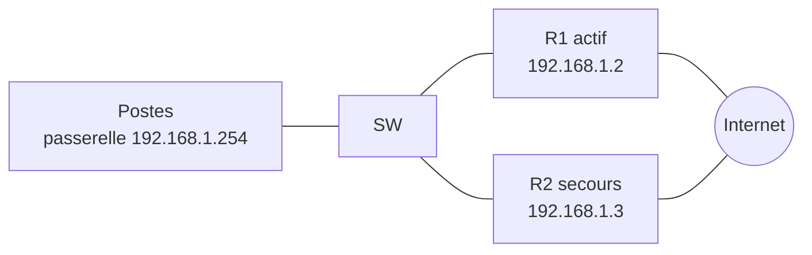

# 📖 Cours – Redondance du premier saut (FHRP)

*Parcours CCNA – Domaine 3 – module 3-04 (sujet 3.5)*

> [!EXAMPLE] 🚀 Pour aller plus loin
> Module du parcours CCNA, **hors programme E31**. **Pas de TP** : les protocoles FHRP (HSRP, VRRP) ne sont pas simulés. L'examen demande seulement d'en **expliquer le rôle**.

## 🎯 À la fin de ce cours, tu sauras

- [ ] expliquer pourquoi la **passerelle** est un point de panne ;
- [ ] décrire le principe d'une **adresse virtuelle** partagée ;
- [ ] comparer **HSRP**, **VRRP** et **GLBP**.

---

## 1. Le problème

### 🤔 Avant de lire : à ton avis ?

Tous les postes d'un réseau ont **une seule passerelle** configurée : le routeur `R1`. `R1` tombe en panne. Que se passe-t-il, alors qu'il existe un second routeur `R2` ?

<details markdown="1"><summary>Voir la réponse</summary>

Les postes **perdent la sortie** : leur passerelle ne répond plus. Les postes ne savent pas qu'un second routeur existe, et reconfigurer chaque poste à la main n'est pas réaliste.

</details>

## 2. La solution : une passerelle virtuelle

Les **deux routeurs** partagent une **adresse IP virtuelle** (et une **MAC virtuelle**). Les postes utilisent **cette adresse** comme passerelle. Un seul routeur (l'**actif**) répond ; si il tombe, le **secours** prend l'adresse virtuelle **tout de suite** : les postes ne changent rien.



Adresse virtuelle : `192.168.1.254` (partagée par R1 et R2).

| Protocole | Origine | Particularités |
|---|---|---|
| **HSRP** | **Cisco** | Un routeur **actif**, un **en attente** (*standby*) ; MAC virtuelle `0000.0c07.acXX` |
| **VRRP** | **Standard** (IETF) | Un **maître** (*master*) et des **sauvegardes** ; fonctionne avec tous les constructeurs |
| **GLBP** | Cisco | **Répartit** la charge entre plusieurs routeurs en plus de la redondance |

### Vocabulaire à connaître

| Terme | Sens |
|---|---|
| **First Hop Redundancy Protocol (FHRP)** | La famille de protocoles |
| **Active / Standby (HSRP)** | Le routeur qui répond / celui qui attend |
| **Master / Backup (VRRP)** | L'équivalent en VRRP |
| **Priorité** | Le plus haut gagne l'élection (HSRP : 100 par défaut) |
| **Préemption** | Un routeur de priorité plus forte **reprend** son rôle quand il revient |

### À quoi ressemble la configuration HSRP (pour la culture)

```text
interface gigabitEthernet 0/0
 ip address 192.168.1.2 255.255.255.0
 standby 1 ip 192.168.1.254
 standby 1 priority 110
 standby 1 preempt
```

> [!WARNING]
> Ces commandes **ne marchent pas dans le simulateur**. Retiens leur **rôle**, pas leur syntaxe exacte.

---

## 🧠 Quiz de fin

**1.** Quelle adresse les postes utilisent-ils comme passerelle ?

<details markdown="1"><summary>Voir la réponse</summary>

L'**adresse IP virtuelle**.

</details>

**2.** Quel protocole FHRP est un standard ouvert ?

<details markdown="1"><summary>Voir la réponse</summary>

**VRRP**.

</details>

**3.** Que fait la préemption ?

<details markdown="1"><summary>Voir la réponse</summary>

Elle permet à un routeur de **priorité plus haute** de **reprendre** le rôle actif quand il revient.

</details>

**4.** Quel protocole répartit aussi la charge ?

<details markdown="1"><summary>Voir la réponse</summary>

**GLBP**.

</details>

---

## 🧊 Alternative avec Cisco Packet Tracer (TP possible)

> [!TIP]
> **HSRP n'est pas simulé** sur le site. Packet Tracer accepte la commande `standby`. Monte ce TP :
>
> 1. Deux routeurs `R1` et `R2`, un switch, un PC, et un « Internet » (un routeur ou un serveur) derrière eux.
> 2. `R1` : `192.168.1.2`, `R2` : `192.168.1.3`, adresse virtuelle `192.168.1.254` (passerelle du PC).
> 3. Sur `R1` : `standby 1 ip 192.168.1.254`, `standby 1 priority 110`, `standby 1 preempt`. Sur `R2` : `standby 1 ip 192.168.1.254`.
> 4. `show standby brief` : qui est *Active* ?
> 5. Coupe l'interface de `R1` : le PC garde-t-il sa sortie ? Qui devient *Active* ?
> 6. Rétablis `R1` : que se passe-t-il grâce à la préemption ?
