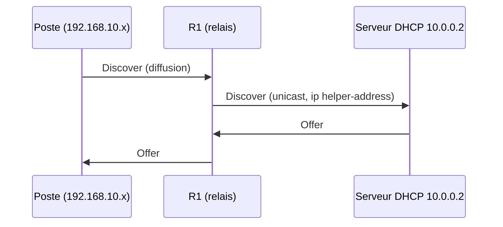

# 📖 Cours – DHCP, relais et DNS

*Parcours CCNA – Domaine 4 – module 4-02 (sujets 4.3 et 4.6)*

> [!EXAMPLE] 🚀 Pour aller plus loin
> Module du parcours CCNA, **hors programme E31** au niveau de détail demandé. DHCP et DNS sont vus en Seconde (S12 et S13) et sur serveur en Première (S11).

## 🎯 À la fin de ce cours, tu sauras

- [ ] décrire les **4 messages DORA** du DHCP ;
- [ ] expliquer le rôle d'un **relais DHCP** (*DHCP relay*) ;
- [ ] configurer un **pool** DHCP et un **relais** sur un routeur Cisco ;
- [ ] expliquer le rôle du **DNS** et des principaux **enregistrements**.

---

## 1. DHCP : le processus DORA

| Étape | Message | Qui → qui |
|---|---|---|
| **D**iscover | « Y a-t-il un serveur DHCP ? » | client → **diffusion** |
| **O**ffer | « Je te propose cette adresse. » | serveur → client |
| **R**equest | « Je prends cette adresse. » | client → diffusion |
| **A**cknowledge | « C'est confirmé, pour telle durée. » | serveur → client |

DHCP utilise **UDP**, ports **67** (serveur) et **68** (client). Le bail (*lease*) a une **durée** ; le client le renouvelle avant l'expiration.

## 2. Le problème des diffusions

Le **Discover** est une **diffusion** : un routeur **ne la transmet pas** aux autres réseaux. Si le serveur DHCP est **dans un autre réseau** que les postes, il ne reçoit jamais la demande.

### 🤔 Avant de lire : à ton avis ?

Comment éviter d'installer un serveur DHCP dans **chaque** réseau ?

<details markdown="1"><summary>Voir la réponse</summary>

Avec un **relais DHCP** (*DHCP relay*) : le routeur **reçoit** la diffusion et la **réémet en unicast** vers le serveur central.

</details>



## 3. Configuration

**Serveur DHCP sur un routeur :**

```text
ip dhcp excluded-address 192.168.10.1 192.168.10.9
ip dhcp pool LAN10
 network 192.168.10.0 255.255.255.0
 default-router 192.168.10.1
 dns-server 8.8.8.8
```

**Relais sur l'interface côté postes :**

```text
interface gigabitEthernet 0/0
 ip helper-address 10.0.0.2
```

| Commande | Rôle |
|---|---|
| `show ip dhcp binding` | adresses attribuées (bail) |
| `show ip dhcp pool` | utilisation du pool |
| `show running-config` | vérifier `ip helper-address` |

> [!NOTE]
> Le **serveur** doit avoir une **route** de retour vers le réseau des postes, sinon l'Offer ne revient pas.

**Client DHCP sur un routeur :** `interface gi0/1` puis `ip address dhcp` : l'interface demande son adresse par DHCP.

## 4. Le DNS

Le **DNS** traduit un **nom** en **adresse IP**. Port **53** (UDP, ou TCP pour les gros échanges).

| Enregistrement | Rôle |
|---|---|
| **A** | Nom → adresse **IPv4** |
| **AAAA** | Nom → adresse **IPv6** |
| **CNAME** | Nom → **autre nom** (alias) |
| **MX** | Serveur de **messagerie** du domaine |
| **PTR** | Adresse → nom (résolution inverse) |
| **NS** | Serveur de noms du domaine |

---

## 🧠 Quiz de fin

**1.** Que signifie DORA ?

<details markdown="1"><summary>Voir la réponse</summary>

Discover, Offer, Request, Acknowledge.

</details>

**2.** Quelle commande configure un relais DHCP ?

<details markdown="1"><summary>Voir la réponse</summary>

`ip helper-address <adresse du serveur>` sur l'interface **côté postes**.

</details>

**3.** Pourquoi le Discover ne traverse-t-il pas un routeur ?

<details markdown="1"><summary>Voir la réponse</summary>

C'est une **diffusion** : les routeurs **ne transmettent pas** les diffusions.

</details>

**4.** Quel enregistrement DNS donne l'adresse IPv6 d'un nom ?

<details markdown="1"><summary>Voir la réponse</summary>

**AAAA**.

</details>

➡️ Suite : [le TP du module](02-tp.md).
