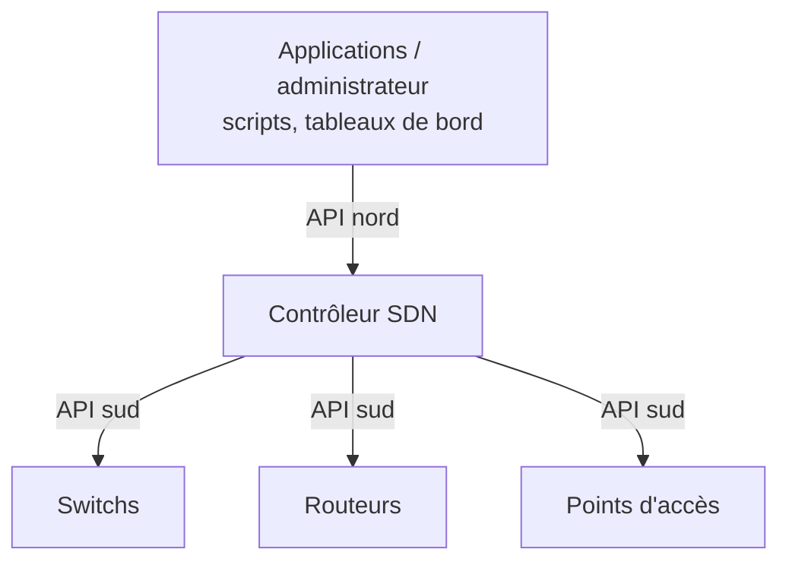

# 📖 Cours – Automatisation et réseaux pilotés par contrôleur

*Parcours CCNA – Domaine 6 – module 6-01 (sujets 6.1, 6.2, 6.3 et 6.4)*

> [!EXAMPLE] 🚀 Pour aller plus loin
> Module du parcours CCNA, **hors programme E31**. Ce module est **théorique** : il n'y a pas de TP dans le simulateur du site (voir l'alternative en bas de page).

## 🎯 À la fin de ce cours, tu sauras

- [ ] expliquer ce que l'**automatisation** change dans la gestion d'un réseau ;
- [ ] comparer **réseau traditionnel** et réseau **piloté par un contrôleur** ;
- [ ] distinguer **plan de contrôle**, **plan de données** et **plan de gestion** ;
- [ ] décrire **overlay**, **underlay**, **fabric**, **API nord / sud** ;
- [ ] situer l'**IA prédictive et générative** dans l'exploitation réseau.

---

## 1. Pourquoi automatiser ?

### 🤔 Avant de lire : à ton avis ?

Tu dois changer le même réglage sur **200 switchs**. Combien de temps à la main ? Quel risque ?

Voir la réponse

Très long, et chaque saisie manuelle est une **occasion d'erreur** : des équipements finissent avec des réglages **différents** (*dérive de configuration*). L'**automatisation** applique la **même** modification partout, **rapidement** et de façon **reproductible**.

| Apport de l'automatisation | Explication |
|---|---|
| **Rapidité** | Un changement déployé sur tout le parc en quelques minutes |
| **Cohérence** | Même configuration partout, moins d'erreurs humaines |
| **Reproductibilité** | Le même script donne le même résultat |
| **Traçabilité** | Les changements sont **versionnés** et revus |
| **Conformité** | On **vérifie** automatiquement que les équipements respectent la règle |

## 2. Les trois plans

| Plan | Rôle | Exemples |
|---|---|---|
| **Plan de données** (*data plane*) | **Transmet** les paquets | Table de commutation, routage |
| **Plan de contrôle** (*control plane*) | **Décide** où envoyer : construit les tables | OSPF, STP, ARP |
| **Plan de gestion** (*management plane*) | **Administre** l'équipement | SSH, SNMP, syslog |

## 3. Réseau traditionnel ou piloté par contrôleur

| | **Traditionnel** | **Piloté par contrôleur** |
|---|---|---|
| Plan de contrôle | **Distribué** : chaque équipement décide | **Centralisé** dans un **contrôleur** |
| Configuration | Équipement par équipement (CLI) | **Politique globale** poussée par le contrôleur |
| Vision du réseau | Locale | **Globale** |
| Exemple | Un switch qui exécute STP | Cisco **Catalyst Center**, contrôleur Wi-Fi |

### API nord et sud

| API | Rôle |
|---|---|
| **API nord** (*northbound*) | Entre le **contrôleur** et les **applications / scripts** (souvent **REST**) |
| **API sud** (*southbound*) | Entre le **contrôleur** et les **équipements** (NETCONF, RESTCONF, OpenFlow, SSH…) |

## 4. Overlay, underlay, fabric

| Terme | Sens |
|---|---|
| **Underlay** | Le réseau **physique** et son routage (câbles, switchs, IP) |
| **Overlay** | Un réseau **virtuel** construit **par-dessus** (VXLAN, tunnels, VPN) |
| **Fabric** | L'**ensemble** underlay + overlay géré comme **une seule entité** |

## 5. L'IA dans l'exploitation réseau (nouveauté du blueprint v1.1)

| Type | Rôle | Exemple |
|---|---|---|
| **IA prédictive** (*predictive AI / machine learning*) | **Prévoit** à partir des données historiques | Anticiper la saturation d'un lien, détecter une anomalie |
| **IA générative** (*generative AI*) | **Produit** du contenu | Générer une configuration, résumer des journaux, répondre à une question |

> [!WARNING]
> Une configuration **générée** doit être **relue et testée** avant d'être appliquée : l'IA peut se tromper. L'ingénieur reste **responsable**.

---

## 🧊 Alternative avec Cisco Packet Tracer

> [!TIP]
> Il n'y a pas de contrôleur SDN dans le simulateur du site. Packet Tracer (selon la version) propose un équipement **Network Controller** et un **éditeur Python** (programmation d'objets connectés) ; les cours **DevNet** de Cisco Networking Academy les utilisent. Vérifie avec ton enseignant ce qui est disponible dans ta version.

---

## 🧠 Quiz de fin

**1.** Quel plan construit les tables de routage ?

Voir la réponse

Le **plan de contrôle**.

**2.** Dans un réseau piloté par contrôleur, où est centralisé le plan de contrôle ?

Voir la réponse

Dans le **contrôleur**.

**3.** À quoi sert l'API nord ?

Voir la réponse

À permettre aux **applications et scripts** de **piloter le contrôleur**.

**4.** Overlay ou underlay : lequel est le réseau physique ?

Voir la réponse

L'**underlay**.

**5.** Donne un usage de l'IA prédictive en exploitation réseau.

Voir la réponse

**Détecter une anomalie** ou **prévoir** la saturation d'un lien.

