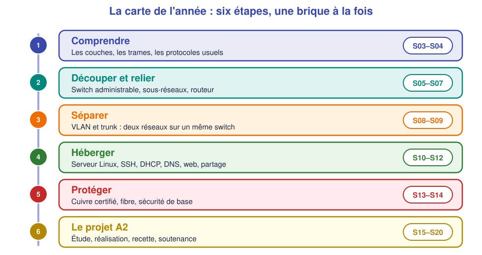

# 📖 Cours – La carte de l'année

*Bac Pro CIEL – Première – E31 – S01*

> [!IMPORTANT]
> **Une idée à la fois.** Réponds à la question **avant** de déplier la réponse.

## 🎯 À la fin de ce cours, tu sauras

- [ ] dire **ce que tu as appris** en Seconde en cinq grandes idées ;
- [ ] décrire **ce que tu vas apprendre** cette année ;
- [ ] expliquer la différence entre **réseau local**, **réseau d'entreprise** et **Internet** ;
- [ ] utiliser ton **Passeport d'autonomie** de Première.

---

## 1. Ce que tu sais déjà (la mémoire du réseau)

### 🤔 Avant de lire : à ton avis ?

Sans regarder tes notes, **liste cinq choses** qui doivent fonctionner pour qu'un PC ouvre un site web. *(Indice : de la prise murale jusqu'au site.)*

Voir la réponse

1. Un **câble** (ou le Wi-Fi) en bon état ;
2. une **adresse IP** valide (donnée par le **DHCP** ou fixée à la main) ;
3. une **passerelle** (la box) pour sortir du réseau local ;
4. un **DNS** pour traduire le nom du site en adresse IP ;
5. un **chemin** vers Internet (box → fournisseur d'accès).

C'est **l'échelle du diagnostic** de la Seconde (S15) : câble → IP → passerelle → Internet par adresse → DNS.

### 💡 L'idée

| Idée de Seconde | Ce qu'il faut savoir répondre |
|---|---|
| **Matériel et systèmes** | Nommer les composants d'un PC, installer Windows et Linux |
| **Câblage** | Fabriquer un câble RJ45, brasser, étiqueter |
| **Adresse IP** | Adresse + masque = **un réseau** ; deux machines se voient si elles sont dans le **même réseau** |
| **Services de base** | **DHCP** distribue les adresses ; **DNS** traduit les noms ; la **box** fait routeur + NAT |
| **Dépannage** | On teste **dans l'ordre**, on change **une chose à la fois** |

### ✅ Vérifie que tu as compris

Un poste a l'adresse `192.168.1.30/24` ; la box est en `192.168.1.1`. **Peuvent-ils se parler directement ?** Et un poste en `192.168.10.30/24` ?

Voir la réponse

`192.168.1.30/24` et `192.168.1.1` : **oui**, même réseau (`192.168.1.0/24`). `192.168.10.30/24` : **non**, c'est **un autre réseau** (`192.168.10.0/24`) ; il faudrait **un routeur** entre les deux. *C'est exactement le sujet de la séance S07.*

---

## 2. Ce que tu vas apprendre cette année

### 🤔 Avant de lire : à ton avis ?

En PFMP, tu as peut-être vu un **switch avec des câbles colorés**, un **serveur** dans une baie, des **réseaux séparés** pour la direction et l'atelier. **Comment ça marche, derrière ?**

Voir la réponse

C'est le programme de l'année : on **découpe** un réseau (sous-réseaux, **VLAN**), on **relie** les morceaux (routeur), on **héberge** des services (serveur Linux, DHCP, DNS, web), et on **protège** (sécurité de base).

### 💡 L'idée

Chaque étape ajoute **une brique** à la précédente. L'année se termine par le **projet A2** : tu conçois, installes et testes le réseau d'une **agence de trois services**.

### ✅ Vérifie que tu as compris

Dans quel ordre vas-tu voir : **VLAN**, **serveur DHCP**, **sous-réseaux** ? Pourquoi cet ordre ?

Voir la réponse

**Sous-réseaux** → **VLAN** → **serveur DHCP**. On découpe d'abord (sous-réseaux), on sépare physiquement avec les VLAN, puis on **distribue les adresses** de chaque réseau avec un serveur.

---

## 3. Réseau local, réseau d'entreprise, Internet

| | Réseau local (LAN) | Réseau d'entreprise | Internet |
|---|---|---|---|
| **Taille** | Une pièce, une maison | Un bâtiment, plusieurs sites | Mondial |
| **Qui l'administre ?** | Toi | L'équipe informatique | Personne seul |
| **Exemples** | Box + 3 PC | Agence : direction, atelier, invités, serveurs | Les sites web |
| **Équipements** | Box, switch | **Switchs administrables, routeurs, serveurs, pare-feu** | Routeurs des opérateurs |

> [!TIP]
> **Retiens :** en Première, on passe du **réseau domestique** au **réseau d'entreprise** : plusieurs réseaux, des équipements **administrables**, des **serveurs**.

---

## 4. Ton Passeport d'autonomie de Première

Même principe qu'en Seconde : pour chaque compétence, tu es **Vu**, **Guidé** ou **Autonome**. Le **Passeport** est dans les [ressources](../../ressources/passeport-autonomie.md) ; tu le complètes **après chaque séance**.

## 📌 Vocabulaire

| Mot | Définition |
|---|---|
| **LAN** | Réseau local |
| **Équipement administrable** | Switch ou routeur qu'on configure en ligne de commande |
| **Serveur** | Machine qui rend un service (DHCP, DNS, web…) à d'autres |
| **VLAN** | Réseau « virtuel » : on sépare des groupes de postes sans changer le matériel |
| **PFMP** | Période de formation en milieu professionnel |

## 🏁 Retiens l'essentiel

- [ ] J'ai **cinq idées de Seconde** : câble, IP, DHCP/DNS/box, dépannage, sécurité de base.
- [ ] Cette année : **découper, relier, héberger, protéger**.
- [ ] Je tiens mon **Passeport** à jour.

➡️ **Suite :** [le TP](02-tp.md).
