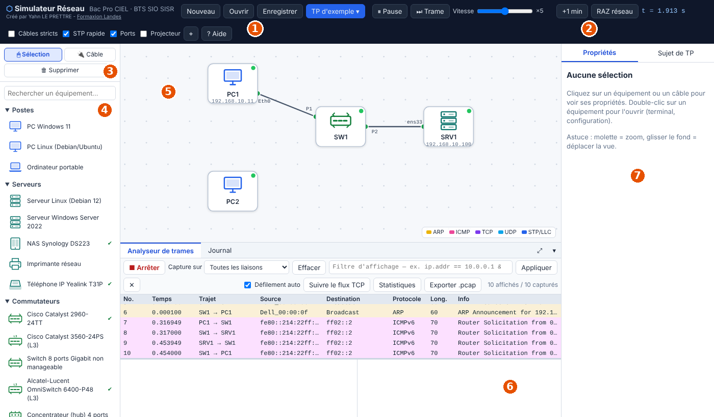
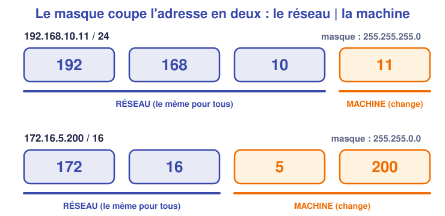
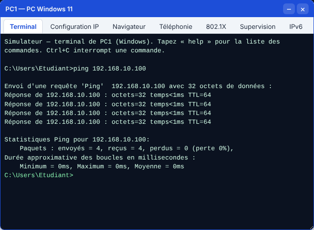

# 📖 Cours – Le simulateur et la remise à niveau

*Bac Pro CIEL – Première – E31 – S02*

> [!IMPORTANT]
> **Une idée à la fois.** Réponds à la question **avant** de déplier la réponse.

## 🎯 À la fin de ce cours, tu sauras

- [ ] te **repérer** dans l'interface du simulateur ;
- [ ] calculer le **réseau** et la **plage** d'une adresse IP avec son masque ;
- [ ] utiliser `ping`, `ipconfig` / `ip a` et **lire** une capture de trames.

---

## 1. Le simulateur : un réseau pour de faux

### 🤔 Avant de lire : à ton avis ?

Un technicien veut tester une nouvelle configuration de switch. Il a le **réseau de l'entreprise** et un **simulateur**. Où teste-t-il d'abord ? Pourquoi ?

Voir la réponse

**Dans le simulateur** : une erreur n'y coupe personne, on peut **recommencer** autant de fois qu'on veut et **observer** ce qui circule. Quand ça marche, on le refait sur le vrai matériel.

### 💡 L'idée

Le **simulateur réseau** est un fichier unique qui fonctionne **dans le navigateur, sans Internet**. Il reproduit des **PC**, des **serveurs**, des **switchs**, des **routeurs**, des **box**, avec des **terminaux** comme sur le vrai matériel.

| N° | Zone | À quoi elle sert |
|---|---|---|
| **1** | **Ouvrir / Enregistrer** | Charger un TP (`.json`) ; sauvegarder son travail |
| **2** | **+1 min / RAZ réseau** | Faire passer le temps (DHCP, tables…) ; effacer ce que le réseau a appris |
| **3** | **Outils** | *Sélection* (déplacer, ouvrir) ; *Câble* (relier) ; *Supprimer* |
| **4** | **Palette** | Les équipements à glisser sur le schéma |
| **5** | **Schéma** | Le réseau : équipements et câbles. **Double-clic** = ouvrir un équipement |
| **6** | **Analyseur de trames** | Les trames qui circulent (comme **Wireshark**) |
| **7** | **Propriétés** | Détails de l'équipement sélectionné (adresses, ports…) |

> [!TIP]
> **Trois gestes à connaître :** **double-clic** sur un équipement = terminal et configuration ; **clic sur Câble** puis sur deux ports = brancher ; **molette** = zoomer.

### ✅ Vérifie que tu as compris

Tu as modifié un réseau, tu as fermé l'onglet : tout est perdu. Comment l'éviter ?

Voir la réponse

Clique sur **Enregistrer** : un fichier `.json` est créé. Nomme-le clairement (`TP-S02-nom.json`) et **ouvre-le** la fois suivante avec **Ouvrir**.

---

## 2. Remise à niveau : adresse + masque = réseau

### 🤔 Avant de lire : à ton avis ?

Deux PC ont `192.168.10.11/24` et `192.168.10.200/24`. **Se voient-ils directement ?** Et `192.168.10.11/24` avec `192.168.11.11/24` ?

Voir la réponse

Les deux premiers : **oui** (même réseau `192.168.10.0/24`). Les deux derniers : **non**, ce sont **deux réseaux différents** (`192.168.10.0` et `192.168.11.0`) : il faut un routeur.

### 💡 L'idée

Le **masque** dit **quelle partie** de l'adresse désigne le **réseau** et quelle partie désigne la **machine**.

| Notation | Masque | Partie réseau | Partie machine | Nombre d'adresses |
|---|---|---|---|---|
| `/24` | `255.255.255.0` | 3 premiers nombres | dernier nombre | 256 (254 utilisables) |
| `/16` | `255.255.0.0` | 2 premiers nombres | 2 derniers | 65 536 |
| `/8` | `255.0.0.0` | 1er nombre | 3 derniers | ~16 millions |

**Les trois adresses à retenir d'un réseau `192.168.10.0/24` :**

| Adresse | Valeur | Rôle |
|---|---|---|
| **Adresse du réseau** | `192.168.10.0` | Le nom du réseau (jamais donnée à une machine) |
| **Première / dernière machine** | `.1` / `.254` | Adresses utilisables |
| **Adresse de diffusion** (*broadcast*) | `192.168.10.255` | Tout le réseau (jamais donnée à une machine) |

### ✅ Vérifie que tu as compris

Quel est le **réseau** de `172.16.5.200/16` ? Et son **adresse de diffusion** ?

Voir la réponse

En `/16`, les **2 premiers nombres** sont le réseau : **`172.16.0.0`**. La diffusion est **`172.16.255.255`** (tous les bits « machine » à 1).

---

## 3. Les commandes essentielles

| Je veux… | Windows | Linux |
|---|---|---|
| Voir mon adresse IP | `ipconfig` (`ipconfig /all`) | `ip a` |
| Tester une machine | `ping 192.168.10.100` | `ping -c 4 192.168.10.100` |
| Voir ma table ARP (voisins) | `arp -a` | `ip neigh` |
| Suivre le chemin | `tracert 203.0.113.1` | `traceroute 203.0.113.1` |
| Nom de la machine | `hostname` | `hostname` |

### 🤔 Avant de lire : à ton avis ?

Quand tu tapes `ping` vers une machine, **qu'est-ce qui circule réellement sur le câble ?**

Voir la réponse

Des **messages** : une **demande d'écho** (*echo request*) et une **réponse** (*echo reply*). Avant ça, souvent, une question **ARP** : « qui a l'adresse `192.168.10.100` ? ». On peut **les voir** dans l'analyseur.

### 💡 L'idée : regarder les trames

- **Haut** : la liste des trames (qui parle à qui, quel protocole).
- **Bas gauche** : le **détail** couche par couche (Ethernet, IP, ICMP).
- **Bas droite** : les **octets bruts**.
- Le **filtre** (`icmp`, `arp`…) cache le reste.

> [!NOTE]
> **Tu peux lire :** une demande (`request`) part de `PC1`, une réponse (`reply`) revient. Chaque ligne est **un saut** (`PC1 → SW1`, puis `SW1 → SRV1`).

### ✅ Vérifie que tu as compris

Combien de **trames ICMP** vois-tu pour **un seul `ping`** (une requête + une réponse) entre `PC1` et `SRV1` à travers `SW1` ? Pourquoi ?

Voir la réponse

**Quatre** : `PC1→SW1`, `SW1→SRV1` (la demande, deux sauts), puis `SRV1→SW1`, `SW1→PC1` (la réponse, deux sauts). Le switch **retransmet** chaque trame.

---

## 📌 Vocabulaire

| Mot | Définition |
|---|---|
| **Masque** | Indique la partie réseau d'une adresse IP |
| **Préfixe (`/24`)** | Nombre de bits du masque à 1 |
| **Adresse de réseau** | Première adresse d'un réseau (bits machine à 0) |
| **Diffusion** | Dernière adresse : « à tout le réseau » |
| **ICMP** | Protocole du `ping` |
| **Trame** | Un paquet de données sur le câble, avec ses en-têtes |

## 🏁 Retiens l'essentiel

- [ ] Le simulateur sert à **tester sans risque** ; j'**enregistre** mon travail.
- [ ] **Adresse + masque** = réseau ; deux machines se voient **directement** si elles sont dans le **même réseau**.
- [ ] Je sais lancer `ping` et **retrouver** les trames dans l'analyseur.

➡️ **Suite :** [le TP](02-tp.md).
