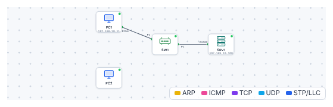
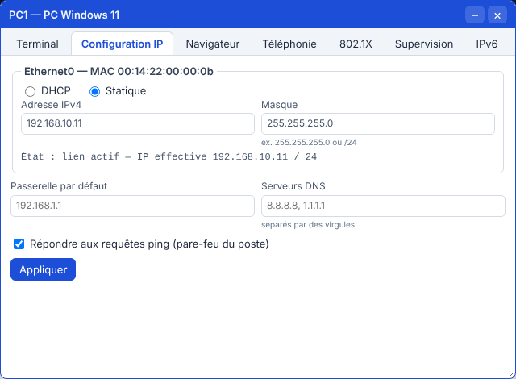
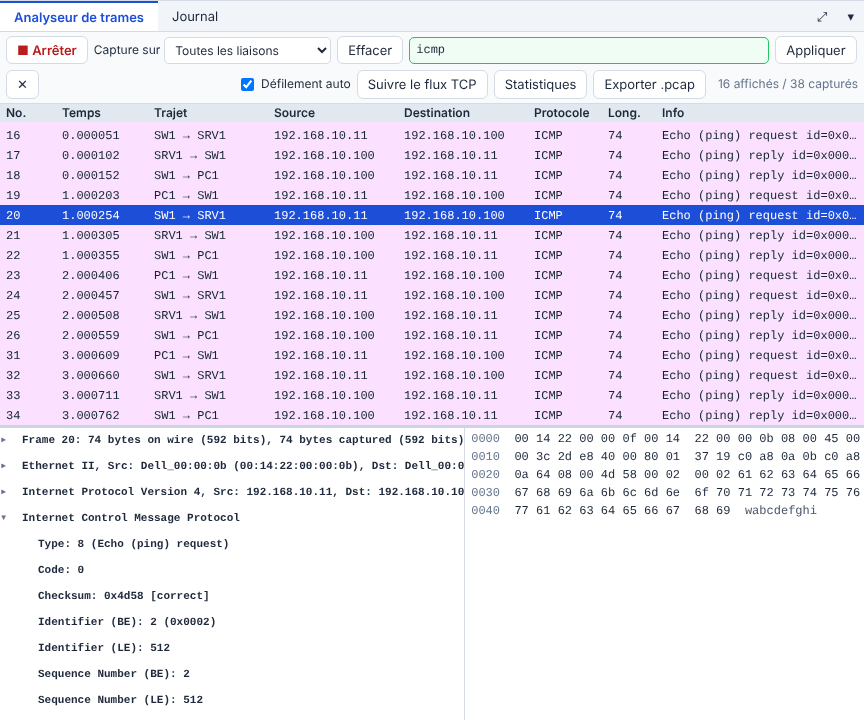

# 🛠️ TP – Prendre en main le simulateur

*Bac Pro CIEL – Première – E31 – S02 – binôme, on **échange les rôles** à chaque partie*

> [!NOTE]
> **Mission.** Ton entreprise de stage t'a demandé de **tester** un petit réseau avant de l'installer. Tu vas apprendre à **utiliser le simulateur**, à **brancher** et **configurer** un poste, à **tester**, puis à **regarder** les trames. Ensuite, tu **combles** tes lacunes avec la fiche d'exercices.
>
> **Temps prévu :** 3 h 10. **Prérequis :** [cours S02](01-cours.md) lu (§1 à §3).

**Binôme :** ____________ / ____________

---

## Partie A – Visite guidée de l'interface (≈ 30 min)

1. Ouvre le [simulateur](../../simulateur/simulateur-reseau.html).
2. Clique sur **Ouvrir** et choisis [`p02-decouverte.json`](tp/p02-decouverte.json).



3. Réponds en regardant l'écran (cours §1 : tableau des zones) :

| Question | Ta réponse |
|---|---|
| Combien d'**équipements** vois-tu ? Lesquels ? | |
| Combien de **câbles** ? | |
| Quelle est l'adresse IP de `SRV1` ? (clic sur l'équipement, panneau *Propriétés*) | |
| `PC2` est-il relié au switch ? | |
| Que fait le bouton **RAZ réseau** ? | |

4. **Double-clique** sur `PC1` : quels **onglets** vois-tu ? ______________________

✅ **Point de contrôle :** tu sais **nommer** les 7 zones de l'écran sans regarder le cours.

**🔁 Échange des rôles.**

---

## Partie B – Brancher et configurer `PC2` (≈ 40 min)

### B1. Brancher

1. Clique sur **🔌 Câble** (barre d'outils à gauche).
2. Clique sur **`PC2`**, puis sur **un port libre de `SW1`** (le simulateur propose les ports disponibles).
3. Repasse en **🖱 Sélection**.

✅ **Point de contrôle :** un trait relie `PC2` à `SW1` ; la pastille verte du port est **allumée**.

### B2. Configurer l'adresse

1. Double-clique sur `PC2` → onglet **Configuration IP**.



2. Choisis **Statique**, puis saisis :
   - Adresse : `192.168.10.12` · Masque : `255.255.255.0`
3. Clique sur **Appliquer**.

### B3. Tester

Dans l'onglet **Terminal** de `PC2` :

```text
ipconfig
ping 192.168.10.100
ping 192.168.10.11
```

| Test | Résultat | OK ? |
|---|---|---|
| `ipconfig` : adresse lue | | |
| `ping 192.168.10.100` (SRV1) | | |
| `ping 192.168.10.11` (PC1) | | |

✅ **Point de contrôle :** les deux `ping` répondent (4 réponses chacun).

❓ **Que se passerait-il si tu mettais `192.168.20.12` à `PC2` ?** ______________________

<details markdown="1"><summary>Aide</summary>

`192.168.20.12/24` est dans le réseau `192.168.20.0/24`, **pas** dans `192.168.10.0/24` : `PC2` ne pourrait plus joindre les autres directement (voir cours §2).

</details>

**🔁 Échange des rôles.**

---

## Partie C – Regarder les trames (≈ 30 min)

1. Dans l'**Analyseur de trames** (en bas de l'écran), clique sur **Effacer**.
2. Fais **un seul** `ping 192.168.10.100` depuis `PC2`.
3. Tape `icmp` dans le **Filtre d'affichage**, puis **Appliquer**.



| Question | Ta réponse |
|---|---|
| Combien de **trames** ICMP vois-tu pour **un** ping (une requête et une réponse) ? | |
| Quelle est l'adresse **source** de la **première** trame ? | |
| Quel est le type de la requête (`Type: 8`) ? Et de la réponse ? | |

4. Remplace le filtre par `arp` : **quelles trames** vois-tu ? Que demande-t-on ? ______________________

✅ **Point de contrôle :** tu sais **retrouver** la requête et la réponse d'un `ping` dans la liste.

<details markdown="1"><summary>Aide</summary>

Une requête **ICMP type 8**, une réponse **type 0**. Avant le premier ping entre deux machines, **ARP** demande : « Qui a l'adresse `192.168.10.100` ? ». La réponse donne **l'adresse MAC**. Si tu ne vois pas d'ARP, fais **RAZ réseau** puis recommence.

</details>

**🔁 Échange des rôles.**

---

## Partie D – Remise à niveau (≈ 55 min, individuelle)

Fais **la [fiche d'exercices](03-exercices-remise-a-niveau.md)** :

- Commence par **A** ; passe à **B** si tu réussis ; **C** si tu veux plus.
- **Corrige-toi** avec les réponses repliées ; note les exercices ratés.

| Mes exercices | Réussis | À reprendre |
|---|---|---|
| A (1 à 4) | | |
| B (5 à 8) | | |
| C (9 à 12) | | |

---

## Partie E – Enregistrer (≈ 5 min)

1. Clique sur **Enregistrer**, nomme ton fichier `TP-S02-tonnom.json`.
2. **Ferme l'onglet**, rouvre le simulateur, **Ouvrir** ton fichier : ton `PC2` est toujours configuré.

✅ **Point de contrôle :** tu as retrouvé ton travail.

---

## 🏁 Bilan

| Mon auto-évaluation | 😟 | 🙂 | 😀 |
|---|---|---|---|
| Je sais ouvrir, brancher, configurer, enregistrer | | | |
| Je sais trouver le réseau d'une adresse avec son masque | | | |
| Je sais lire une capture de `ping` | | | |

## 🔍 Dépannage

| Symptôme | Cause probable | Que faire |
|---|---|---|
| Le fichier ne s'ouvre pas | Double-clic sur le fichier | Utiliser **Ouvrir** dans le simulateur |
| Le câble ne se pose pas | Outil *Sélection* actif | Cliquer sur **🔌 Câble** d'abord |
| `ping` : « délai d'attente dépassé » | Câble absent ou adresse fausse | Vérifier le câble, le masque, le réseau (`192.168.10.x`) |
| L'analyseur est vide | Capture arrêtée | Cliquer sur **■ Arrêter** puis **Démarrer** (bouton de capture) |
| Rien ne bouge | Simulation en pause | Bouton **⏸ Pause** → **▶ Reprendre** |

> [!TIP]
> **Passeport d'autonomie :** ligne « Utiliser le simulateur : ouvrir, brancher, configurer, enregistrer » → *vu en guidé* ✔.

➡️ **Mission en entreprise :** relever le **plan d'adressage** du réseau de l'entreprise (ou en demander une copie).
