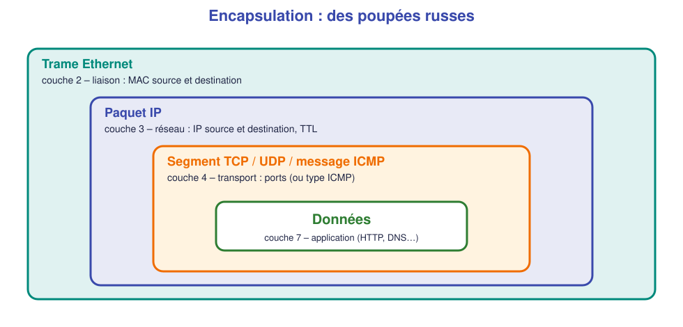
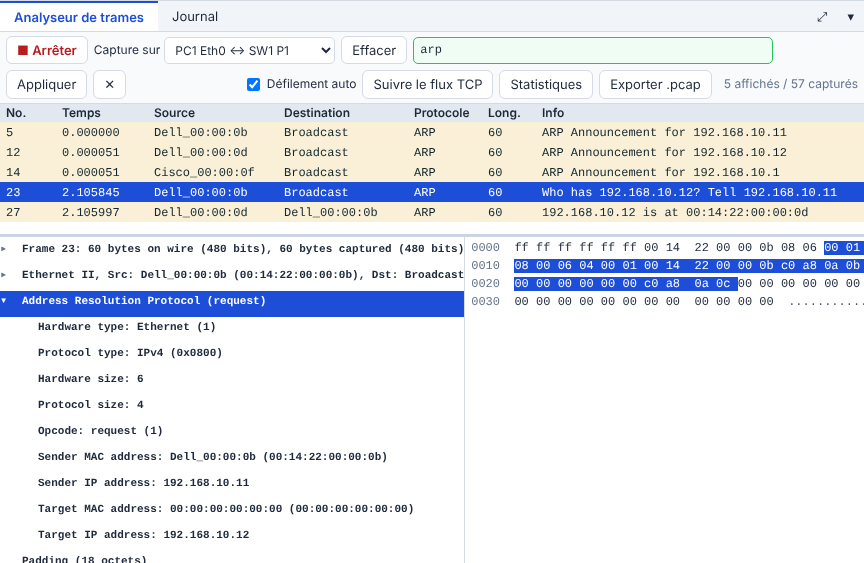
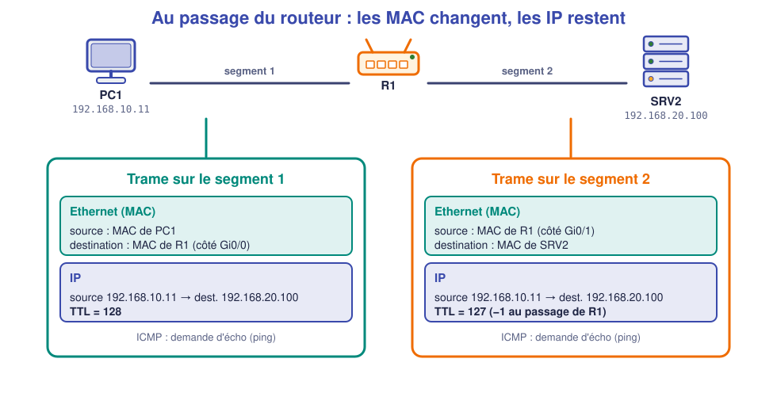
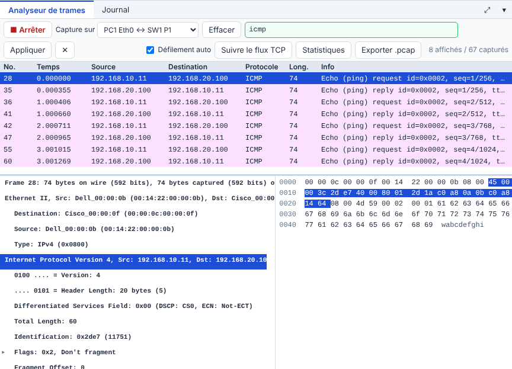

# 📖 Cours – Les couches et ce qui circule

*Bac Pro CIEL – Première – E31 – S03*

> [!IMPORTANT]
> **Une idée à la fois.** Réponds à la question **avant** de déplier la réponse.

## 🎯 À la fin de ce cours, tu sauras

- [ ] expliquer **pourquoi** on découpe un réseau en couches ;
- [ ] décrire l'**encapsulation** ;
- [ ] distinguer **MAC** et **IP** ;
- [ ] expliquer **ARP** et le **TTL** ;
- [ ] dire **ce qui change** quand un paquet traverse un routeur.

---

## 1. Pourquoi des couches ?

### 🤔 Avant de lire : à ton avis ?

Tu envoies un colis à un ami. Tu écris une **lettre**, tu la mets dans une **enveloppe** avec l'adresse, la **Poste** la met dans un **sac**, le camion roule jusqu'au centre de tri. **Le facteur lit-il ta lettre ? Le chauffeur du camion connaît-il l'adresse finale ?**

Voir la réponse

**Non** dans les deux cas. Chaque intermédiaire ne s'occupe que **de son étage** : le facteur lit l'enveloppe, le chauffeur lit le sac. Si on change le camion par un train, **la lettre ne change pas**. C'est exactement l'idée des **couches** réseau.

### 💡 L'idée

Un réseau est **découpé en couches** : chaque couche rend **un service** à celle du dessus et utilise celle du dessous. On peut **changer une couche** (câble → Wi-Fi) **sans toucher aux autres**.

| Couche (TCP/IP) | Rôle | Exemples | Adresse | Équipement |
|---|---|---|---|---|
| **Application** | Le service utilisé | HTTP, DNS, DHCP, SSH | nom, URL | PC, serveur |
| **Transport** | Dialogue entre deux programmes | **TCP**, **UDP** | **port** | PC, serveur, pare-feu |
| **Réseau** (Internet) | Acheminer **de bout en bout** | **IP**, **ICMP** | **adresse IP** | **Routeur** |
| **Liaison** (accès) | Aller **d'une machine voisine** à l'autre | **Ethernet**, Wi-Fi, **ARP** | **adresse MAC** | **Switch**, carte réseau |
| **Physique** | Les signaux | Cuivre, fibre, ondes | – | Câble, hub |

> [!TIP]
> **À retenir :** le **switch** travaille avec les **MAC** (couche 2) ; le **routeur** avec les **IP** (couche 3).

### Et le modèle OSI ?

Dans les notices, les offres d'emploi et chez les collègues, on parle aussi du **modèle OSI**, à **7 couches**. C'est le **même découpage**, en plus détaillé :

| OSI (7 couches) | TCP/IP (ce cours) |
|---|---|
| 7 Application · 6 Présentation · 5 Session | **Application** |
| 4 Transport | **Transport** |
| 3 Réseau | **Réseau** (Internet) |
| 2 Liaison de données | **Liaison** |
| 1 Physique | **Physique** |

> [!NOTE]
> **TCP/IP** est le modèle **réel** d'Internet ; **OSI** est un **langage commun** pour se comprendre. Quand on dit « un switch de **niveau 2** », cela veut dire « un switch qui travaille sur la couche **liaison** ».

**Question :** un « switch de niveau 3 » utilise quelle adresse **en plus** des adresses MAC ?

Voir la réponse

Les adresses **IP** : il sait **router**, comme un routeur.

### ✅ Vérifie que tu as compris

À quelle couche appartient le `ping` (ICMP) ? Et un câble RJ45 ?

Voir la réponse

**ICMP** : couche **réseau** (avec IP). Le **câble** : couche **physique**.

---

## 2. L'encapsulation

### 🤔 Avant de lire : à ton avis ?

Quand `PC1` envoie des données, il ajoute **des en-têtes** autour. Pourquoi ? *(Pense au colis.)*

Voir la réponse

Chaque couche **ajoute sa propre « étiquette »** (en-tête) avec **les informations dont elle a besoin** : la couche IP ajoute les adresses IP, la couche Ethernet ajoute les MAC. **Le receveur retire les étiquettes** dans l'ordre inverse.

### 💡 L'idée

| Étage | Nom de l'ensemble | Ajoute |
|---|---|---|
| Application | **Données** | – |
| Transport | **Segment** (TCP) / **datagramme** (UDP) | **ports** source et destination |
| Réseau | **Paquet** | **adresses IP** source et destination, **TTL** |
| Liaison | **Trame** | **adresses MAC** source et destination |

À la réception, chaque couche **retire** son en-tête et passe le reste à la couche au-dessus : c'est la **désencapsulation**.

### ✅ Vérifie que tu as compris

Un **switch** reçoit une trame. Quel en-tête **lit-il** pour décider où l'envoyer ?

Voir la réponse

L'en-tête **Ethernet** : l'adresse **MAC de destination**. Il ne regarde pas l'IP (sauf switchs « de couche 3 », qu'on verra plus tard).

---

## 3. MAC, ARP et IP

### 🤔 Avant de lire : à ton avis ?

`PC1` (`192.168.10.11`) veut parler à `PC2` (`192.168.10.12`) sur le **même** switch. Il connaît **l'adresse IP** de `PC2`. Mais l'**Ethernet** exige **une adresse MAC**. **Comment `PC1` la trouve-t-il ?**

Voir la réponse

Il **demande à tout le monde** : « **Qui a l'adresse `192.168.10.12` ?** » C'est une **requête ARP** envoyée en **diffusion** (*broadcast*). `PC2` répond : « C'est moi, ma MAC est `…:0d`. »

### 💡 L'idée

| | Adresse **MAC** | Adresse **IP** |
|---|---|---|
| **Format** | 6 octets (`00:14:22:00:00:0b`) | 4 octets (`192.168.10.11`) |
| **Attribuée par** | Le **fabricant** de la carte | L'**administrateur** ou le **DHCP** |
| **Portée** | **Un seul segment** (voisin direct) | **De bout en bout** |
| **Change quand** | On change la carte | On change de réseau |

*Ligne bleue : « Who has 192.168.10.12? Tell 192.168.10.11 » (diffusion) ; ligne suivante : la réponse « 192.168.10.12 is at 00:14:22:00:00:0d ».*

**ARP** est la « table de correspondance IP → MAC ». Chaque machine garde **un cache** (`arp -a`).

### ✅ Vérifie que tu as compris

Pourquoi la requête ARP est-elle envoyée **à tout le monde** (destination `ff:ff:ff:ff:ff:ff`) ?

Voir la réponse

Parce que `PC1` **ne connaît pas encore** la MAC de `PC2` : il ne peut donc pas l'écrire dans le champ « destination ». Il **diffuse** à tout le segment, seul le bon destinataire répond.

---

## 4. Traverser un routeur : ce qui change, ce qui reste

### 🤔 Avant de lire : à ton avis ?

`PC1` (`192.168.10.11`) pingue `SRV2` (`192.168.20.100`), dans un **autre** réseau, à travers un routeur `R1`. **Les adresses IP et MAC changent-elles en route ?**

Voir la réponse

Les **IP ne changent pas** (de `PC1` vers `SRV2` du début à la fin). Les **MAC changent à chaque segment** : sur le premier, la trame va de `PC1` vers `R1` ; sur le second, de `R1` vers `SRV2`. Le **TTL** baisse de 1.

### 💡 L'idée

- Le **routeur** retire la trame, lit le **paquet IP**, choisit la sortie, **crée une nouvelle trame** avec ses propres MAC.
- Le **TTL** (*Time To Live*) est un compteur décrémenté à chaque routeur ; à **0**, le paquet est détruit. Cela évite qu'un paquet **tourne en boucle** sur le réseau. `128` est la valeur de départ de Windows ; `64` celle de Linux.

*Trame sur le segment 1 : destination = MAC du routeur (`Cisco_00:00:0f`).*

*Même paquet sur le segment 2 : source = MAC du routeur (`Cisco_00:00:10`), TTL = `0x7f` = 127.*

### ✅ Vérifie que tu as compris

`PC1` envoie à `SRV2` via `R1`. Dans la trame du **segment 1**, quelle est l'**adresse MAC de destination** : celle de `SRV2` ou celle de `R1` ? Pourquoi ?

Voir la réponse

Celle de **`R1`** : `PC1` ne peut atteindre **que son voisin direct** sur le segment ; c'est la **passerelle** qui se charge de la suite. C'est pour cela que `PC1` fait un ARP pour **l'adresse de la passerelle**, pas pour celle de `SRV2`.

---

## 📌 Vocabulaire

| Mot | Définition |
|---|---|
| **Couche** | Un étage du modèle, avec un rôle précis |
| **OSI** | Modèle à 7 couches, langage commun ; correspond au découpage TCP/IP |
| **Encapsulation** | Ajout d'en-têtes à chaque couche |
| **Trame / paquet / segment** | Données + en-têtes de la couche 2 / 3 / 4 |
| **MAC** | Adresse physique d'une carte réseau (locale) |
| **ARP** | Protocole qui retrouve une MAC à partir d'une IP |
| **TTL** | Compteur de sauts d'un paquet IP |
| **Diffusion (*broadcast*)** | Message envoyé à tous les voisins du segment |

## 🏁 Retiens l'essentiel

- [ ] Le **switch** lit la **MAC** ; le **routeur** lit l'**IP**.
- [ ] **ARP** : IP → MAC, par diffusion.
- [ ] Au passage d'un routeur : **MAC changent, IP restent, TTL −1**.

➡️ **Suite :** [le TP](02-tp.md).
