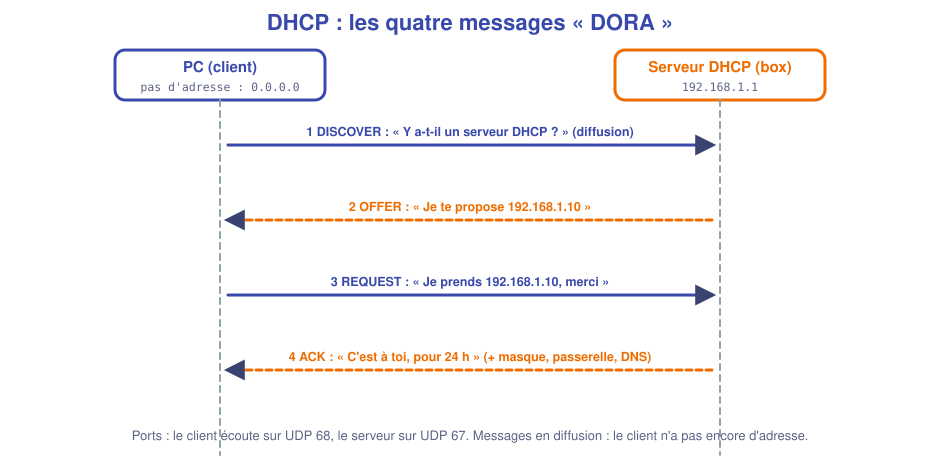
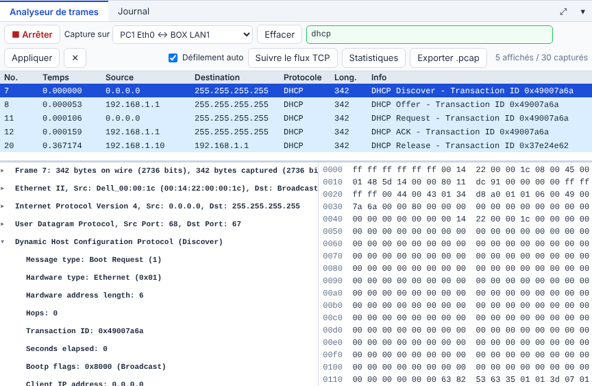
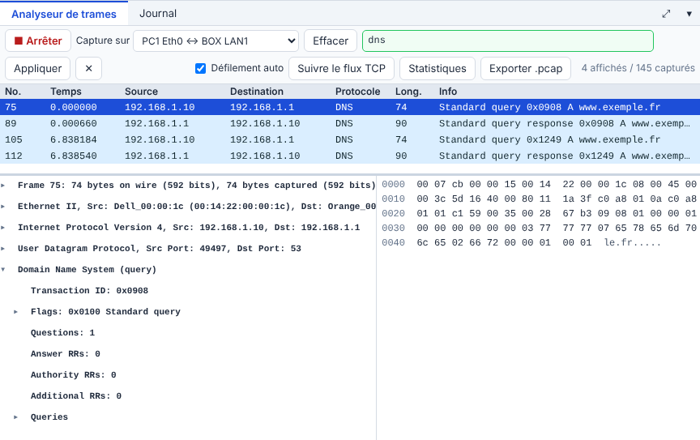
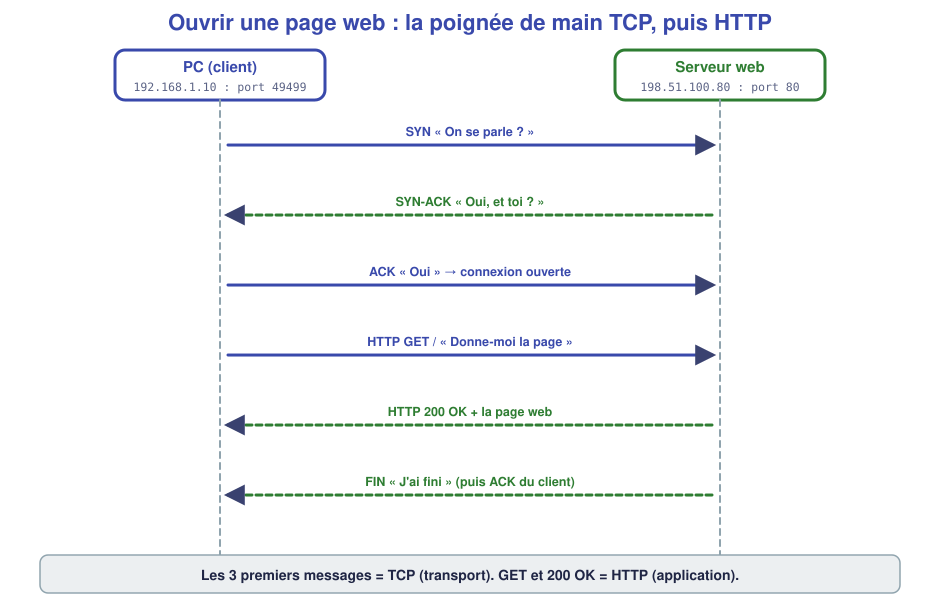
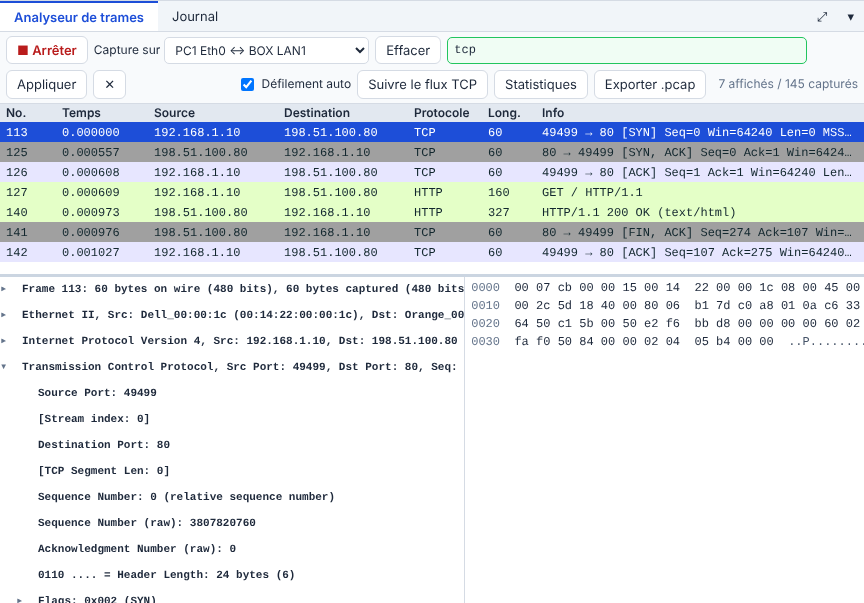
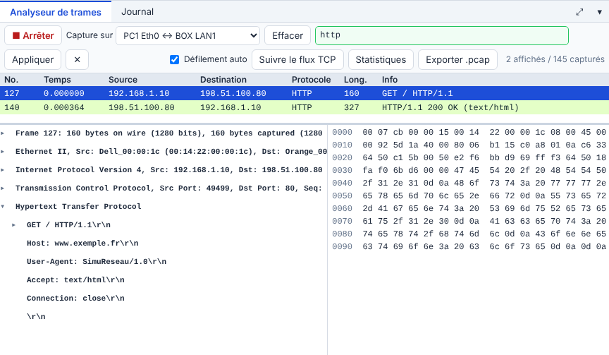

# 📖 Cours – Les protocoles qu'on utilise tous les jours

*Bac Pro CIEL – Première – E31 – S04*

> [!IMPORTANT]
> **Une idée à la fois.** Réponds à la question **avant** de déplier la réponse.

## 🎯 À la fin de ce cours, tu sauras

- [ ] décrire **DHCP**, **DNS**, **TCP**, **HTTP** ;
- [ ] **lire** leurs messages dans un analyseur ;
- [ ] relier un **service** à son **port** ;
- [ ] expliquer la différence entre **TCP** et **UDP**.

---

## 1. DHCP : obtenir une adresse

### 🤔 Avant de lire : à ton avis ?

Un PC vient d'être branché. Il **n'a pas d'adresse IP**. Comment peut-il **demander** une adresse, alors qu'il ne peut pas encore envoyer de message « normal » ?

Voir la réponse

Il envoie un message **à tout le réseau** (**diffusion**), avec l'adresse source `0.0.0.0` : « Y a-t-il un serveur DHCP ? ». Le serveur répond.

### 💡 L'idée

Les **quatre messages** s'appellent **DORA** : **D**iscover, **O**ffer, **R**equest, **A**CK. Le serveur donne aussi **le masque, la passerelle, le DNS** et **la durée du bail**.

*Les 4 messages DORA dans l'analyseur (UDP 68 → 67). `Release` : le client rend son adresse.*

### ✅ Vérifie que tu as compris

Pourquoi la requête `Discover` est-elle envoyée en **diffusion** (`255.255.255.255`) ?

Voir la réponse

Parce que le client **ne connaît ni l'adresse du serveur, ni la sienne**. Il lance un appel à tout le segment ; seul un serveur DHCP répondra.

---

## 2. DNS : traduire un nom en adresse

### 🤔 Avant de lire : à ton avis ?

Pour ouvrir `www.exemple.fr`, ton PC doit connaître **l'adresse IP** du site. Qui la lui donne ? Où ton PC trouve-t-il l'adresse de **ce** serveur ?

Voir la réponse

Un serveur **DNS** la lui donne. Son adresse est fournie **par le DHCP** (voir §1 : « DNS » dans l'ACK). À la maison, c'est souvent **la box** qui relaie la question.

### 💡 L'idée

| Élément | Valeur dans l'exemple |
|---|---|
| **Requête** (PC → DNS) | `Standard query A www.exemple.fr`, **UDP**, port **53** |
| **Réponse** (DNS → PC) | `Standard query response … A 198.51.100.80` |
| **Type A** | Enregistrement « nom → adresse IPv4 » |

> [!NOTE]
> **Autres types :** `AAAA` (nom → IPv6), `MX` (serveur de messagerie), `CNAME` (alias), `PTR` (adresse → nom).

### ✅ Vérifie que tu as compris

La réponse DNS dit `A 198.51.100.80`. Que fait le PC **ensuite** ?

Voir la réponse

Il **ouvre une connexion TCP** vers `198.51.100.80` (port 80) puis demande la page. **Sans DNS, pas de connexion** : c'est pourquoi une panne DNS se voit par « le ping de l'adresse marche, pas celui du nom ».

---

## 3. TCP, UDP et les ports

### 🤔 Avant de lire : à ton avis ?

Sur ton PC, **un navigateur, un lecteur de musique et une messagerie** utilisent le réseau **en même temps**. Comment les messages qui arrivent savent-ils **à quel programme** ils sont destinés ?

Voir la réponse

Grâce au **port** : un numéro de 0 à 65 535, comme un **numéro d'appartement** dans un immeuble (l'adresse IP est l'adresse de l'immeuble).

### 💡 L'idée

| | **TCP** | **UDP** |
|---|---|---|
| **Principe** | On **ouvre une connexion**, on **vérifie** que tout est arrivé | On **envoie** sans vérifier |
| **Fiabilité** | Oui (accusés, renvoi) | Non |
| **Vitesse** | Un peu plus lent | Rapide |
| **Usage** | Web, mail, SSH, fichiers | DNS, DHCP, voix, vidéo |

**Ports à connaître :**

| Service | Port | Transport |
|---|---|---|
| **HTTP** | 80 | TCP |
| **HTTPS** | 443 | TCP |
| **SSH** | 22 | TCP |
| **Telnet** | 23 | TCP |
| **DNS** | 53 | UDP (et TCP) |
| **DHCP** | 67 (serveur) / 68 (client) | UDP |
| **FTP** | 21 | TCP |
| **SMTP** (envoi mail) | 25 | TCP |

> [!TIP]
> **Le client prend un port aléatoire élevé** (ex. `49499`) ; le **serveur écoute sur un port connu** (ex. `80`).

### ✅ Vérifie que tu as compris

Pourquoi le **DNS** préfère-t-il **UDP** à TCP ?

Voir la réponse

Une question DNS est **très courte** (un message, un message de réponse) : ouvrir une connexion TCP serait plus long que la question elle-même. Si la réponse se perd, le client **redemande**.

---

## 4. HTTP : demander une page

### 🤔 Avant de lire : à ton avis ?

Une fois la connexion TCP ouverte, comment le navigateur dit-il **quelle page** il veut ?

Voir la réponse

Il envoie **du texte** : `GET / HTTP/1.1` suivi de `Host: www.exemple.fr`. Le serveur répond `HTTP/1.1 200 OK` puis la page.

### 💡 L'idée

*SYN → SYN-ACK → ACK, puis `GET`, `200 OK`, `FIN`.*

*Le texte de la requête est **lisible** : HTTP n'est pas chiffré. En **HTTPS** (port 443), il est chiffré.*

| Code de réponse | Signification |
|---|---|
| **200** | OK, voici la page |
| **301 / 302** | La page a changé d'adresse |
| **404** | Page introuvable |
| **500** | Erreur du serveur |

### ✅ Vérifie que tu as compris

Tu vois sur une capture : `SYN`, `SYN-ACK`, `ACK`, `GET`, `200 OK`. **Quel est le protocole de transport ? Quel est le protocole applicatif ?**

Voir la réponse

Transport : **TCP** (la poignée de main). Application : **HTTP** (`GET`, `200 OK`).

---

> [!EXAMPLE]+ 🚀 Pour aller plus loin : tester un port sous Windows
> Sous Windows (PowerShell), `Test-NetConnection 192.168.1.10 -Port 443` dit si **le port 443 répond** sur le serveur. C'est un test de **couche transport**, plus précis qu'un simple `ping`.

## 📌 Vocabulaire

| Mot | Définition |
|---|---|
| **DORA** | Discover, Offer, Request, ACK : les 4 messages DHCP |
| **Bail** | Durée pendant laquelle une adresse est prêtée |
| **Enregistrement A** | Association nom → adresse IPv4 |
| **Port** | Numéro qui désigne un service sur une machine |
| **Poignée de main (3-way handshake)** | SYN, SYN-ACK, ACK |
| **HTTP / HTTPS** | Protocole du web / sa version chiffrée |

## 🏁 Retiens l'essentiel

- [ ] **DHCP** : DORA, UDP 67/68, diffusion au début.
- [ ] **DNS** : nom → adresse, UDP 53.
- [ ] **TCP** : on ouvre (SYN, SYN-ACK, ACK) puis on dialogue ; **UDP** : on envoie.
- [ ] **HTTP** : `GET` puis `200 OK`, en clair sur le port 80.

➡️ **Suite :** [le TP](02-tp.md).
