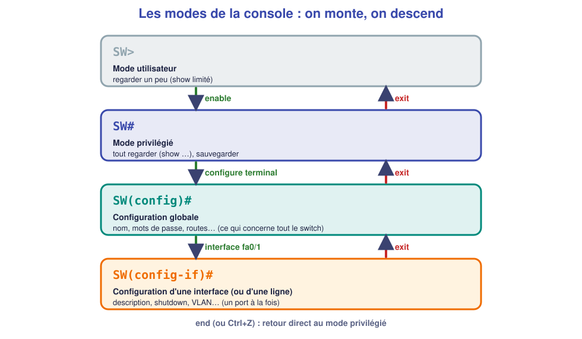
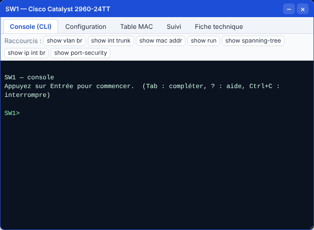

# 📖 Cours – Le switch administrable

*Bac Pro CIEL – Première – E31 – S05*

> [!IMPORTANT]
> **Une idée à la fois.** Réponds à la question **avant** de déplier la réponse.

## 🎯 À la fin de ce cours, tu sauras

- [ ] expliquer ce qu'un switch **administrable** apporte ;
- [ ] **naviguer** dans les modes de la console ;
- [ ] **lire** l'état d'un switch (`show`) ;
- [ ] **configurer** les réglages de base et **sauvegarder**.

---

## 1. Pourquoi « administrable » ?

### 🤔 Avant de lire : à ton avis ?

Le switch 8 ports de la salle de TP marche **dès qu'on le branche**. Qu'est-ce qui pourrait **manquer** dans une entreprise de 50 postes ?

<details markdown="1"><summary>Voir la réponse</summary>

On ne peut **ni le nommer**, **ni savoir** quel poste est sur quel port, **ni couper** un port inutilisé, **ni séparer** les services (VLAN), **ni le superviser**, **ni le protéger** d'un intrus. Un switch **non administrable** subit ; un switch **administrable** se **pilote**.

</details>

### 💡 L'idée

| | Switch non administrable | Switch **administrable** |
|---|---|---|
| **Configuration** | Aucune | Nom, adresses, ports, VLAN… |
| **Connaître l'état** | Voyants seulement | Commandes `show` |
| **Sécurité** | Aucune | Mots de passe, ports désactivés, SSH |
| **Administration à distance** | Non | Oui (SSH) |
| **Prix** | ~20 € | de 150 € à plusieurs milliers |

On s'y connecte par la **console** (câble série ou USB) pour la première configuration, puis à distance (**SSH**).

### ✅ Vérifie que tu as compris

Le switch est neuf, sans adresse IP : peux-tu t'y connecter par **SSH** ? Pourquoi ?

<details markdown="1"><summary>Voir la réponse</summary>

**Non** : SSH passe par le réseau, il faut donc **une adresse IP de gestion** sur le switch. La **première** configuration se fait forcément par la **console**.

</details>

---

## 2. La console : modes et commandes `show`

### 🤔 Avant de lire : à ton avis ?

Sur ton PC, on ne peut pas tout faire en étant simple utilisateur : il faut parfois « administrateur ». **Où retrouve-t-on cette idée sur un switch ?**

<details markdown="1"><summary>Voir la réponse</summary>

Dans les **modes** de la console : *utilisateur* (`>`, on regarde un peu), *privilégié* (`#`, on regarde tout), *configuration* (`(config)#`, on modifie).

</details>

### 💡 L'idée





*La console du simulateur : `SW1>` = mode utilisateur ; il faut taper `enable`.*

**Les commandes de lecture (`show`)**, à connaître :

| Commande | Ce qu'elle montre |
|---|---|
| `show version` | Modèle, version, adresse MAC de base |
| `show interfaces status` | **Tous les ports** : connecté ou non, VLAN, vitesse |
| `show mac address-table` | **Quelle MAC est derrière quel port** |
| `show cdp neighbors` | **Quels équipements Cisco sont branchés** sur quel port (retrouver un câble) |
| `show ip interface brief` | Les adresses IP et l'état des interfaces |
| `show running-config` | La **configuration en cours** |
| `show startup-config` | La configuration **sauvegardée** (celle du prochain démarrage) |

> [!TIP]
> **Trois astuces de console :** `?` affiche l'aide ; **Tab** complète une commande ; on peut **abréger** (`sh int st` = `show interfaces status`).

### La table MAC : le switch apprend tout seul

Quand une trame arrive sur un port, le switch **note sa MAC source** dans sa **table**. S'il connaît la MAC destination, il envoie **seulement** sur le bon port ; sinon il **diffuse**.

```text
SW#show mac address-table
Vlan    Mac Address       Type        Ports
   1    0014.2200.001d    DYNAMIC     Fa0/1
   1    0014.2200.001f    DYNAMIC     Fa0/2
   1    0014.2200.0021    DYNAMIC     Gi0/1
```

### ✅ Vérifie que tu as compris

La table MAC est **vide** juste après un `clear mac address-table dynamic`. Que se passe-t-il quand `PC1` envoie une trame à `PC2` ?

<details markdown="1"><summary>Voir la réponse</summary>

Le switch **apprend** la MAC de `PC1` (port Fa0/1), mais ne connaît pas `PC2` : il **diffuse** la trame sur tous les ports. Dès que `PC2` répond, il **apprend** aussi sa MAC, et les trames suivantes vont **directement** au bon port.

</details>

---

## 3. Configurer les bases

### 🤔 Avant de lire : à ton avis ?

Tu installes un switch dans une baie. Pour qu'un collègue s'y retrouve **dans un an**, que dois-tu **écrire dessus (dans sa configuration)** ?

<details markdown="1"><summary>Voir la réponse</summary>

Son **nom**, **à quoi sert chaque port** (« PC compta », « Serveur »), une **bannière** d'avertissement, des **mots de passe**, et **couper les ports inutilisés**.

</details>

### 💡 L'idée : la liste de contrôle

| Étape | Commandes |
|---|---|
| **Nom** | `hostname SW-ATELIER` |
| **Accès privilégié protégé** | `enable secret MonMotDePasse` |
| **Bannière** | `banner motd #Acces reserve au personnel#` |
| **Décrire les ports** | `interface fa0/1` puis `description PC-COMPTA` |
| **Couper les ports libres** | `interface range fa0/4 - 24` puis `shutdown` |
| **Adresse de gestion** | `interface vlan 1` → `ip address 192.168.10.2 255.255.255.0` → `no shutdown` ; puis `ip default-gateway 192.168.10.1` |
| **Sauvegarder** | `write memory` (ou `copy running-config startup-config`) |

> [!WARNING]
> **`enable secret`**, **jamais** `enable password` : le *secret* est **haché** (illisible), le *password* est en clair.
> **Sans `write memory`, la configuration est perdue au prochain redémarrage** du vrai switch.

### ✅ Vérifie que tu as compris

Pourquoi **désactive-t-on** (`shutdown`) les ports libres ?

<details markdown="1"><summary>Voir la réponse</summary>

Pour empêcher **quelqu'un de brancher un PC** sur une prise inutilisée et d'accéder au réseau. Un port coupé ne transmet rien.

</details>

---

## 4. Administrer à distance : SSH

### 🤔 Avant de lire : à ton avis ?

On peut aussi administrer un switch avec **Telnet**. Pourquoi les entreprises **interdisent-elles Telnet** ?

<details markdown="1"><summary>Voir la réponse</summary>

Telnet envoie tout **en clair**, **mot de passe compris** : une capture suffit à le lire (on l'a vu en S04 avec HTTP). **SSH** chiffre l'échange.

</details>

### 💡 L'idée

Les commandes pour activer SSH :

```text
ip domain-name atelier.local
username admin privilege 15 secret Adm1n!
crypto key generate rsa modulus 1024
ip ssh version 2
line vty 0 4
 transport input ssh
 login local
```

Depuis un PC : `ssh admin@192.168.10.2`.

| Commande | Rôle |
|---|---|
| `ip domain-name` | Nécessaire pour fabriquer les clés |
| `username … secret …` | Le compte d'administration |
| `crypto key generate rsa` | Les clés de chiffrement |
| `line vty 0 4` | Les 5 « terminaux virtuels » (connexions à distance) |
| `transport input ssh` | **Seul SSH** est accepté (pas Telnet) |

### ✅ Vérifie que tu as compris

Quelle ligne **interdit Telnet** ?

<details markdown="1"><summary>Voir la réponse</summary>

**`transport input ssh`** : seul SSH est accepté sur les lignes `vty`.

</details>

---

## 📌 Vocabulaire

| Mot | Définition |
|---|---|
| **Administrable (manageable)** | Qu'on peut configurer et superviser |
| **CLI** | Interface en ligne de commande |
| **Console** | Port (ou connexion) de première configuration |
| **running-config** | Configuration en cours (en mémoire vive) |
| **startup-config** | Configuration sauvegardée (relue au démarrage) |
| **SVI (`interface vlan 1`)** | Adresse IP **du switch lui-même** |
| **vty** | Lignes de connexion à distance |

## 🏁 Retiens l'essentiel

- [ ] Un switch administrable se **pilote** en ligne de commande, dans des **modes**.
- [ ] `show …` pour **lire**, `configure terminal` pour **modifier**.
- [ ] Les bases : **nom, secret, descriptions, ports libres coupés, IP de gestion, SSH**.
- [ ] **`write memory`** pour ne rien perdre.

➡️ **Suite :** [le TP](02-tp.md).
