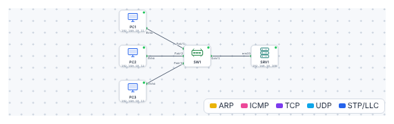

# 🛠️ TP – Configurer un switch administrable neuf

*Bac Pro CIEL – Première – E31 – S05 – binôme, on **échange les rôles** à chaque partie*

> [!NOTE]
> **Mission.** Un atelier vient de recevoir un **switch Cisco Catalyst 2960** neuf, avec sa configuration d'usine. Il relie trois postes et un serveur. Ta mission : le **prendre en main**, le **nommer**, le **protéger**, **décrire ses ports**, lui donner **une adresse de gestion**, l'**administrer à distance** et **sauvegarder**.
>
> **Temps prévu :** 3 h 30. **Prérequis :** [cours S05](01-cours.md) lu.

**Binôme :** ____________ / ____________

---

## Mise en place

1. Ouvre le [simulateur](../../simulateur/simulateur-reseau.html), puis **Ouvre** [`p05-switch.json`](tp/p05-switch.json).

| Équipement | Adresse IP | Branché sur |
|---|---|---|
| `PC1` (Compta) | 192.168.10.11 | Fa0/1 |
| `PC2` (Atelier) | 192.168.10.12 | Fa0/2 |
| `PC3` (Accueil) | 192.168.10.13 | Fa0/3 |
| `SRV1` (Serveur) | 192.168.10.100 | Gi0/1 |

2. **Double-clique** sur `SW1` → onglet **Console (CLI)**, puis appuie sur **Entrée**.

> [!TIP]
> **Besoin d'aide ?** Tape `?` pour la liste des commandes possibles dans le mode courant, ou garde l'[aide-mémoire](03-aide-memoire-cli.md) sous la main.

> [!NOTE]
> **Comment ce TP fonctionne.** La partie A est **guidée** : les commandes sont données. À partir de la partie B, on te donne **le but et les contraintes** : cherche la commande dans l'aide-mémoire. Si tu bloques, ouvre l'**💡 Aide** (elle donne la syntaxe, jamais la réponse aux questions). **Avant** chaque action, écris ce que tu **attends** ; **après**, ce que tu **observes**. Si les deux diffèrent, c'est là que tu apprends le plus.

---

## Partie A – Explorer le switch (≈ 30 min) · *guidée*

Tape ces commandes dans l'ordre : `enable`, `show version`, `show interfaces status`, `show mac address-table`, `show ip interface brief`.

| Question | Ta réponse |
|---|---|
| Quel est le **modèle** ? Quelle version d'IOS ? | |
| Combien de ports **Fast Ethernet** ? De ports **Gigabit** ? | |
| Quels ports sont **connectés** ? | |
| Combien d'adresses MAC dans la table ? Sur quels ports ? | |
| Le switch a-t-il une **adresse IP** ? | |

✅ **Point de contrôle :** tu retrouves, dans la table MAC, **chaque PC sur son port**.

### Expérience : la table MAC apprend

🤔 **J'anticipe.** Si je vide la table MAC (`clear mac address-table dynamic`) puis que `PC1` envoie un `ping` vers le serveur, **combien de lignes vais-je voir** dans la table, et lesquelles ? Mon pronostic : ______________________

1. Vide la table, puis affiche-la.
2. Depuis `PC1`, lance `ping 192.168.10.100`.
3. Affiche la table de nouveau.

🔍 **J'observe.** Qui est apparu ? ______________________  Mon pronostic était-il juste ? ______

❓ **Pourquoi `PC2` et `PC3` ne sont-ils pas dans la table, alors qu'ils sont branchés ?** ______________________

💡 Aide

Le switch n'apprend une MAC **que quand la machine envoie une trame**. `PC2` et `PC3` n'ont encore rien envoyé.

**🔁 Échange des rôles.**

---

## Partie B – Le nommer et le protéger (≈ 35 min) · *semi-guidée*

**But :** un technicien qui arrive sur ce switch doit (1) savoir **lequel c'est**, (2) ne pas pouvoir passer en mode privilégié **sans mot de passe**, (3) lire un **avertissement** à la connexion.

**Contraintes :** nom `SW-ATELIER` ; mot de passe d'au moins 10 caractères, **que tu choisis** et notes : ______________________ (*en entreprise : dans un coffre de mots de passe, jamais sur une feuille collée au switch*) ; la bannière dit que l'accès est réservé au personnel.

🤔 **J'anticipe.** Une fois le secret défini, **que va demander le switch** quand je ferai `exit` puis `enable` ? Et dans `show running-config`, **le secret sera-t-il lisible** ? Mon pronostic : ______________________

💡 Aide : la syntaxe

`configure terminal`, puis `hostname …`, `enable secret …`, `banner motd #…#`, puis `end`. Voir l'[aide-mémoire](03-aide-memoire-cli.md).

🔍 **J'observe.**

| Test | Résultat |
|---|---|
| Le prompt est maintenant… | |
| `exit` puis `enable` : que demande le switch ? | |
| `show running-config` : quelle ligne contient le secret ? Est-il lisible ? | |

✅ **Point de contrôle :** le prompt est `SW-ATELIER#` et le secret apparaît **haché** dans la configuration.

❓ **Quelle est la différence entre `enable secret` et `enable password` ?** ______________________

❓ **Un collègue dit : « Mon mot de passe est dans la config, donc quelqu'un qui lit le fichier le voit. » Que lui réponds-tu, et que faut-il quand même protéger ?** ______________________

**🔁 Échange des rôles.**

---

## Partie C – Décrire et sécuriser les ports (≈ 35 min) · *semi-guidée*

**But :** un collègue, six mois plus tard, doit comprendre **à quoi sert chaque port** sans ouvrir le schéma, et **personne ne doit pouvoir brancher un PC** sur un port libre.

**Contraintes :** les 4 ports utilisés portent une description **parlante** (`PC-COMPTA`, `PC-ATELIER`, `PC-ACCUEIL`, `SERVEUR`) ; **tous** les autres ports (`Fa0/4` à `Fa0/24`) sont coupés. Tu dois obtenir le résultat en **deux manipulations**, pas 21.

🤔 **J'anticipe.** Combien de ports afficheront `disabled` ? Et si je branche un PC sur `Fa0/10` après cette configuration, **qu'est-ce qui se passe** ? Mon pronostic : ______________________

💡 Aide : la syntaxe

`interface fa0/1` puis `description …` pour un port ; `interface range fa0/4 - 24` puis `shutdown` pour plusieurs ports à la fois. Vérifie avec `show interfaces status`.

🔍 **J'observe.**

| Question | Réponse |
|---|---|
| Combien de ports sont maintenant **disabled** ? | |
| Que se passe-t-il si tu branches un PC sur Fa0/10 ? (essaie) | |
| La colonne **Name** affiche-t-elle bien les descriptions ? | |

❓ **Pourquoi est-ce une bonne pratique de sécurité de couper les ports libres ?** ______________________

❓ **Un nouveau salarié arrive demain : que fais-tu sur le switch, et dans quel ordre ?** ______________________

**🔁 Échange des rôles.**

---

## Partie D – Adresse de gestion et SSH (≈ 40 min) · *semi-guidée*

**But :** administrer le switch **depuis `PC1`**, sans se déplacer dans l'atelier, avec une connexion **chiffrée**.

### D1. Une adresse pour le switch

Un switch n'a pas besoin d'adresse IP pour **commuter**. 🤔 **Pourquoi lui en donner une ?** Mon avis : ______________________

**Contraintes :** adresse `192.168.10.2/24` (réseau des postes) ; passerelle `192.168.10.1`. L'adresse se porte sur l'**interface virtuelle du VLAN 1**.

💡 Aide : la syntaxe

`interface vlan 1` → `ip address … …` → `no shutdown`, puis `exit` et `ip default-gateway …`. Vérifie avec `show ip interface brief`, puis `ping 192.168.10.2` depuis `PC1`.

✅ **Point de contrôle :** le `ping` répond (le switch est joignable **en tant que machine**).

### D2. Activer SSH

**Contraintes :** un compte `admin` (privilège 15) avec **ton** mot de passe : ______________________ ; connexion **uniquement en SSH version 2**, pas en Telnet ; authentification **par compte local** (pas un simple mot de passe de ligne).

🤔 **J'anticipe.** Si j'oublie `ip domain-name`, **la génération de la clé va-t-elle fonctionner** ? Mon pronostic : ______ (essaie volontairement une fois dans cet ordre, lis le message, puis corrige).

💡 Aide : l'ordre des commandes

Dans l'ordre : `ip domain-name …` · `username … privilege 15 secret …` · `crypto key generate rsa modulus 1024` · `ip ssh version 2` · `line vty 0 4` puis `transport input ssh` et `login local`. Vérifie : `show ip ssh`.
*(1024 bits est la valeur du simulateur ; sur du matériel réel, on utilise **2048**.)*

Depuis `PC1` : `ssh admin@192.168.10.2`, puis `show ip interface brief` : **tu es sur le switch, à distance**.

✅ **Point de contrôle :** tu obtiens le prompt `SW-ATELIER#` **depuis `PC1`**.

❓ **Pourquoi `transport input ssh` et pas `telnet` ?** ______________________

❓ **Pourquoi la clé de chiffrement a-t-elle besoin d'un nom de domaine et d'un nom de switch ?** ______________________

**🔁 Échange des rôles.**

---

## Partie E – Sauvegarder (≈ 15 min)

🤔 **J'anticipe.** `show startup-config` **avant** `write memory` : le nom du switch sera-t-il `SW-ATELIER` ? Pourquoi ? Mon pronostic : ______________________

Compare `show startup-config` **avant** puis **après** `write memory`.

| Avant `write memory` | Après |
|---|---|
| `show startup-config` : | |

❓ **Que se passerait-il, sur un vrai switch, si on coupe le courant avant `write memory` ?** ______________________

✅ **Point de contrôle :** `show startup-config` contient `hostname SW-ATELIER`.

Enregistre aussi **ton travail** dans le simulateur (**Enregistrer** → `TP-S05-tonnom.json`).

---

## Partie F – Fiche d'identité et contrôle (≈ 30 min, individuel)

1. Remplis la **fiche d'identité** du switch :

| Élément | Valeur |
|---|---|
| Nom | |
| Modèle | |
| Adresse de gestion | |
| Passerelle | |
| Ports utilisés (avec description) | |
| Ports désactivés | |
| Accès à distance | |
| Date de la dernière sauvegarde | |

2. **Contrôle final** (coche) :

- [ ] Le switch s'appelle `SW-ATELIER`
- [ ] Un `enable secret` est défini
- [ ] Les 4 ports utilisés ont une description
- [ ] Les ports `Fa0/4` à `Fa0/24` sont désactivés
- [ ] `PC1` joint `192.168.10.2` (ping)
- [ ] SSH fonctionne depuis `PC1`
- [ ] La configuration est sauvegardée

---

## 🏁 Bilan

### 📒 Mon bilan pour le passeport d'autonomie (individuel, écrit)

| | Ma réponse |
|---|---|
| **Une décision que j'ai prise et pourquoi** (ex. : ports coupés, protocole SSH) | |
| **Une chose que j'ai observée qui m'a surpris** (mon pronostic ≠ le résultat) | |
| **Ce que je sais refaire seul, sans la fiche** | |
| **Ce pour quoi j'ai encore besoin de l'aide-mémoire** | |
| **Ma preuve** (capture ou sortie de commande à joindre) | |

> [!TIP]
> **Passeport :** ligne « Configurer un switch administrable et le sauvegarder » (S05). *Niveau 1 « Vu »* : je l'ai fait avec l'aide. *Niveau 2 « Je sais »* : je l'ai fait seul avec l'aide-mémoire. *Niveau 3 « Autonome »* : je le refais **sans** fiche **et** j'explique **pourquoi** chaque réglage (les ❓ ci-dessus servent de preuve). Ne coche que le niveau que tu peux **démontrer**.

### Oral (2 min par élève)

1. Pourquoi configure-t-on un switch qui marche « tout seul » ?
2. Quelle différence entre `running-config` et `startup-config` ?
3. Pourquoi SSH plutôt que Telnet ?

| Mon auto-évaluation | 😟 | 🙂 | 😀 |
|---|---|---|---|
| Je navigue entre les modes de la console | | | |
| Je lis l'état du switch avec `show` | | | |
| Je configure nom, secret, ports | | | |
| Je configure SSH et je m'y connecte | | | |

## 🔍 Dépannage

| Symptôme | Cause probable | Que faire |
|---|---|---|
| `% Invalid input detected` | Mauvais mode ou faute de frappe | Vérifier le prompt (`#`, `(config)#`), utiliser `?` |
| `show` refusé en `>` | Mode utilisateur | Taper `enable` |
| Pas de ping vers `192.168.10.2` | `interface vlan 1` en `shutdown` | `interface vlan 1` puis `no shutdown` |
| SSH : `Login invalid` | Mauvais nom ou mot de passe | Retaper `admin` puis le mot de passe (majuscules !) |
| `crypto key generate` refusé | Pas de `ip domain-name` / pas de nom de switch | Faire `ip domain-name …` d'abord |

➡️ **Mission en entreprise :** noter la marque, le nombre de ports et la méthode de connexion d'un switch de l'entreprise.
