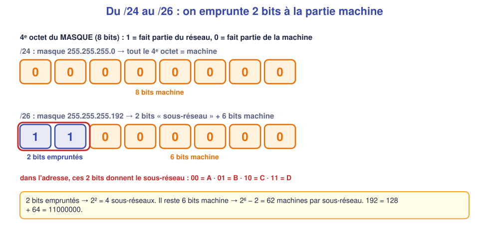
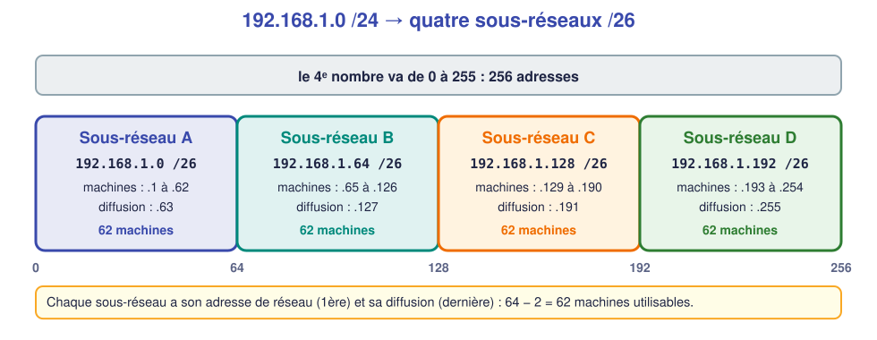

# 📖 Cours – Les sous-réseaux

*Bac Pro CIEL – Première – E31 – S06*

> [!IMPORTANT]
> **Une idée à la fois.** Réponds à la question **avant** de déplier la réponse. Garde un brouillon pour calculer.

## 🎯 À la fin de ce cours, tu sauras

- [ ] dire ce que fait un **masque** ;
- [ ] **découper** un /24 en /25 ou /26 ;
- [ ] trouver **réseau, diffusion et plage** d'un sous-réseau ;
- [ ] **placer** une adresse dans le bon sous-réseau.

---

## 1. Le masque : qui est « dans mon réseau » ?

### 🤔 Avant de lire : à ton avis ?

`PC1` veut parler à `192.168.1.80`. Il a l'adresse `192.168.1.10`. **Comment sait-il** s'il doit envoyer directement ou passer par une passerelle ?

Voir la réponse

Il utilise **son masque** : il compare la **partie réseau** de sa propre adresse avec celle de la destination. Si elles sont identiques, la machine est **dans mon réseau** (envoi direct, par ARP) ; sinon, il envoie à la **passerelle**.

### 💡 L'idée

Une adresse IPv4 = **32 bits**. Le masque indique **combien de bits au début** désignent le **réseau** (les `1`), le reste désigne la **machine** (les `0`).

| Écriture | Masque | Bits réseau | Bits machine | Machines |
|---|---|---|---|---|
| /24 | 255.255.255.0 | 24 | 8 | 254 |
| /25 | 255.255.255.128 | 25 | 7 | 126 |
| /26 | 255.255.255.192 | 26 | 6 | 62 |
| /27 | 255.255.255.224 | 27 | 5 | 30 |
| /28 | 255.255.255.240 | 28 | 4 | 14 |

> [!NOTE]
> Dans chaque réseau, **2 adresses sont réservées** : la **première** (adresse **du réseau**) et la **dernière** (adresse de **diffusion**, *broadcast*). Machines utilisables = 2ⁿ − 2 (n = bits machine).

### ✅ Vérifie que tu as compris

Combien de machines dans un /28 ?

Voir la réponse

4 bits machine → 2⁴ = 16 adresses, moins 2 réservées = **14 machines**.

---

## 2. Découper : emprunter des bits

### 🤔 Avant de lire : à ton avis ?

Tu as **un seul** réseau 192.168.1.0/24 et **deux services** à séparer. Tu ne veux pas changer de plage. **Que peux-tu modifier ?**

Voir la réponse

Le **masque**. En le rallongeant, on **prend des bits à la partie machine** pour les donner à la partie réseau : on crée ainsi plusieurs **petits réseaux** dans le grand.

### 💡 L'idée

Un /24 découpé en /26 : on **emprunte 2 bits** → 2² = **4 sous-réseaux**, chacun de 64 adresses (62 machines).

| Sous-réseau | Réseau | Plage utilisable | Diffusion |
|---|---|---|---|
| A | 192.168.1.**0**/26 | .1 à .62 | .63 |
| B | 192.168.1.**64**/26 | .65 à .126 | .127 |
| C | 192.168.1.**128**/26 | .129 à .190 | .191 |
| D | 192.168.1.**192**/26 | .193 à .254 | .255 |

> [!TIP]
> **Le « pas »** : la taille d'un bloc donne l'écart entre deux réseaux. En /26, le pas est **64** ; en /25, **128** ; en /27, **32**. Les réseaux commencent à 0, 64, 128, 192…

### ✅ Vérifie que tu as compris

`192.168.1.70/26` est dans quel sous-réseau ? Et `192.168.1.20/26` ?

Voir la réponse

70 est entre 64 et 127 → sous-réseau **B** (192.168.1.64/26). 20 est entre 0 et 63 → sous-réseau **A** (192.168.1.0/26).

---

## 3. La méthode à la main (le tableau des puissances de 2)

### 💡 L'idée

| Bit | 7 | 6 | 5 | 4 | 3 | 2 | 1 | 0 |
|---|---|---|---|---|---|---|---|---|
| **Valeur** | 128 | 64 | 32 | 16 | 8 | 4 | 2 | 1 |

**Pour un besoin de N machines :**

1. Ajoute 2 (réseau + diffusion) : N + 2.
2. Trouve la **plus petite puissance de 2 ≥ N + 2** → c'est la **taille du bloc** (le pas).
3. Le nombre de **bits machine** = l'exposant ; masque = 32 − bits machine.

*Exemple : 25 postes → 27 → 32 (2⁵) → 5 bits machine → /27 (masque 255.255.255.224), pas de 32.*

**Pour trouver le réseau d'une adresse** : divise le dernier octet par le pas, garde la partie entière et remultiplie.
*Exemple : 192.168.1.100/27 → 100 ÷ 32 = 3,1 → 3 × 32 = **96** → réseau 192.168.1.96/27, diffusion .127.*

### ✅ Vérifie que tu as compris

Il faut 100 machines. Quel masque minimum ?

Voir la réponse

100 + 2 = 102 → 128 (2⁷) → 7 bits machine → **/25** (255.255.255.128), 126 machines.

---

## 4. Plan d'adressage d'une PME

Un **plan d'adressage** est le tableau où l'on note, pour chaque service : réseau, masque, plage, passerelle, nombre de machines prévues **+ marge**.

> [!WARNING]
> **Toujours prévoir de la marge** (au moins 20 %) : une entreprise s'agrandit. Et ne jamais mélanger deux services dans le même sous-réseau si on veut les séparer plus tard (VLAN, S08).

| Service | Machines (aujourd'hui) | Taille de bloc | Réseau |
|---|---|---|---|
| Direction | 10 | 16 (/28) | à placer |
| Atelier | 40 | 64 (/26) | à placer |
| Invités | 20 | 32 (/27) | à placer |

*(Exercice : placer ces trois réseaux dans 192.168.1.0/24, voir [exercices](03-exercices.md).)*

## 📖 Vocabulaire

| Mot | Définition |
|---|---|
| **Masque** | Indique combien de bits sont la partie réseau |
| **Sous-réseau** | Petit réseau découpé dans un grand |
| **Adresse de réseau** | Première adresse du bloc (identifie le réseau) |
| **Adresse de diffusion** | Dernière adresse du bloc (tout le monde) |
| **Plage utilisable** | Adresses attribuables aux machines |
| **Pas** | Taille d'un bloc ; écart entre deux réseaux |

## 🧠 À retenir

- **Masque plus long** = **plus de petits réseaux**, **moins de machines** par réseau.
- Machines utilisables = **2ⁿ − 2**.
- Pour placer une adresse : **diviser par le pas**.
- Deux machines **ne se parlent directement** que si elles sont dans le **même sous-réseau**. Pour sortir : un **routeur** (S07).
