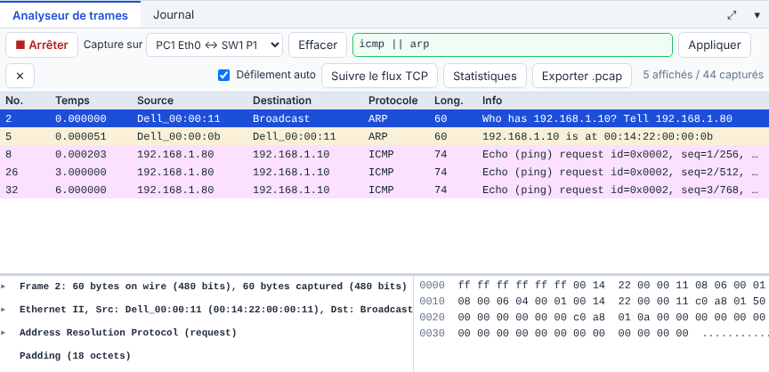

# 🛠️ TP – Deux erreurs d'adressage

*Bac Pro CIEL – Première – E31 – S06 – binôme, on **échange les rôles** à chaque partie*

> [!NOTE]
> **Mission.** Un technicien a découpé le réseau `192.168.1.0/24` en deux sous-réseaux **/26** : le **sous-réseau A** (Direction : `PC1`, `PC2`) et le **sous-réseau B** (Atelier : `PC3`, `PC4`). Rien ne marche comme prévu. Ta mission : **trouver les deux erreurs**, les **corriger** et **prouver** que c'est réparé.
>
> **Temps prévu :** 1 h 45. **Prérequis :** [cours S06](01-cours.md) lu (§1 à §3).

**Binôme :** ____________ / ____________

---

> [!NOTE]
> **Comment ce TP fonctionne.** Les **commandes et réglages sont donnés** quand on ne peut pas les deviner : ton travail est de les **comprendre** (que fait chaque ligne, pourquoi, comment je le vérifie). Écris tes réponses aux ❓ **avant** de tester. Le **bilan final** nourrit ton **passeport d'autonomie**.

## Mise en place

Ouvre le [simulateur](../../simulateur/simulateur-reseau.html), puis **Ouvre** [`p06-sousreseaux.json`](tp/p06-sousreseaux.json).

| Poste | Service | Adresse | Masque |
|---|---|---|---|
| `PC1` | A – Direction | 192.168.1.10 | 255.255.255.192 |
| `PC2` | A – Direction | 192.168.1.70 | 255.255.255.192 |
| `PC3` | B – Atelier | 192.168.1.71 | 255.255.255.192 |
| `PC4` | B – Atelier | 192.168.1.80 | 255.255.255.0 |

> [!TIP]
> Tout est branché sur **le même switch** : physiquement, c'est un seul réseau. Ce sont **les adresses et les masques** qui font les sous-réseaux.

---

## Partie A – Prévoir avant de tester (≈ 20 min)

Sans rien lancer, **remplis** avec ce que tu as appris au cours (§2) :

| Poste | Sous-réseau dans lequel il est **réellement** (réseau /26) | Dans quel service il **devrait** être |
|---|---|---|
| `PC1` | | A |
| `PC2` | | A |
| `PC3` | | B |
| `PC4` | | B |

❓ **Quel poste est mal placé ?** ______________________

Aide

Pour chaque adresse, divise le dernier octet par 64 : 0 à 63 → réseau .0 ; 64 à 127 → réseau .64.

**Prédis :** `PC1` pourra-t-il joindre `PC2` ? `PC3` joindra-t-il `PC4` ? ______________________

---

## Partie B – Tester et observer (≈ 35 min)

Dans le simulateur, ouvre un terminal sur chaque PC et teste :

| Test | Résultat (copie le message) | Conforme à ta prédiction ? |
|---|---|---|
| `PC1` → `ping 192.168.1.70` (PC2) | | |
| `PC3` → `ping 192.168.1.80` (PC4) | | |
| `PC4` → `ping 192.168.1.10` (PC1) | | |
| `PC1` → `ping 192.168.1.80` (PC4) | | |

### Le cas étrange : « dans un sens seulement »

`PC4` → `PC1` ne donne **pas** le même message que `PC1` → `PC4`. Pour comprendre, **regarde les trames** :

1. Ouvre l'**analyseur de trames** (panneau du bas), capture sur le lien **PC1 ↔ SW1**.
2. Dans le filtre, tape `icmp || arp`, **Appliquer**.
3. Lance `ping 192.168.1.10` depuis `PC4`.

| Question | Ta réponse |
|---|---|
| `PC4` fait d'abord un **ARP** : que demande-t-il ? | |
| `PC1` répond-il à l'ARP ? | |
| Les requêtes ICMP (*Echo request*) **arrivent-elles** à `PC1` ? | |
| Y a-t-il des *Echo reply* (réponses) ? | |

❓ **Pourquoi `PC1` ne répond-il pas, alors que la requête est arrivée ?**

Aide

`PC1` doit répondre à `192.168.1.80`. Avec **son** masque /26, il compare : 192.168.1.80 est-il dans **son** réseau (192.168.1.0/26) ? Non ! Il envoie donc la réponse **à sa passerelle**… qu'il n'a pas. La réponse ne part pas.

> [!IMPORTANT]
> **Un masque est une opinion de chaque machine.** Quand deux machines ne sont pas d'accord sur ce qui est « le même réseau », on obtient des pannes **dans un seul sens** — les plus difficiles à comprendre.

**🔁 Échange des rôles.**

---

## Partie C – Corriger (≈ 20 min)

1. **Corrige `PC2`** : choisis une adresse **libre** dans le sous-réseau A (192.168.1.0/26). Adresse choisie : ______________________
2. **Corrige `PC4`** : mets-lui le bon masque : ______________________

> [!WARNING]
> **N'utilise jamais l'adresse du réseau (.0, .64) ni celle de diffusion (.63, .127).** Elles ne s'attribuent pas à une machine.

✅ **Point de contrôle :** `PC1` ↔ `PC2` répondent dans les deux sens ; `PC3` ↔ `PC4` aussi.

---

## Partie D – Prouver que c'est réparé (≈ 20 min)

Complète :

| Test | Résultat attendu | Résultat obtenu |
|---|---|---|
| `PC1` → `PC2` | répond | |
| `PC2` → `PC1` | répond | |
| `PC3` → `PC4` | répond | |
| `PC4` → `PC3` | répond | |
| `PC1` → `PC3` | **ne répond pas** (autre sous-réseau) | |

❓ **Pourquoi `PC1` ne joint-il toujours pas `PC3` alors qu'ils sont sur le même switch ?** ______________________

Aide

Ils sont dans **deux sous-réseaux différents** (A et B). Pour passer de l'un à l'autre il faut un **routeur**. On le verra en **S07**.

✅ **Point de contrôle :** les 5 tests sont conformes. Enregistre ton travail (**Enregistrer** → `TP-S06-tonnom.json`).

---

## 📒 Mon bilan pour le passeport d'autonomie (écrit)

| Question | Ma réponse |
|---|---|
| Une **décision** que j'ai prise, et **pourquoi** | |
| Ce qui m'a **surpris** ou ne s'est pas passé comme prévu | |
| Ce que je saurais **refaire seul(e)**, sans fiche | |
| Ma **preuve** (capture, sortie de commande) | |

> [!TIP]
> **Niveau 3 « Autonome » du passeport** : je découpe un réseau en sous-réseaux **sans fiche** et j'**explique** mon plan d'adressage.

## 🏁 Bilan

### Oral (2 min par élève)

1. Comment une machine sait-elle si une adresse est dans son réseau ?
2. Quelle était l'erreur de `PC2` ? De `PC4` ?
3. Pourquoi les pannes « dans un sens seulement » existent-elles ?

| Mon auto-évaluation | 😟 | 🙂 | 😀 |
|---|---|---|---|
| Je sais dire dans quel sous-réseau est une adresse | | | |
| Je repère une erreur de masque | | | |
| Je lis un ping et une capture pour comprendre une panne | | | |

## 🔍 Dépannage

| Symptôme | Cause probable | Que faire |
|---|---|---|
| « Délai d'attente dépassé » | La requête part mais pas de réponse | Vérifier masques **des deux côtés** |
| « Échec général » | Destination hors du réseau et pas de passerelle | Même sous-réseau ? Sinon : routeur |
| Changement d'IP sans effet | Fenêtre non validée | Valider, puis refaire `ipconfig` |

> [!TIP]
> **Passeport d'autonomie :** ligne « Placer une adresse dans un sous-réseau et corriger un masque » → *guidé* ✔.

➡️ **Mission en entreprise :** relever le plan d'adressage du site.

➡️ **Ensuite :** [exercices et plan d'adressage](03-exercices.md).
