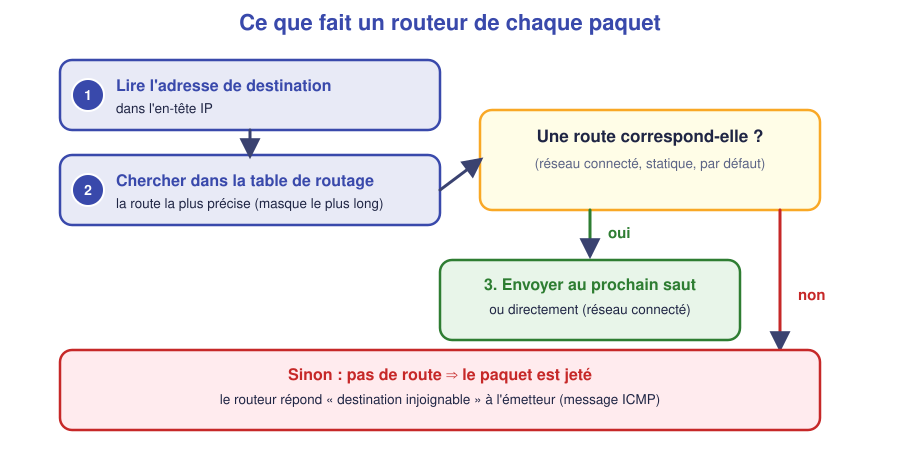
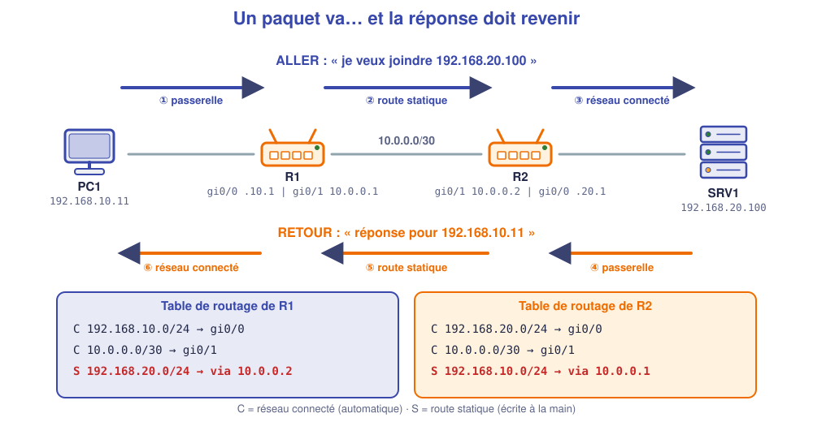

# 📖 Cours – Le routeur et le routage statique

*Bac Pro CIEL – Première – E31 – S07*

> [!IMPORTANT]
> **Une idée à la fois.** Réponds à la question **avant** de déplier la réponse.

## 🎯 À la fin de ce cours, tu sauras

- [ ] dire **à quoi sert** un routeur et ce qu'est une **passerelle** ;
- [ ] **lire** une table de routage ;
- [ ] **écrire** une route statique et une route par défaut ;
- [ ] expliquer pourquoi **l'aller et le retour** doivent être routés.

---

## 1. Le routeur : relier des réseaux différents

### 🤔 Avant de lire : à ton avis ?

Au S06, `PC1` (réseau A) ne joignait pas `PC3` (réseau B) alors qu'ils étaient sur le même switch. **Que manque-t-il ?**

<details markdown="1"><summary>Voir la réponse</summary>

Un équipement qui **fait le lien entre les deux réseaux** : un **routeur**. Le switch relie des machines **du même réseau** ; le routeur relie **des réseaux différents**.

</details>

### 💡 L'idée

| | Switch | Routeur |
|---|---|---|
| **Couche** | 2 (trames, adresses MAC) | 3 (paquets, adresses IP) |
| **Relie** | des machines **d'un même réseau** | **des réseaux** entre eux |
| **Décide avec** | la table MAC | la **table de routage** |
| **Chaque interface a** | pas d'adresse IP | **une adresse IP** (un réseau par interface) |

La **passerelle par défaut** d'un poste est l'adresse de l'**interface du routeur** dans son réseau : c'est « la porte de sortie » du réseau.

### ✅ Vérifie que tu as compris

`PC1` est en 192.168.10.11/24. Quelle est son adresse de passerelle la plus probable, et pourquoi ?

<details markdown="1"><summary>Voir la réponse</summary>

**192.168.10.1** (ou .254) : la passerelle est **dans le même réseau** que le poste (sinon il ne pourrait pas lui parler directement), et c'est souvent la première ou la dernière adresse utilisable.

</details>

---

## 2. La table de routage

### 🤔 Avant de lire : à ton avis ?

Un routeur reçoit un paquet pour `192.168.20.100`. **Que doit-il savoir** pour le faire suivre ?

<details markdown="1"><summary>Voir la réponse</summary>

**Par quelle interface / quel voisin** passer pour atteindre le réseau de `192.168.20.100`. Cette information est stockée dans sa **table de routage**.

</details>

### 💡 L'idée



Commande : `show ip route`.

```text
C    192.168.10.0/24 is directly connected, GigabitEthernet0/0
L    192.168.10.1/32 is directly connected, GigabitEthernet0/0
C    10.0.0.0/30 is directly connected, GigabitEthernet0/1
S    192.168.20.0/24 [1/0] via 10.0.0.2
```

| Code | Signification |
|---|---|
| **C** | Réseau **connecté** : le routeur l'apprend tout seul dès qu'une interface a une IP et est allumée |
| **L** | L'adresse **locale** de l'interface |
| **S** | Route **statique** : écrite à la main par l'administrateur |
| **S\*** | Route statique **par défaut** (0.0.0.0/0) |

*Lecture de la ligne `S` : « pour aller vers 192.168.20.0/24, envoie au routeur **10.0.0.2** (le « prochain saut »). »*

### ✅ Vérifie que tu as compris

Un routeur a deux interfaces : `192.168.10.1/24` et `10.0.0.1/30`. Quels réseaux **connaît-il déjà** sans rien écrire ?

<details markdown="1"><summary>Voir la réponse</summary>

Les deux : **192.168.10.0/24** et **10.0.0.0/30** (lignes `C`). Tout le reste doit être **appris** (route statique) ou **ignoré**.

</details>

---

## 3. La route statique : aller **et** retour

### 🤔 Avant de lire : à ton avis ?

Tu écris sur R1 la route vers 192.168.20.0/24. Le ping de `PC1` vers le serveur **marche-t-il** ?

<details markdown="1"><summary>Voir la réponse</summary>

**Non** : la requête arrive jusqu'au serveur, mais **la réponse** doit revenir. Si R2 ne connaît pas 192.168.10.0/24, il **jette** la réponse. Résultat : « Délai d'attente dépassé ».

</details>

### 💡 L'idée



```text
ip route <réseau> <masque> <prochain saut>
```

*Exemple sur R1 :* `ip route 192.168.20.0 255.255.255.0 10.0.0.2`

> [!WARNING]
> **Chaque routeur doit connaître chaque réseau lointain.** Penser **aller ET retour** : pour chaque route écrite d'un côté, vérifier la route inverse de l'autre.

Pour vérifier un chemin : `tracert 192.168.20.100` (Windows) ; chaque ligne est **un routeur traversé**. Une ligne `*` signale **le premier endroit où ça casse**. Sous Linux, la commande s'appelle `traceroute`. Pour afficher la **table de routage d'un poste** : `route print` (Windows) ou `ip route` (Linux).

### ✅ Vérifie que tu as compris

`tracert` s'arrête après `192.168.10.1` (saut 1) puis affiche des `*`. Où chercher ?

<details markdown="1"><summary>Voir la réponse</summary>

R1 a **transmis** le paquet au saut suivant (R2), mais la **réponse n'est pas revenue** : on cherche **côté R2 / retour** (route vers 192.168.10.0/24 manquante ou câble défectueux).

</details>

---

## 4. La route par défaut

### 🤔 Avant de lire : à ton avis ?

Une agence n'a **qu'une seule sortie** vers le siège et Internet. Faut-il écrire une route par réseau lointain ?

<details markdown="1"><summary>Voir la réponse</summary>

**Non** : on écrit **une seule** route qui dit « **tout le reste, c'est par là** » : la route **par défaut**.

</details>

### 💡 L'idée

```text
ip route 0.0.0.0 0.0.0.0 10.0.0.2
```

`0.0.0.0/0` correspond à **toutes** les adresses. Le routeur la choisit **en dernier**, quand aucune route plus précise n'existe (masque le plus long d'abord). Dans la table : `S*` et « Gateway of last resort is 10.0.0.2 ».

C'est ce que fait **ta box** : tout ce qui n'est pas ton réseau local part vers le FAI.

## 📖 Vocabulaire

| Mot | Définition |
|---|---|
| **Routeur** | Équipement de couche 3 qui relie des réseaux |
| **Passerelle par défaut** | Adresse du routeur dans le réseau du poste |
| **Table de routage** | Liste « réseau de destination → par où passer » |
| **Prochain saut (*next hop*)** | Routeur voisin vers qui envoyer |
| **Route statique** | Route écrite à la main |
| **Route par défaut** | `0.0.0.0/0` : « tout le reste » |
| **Réseau connecté** | Réseau directement relié à une interface |

## 🧠 À retenir

- Le **switch** relie des machines, le **routeur** relie des **réseaux**.
- Une interface de routeur doit avoir **une IP** et être **allumée** (`no shutdown`).
- Les réseaux **connectés** sont appris seuls ; les autres demandent **une route**.
- **Aller et retour** : chaque côté doit connaître l'autre réseau.
- Une panne « **dans un sens** » = souvent **une route de retour manquante**.
