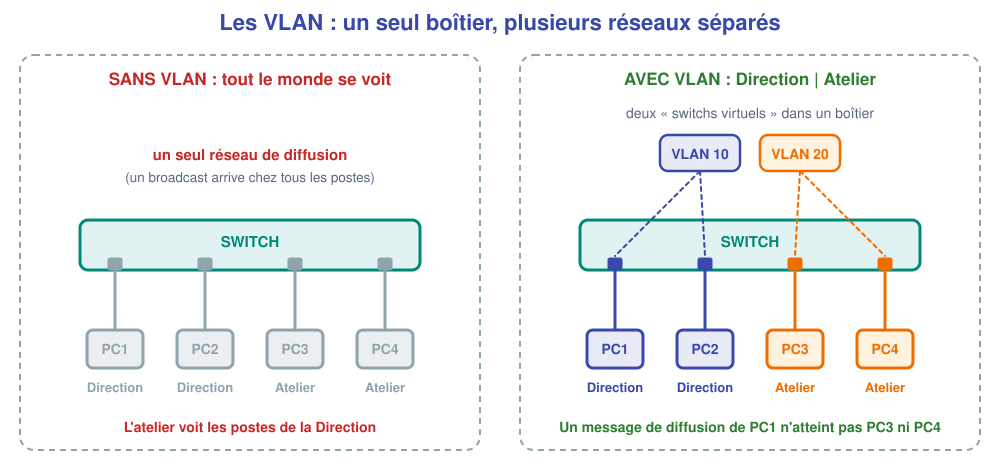
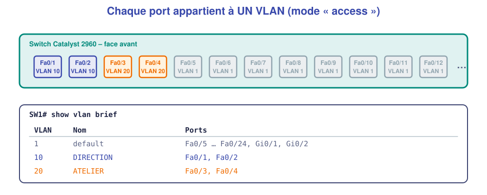

# 📖 Cours – Les VLAN

*Bac Pro CIEL – Première – E31 – S08*

> [!IMPORTANT]
> **Une idée à la fois.** Réponds à la question **avant** de déplier la réponse.

## 🎯 À la fin de ce cours, tu sauras

- [ ] expliquer ce qu'est un **domaine de diffusion** ;
- [ ] dire **à quoi sert** un VLAN ;
- [ ] **créer** un VLAN et y **affecter** des ports ;
- [ ] **vérifier** et **dépanner** une affectation.

---

## 1. Le problème : un seul réseau pour tout le monde

### 🤔 Avant de lire : à ton avis ?

Tous les postes d'une entreprise sont sur un même switch, dans un seul réseau. **Donne deux inconvénients.**

<details markdown="1"><summary>Voir la réponse</summary>

1. **Sécurité** : un poste de l'atelier peut **atteindre** les postes de la Direction (fichiers, imprimantes).
2. **Trafic** : les messages de **diffusion** (*broadcast* : ARP, DHCP…) arrivent chez **tous** les postes ; plus il y a de postes, plus le réseau est bruyant.

</details>

### 💡 L'idée

Un switch **non configuré** met tous ses ports dans **un seul domaine de diffusion** : un message envoyé « à tout le monde » arrive partout.



> [!NOTE]
> **VLAN** = *Virtual Local Area Network* : un **réseau local virtuel**. On découpe **un** switch physique en **plusieurs** switchs logiques, **séparés**. Deux postes de VLAN différents ne se parlent **plus**, même branchés sur le même boîtier.

### ✅ Vérifie que tu as compris

On a 4 PC sur un switch : 2 dans le VLAN 10, 2 dans le VLAN 20. Combien de domaines de diffusion ?

<details markdown="1"><summary>Voir la réponse</summary>

**Deux** : un par VLAN.

</details>

---

## 2. Créer des VLAN et affecter des ports

### 🤔 Avant de lire : à ton avis ?

Comment le switch sait-il **à quel VLAN** appartient un poste branché sur le port 3 ?

<details markdown="1"><summary>Voir la réponse</summary>

Par **le port** : l'administrateur écrit « le port 3 est dans le VLAN 20 ». Le poste n'a **rien à configurer**. (On parle de VLAN **par port**, mode *access*.)

</details>

### 💡 L'idée



**Deux étapes :**

```text
configure terminal
vlan 10
 name DIRECTION        ← 1. créer le VLAN (numéro + nom)
 exit
interface range fa0/1 - 2
 switchport mode access
 switchport access vlan 10   ← 2. y mettre les ports
 end
```

**Vérifier :**

```text
show vlan brief
show interfaces status      (colonne Vlan)
```

> [!WARNING]
> **Par défaut tous les ports sont dans le VLAN 1.** Un port que l'on **oublie** reste dans le VLAN 1 : le poste branché dessus est alors « hors-service » côté Direction/Atelier. C'est **l'erreur n°1**.

### ✅ Vérifie que tu as compris

Tu branches un PC sur `Fa0/9`, personne n'a rien configuré. Dans quel VLAN est-il ?

<details markdown="1"><summary>Voir la réponse</summary>

Dans le **VLAN 1** (VLAN par défaut) : il voit les autres postes restés en VLAN 1, mais pas les VLAN 10 ni 20.

</details>

---

## 3. Un VLAN = un sous-réseau

### 🤔 Avant de lire : à ton avis ?

PC1 (VLAN 10) et PC3 (VLAN 20) ont la **même plage** 192.168.1.0/24. Est-ce une bonne idée ?

<details markdown="1"><summary>Voir la réponse</summary>

Non : un VLAN séparant déjà les postes, on donne **à chaque VLAN son propre sous-réseau** (cours S06). Cela évite les confusions et **prépare le routage** entre VLAN.

</details>

### 💡 L'idée

| VLAN | Nom | Sous-réseau | Passerelle |
|---|---|---|---|
| 10 | DIRECTION | 192.168.**10**.0/24 | 192.168.10.1 |
| 20 | ATELIER | 192.168.**20**.0/24 | 192.168.20.1 |

> [!TIP]
> **Astuce de numérotation :** le **numéro du VLAN** = le **troisième octet** du réseau (VLAN 10 → 192.168.**10**.x). On retrouve la correspondance d'un coup d'œil.

Pour que deux VLAN **communiquent** (quand c'est voulu), on passe par un **routeur** : c'est l'inter-VLAN, vu en Terminale.

---

## 4. Bonnes pratiques

| À faire | Pourquoi |
|---|---|
| **Nommer** chaque VLAN | `show vlan brief` lisible |
| **Documenter** : tableau VLAN / ports / réseau | Le technicien suivant s'y retrouve |
| **Ne pas utiliser le VLAN 1** pour les postes | VLAN par défaut = cible facile |
| **Sauvegarder** (`write memory`) | Sinon tout est perdu au redémarrage |

## 📖 Vocabulaire

| Mot | Définition |
|---|---|
| **VLAN** | Réseau local virtuel : un groupe de ports isolé des autres |
| **Domaine de diffusion** | Ensemble des machines qui reçoivent un message de diffusion |
| **Port *access*** | Port qui appartient à **un seul** VLAN (poste, imprimante…) |
| **VLAN par défaut** | VLAN 1 : celui de tous les ports d'un switch neuf |
| **ID de VLAN** | Numéro du VLAN (1 à 4094) |

## 🧠 À retenir

- Un VLAN **sépare** des groupes de ports **dans un même switch**.
- Deux VLAN **ne se parlent pas** sans routeur.
- On **crée** le VLAN, puis on **affecte** les ports (*access*).
- Un port oublié reste dans le **VLAN 1**.
- **Un VLAN = un sous-réseau.**
