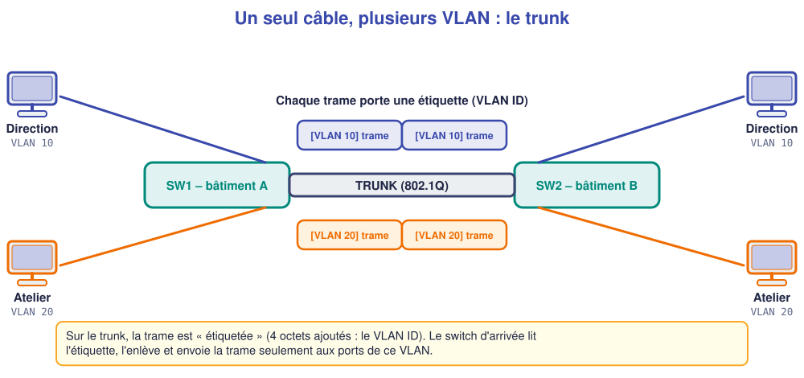
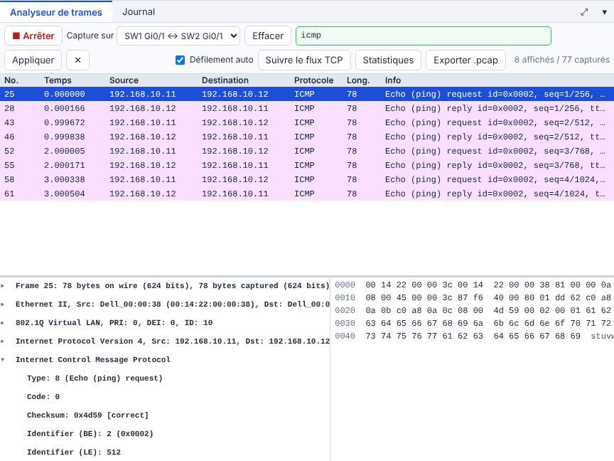

# 📖 Cours – Le lien trunk

*Bac Pro CIEL – Première – E31 – S09*

> [!IMPORTANT]
> **Une idée à la fois.** Réponds à la question **avant** de déplier la réponse.

## 🎯 À la fin de ce cours, tu sauras

- [ ] dire **pourquoi** on utilise un trunk ;
- [ ] expliquer l'**étiquette 802.1Q** ;
- [ ] **configurer** et **vérifier** un trunk ;
- [ ] **dépanner** un trunk.

---

## 1. Le problème : deux switchs, deux VLAN

### 🤔 Avant de lire : à ton avis ?

La Direction a des postes dans les bâtiments A et B. Deux VLAN (10 et 20) existent sur chaque switch. Comment **relier** les deux switchs pour que les VLAN soient prolongés ?

<details markdown="1"><summary>Voir la réponse</summary>

Deux solutions : **(1)** un câble **par VLAN** entre les switchs (coûteux, il faut un port par VLAN) ; **(2)** **un seul câble** qui transporte **tous** les VLAN : le **trunk**.

</details>

### 💡 L'idée

Un port **access** appartient à **un** VLAN. Un port **trunk** transporte **plusieurs** VLAN : chaque trame est **étiquetée** avec son numéro de VLAN.



### ✅ Vérifie que tu as compris

Avec 5 VLAN, combien de câbles entre deux switchs avec la solution trunk ?

<details markdown="1"><summary>Voir la réponse</summary>

**Un seul** (souvent doublé pour la redondance, mais le principe reste un trunk).

</details>

---

## 2. L'étiquette 802.1Q

> [!EXAMPLE]+ 🚀 Pour aller plus loin
> Ce passage va **au-delà du référentiel** : il est utile au métier, mais **non exigé à l'épreuve terminale**.

### 🤔 Avant de lire : à ton avis ?

Sur le même câble passent des trames du VLAN 10 **et** du VLAN 20. Comment le switch d'arrivée sait-il où envoyer chacune ?

<details markdown="1"><summary>Voir la réponse</summary>

Grâce à une **étiquette** (*tag*) de **4 octets** insérée dans la trame, qui contient le **VLAN ID**. Elle n'existe **que sur le trunk** : les postes ne la voient jamais.

</details>

### 💡 L'idée



Dans la capture, entre **Ethernet II** et **IPv4**, on lit : **802.1Q Virtual LAN, ID: 10**. Les trames font 78 octets au lieu de 74 : ce sont les 4 octets de l'étiquette.

**Configuration (des deux côtés !)** :

```text
interface gi0/1
 switchport mode trunk
```

**Vérifier :**

```text
show interfaces trunk
```

```text
Port        Mode   Encapsulation  Status     Native vlan
Gi0/1       on     802.1q         trunking   1
Port        Vlans allowed on trunk
Gi0/1       1-4094
```

> [!WARNING]
> Un trunk **configuré d'un seul côté** ne fonctionne pas : l'autre extrémité reste *access* et jette les trames étiquetées.

### ✅ Vérifie que tu as compris

`PC1` et `PC3` sont dans le VLAN 10 sur deux switchs. Le trunk est configuré sur `SW1` seulement. Que voit-on ?

<details markdown="1"><summary>Voir la réponse</summary>

Le ping échoue (« Impossible de joindre l'hôte de destination ») : `SW2` reçoit des trames étiquetées sur un port *access* du VLAN 1 et les rejette.

</details>

---

## 3. Autoriser seulement certains VLAN

### 🤔 Avant de lire : à ton avis ?

Par défaut un trunk transporte **tous** les VLAN (1–4094). Est-ce toujours souhaitable ?

<details markdown="1"><summary>Voir la réponse</summary>

Non : **moins un VLAN circule**, **moins il y a de risque** (principe du « strict nécessaire »). On liste donc **les VLAN utiles**.

</details>

### 💡 L'idée

```text
interface gi0/1
 switchport trunk allowed vlan 10,20
```

| Commande | Effet |
|---|---|
| `switchport trunk allowed vlan 10,20` | **Remplace** la liste par 10 et 20 |
| `switchport trunk allowed vlan add 30` | **Ajoute** le VLAN 30 |
| `no switchport trunk allowed vlan` | Revient à « tous » |

> [!WARNING]
> Sans le mot **add**, la commande **remplace** toute la liste : un VLAN oublié est **coupé**. C'est une erreur fréquente en production.

**Le VLAN natif** (par défaut le 1) est le seul dont les trames circulent **sans étiquette** sur le trunk. Il doit être **identique des deux côtés** ; on évite d'y mettre des postes.

## 📖 Vocabulaire

| Mot | Définition |
|---|---|
| **Trunk** | Lien qui transporte plusieurs VLAN |
| **802.1Q** | Norme de l'étiquette de VLAN |
| **Étiquette (tag)** | 4 octets ajoutés à la trame (VLAN ID) |
| **VLAN autorisés** | Liste des VLAN admis sur le trunk |
| **VLAN natif** | VLAN sans étiquette sur le trunk |

## 🧠 À retenir

- **Trunk** = un câble, **plusieurs** VLAN, trames **étiquetées**.
- À configurer **des deux côtés**.
- `show interfaces trunk` : état et VLAN autorisés.
- `allowed vlan` **sans** `add` **remplace** la liste.
