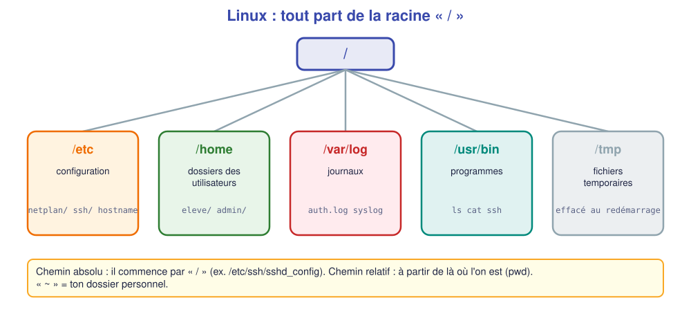
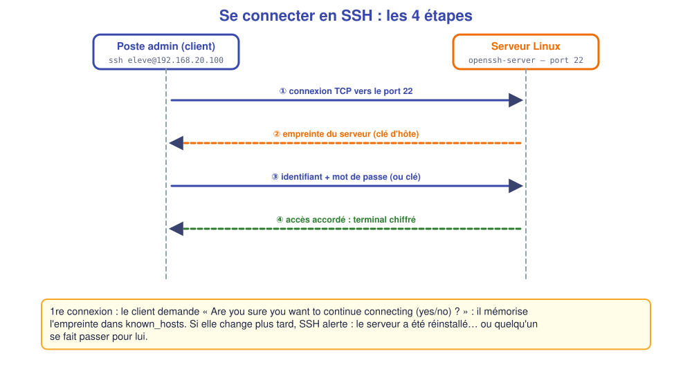

# 📖 Cours – Le serveur Linux et l'administration à distance

*Bac Pro CIEL – Première – E31 – S10*

> [!IMPORTANT]
> **Une idée à la fois.** Réponds à la question **avant** de déplier la réponse.

## 🎯 À la fin de ce cours, tu sauras

- [ ] dire **pourquoi** un serveur n'a pas d'écran ni de bureau ;
- [ ] te **repérer** dans l'arborescence Linux ;
- [ ] expliquer **utilisateurs** et **`sudo`** ;
- [ ] décrire une connexion **SSH** et **l'authentification par clé**.

---

## 1. Un serveur, ça se pilote à distance

### 🤔 Avant de lire : à ton avis ?

Pourquoi installe-t-on souvent un serveur **sans interface graphique** (sans bureau) ?

<details markdown="1"><summary>Voir la réponse</summary>

Moins de logiciels = **moins de pannes et de failles**, **moins de mémoire et de disque** utilisés, **mises à jour plus rapides**. Et personne n'est devant : on l'administre **en ligne de commande**, à distance.

</details>

### 💡 L'idée

| | Poste de travail | Serveur |
|---|---|---|
| **Utilisateur** | Une personne devant l'écran | Des **services** (web, fichiers…) qu'on atteint par le réseau |
| **Interface** | Graphique | **Ligne de commande** |
| **Adresse IP** | Souvent DHCP | **Fixe** (on doit toujours le retrouver) |
| **Accès** | Clavier/écran | **SSH** |

Un serveur se **surveille** aussi en ligne de commande :

| Commande | Ce qu'elle montre |
|---|---|
| `top` | Les **processus** qui consomment le plus (touche `q` pour quitter) |
| `ps aux` | La **liste** de tous les processus en cours |
| `df -h` · `free -h` | **Disque** et **mémoire** (vus en Seconde S05) |

Dans le TP, tu **joindras** d'abord un serveur depuis **un autre réseau** (S07 : le serveur doit avoir une **passerelle**), puis tu en **installeras** un.

### ✅ Vérifie que tu as compris

Un serveur a l'adresse 192.168.20.100/24 mais **pas de passerelle**. Un poste du réseau 192.168.10.0/24 envoie un ping. Que se passe-t-il ?

<details markdown="1"><summary>Voir la réponse</summary>

La requête **arrive** (le routeur la transmet), mais le serveur **ne sait pas répondre** à une adresse d'un autre réseau (« Network is unreachable ») : le ping échoue **dans un seul sens**. Il faut donner au serveur sa **passerelle**.

</details>

---

## 2. L'arborescence Linux

### 🤔 Avant de lire : à ton avis ?

Sous Windows, il y a `C:\`, `D:\`… Que se passe-t-il sous Linux avec une clé USB ou un second disque ?

<details markdown="1"><summary>Voir la réponse</summary>

Il n'y a **pas de lettres de lecteur**. Tout est dans **un seul arbre** qui part de la racine **`/`** : un disque supplémentaire est « monté » dans un dossier (ex. `/mnt/usb`).

</details>

### 💡 L'idée



| Commande | Rôle |
|---|---|
| `pwd` | Où suis-je ? |
| `ls -l` | Lister (avec droits) |
| `cd /etc` | Aller dans un dossier |
| `cat fichier` | Afficher un fichier |
| `nano fichier` | Éditer un fichier (Ctrl+O enregistrer, Ctrl+X quitter) |

> [!NOTE]
> Sous Linux, **la configuration est faite de fichiers texte** (surtout dans `/etc`). Administrer = **lire et modifier des fichiers** puis **redémarrer le service**.

### ✅ Vérifie que tu as compris

Où cherches-tu **pourquoi** une connexion SSH a échoué ?

<details markdown="1"><summary>Voir la réponse</summary>

Dans les **journaux** : `journalctl -u ssh` ou le fichier `/var/log/auth.log` (qui s'est connecté, qui a échoué).

</details>

---

## 3. Utilisateurs, droits et `sudo`

### 🤔 Avant de lire : à ton avis ?

Faut-il travailler **tout le temps** en administrateur (`root`) ? Pourquoi ?

<details markdown="1"><summary>Voir la réponse</summary>

**Non** : une faute de frappe sous `root` peut tout détruire, et un pirate qui prend le compte a **tous les droits**. On travaille en **utilisateur normal** et on élève ses droits **ponctuellement** avec `sudo`.

</details>

### 💡 L'idée

| Commande | Effet |
|---|---|
| `whoami` | Qui suis-je ? |
| `sudo commande` | Exécute **en administrateur** (demande **ton** mot de passe) |
| `sudo adduser bob` | Crée l'utilisateur `bob` |
| `sudo usermod -aG sudo bob` | Donne à `bob` le droit d'utiliser `sudo` |
| `groups bob` | Liste ses groupes |

**Droits d'un fichier** : `ls -l` donne par exemple `-rw-r--r-- 1 eleve eleve …` : trois blocs **propriétaire / groupe / autres**, avec `r` (lire), `w` (écrire), `x` (exécuter).

### ✅ Vérifie que tu as compris

Que signifie `-rw-------` pour un fichier ?

<details markdown="1"><summary>Voir la réponse</summary>

Seul le **propriétaire** peut lire et écrire ; **personne d'autre** n'a de droit. C'est le réglage attendu pour un fichier **sensible** (clé SSH).

</details>

---

## 4. SSH et authentification par clé

### 🤔 Avant de lire : à ton avis ?

Un mot de passe peut être **deviné** ou **volé**. Comment prouver qu'on est bien soi **sans** envoyer de mot de passe ?

<details markdown="1"><summary>Voir la réponse</summary>

Avec une **paire de clés** : une **clé privée** (secrète, reste sur ton poste) et une **clé publique** (déposée sur le serveur). Le serveur envoie un défi que **seule la clé privée** sait résoudre : le secret **ne circule jamais**.

</details>

### 💡 L'idée



| Élément | Où ? | Secret ? |
|---|---|---|
| **Clé privée** `id_ed25519` | Sur **ton poste** | **OUI** — ne jamais la partager |
| **Clé publique** `id_ed25519.pub` | Copiée dans `~/.ssh/authorized_keys` du serveur | Non |

**Durcir SSH** (fichier de configuration `sshd`) :

```text
PasswordAuthentication no
PermitRootLogin no
```

> [!WARNING]
> **Avant** de désactiver le mot de passe : vérifie que **ta clé fonctionne** dans un **second** terminal. Sinon tu t'enfermes dehors.

> [!EXAMPLE]+ 🚀 Pour aller plus loin : copier un fichier et planifier une tâche
> `scp fichier admin@192.168.56.10:/home/admin/` **copie** un fichier vers le serveur **à travers SSH** (donc chiffré). `cron` **planifie** une tâche (par exemple une sauvegarde chaque nuit) : on l'édite avec `crontab -e`.

## 📖 Vocabulaire

| Mot | Définition |
|---|---|
| **SSH** | Connexion à distance **chiffrée**, port 22 |
| **sudo** | Exécuter une commande en administrateur |
| **Service (daemon)** | Programme qui tourne en arrière-plan (`sshd`) |
| **systemctl** | Démarrer, arrêter, vérifier un service |
| **Clé publique / privée** | Paire servant à s'authentifier sans mot de passe |
| **netplan** | Configuration réseau d'Ubuntu (fichiers YAML) |
| **Journal (log)** | Fichier qui note ce que fait le système |

## 🧠 À retenir

- Un serveur : **sans écran**, **IP fixe**, administré en **SSH**.
- Linux : **un seul arbre** ; la config est dans `/etc`, les journaux dans `/var/log`.
- On travaille en **utilisateur**, on élève avec **`sudo`**.
- **Clé privée = secret**, clé publique = on la donne.
- Après une modification de service : **tester**, puis **redémarrer** et **vérifier**.
