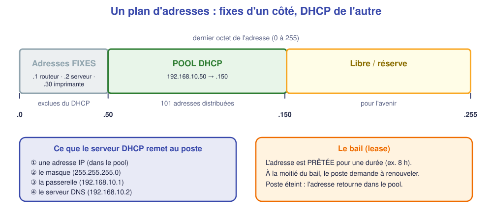
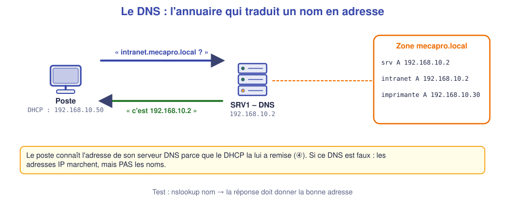

# 📖 Cours – DHCP et DNS sur un serveur

*Bac Pro CIEL – Première – E31 – S11*

> [!IMPORTANT]
> **Une idée à la fois.** Réponds à la question **avant** de déplier la réponse.

## 🎯 À la fin de ce cours, tu sauras

- [ ] **organiser** les adresses d'un réseau (fixes / DHCP) ;
- [ ] dire **ce que distribue** un serveur DHCP ;
- [ ] expliquer **ce que fait** un serveur DNS ;
- [ ] **tester** les deux depuis un poste.

---

## 1. Planifier les adresses

### 🤔 Avant de lire : à ton avis ?

Si le serveur DHCP distribue **toutes** les adresses du réseau, que peut-il arriver au routeur (192.168.10.1) et au serveur (192.168.10.2) ?

Voir la réponse

Le DHCP pourrait **donner leur adresse à un poste** : **deux machines avec la même adresse** (conflit), et plus personne ne joint le routeur. D'où le **plan d'adresses** : on **réserve** une zone pour les adresses **fixes** et on ne distribue qu'une **plage**.

### 💡 L'idée

| Zone | Contenu | Pourquoi |
|---|---|---|
| **Fixes** | routeur, serveurs, imprimantes, bornes | Doivent toujours être **retrouvés** |
| **Pool DHCP** | postes, portables, smartphones | Changent souvent |
| **Libre** | réserve | Croissance |

### ✅ Vérifie que tu as compris

Il y a 60 postes. Une plage DHCP de 50 adresses suffit-elle ?

Voir la réponse

**Non** : il faut **plus** que le nombre de postes (marge : portables, visiteurs, baux non expirés). Prévoir ≥ 25 % de plus.

---

## 2. Le serveur DHCP

### 🤔 Avant de lire : à ton avis ?

Un poste arrive sur le réseau **sans aucune adresse**. Comment peut-il **contacter** un serveur qu'il ne connaît pas ?

Voir la réponse

Il envoie un **message de diffusion** (*broadcast*) : « y a-t-il un serveur DHCP ? ». Le serveur répond. (Tu as déjà observé ces 4 trames en S04 : **Discover, Offer, Request, Ack**.)

### 💡 L'idée

Le serveur DHCP est configuré avec un **pool** :

| Champ | Exemple | Rôle |
|---|---|---|
| **Réseau / masque** | 192.168.10.0 / 255.255.255.0 | Le réseau servi |
| **Plage** | .50 → .150 | Adresses distribuables |
| **Passerelle** | 192.168.10.1 | Sortie du réseau |
| **DNS** | 192.168.10.2 | Serveur de noms |
| **Domaine** | mecapro.local | Suffixe des noms |
| **Bail** | 8 h (28 800 s) | Durée de « prêt » |
| **Exclusions** | .1 → .49 | Jamais distribuées |

> [!NOTE]
> **Réservation DHCP** : on peut associer une adresse **fixe** à une **adresse MAC** (ex. l'imprimante). Elle reçoit toujours la même adresse **via DHCP**. *(Non simulée ici ; on la voit sur les box et les serveurs réels.)*

**Sans DHCP**, un poste se donne une adresse **169.254.x.x** (APIPA) : il ne parle qu'à ses voisins.

### ✅ Vérifie que tu as compris

Un poste affiche `169.254.19.74`. Que doit-on soupçonner ?

Voir la réponse

Le poste **n'a pas obtenu** d'adresse DHCP : serveur éteint, **service DHCP non démarré**, câble/VLAN, ou **pool épuisé**.

---

## 3. Le serveur DNS

### 🤔 Avant de lire : à ton avis ?

`ping 192.168.10.2` marche, mais `ping srv.mecapro.local` dit « hôte introuvable ». Quelle brique est en cause ?

Voir la réponse

Le **DNS** : le réseau fonctionne (l'IP répond), mais **le nom n'est pas traduit** (mauvais serveur DNS, enregistrement absent ou faux).

### 💡 L'idée

Un serveur DNS contient des **enregistrements** :

| Type | Sens | Exemple |
|---|---|---|
| **A** | nom → adresse IPv4 | `intranet.mecapro.local → 192.168.10.2` |
| **CNAME** | alias d'un autre nom | `www` → `intranet` |
| **PTR** | adresse → nom (« à l'envers ») | `192.168.10.2 → srv` |

Il peut aussi **relayer** (*forwarder*) vers un DNS public (8.8.8.8) pour les noms d'Internet.

**Tester depuis un poste :**

| Commande | Question posée |
|---|---|
| `ipconfig /all` | Quel DNS m'a-t-on donné ? |
| `nslookup intranet.mecapro.local` | Quelle adresse pour ce nom ? |
| `ping srv.mecapro.local` | Le nom **se résout-il** et l'hôte **répond-il** ? |

### ✅ Vérifie que tu as compris

`nslookup` donne la **mauvaise adresse**, `ping` du nom échoue. Où est l'erreur ?

Voir la réponse

Dans **l'enregistrement** du serveur DNS (zone) : il pointe vers une adresse **fausse**. Le DNS répond correctement… à une question mal renseignée.

## 📖 Vocabulaire

| Mot | Définition |
|---|---|
| **Pool** | Plage d'adresses distribuées par le DHCP |
| **Bail (lease)** | Durée de prêt d'une adresse |
| **Exclusion** | Adresse jamais distribuée |
| **Réservation** | Adresse fixe pour une MAC donnée |
| **APIPA** | Adresse 169.254.x.x auto-attribuée sans DHCP |
| **Zone** | Ensemble des noms gérés par un serveur DNS |
| **Enregistrement A** | Lien nom → adresse IPv4 |
| **Redirecteur** | DNS vers lequel on transmet les questions inconnues |

## 🧠 À retenir

- **Plan d'adresses** : zone fixe + pool DHCP (+ marge).
- Le DHCP remet **IP, masque, passerelle, DNS, durée**.
- Le DNS **traduit** les noms en adresses.
- « Marche avec l'IP, pas avec le nom » → **DNS**.
- Poste en 169.254.x.x → **DHCP**.
