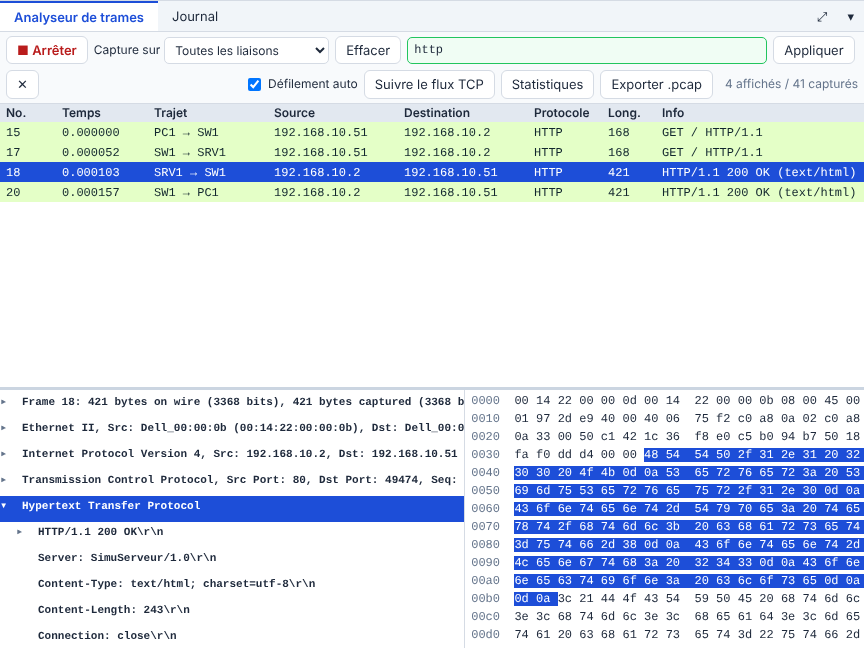
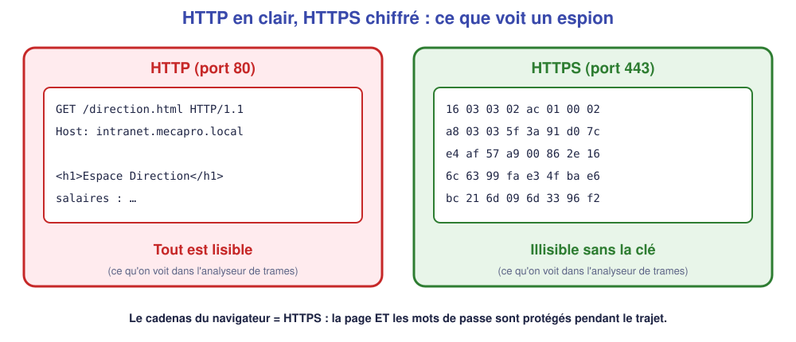
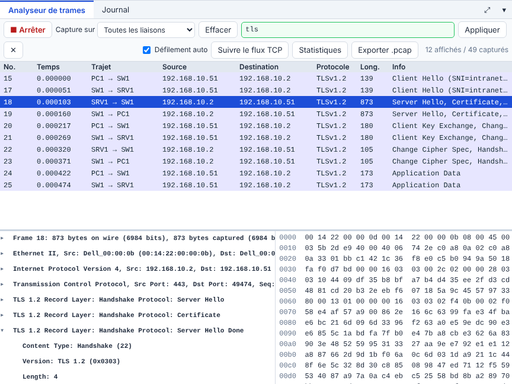
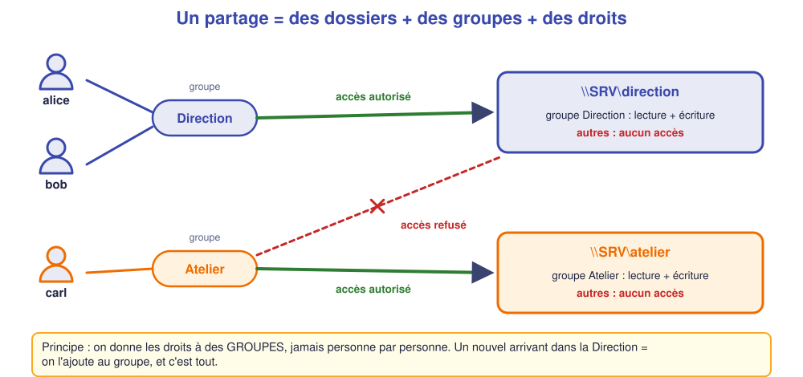

# 📖 Cours – Le serveur web et le partage de fichiers

*Bac Pro CIEL – Première – E31 – S12*

> [!IMPORTANT]
> **Une idée à la fois.** Réponds à la question **avant** de déplier la réponse.

## 🎯 À la fin de ce cours, tu sauras

- [ ] décrire un **échange HTTP** ;
- [ ] lire un **code de réponse** (200, 404…) ;
- [ ] expliquer **ce que HTTPS protège** ;
- [ ] organiser un **partage de fichiers** avec **groupes et droits**.

---

## 1. Le web : un client qui demande, un serveur qui répond

### 🤔 Avant de lire : à ton avis ?

Tu tapes `http://intranet.mecapro.local` dans le navigateur. Quelles **étapes** se passent avant que la page s'affiche ?

Voir la réponse

1. **DNS** : traduire le nom en adresse IP (S11).
2. **TCP** : ouvrir une connexion vers le **port 80** (ou 443).
3. **HTTP** : le navigateur envoie `GET /` ; le serveur répond avec un **code** et la **page**.

### 💡 L'idée

Dans la capture : `GET / HTTP/1.1` (requête) puis `HTTP/1.1 200 OK` (réponse, avec le contenu HTML).

| Code | Sens | Exemple |
|---|---|---|
| **200** | OK | La page s'affiche |
| **301 / 302** | Redirection | Le site a déménagé |
| **403** | Interdit | Pas le droit d'ouvrir |
| **404** | Introuvable | La page n'existe pas |
| **500** | Erreur serveur | Le programme du serveur a planté |

> [!NOTE]
> Et si **personne** n'écoute sur le port 80 ? Le client reçoit **« Connexion refusée »** (service arrêté) — ce n'est pas un code HTTP : la requête n'est même pas arrivée au web.

### ✅ Vérifie que tu as compris

`curl http://intranet/absente.html` répond « 404 Not Found ». Le serveur web marche-t-il ?

Voir la réponse

**Oui** : il a répondu ! Seule **cette page** n'existe pas. (Si le service était arrêté, on aurait « Connexion refusée ».)

---

## 2. HTTPS : chiffrer l'échange

### 🤔 Avant de lire : à ton avis ?

Sur un réseau Wi-Fi public, quelqu'un capture les trames. Que voit-il si tu te connectes à un site en HTTP ?

Voir la réponse

**Tout** : les pages, les formulaires, **les mots de passe**, en clair.

### 💡 L'idée

HTTPS = HTTP **dans un tunnel TLS** (port **443**). La capture montre la **poignée de main TLS** (*Client Hello, Server Hello, Certificate…*), puis seulement des **« Application Data »** illisibles.

Le **certificat** du serveur prouve son identité (signé par une autorité). Un certificat **expiré** ou **inconnu** déclenche un **avertissement** dans le navigateur : on ne passe pas outre sans comprendre.

### ✅ Vérifie que tu as compris

HTTPS cache-t-il **l'adresse du serveur** visité ?

Voir la réponse

**Non** : l'adresse IP (et souvent le nom, via SNI) reste visible. HTTPS protège **le contenu** des échanges, pas le fait qu'on se connecte à ce serveur.

---

## 3. Partager des fichiers sur un réseau

### 🤔 Avant de lire : à ton avis ?

Pourquoi ne pas mettre tous les fichiers de l'entreprise **sur les postes** ?

Voir la réponse

Pas de **sauvegarde** centralisée, fichiers **dispersés**, versions multiples, et **panne = perte**. Un **serveur de fichiers** (ou NAS) centralise, sauvegarde et gère les **droits**.

### 💡 L'idée

Un **partage** est un dossier du serveur accessible par le réseau. Protocole courant en entreprise : **SMB** (Windows ; sous Linux : **Samba**). On s'y connecte par `\\serveur\partage`.

| Élément | Rôle |
|---|---|
| **Partage** | Le dossier visible sur le réseau (`direction`) |
| **Utilisateur** | Un compte (alice) |
| **Groupe** | Un ensemble d'utilisateurs (Direction) |
| **Droits** | Lecture / écriture / aucun accès |

---

## 4. Groupes et droits : le principe du moindre privilège

### 🤔 Avant de lire : à ton avis ?

Un nouvel employé arrive à la Direction. Vaut-il mieux lui donner les droits **dossier par dossier**, ou autre chose ?

Voir la réponse

Mieux vaut l'**ajouter au groupe « Direction »** : tous les droits du groupe s'appliquent d'un coup, et **à son départ** on le retire d'un seul endroit.

### 💡 L'idée

**Moindre privilège** : chacun a **le strict nécessaire**, rien de plus.

| Droit | Pour qui |
|---|---|
| Lecture + écriture | Le groupe propriétaire du dossier |
| Lecture seule | Services qui consultent seulement |
| Aucun accès | **Tous les autres** |

### ✅ Vérifie que tu as compris

Carl (Atelier) doit consulter un document de la Direction, **une seule fois**. Quelle bonne pratique ?

Voir la réponse

Ne pas lui ouvrir tout le dossier : **copier ce document** dans un dossier commun, ou donner un accès **en lecture seule limité** et **temporaire**. On ne l'ajoute pas au groupe Direction.

## 📖 Vocabulaire

| Mot | Définition |
|---|---|
| **HTTP / HTTPS** | Protocole du web, sans / avec chiffrement |
| **Code de réponse** | 200 OK, 404 introuvable… |
| **TLS** | Chiffrement utilisé par HTTPS |
| **Certificat** | « Carte d'identité » du serveur |
| **SMB / Samba** | Protocole de partage de fichiers Windows / sa version Linux |
| **Groupe** | Ensemble d'utilisateurs ayant les mêmes droits |
| **Moindre privilège** | Donner uniquement les droits nécessaires |

## 🧠 À retenir

- Web : **DNS → TCP → HTTP**. 200 = OK, 404 = page absente, « refusée » = service arrêté.
- **HTTPS** protège **le contenu** pendant le trajet.
- Partage : **groupes**, pas des droits individuels.
- **Moindre privilège** ; les autres n'ont **aucun accès**.
