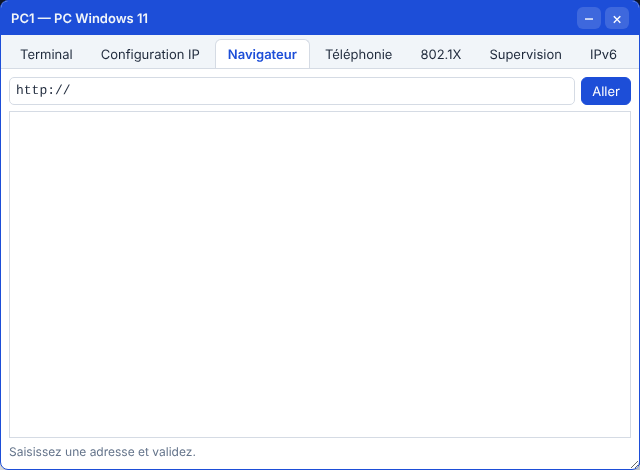

# 🛠️ TP – Un intranet et un partage de fichiers

*Bac Pro CIEL – Première – E31 – S12 – binôme, on **échange les rôles** à chaque partie*

> [!NOTE]
> **Mission.** MécaPro veut un **intranet** accessible par son nom (`intranet.mecapro.local`) avec une page d'accueil et un **espace Direction**, puis un **dossier partagé réservé à la Direction**. Ta mission : **publier** les pages (simulateur), **prouver** que HTTPS protège l'échange, puis **créer le partage** sur un serveur Linux et y accéder depuis Windows.
>
> **Temps prévu :** 3 h 40. **Prérequis :** [cours S12](01-cours.md) lu, [aide-mémoire](03-aide-memoire-web-partage.md) sous la main.

**Binôme :** ____________ / ____________

---

> [!NOTE]
> **Comment ce TP fonctionne.** Tu vas **décider**, pas seulement taper. Avant chaque manipulation, **écris ce que tu attends** ; après, **ce que tu observes**. Les pages HTML et les commandes Linux sont dans des **💡 Aides** repliées : essaie d'abord avec l'[aide-mémoire](03-aide-memoire-web-partage.md).

## Mise en place (simulateur)

Ouvre le [simulateur](../../simulateur/simulateur-reseau.html), puis **Ouvre** [`p12-web.json`](tp/p12-web.json).

| Équipement | Adresse | Rôle |
|---|---|---|
| `SRV1` | 192.168.10.2 | Serveur : DNS (déjà fait) et **web** (à faire) |
| `PC1`, `PC2` | 192.168.10.51 / .52 | Postes (DNS = `SRV1`) |

Le DNS connaît déjà `intranet.mecapro.local → 192.168.10.2`.

---

## Partie A – Constater (≈ 15 min)

🤔 **J'anticipe.** Le serveur web n'est pas encore démarré, mais le DNS est configuré. Sur `PC1`, `ping intranet.mecapro.local` va-t-il répondre ? Et `curl http://intranet.mecapro.local` ? Mon pronostic : ______________________

Sur `PC1` (terminal), lance ces deux commandes : `ping intranet.mecapro.local` puis `curl http://intranet.mecapro.local`.

| Test | Résultat |
|---|---|
| `ping intranet.mecapro.local` | |
| `curl http://intranet.mecapro.local` | |

❓ **Le nom est-il résolu ? Le serveur web répond-il ? Que veut dire ce message ?** ______________________

**🔁 Échange des rôles.**

---

## Partie B – Démarrer le serveur web (≈ 30 min)

1. Double-clique `SRV1` → **Services** → **Web (HTTP/HTTPS)**.
2. **Coche** « Serveur web activé (HTTP 80) ».
3. Sur `PC1`, onglet **Navigateur** : tape `http://intranet.mecapro.local` → **Aller**.



| Question | Ta réponse |
|---|---|
| Que voit-on ? Quel code HTTP (en bas du navigateur) ? | |
| `curl http://intranet.mecapro.local/absente.html` : que dit-il ? | |

❓ **Quelle différence entre cette réponse et la « Connexion refusée » de la partie A ?** ______________________

✅ **Point de contrôle :** la page d'accueil par défaut s'affiche, code **200**.

---

## Partie C – Écrire l'intranet (≈ 40 min)

**But :** une page d'accueil qui présente l'intranet et **renvoie vers une seconde page** `/direction.html` (l'espace Direction). Les deux pages doivent s'afficher depuis `PC2`.

<details markdown="1"><summary>💡 Aide : un exemple de page d'accueil et de page Direction</summary>

Sur `SRV1`, dans l'éditeur (liste de pages → `/`), remplace le contenu par :

```html
<!DOCTYPE html>
<html><head><meta charset="utf-8"><title>Intranet MécaPro</title></head>
<body>
<h1>Intranet MécaPro</h1>
<p>Bienvenue sur l'intranet de l'atelier.</p>
<ul><li><a href="/direction.html">Espace Direction</a></li></ul>
</body></html>
```

Clique **Enregistrer la page**. Puis, dans le champ « nouvelle page », tape `/direction.html`, ajoute-la, et colle :

```html
<!DOCTYPE html>
<html><head><meta charset="utf-8"><title>Espace Direction</title></head>
<body>
<h1>Espace Direction</h1>
<p>Documents de la Direction.</p>
</body></html>
```

**Enregistrer la page.**

</details>

### Tester

🤔 **J'anticipe.** Si je tape `/direction.htm` (sans le `l`), **quel code** le navigateur va-t-il afficher ? Mon pronostic : ______

Depuis `PC2` : `http://intranet.mecapro.local`, **clique** sur le lien « Espace Direction » (ou tape l'adresse complète).

✅ **Point de contrôle :** `PC2` affiche **les deux pages**, code 200.

> [!WARNING]
> Cet intranet est **en HTTP** et **sans mot de passe** : n'importe qui du réseau lit « l'Espace Direction ». C'est un exemple pour le TP ; en vrai, on **protège** les pages sensibles.

**🔁 Échange des rôles.**

---

## Partie D – HTTP contre HTTPS (≈ 30 min)

🤔 **J'anticipe.** Dans la capture, **pourrai-je lire le contenu de la page** en HTTP ? Et en HTTPS ? Mon pronostic : ______________________

1. Ouvre l'**analyseur de trames**, **Effacer**, filtre `http`. Sur `PC1` : `curl http://intranet.mecapro.local`.
2. **Clique** la réponse « 200 OK » et déplie **Hypertext Transfer Protocol** : **lis-tu le contenu de la page ?**
3. Sur `SRV1`, **coche « HTTPS (443) »**. Efface la capture, mets le filtre `tls`, puis sur `PC1` : `curl https://intranet.mecapro.local`.

| Question | Ta réponse |
|---|---|
| En HTTP : le contenu de la page est-il visible dans la capture ? | |
| En HTTPS : quels messages voit-on avant les « Application Data » ? | |
| Le contenu de la page est-il lisible ? | |
| Quel port est utilisé en HTTP ? en HTTPS ? | |

❓ **Pourquoi interdit-on la saisie d'un mot de passe sur une page en HTTP ?** ______________________

✅ **Point de contrôle :** `https://intranet.mecapro.local` répond (200).

Enregistre ton travail (**Enregistrer** → `TP-S12-tonnom.json`).

---

## Partie E – Le partage de fichiers (VM Ubuntu Server, ≈ 60 min)

> [!NOTE]
> Le simulateur ne gère pas les partages : tu utilises la **VM Ubuntu Server** de S10 (IP `192.168.56.10`). Connecte-toi en SSH : `ssh admin1@192.168.56.10`.

### E1. Concevoir avant d'installer

**Besoin :** deux services, deux dossiers : la **Direction** (`alice`) et l'**Atelier** (`carl`). Chacun lit et écrit dans **son** dossier, **et ne voit pas** l'autre.

🤔 **Je décide, puis je justifie** (avant de toucher au serveur) :

| Question | Ma décision | Pourquoi |
|---|---|---|
| Je donne les droits aux **utilisateurs** ou à des **groupes** ? | | |
| Quels groupes, quels membres ? | | |
| Qui est **propriétaire** de chaque dossier, quel groupe ? | | |
| Quels droits (en octal) pour que **les autres** n'entrent pas ? | | |
| Que faut-il pour que **un nouveau fichier** hérite du bon groupe ? | | |

<details markdown="1"><summary>💡 Aide 1 : les idées à utiliser</summary>

Un **groupe** par service (`direction`, `atelier`) ; le dossier appartient à `root` et au groupe du service ; droits **`770`** (propriétaire et groupe : tout ; autres : rien) ; le **bit setgid** (le `2` de `2770`) fait hériter le groupe aux nouveaux fichiers. Voir le [cours S12](01-cours.md).

</details>

<details markdown="1"><summary>💡 Aide 2 : les commandes</summary>

```text
sudo apt update && sudo apt install -y samba
sudo groupadd direction ; sudo groupadd atelier
sudo adduser alice ; sudo adduser carl
sudo usermod -aG direction alice ; sudo usermod -aG atelier carl
sudo smbpasswd -a alice ; sudo smbpasswd -a carl
sudo mkdir -p /srv/partage/direction /srv/partage/atelier
sudo chown root:direction /srv/partage/direction
sudo chown root:atelier /srv/partage/atelier
sudo chmod 2770 /srv/partage/direction /srv/partage/atelier
ls -ld /srv/partage/*
```

*(Les mots de passe sont à toi : ______________________)*

</details>

| Question (après réalisation) | Ta réponse |
|---|---|
| Que signifient les droits `drwxrws---` ? | |
| Qui peut entrer dans `/srv/partage/direction` ? | |
| Ma décision de départ était-elle la même ? Qu'ai-je changé ? | |

### E2. Déclarer les partages

**But :** deux partages `[direction]` et `[atelier]`, chacun **réservé** au groupe correspondant, en lecture **et** écriture. Le fichier à modifier est `/etc/samba/smb.conf`.

<details markdown="1"><summary>💡 Aide : ce qu'il faut ajouter à la fin du fichier</summary>

```text
[direction]
   path = /srv/partage/direction
   valid users = @direction
   read only = no

[atelier]
   path = /srv/partage/atelier
   valid users = @atelier
   read only = no
```

Puis : `testparm` (vérifie la syntaxe) et `sudo systemctl restart smbd`.

</details>

✅ **Point de contrôle :** `testparm` ne signale **aucune erreur** et affiche tes deux partages.

❓ **Pourquoi lance-t-on `testparm` avant de redémarrer le service ?** ______________________

### E3. Accéder depuis Windows

🤔 **Remplis la colonne « attendu » avant de tester.** Sur ton PC : explorateur de fichiers → barre d'adresse → `\\192.168.56.10\direction` → identifiant `alice` + son mot de passe.

| Test | Résultat attendu | Résultat obtenu |
|---|---|---|
| `alice` ouvre `\\…\direction`, crée un fichier | Accès autorisé | |
| `alice` ouvre `\\…\atelier` | **Refusé** | |
| `carl` ouvre `\\…\atelier`, crée un fichier | Accès autorisé | |
| `carl` ouvre `\\…\direction` | **Refusé** | |

> [!TIP]
> Windows **mémorise** la connexion : pour tester un autre utilisateur, ferme la session Windows ou tape dans une invite de commandes `net use * /delete`.

Sur le serveur : `ls -l /srv/partage/direction` (le fichier d'`alice` y est) et `sudo smbstatus` (qui est connecté ?).

❓ **Pourquoi donne-t-on les droits à des groupes plutôt qu'à `alice` directement ?** ______________________

**🔁 Échange des rôles.**

---

## Partie F – Fiche de synthèse (≈ 20 min, individuel)

| Élément | Valeur |
|---|---|
| Nom de l'intranet / adresse | |
| Pages publiées | |
| HTTPS activé ? Pourquoi ? | |
| Partages créés | |
| Groupes et membres | |
| Droits du dossier `direction` | |
| Point d'amélioration de sécurité (une idée) | |

---

## 🏁 Bilan

### 📒 Mon bilan pour le passeport d'autonomie (individuel, écrit)

| | Ma réponse |
|---|---|
| **Une décision que j'ai prise et pourquoi** (groupes, droits, HTTPS) | |
| **Une prédiction fausse, et ce qu'elle m'a appris** | |
| **Comment je diagnostiquerais « Windows refuse l'accès à tort »** (étapes) | |
| **Ce que je sais refaire seul, sans la fiche** | |
| **Ma preuve** (capture du navigateur, de `testparm`, de l'accès refusé) | |

> [!TIP]
> **Passeport :** ligne « Publier un site web et créer un partage de fichiers avec groupes et droits » (S12). Niveau 3 « Autonome » : je conçois les groupes et les droits **sans fiche** et j'explique **pourquoi** `2770` et pas `777`. Ne coche que le niveau démontrable.

### Oral (2 min par élève)

1. Qu'est-ce qui sépare « Connexion refusée » de « 404 » ?
2. Que protège HTTPS ? Que ne protège-t-il pas ?
3. Pourquoi des groupes pour les droits ?

| Mon auto-évaluation | 😟 | 🙂 | 😀 |
|---|---|---|---|
| J'explique un échange HTTP | | | |
| Je publie une page sur un serveur web | | | |
| Je distingue HTTP et HTTPS en capture | | | |
| Je crée un partage avec groupes et droits | | | |

## 🔍 Dépannage

| Symptôme | Cause probable | Que faire |
|---|---|---|
| « Connexion refusée » | Service web arrêté | Cocher « Serveur web activé » |
| 404 sur une page | Nom de page différent (`/direction.html`) | Vérifier la liste des pages |
| Le nom ne se résout pas | DNS faux ou service DNS arrêté | Voir S11 |
| HTTPS échoue, HTTP marche | HTTPS non activé | Cocher « HTTPS (443) » |
| Windows : « accès refusé » à tort | Mauvais utilisateur mémorisé | `net use * /delete`, reconnecter |
| Windows : identifiants refusés | Utilisateur Samba non créé | `sudo smbpasswd -a nom` |
| Samba : `testparm` erreur | Faute dans `smb.conf` | Relire les accolades `[ ]` et les `=` |
| Accès OK mais écriture refusée | `read only = yes` ou droits `chmod` | `read only = no`, `chmod 2770` |

➡️ **Mission en entreprise :** noter où sont stockés les fichiers et comment sont gérés les droits.
