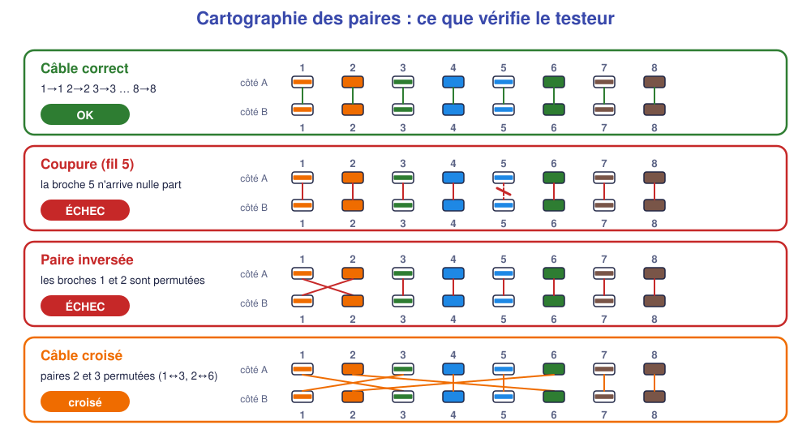
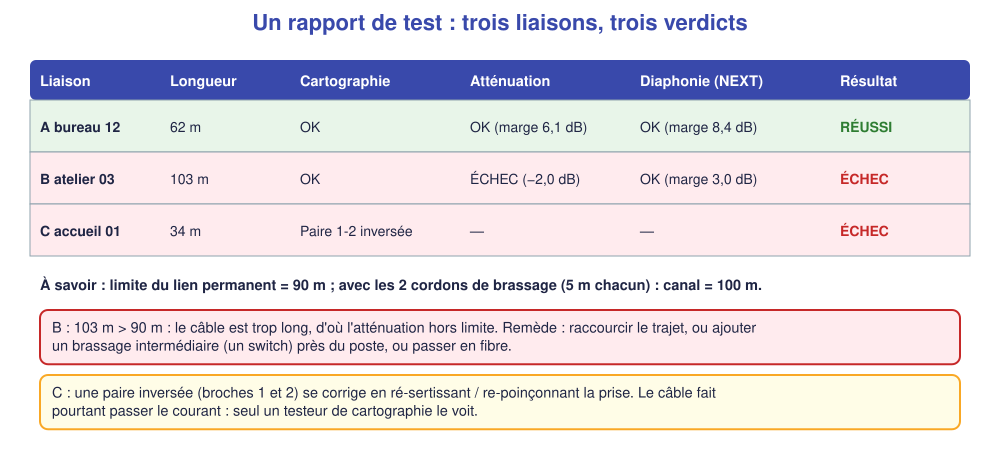
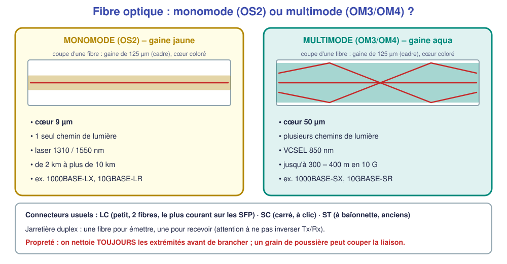
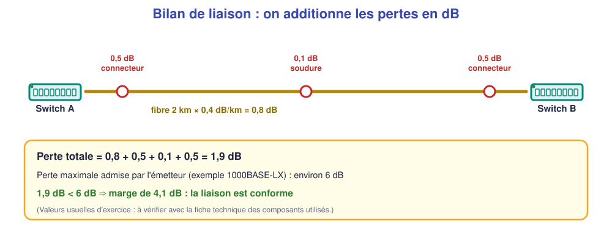

# 📖 Cours – Cuivre certifié, fibre optique et sécurité

*Bac Pro CIEL – Première – E31 – S13*

> [!IMPORTANT]
> **Une idée à la fois.** Réponds à la question **avant** de déplier la réponse.

## 🎯 À la fin de ce cours, tu sauras

- [ ] dire **pourquoi** un lien se **certifie** ;
- [ ] **lire** une cartographie des paires et un rapport de test ;
- [ ] **choisir** entre cuivre, fibre monomode et multimode ;
- [ ] **calculer** un bilan optique simple ;
- [ ] respecter les **règles de sécurité** (laser, électricité).

---

## 1. Le cuivre : un lien « qui s'allume » n'est pas forcément bon

### 🤔 Avant de lire : à ton avis ?

Un câble RJ45 est branché, les voyants du switch sont allumés. Le lien est-il **forcément** bon ?

Voir la réponse

**Non.** Le voyant prouve qu'**un signal passe** (parfois à **100 Mb/s** au lieu de 1 Gb/s si une paire est cassée !). Seul un **test** prouve que **les 8 fils** sont bien raccordés et que la longueur est respectée.

### 💡 L'idée

| Catégorie | Fréquence | Débit courant sur 100 m |
|---|---|---|
| 5e | 100 MHz | 1 Gb/s |
| **6** | 250 MHz | 1 Gb/s (10 Gb/s ≤ 55 m) |
| **6A** | 500 MHz | **10 Gb/s** |

**Distances** (câblage structuré) :

| Élément | Longueur maximale |
|---|---|
| **Lien permanent** (de la prise murale à la baie) | **90 m** |
| Cordons de brassage (2 × 5 m) | 10 m |
| **Canal complet** (poste → switch) | **100 m** |

### ✅ Vérifie que tu as compris

Un câble donne 100 Mb/s au lieu de 1 Gb/s. Quel défaut de **cartographie** le provoque souvent ?

Voir la réponse

**Une paire coupée** : le Gigabit utilise **les 4 paires** ; le 100 Mb/s n'en utilise que **2** (broches 1-2 et 3-6). Un fil coupé sur les 2 autres paires n'empêche pas le 100 Mb/s mais interdit le Gigabit.

---

## 2. Lire un rapport de test

### 🤔 Avant de lire : à ton avis ?

Un câble de **103 m** fonctionne « à peu près ». Pourquoi le refuse-t-on à la **certification** ?

Voir la réponse

Au-delà de **90 m**, le signal s'**affaiblit** trop (atténuation) et se mélange aux signaux voisins (**diaphonie**) : les erreurs augmentent, surtout à haut débit. La norme fixe des limites **mesurables**.

### 💡 L'idée

| Mesure | Ce que c'est | Limite |
|---|---|---|
| **Cartographie** | Chaque fil arrive-t-il au bon endroit ? | aucun défaut |
| **Longueur** | Distance mesurée | ≤ 90 m (lien permanent) |
| **Atténuation** | Perte du signal sur le trajet | dans la limite de la catégorie |
| **Diaphonie (NEXT)** | Le signal d'une paire « fuit » dans la voisine | marge positive |

> [!NOTE]
> Une **marge** (dB) indique **de combien** on est au-dessus de la limite : plus elle est grande, mieux c'est. Une marge **négative** = échec.

### ✅ Vérifie que tu as compris

Rapport : longueur 87 m, cartographie OK, atténuation OK (marge 1,2 dB), diaphonie **ÉCHEC (−0,8 dB)**. Quel est le problème probable ?

Voir la réponse

**Mauvais sertissage / poinçonnage** : paires **trop détorsadées** à la prise (on doit garder les paires torsadées le plus près possible du connecteur). La longueur est correcte : ce n'est pas un problème de distance.

---

## 3. La fibre optique

### 🤔 Avant de lire : à ton avis ?

Un lien doit relier deux bâtiments distants de **400 m**. Le cuivre est-il possible ?

Voir la réponse

**Non** : au-delà de 100 m, il faut un **autre support**. De plus, entre deux bâtiments, le cuivre peut créer des **différences de potentiel** (boucles de terre). La **fibre** résout les deux problèmes : longues distances, isolation électrique, insensibilité aux parasites.

### 💡 L'idée

| | **Monomode (OS2)** | **Multimode (OM3 / OM4)** |
|---|---|---|
| Cœur | 9 µm | 50 µm |
| Gaine extérieure | **jaune** | **aqua** (OM3/OM4) |
| Émetteur | laser | VCSEL (moins cher) |
| Distance | jusqu'à 10 km et plus | ~ 300–400 m en 10 G |
| Prix des optiques | plus élevé | plus bas |
| Usage | entre bâtiments, grandes distances | dans un bâtiment, salle serveurs |

**Les connecteurs** : **LC** (petit, 2 fibres : le plus courant sur les modules **SFP**), **SC** (carré, « clic »), ST (ancien). Une **jarretière duplex** : une fibre pour **émettre** (Tx), une pour **recevoir** (Rx).

> [!WARNING]
> **Compatibilité** : un module **monomode** ne se branche pas sur une fibre **multimode**, et inversement. Les deux extrémités doivent avoir **le même type de module**.

### ✅ Vérifie que tu as compris

Deux bâtiments sont séparés de 2 km. Quel type de fibre ?

Voir la réponse

**Monomode (OS2)** : 2 km dépassent largement la portée du multimode.

---

## 4. Le bilan de liaison optique

### 💡 L'idée

La lumière **perd de la puissance** à chaque connecteur, soudure et kilomètre de fibre. On additionne les **pertes (dB)** et on vérifie qu'elles restent **sous la limite** de l'émetteur.

| Source de perte | Valeur d'exercice |
|---|---|
| Fibre monomode 1310 nm | 0,4 dB / km |
| Fibre multimode 850 nm | 3,5 dB / km |
| Connecteur (paire accouplée) | 0,5 dB |
| Soudure | 0,1 dB |

> [!TIP]
> Un **connecteur sale** peut ajouter plusieurs dB : **nettoyer avant de brancher** est la première cause d'un lien optique qui ne monte pas.

### ✅ Vérifie que tu as compris

Fibre monomode de 5 km, 2 connecteurs, 4 soudures. Perte totale ?

Voir la réponse

Fibre : 5 × 0,4 = **2,0 dB** ; connecteurs : 2 × 0,5 = **1,0 dB** ; soudures : 4 × 0,1 = **0,4 dB**. Total = **3,4 dB**.

---

## 5. Sécurité

### 🤔 Avant de lire : à ton avis ?

Un port fibre est « éteint » (aucune lumière visible). Peut-on regarder dedans pour vérifier ?

Voir la réponse

**Jamais.** La lumière des liaisons optiques est **infrarouge, donc invisible**, et peut lésionner la rétine. On ne regarde **jamais** dans une fibre ni dans un port optique, même si on croit qu'il est éteint ; on contrôle avec un **détecteur** ou on suppose qu'il est actif.

### 💡 L'idée

| Risque | Où ? | Règle |
|---|---|---|
| **Laser (fibre)** | Ports SFP, jarretières | Ne jamais regarder dedans ; VFL jamais vers un œil ; capuchons remis |
| **Électrique** | Baie : multiprise/PDU 230 V, onduleur | Ne pas ouvrir ; ne pas surcharger les prises ; mise à la terre ; ne travailler qu'**hors tension** sauf si habilité |
| **PoE** | Câbles des caméras, bornes, téléphones | Tension continue ≈ 48 V (basse tension) : ne pas ouvrir un switch PoE sous tension ; ne pas brancher un appareil non PoE sur un port PoE « forcé » sans vérifier |
| **Mécanique** | Baie lourde, échelles | Ne pas monter seul un équipement lourd ; ranger les câbles (chutes) |
| **Verre (fibre)** | Éclats de fibre | Jeter dans un contenant dédié, jamais au sol |

> [!WARNING]
> **Habilitation électrique** : pour intervenir sur des installations électriques, une **habilitation** délivrée par l'employeur est nécessaire. Cette séance **sensibilise** ; elle **n'habilite pas**. Ton enseignant précisera la formation d'habilitation prévue dans ton parcours.

## 📖 Vocabulaire

| Mot | Définition |
|---|---|
| **Lien permanent** | Câble fixe de la prise murale à la baie (≤ 90 m) |
| **Canal** | Lien complet, cordons compris (≤ 100 m) |
| **Cartographie (wiremap)** | Test de la correspondance des 8 fils |
| **Atténuation** | Perte de signal sur le trajet |
| **Diaphonie (NEXT)** | Signal d'une paire qui « fuit » dans la voisine |
| **Monomode / multimode** | Types de fibre (cœur 9 µm / 50 µm) |
| **SFP** | Module optique enfichable dans un switch |
| **dB** | Unité de perte de puissance |
| **VFL** | Source lumineuse visible (laser rouge) pour vérifier la continuité |

## 🧠 À retenir

- **Voyant allumé ≠ lien certifié** : on **teste** (cartographie, longueur, rapport).
- **90 m** de lien permanent, **100 m** de canal.
- **Fibre** : monomode (jaune, très longue distance), multimode (aqua, bâtiment).
- **Bilan optique** = somme des pertes en dB, **sous** la limite de l'émetteur.
- **Ne jamais regarder dans une fibre.**
