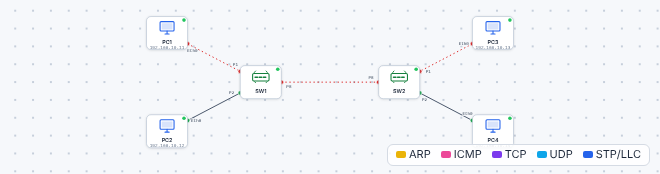

# 🛠️ TP – Réceptionner un câblage : tests et fibre

*Bac Pro CIEL – Première – E31 – S13 – binôme, on **échange les rôles** à chaque partie*

> [!NOTE]
> **Mission.** MécaPro réceptionne le câblage de deux bâtiments. Plusieurs câbles posés ne fonctionnent pas. Ta mission : **trouver les câbles du mauvais type** (simulateur), **lire des rapports de test** pour décider d'accepter ou de refuser chaque liaison, **vérifier** de vraies liaisons si le matériel est disponible, et **dimensionner** une liaison fibre.
>
> **Temps prévu :** 3 h 30. **Prérequis :** [cours S13](01-cours.md) lu.

**Binôme :** ____________ / ____________

---

> [!NOTE]
> **Comment ce TP fonctionne.** Les **commandes et réglages sont donnés** quand on ne peut pas les deviner : ton travail est de les **comprendre** (que fait chaque ligne, pourquoi, comment je le vérifie). Écris tes réponses aux ❓ **avant** de tester. Le **bilan final** nourrit ton **passeport d'autonomie**.

## Partie A – Les câbles du mauvais type (simulateur, ≈ 45 min)

Ouvre le [simulateur](../../simulateur/simulateur-reseau.html), puis **Ouvre** [`p13-cables.json`](tp/p13-cables.json).

> [!NOTE]
> Le fichier active l'option **« Câbles stricts »** : le simulateur vérifie le **type de câble** (droit, croisé, fibre). Un câble inadapté apparaît en **pointillé rouge** : le lien **ne monte pas**.

| Équipement | Adresse |
|---|---|
| `PC1`, `PC2` (bâtiment A, sur `SW1`) | 192.168.10.11 / .12 |
| `PC3`, `PC4` (bâtiment B, sur `SW2`) | 192.168.10.13 / .14 |

### A1. Constater

| Test | Résultat |
|---|---|
| `PC1` → `ping 192.168.10.12` | |
| `PC3` → `ping 192.168.10.14` | |
| `PC1` → `ping 192.168.10.13` | |
| `PC2` → `ping 192.168.10.14` | |

### A2. Trouver les câbles défectueux

Clique chaque **câble en pointillé rouge** : l'inspecteur indique son **type** (droit, croisé, fibre) et ses extrémités.

| Câble (extrémités) | Type actuel | Type correct | Pourquoi ? |
|---|---|---|---|
| | | | |
| | | | |
| | | | |

Aide – les règles du mode « câbles stricts »

- **Poste ↔ switch** : câble **droit**.
- **Switch ↔ switch** : câble **croisé**.
- **Fibre** : seulement entre **ports optiques** ; un PC et un switch cuivre n'ont pas de port optique.

*(Les équipements récents sont « auto-MDI-X » et se passent du câble croisé ; ici, on le travaille pour comprendre le principe.)*

### A3. Remplacer

Pour chaque câble faux : **clique-le → Supprimer**, puis **recrée-le** avec l'outil **Câble** en choisissant le bon type.

✅ **Point de contrôle :** les 4 pings répondent, plus aucun câble en pointillé rouge.

❓ **Pourquoi un câble de mauvais type ne donne-t-il pas simplement un lien « plus lent » ?** ______________________

**🔁 Échange des rôles.**

---

## Partie B – Lire des rapports de test (≈ 40 min)

Voici trois rapports de la réception du câblage :

| Liaison | Verdict | Cause du défaut | Action proposée |
|---|---|---|---|
| A – bureau 12 | | | |
| B – atelier 03 | | | |
| C – accueil 01 | | | |

❓ **Si tu n'avais que les voyants du switch, aurais-tu vu le défaut de la liaison C ? Pourquoi ?** ______________________

❓ **Pour la liaison B (103 m), propose deux solutions** : ______________________

Rapports supplémentaires — **à toi de juger** :

| Longueur | Cartographie | Atténuation | NEXT | Ton verdict |
|---|---|---|---|---|
| 82 m | OK | OK (+4 dB) | OK (+6 dB) | |
| 76 m | **paire 4-5 coupée** | — | — | |
| 91 m | OK | ÉCHEC (−0,5 dB) | OK | |

**🔁 Échange des rôles.**

---

## Partie C – Tester de vrais câbles (≈ 40 min, si matériel disponible)

> [!NOTE]
> Sans matériel : passe à la partie D et fais **l'exercice 3** de la fiche.

Avec un **testeur de câble** (cartographie + longueur) et trois câbles étiquetés **1, 2, 3** :

| Câble | Longueur mesurée | Cartographie (OK / défaut + lequel) | Conclusion |
|---|---|---|---|
| 1 | | | |
| 2 | | | |
| 3 | | | |

**Observe** : un câble avec une paire coupée donne-t-il un voyant allumé sur un switch ? À quelle vitesse ? ______________________

> [!WARNING]
> **Ne jamais brancher un testeur de câble sur un port actif** d'un switch ou d'un équipement sous tension, sauf si la fiche du testeur l'autorise.

### Fibre (avec matériel)

1. Avec un **détecteur** ou la **fiche du technicien**, **identifie** : monomode ou multimode ? type de connecteur (LC, SC) ?
2. **Nettoie** les extrémités avec le kit.
3. Avec la **source lumineuse visible (VFL)** à une extrémité, **vérifie** la continuité : la lumière rouge sort-elle à l'autre bout ?

| Jarretière | Gaine (couleur) | Connecteurs | Continuité (VFL) |
|---|---|---|---|
| 1 | | | |
| 2 | | | |

> [!WARNING]
> **Ne regarde JAMAIS dans une fibre ni dans un port optique**, même si tu penses qu'il est éteint. **Ne dirige jamais la VFL** vers un œil.

---

## Partie D – Dimensionner une liaison fibre (≈ 35 min)

MécaPro relie son **atelier** (bâtiment B) au **bâtiment de stockage**, à **1,8 km**, avec une **fibre monomode** (2 connecteurs, 2 soudures).

| Calcul | Résultat |
|---|---|
| Perte de la fibre (1,8 km × 0,4 dB/km) | |
| Pertes des connecteurs (2 × 0,5 dB) | |
| Pertes des soudures (2 × 0,1 dB) | |
| **Perte totale** | |
| Budget de l'émetteur (exemple) | 6 dB |
| **Marge** | |
| Conforme ? | |

❓ **Le même trajet en multimode 850 nm (3,5 dB/km) serait-il possible ?** Calcule : ______________________

❓ **Quel module SFP faut-il acheter (monomode ou multimode) ? Pourquoi les deux bouts doivent-ils être identiques ?** ______________________

---

## Partie E – Fiche de résultats et sécurité (≈ 30 min, individuel)

Remplis la **fiche de résultats** et réponds au **QCM sécurité** de la [fiche d'exercices](03-exercices-fiche-resultats.md).

---

## 📒 Mon bilan pour le passeport d'autonomie (écrit)

| Question | Ma réponse |
|---|---|
| Une **décision** que j'ai prise, et **pourquoi** | |
| Ce qui m'a **surpris** ou ne s'est pas passé comme prévu | |
| Ce que je saurais **refaire seul(e)**, sans fiche | |
| Ma **preuve** (capture, sortie de commande) | |

> [!TIP]
> **Niveau 3 « Autonome » du passeport** : je choisis cuivre ou fibre **sans fiche** et j'**explique** mon choix selon la distance et le débit.

## 🏁 Bilan

### Oral (2 min par élève)

1. Pourquoi un voyant allumé ne suffit-il pas pour accepter un câblage ?
2. Cuivre ou fibre : comment choisir ?
3. Quelle règle de sécurité te semble la plus importante ? Pourquoi ?

| Mon auto-évaluation | 😟 | 🙂 | 😀 |
|---|---|---|---|
| Je choisis le bon type de câble | | | |
| Je lis un rapport de test | | | |
| Je distingue fibre monomode / multimode | | | |
| Je calcule un bilan optique | | | |
| Je connais les règles de sécurité | | | |

## 🔍 Dépannage

| Symptôme | Cause probable | Que faire |
|---|---|---|
| Aucun voyant | Câble coupé, mauvais type, port éteint | Tester le câble, changer de port |
| Lien à 100 Mb/s au lieu de 1 Gb/s | Une paire cassée, câble de catégorie trop basse | Cartographie, remplacer |
| Beaucoup d'erreurs (CRC) | Diaphonie, trop long, mauvais sertissage | Rapport de test |
| Fibre : pas de lien | Tx/Rx inversés, connecteur sale, modules incompatibles | Inverser les fibres, nettoyer, vérifier mono/multi |
| Fibre : lien instable | Courbure trop serrée, perte élevée | Rayon de courbure, bilan optique |

> [!TIP]
> **Passeport d'autonomie :** ligne « Tester un lien cuivre, lire un rapport et calculer un bilan optique » → *semi-guidé* ✔.

➡️ **Mission en entreprise :** repérer des liaisons fibre ou des rapports de test.
