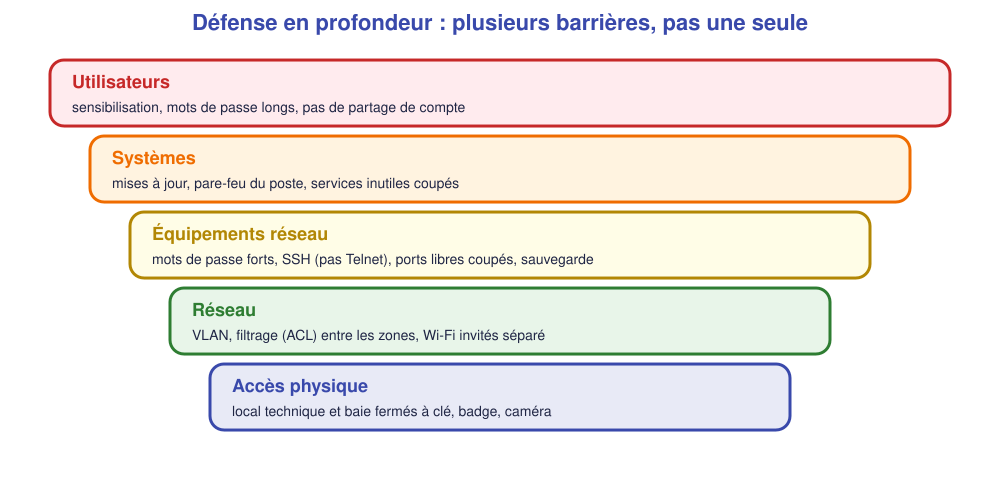
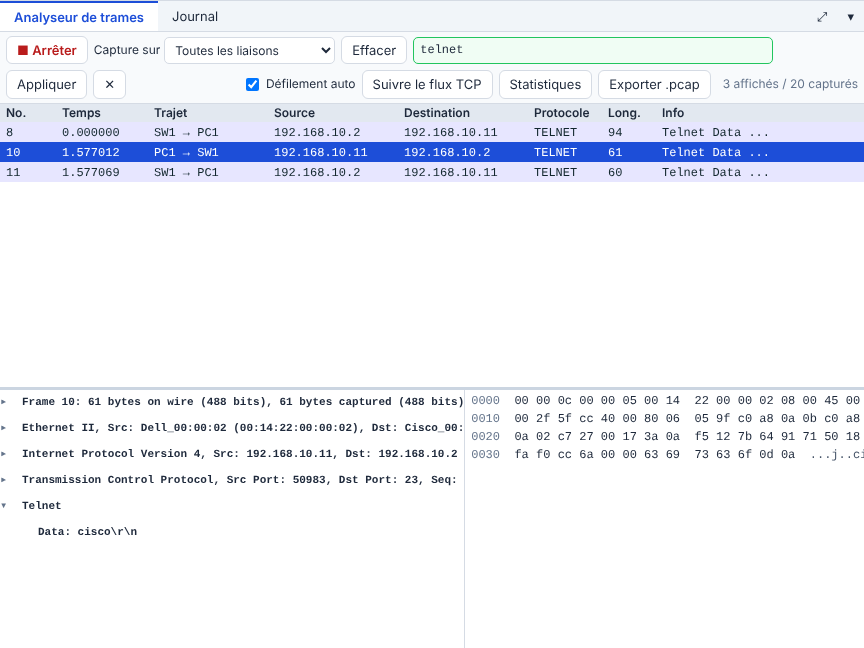
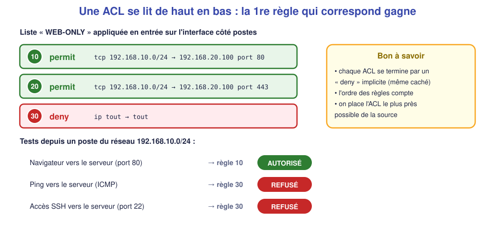

# 📖 Cours – La sécurité de base d'un réseau

*Bac Pro CIEL – Première – E31 – S14*

> [!IMPORTANT]
> **Une idée à la fois.** Réponds à la question **avant** de déplier la réponse.

## 🎯 À la fin de ce cours, tu sauras

- [ ] expliquer la **défense en profondeur** ;
- [ ] citer **10 bonnes pratiques** de base ;
- [ ] **lire** une ACL et prédire ce qu'elle autorise ;
- [ ] expliquer le rôle des **mises à jour** et des **sauvegardes**.

---

## 1. Pourquoi plusieurs barrières ?

### 🤔 Avant de lire : à ton avis ?

Un réseau a un pare-feu très performant. Est-il **protégé** ?

<details markdown="1"><summary>Voir la réponse</summary>

**Pas suffisamment.** Un pare-feu n'arrête ni un **mot de passe faible**, ni une **clé USB piégée**, ni un **employé qui clique** sur un lien. Une seule barrière qui cède, et tout est ouvert : on en met **plusieurs**.

</details>

### 💡 L'idée



> [!NOTE]
> **Réalité de terrain** : la plupart des incidents viennent de **faiblesses banales** : mots de passe par défaut, systèmes non mis à jour, services inutiles ouverts, pas de sauvegarde.

### ✅ Vérifie que tu as compris

Quelle barrière protège un switch dont le **câble est branché dans le couloir** ?

<details markdown="1"><summary>Voir la réponse</summary>

**L'accès physique** (local fermé) **et** les **ports libres désactivés** : sans cela, n'importe qui branche son portable et entre dans le réseau.

</details>

---

## 2. Mots de passe et accès aux équipements

### 🤔 Avant de lire : à ton avis ?

Sur un switch, pourquoi préférer **SSH** à **Telnet** ?

<details markdown="1"><summary>Voir la réponse</summary>

**Telnet** envoie tout **en clair**, y compris le **mot de passe** : une capture suffit à le lire (tu l'as vu en S05 avec SSH). **SSH** chiffre l'échange.



On lit : `Data: cisco\r\n` — le mot de passe, **tel quel**.

</details>

### 💡 L'idée

| Pratique | Pourquoi |
|---|---|
| **Changer** les mots de passe par défaut (`admin/admin`, `cisco`) | Les attaquants les essaient en premier |
| Mots de passe **longs** (≥ 12 caractères) et **uniques** | Résistent aux essais automatiques |
| Comptes **nominatifs** (un compte par personne) | On sait **qui** a fait quoi |
| **`enable secret`** (haché), pas `enable password` | Le secret n'est pas lisible dans la configuration |
| **SSH** seulement ; Telnet désactivé | Pas de mot de passe en clair sur le réseau |
| **Bannière** d'avertissement | Rappel légal : accès réservé |

> [!WARNING]
> Un mot de passe **écrit sur un post-it** collé sur l'équipement n'est **pas** un mot de passe protégé. On utilise un **gestionnaire de mots de passe**.

### ✅ Vérifie que tu as compris

Pourquoi un compte **partagé** (`admin` pour tout le monde) est-il une mauvaise pratique ?

<details markdown="1"><summary>Voir la réponse</summary>

On ne sait plus **qui a fait une modification** en cas de problème, et quand quelqu'un **part**, il faut changer le mot de passe **pour tous**.

</details>

---

## 3. Services inutiles, mises à jour, sauvegardes

### 🤔 Avant de lire : à ton avis ?

Un serveur n'a besoin que du web, mais le service **FTP** y tourne aussi « au cas où ». Est-ce un problème ?

<details markdown="1"><summary>Voir la réponse</summary>

**Oui** : chaque service **ouvert** est une **porte** de plus, avec ses propres failles. Principe : **ce qui n'est pas utile est désactivé** (réduire la « surface d'attaque »).

</details>

### 💡 L'idée

| Mesure | À faire |
|---|---|
| **Services** | Lister ce qui écoute (`ss -tlnp`) ; **couper** le reste |
| **Ports libres** du switch | `shutdown` |
| **Mises à jour** | Appliquer régulièrement (`apt update && apt upgrade`) : les failles connues sont **corrigées** par des mises à jour |
| **Sauvegarde** | **Copier** la configuration (`write memory` + une copie **hors de l'équipement**) ; sauvegarder aussi les **données** |
| **Test de restauration** | Une sauvegarde qu'on n'a jamais restaurée est une **hypothèse**, pas une sauvegarde |

**Règle 3-2-1** : **3** copies, sur **2** supports différents, dont **1** hors site.

### ✅ Vérifie que tu as compris

Le disque du serveur tombe en panne. Les sauvegardes sont **sur le même disque**. Que se passe-t-il ?

<details markdown="1"><summary>Voir la réponse</summary>

**Tout est perdu** : données **et** sauvegardes. Une sauvegarde doit être sur **un autre support**, idéalement **hors du site** (incendie, vol).

</details>

---

## 4. Pare-feu et ACL

> [!EXAMPLE]+ 🚀 Pour aller plus loin
> Ce passage va **au-delà du référentiel** : il est utile au métier, mais **non exigé à l'épreuve terminale**.

### 🤔 Avant de lire : à ton avis ?

Le serveur web de l'entreprise n'a besoin que de recevoir des requêtes **web**. Que **bloque-t-on** utilement entre les postes et ce serveur ?

<details markdown="1"><summary>Voir la réponse</summary>

Tout sauf **HTTP (80) / HTTPS (443)** : pas de ping inutile, pas de SSH depuis n'importe quel poste, pas de partage de fichiers… **On n'autorise que ce qui est nécessaire.**

</details>

### 💡 L'idée

Un **pare-feu** filtre le trafic selon des **règles** : source, destination, protocole, port. Sur un routeur Cisco, on parle d'**ACL** (*Access Control List*).



```text
ip access-list extended WEB-ONLY
 permit tcp 192.168.10.0 0.0.0.255 host 192.168.20.100 eq 80
 permit tcp 192.168.10.0 0.0.0.255 host 192.168.20.100 eq 443
 deny ip any any log
interface gi0/0
 ip access-group WEB-ONLY in
```

> [!NOTE]
> **`0.0.0.255`** est le **masque inversé** (*wildcard*) : il dit **quels bits peuvent varier** (ici le dernier octet : tout le /24). **`host X`** = une seule adresse.

**Sur un serveur Linux : `ufw`** (« pare-feu simple ») :

```text
sudo ufw allow 22/tcp        ← AVANT d'activer ! sinon on s'enferme dehors
sudo ufw allow 80/tcp
sudo ufw enable
sudo ufw status
```

### ✅ Vérifie que tu as compris

Tu actives `ufw` **sans** autoriser SSH, en étant connecté en SSH. Que se passe-t-il ?

<details markdown="1"><summary>Voir la réponse</summary>

Ta session est **coupée** et tu ne peux **plus** te reconnecter : il faudra passer par **la console** de la machine. C'est l'erreur n°1 sur un serveur distant.

</details>

## 📖 Vocabulaire

| Mot | Définition |
|---|---|
| **Surface d'attaque** | Ensemble des portes ouvertes (services, ports, comptes) |
| **Durcissement** | Réduire la surface d'attaque d'un équipement |
| **ACL** | Liste de règles de filtrage sur un routeur |
| **Masque inversé** | Notation des ACL : bits qui peuvent varier |
| **Pare-feu (firewall)** | Équipement ou logiciel qui filtre le trafic |
| **Moindre privilège** | Donner uniquement ce qui est nécessaire |
| **Règle 3-2-1** | 3 copies, 2 supports, 1 hors site |

## 🧠 À retenir

- **Plusieurs barrières**, pas une seule.
- Mots de passe **forts et uniques**, **SSH** plutôt que Telnet, comptes **nominatifs**.
- **Désactiver** ce qui ne sert pas ; **mettre à jour** ; **sauvegarder et tester**.
- Une **ACL** se lit de **haut en bas** ; fin de liste = **refus**.
- **Autoriser SSH avant d'activer le pare-feu.**
