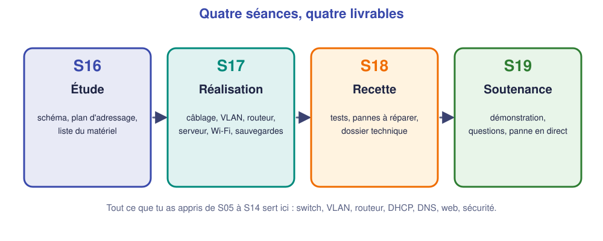

# 📖 Cours – La carte des notions de l'année

*Bac Pro CIEL – Première – E31 – S15*

> [!IMPORTANT]
> **Un cours de révision se lit avec un crayon.** Pour chaque notion, réponds à la question-flash **avant** de déplier la réponse. Coche seulement ce que tu sais **expliquer à voix haute**.

---

## 1. Adresser et découper (S06)

### ⚡ Question-flash

Dans `192.168.50.34/27`, quelle est l'adresse du **réseau** et celle de **diffusion** ?

Voir la réponse

Un `/27` a des blocs de **32** adresses (255.255.255.224). Le bloc de `.34` va de `.32` à `.63` : **réseau** `192.168.50.32`, **diffusion** `192.168.50.63`, **30 machines** possibles (`.33` à `.62`).

- [ ] Je sais donner réseau, diffusion et plage utile d'un `/24`, `/26`, `/27`.
- [ ] Je sais découper un réseau en **sous-réseaux** adaptés au nombre de machines.

## 2. Le routeur (S07)

### ⚡ Question-flash

Un paquet part de `PC1` vers un autre réseau. Que fait `PC1` ?

Voir la réponse

Il voit que la destination n'est **pas dans son réseau** et envoie le paquet à sa **passerelle** (le routeur). Le routeur consulte sa **table de routage** : réseau connu → il le transmet ; sinon il répond « réseau injoignable ».

- [ ] Je sais lire `show ip route` (lignes `C` et `S`).
- [ ] Je sais écrire une **route statique** et expliquer pourquoi la **route retour** est indispensable.

## 3. Les VLAN et le trunk (S08–S09)

### ⚡ Question-flash

Deux PC sont branchés sur le **même switch** mais dans deux VLAN. Peuvent-ils se joindre sans routeur ?

Voir la réponse

**Non.** Un VLAN est un réseau **séparé** : les trames d'un VLAN ne sortent pas de ce VLAN. Pour passer d'un VLAN à l'autre il faut un **routeur**.

- [ ] Je sais créer un VLAN, y mettre un port (`access`) et lire `show vlan brief`.
- [ ] Je sais expliquer le **trunk** et l'étiquette 802.1Q.

## 4. Les services : DHCP, DNS, web (S10–S12)

### ⚡ Question-flash

Un poste en DHCP n'a pas de nom qui fonctionne mais joint les serveurs par adresse. Que vérifies-tu ?

Voir la réponse

Le **serveur DNS** donné par le DHCP (adresse correcte ?) puis l'**enregistrement** DNS du nom. `nslookup nom` dit lequel des deux est faux.

- [ ] Je sais configurer un **pool DHCP** (plage, passerelle, DNS, exclusions).
- [ ] Je sais créer un **enregistrement DNS** et publier une **page web**.

## 5. Le câblage et la sécurité (S13–S14)

### ⚡ Question-flash

Quels sont les deux **premiers gestes** de sécurité sur un switch neuf ?

Voir la réponse

Un **mot de passe privilégié chiffré** (`enable secret`) et la **coupure des ports libres**. Puis **SSH** à la place de Telnet, une bannière, et **sauvegarder** la configuration.

- [ ] Je sais lire un **rapport de test** de câble cuivre.
- [ ] Je sais appliquer les **corrections de base** d'une checklist de sécurité.

---

## 🧠 Le réflexe du dépanneur

Quand « ça ne marche pas », on suit toujours le **même ordre** :

1. **Couche 1** : câble, voyant, port allumé ?
2. **Couche 2** : bon VLAN ? trunk ?
3. **Couche 3** : adresse, masque, passerelle ? `ping` de proche en proche.
4. **Services** : DHCP, DNS, web ?
5. **Filtrage** : une ACL bloque-t-elle ?

## 🧠 À retenir

- Le projet A2 reprend **tout** : on ne devine pas, on **suit la méthode**.
- On **note** chaque décision et **on sauvegarde** chaque configuration validée.
