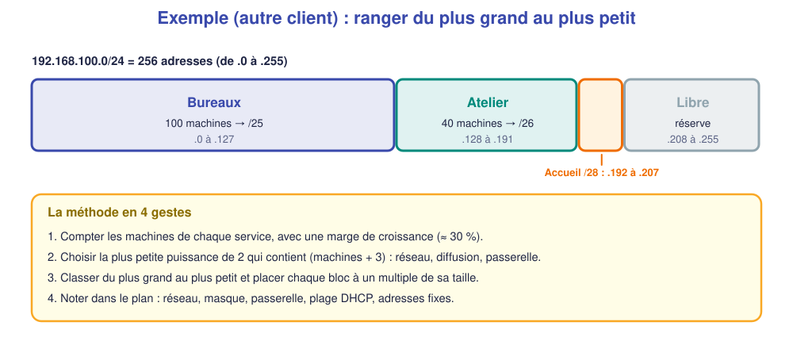

# 📖 Cours – Étudier une installation avant de câbler

*Bac Pro CIEL – Première – E31 – S16*

> [!IMPORTANT]
> **Une idée à la fois.** Réponds à la question **avant** de déplier la réponse.

## 🎯 À la fin de ce cours, tu sauras

- [ ] transformer un cahier des charges en **flux** à autoriser ou interdire ;
- [ ] **découper** un réseau en blocs alignés ;
- [ ] construire un **plan de VLAN**, un **plan d'adressage** et un **tableau de câblage** ;
- [ ] dessiner un **schéma lisible**.

---

## 1. Du cahier des charges aux flux

### 🤔 Avant de lire : à ton avis ?

« Les invités ne doivent voir que le site web. » Quelles **règles techniques** cela impose-t-il ?

Voir la réponse

Il faut : (1) les mettre dans un **réseau à part** (VLAN + sous-réseau) ; (2) **autoriser** seulement le **web** (port 80) et le **DNS** (port 53) vers le serveur, et le **DHCP** pour obtenir une adresse ; (3) **interdire** le reste. Une phrase du client devient des **règles testables**.

### 💡 L'idée

On remplit une **matrice** : en ligne **qui part**, en colonne **vers qui**. Chaque case verte devient un **test de recette** ; chaque case rouge, un **test d'interdiction**.

### ✅ Vérifie que tu as compris

Pourquoi tester aussi ce qui est **interdit** ?

Voir la réponse

Parce qu'un réseau **trop ouvert** marche aussi : le client ne s'en plaindra pas… jusqu'au jour de l'incident. Une recette sérieuse prouve **ce qui marche** et **ce qui est bloqué**.

---

## 2. Découper l'adresse

### 🤔 Avant de lire : à ton avis ?

Pourquoi ne pas donner à chaque service un `/24` entier ?

Voir la réponse

Parce que le client n'a **qu'un** `/24` (192.168.50.0/24) et que chaque service a **peu** de machines. On **découpe** pour ne pas gaspiller, tout en gardant une **marge**.

### 💡 L'idée

> [!NOTE]
> **Règle d'alignement** : un bloc de **32** commence à `.0`, `.32`, `.64`… ; un bloc de **64** à `.0`, `.64`, `.128`… Sinon, **le masque ne tombe pas juste**.

### ✅ Vérifie que tu as compris

Un service de **25 machines** : quel masque ? Pourquoi pas un `/28` ?

Voir la réponse

25 + 3 = 28 adresses à prévoir → il faut **32** adresses : un **/27** (30 machines utiles). Un `/28` n'a que 14 machines utiles : **insuffisant**.

---

## 3. Le plan de VLAN et de ports

Un **tableau** dit, pour chaque port du switch, **qui** est branché et dans **quel VLAN**. Il sert à **configurer** puis à **vérifier**.

| Port | Équipement | VLAN | Mode |
|---|---|---|---|
| Fa0/1 | Poste Direction | 10 | access |
| … | … | … | … |

> [!TIP]
> **Regroupe** les ports par service (ex. Fa0/1-8 Direction, Fa0/9-16 Atelier…) : on configure avec `interface range` en **trois commandes** au lieu de vingt.

### ✅ Vérifie que tu as compris

Pourquoi le port du switch relié **au routeur** est-il lui aussi dans un VLAN ?

Voir la réponse

Parce que le routeur ne sait pas ce qu'est un VLAN : il se branche sur un port **access** et **appartient** au VLAN du service qu'il dessert. Trois pattes, trois ports, trois VLAN.

---

## 4. Le schéma et le câblage

### Un bon schéma

| Règle | Pourquoi |
|---|---|
| **Titre, date, auteur** | On sait ce qu'on regarde |
| **Légende** (couleurs = VLAN) | Lisible en 10 secondes |
| **Noms** des équipements et **adresses** | On retrouve la machine |
| **Pas de croisement** de liaisons | Pas d'ambiguïté |
| **Ports** indiqués aux extrémités | Dépannage rapide |

### Le tableau de câblage

| N° | De (équipement:port) | Vers | Câble | Longueur | Étiquette |
|---|---|---|---|---|---|
| 1 | PC-DIR:eth0 | SW1:Fa0/1 | droit RJ45 | 2 m | C01 |

Chaque câble est **étiqueté aux deux bouts** avec le même repère.

### La baie

On range **de haut en bas** : panneau de brassage, switch, routeur, serveur ; on garde un espace libre pour la ventilation. Chaque équipement est **repéré** sur sa face avant.

---

## 🧠 À retenir

- Une **matrice de flux** transforme le cahier des charges en **tests**.
- On découpe en **blocs alignés**, du plus grand au plus petit.
- Plan de VLAN + plan d'adressage + tableau de câblage = **dossier** qui permet à un autre technicien de reprendre le travail.
