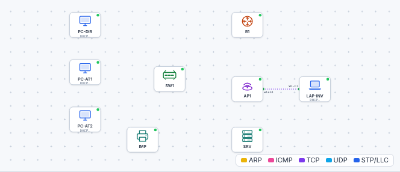

# 🛠️ TP – Produire le dossier d'étude

*Bac Pro CIEL – Première – E31 – S16 – équipe de 2 ou 3, on **échange les rôles** à chaque partie*

> [!NOTE]
> **Mission.** ArchiPlus emménage. Avant la pose, tu dois **étudier** : flux, adressage, VLAN, câblage, matériel. Ton **dossier** sera défendu devant l'enseignant, qui jouera le **client**. Tu n'as **ni câble ni commande** à taper cette séance : tu **réfléchis et tu décides**.
>
> **Temps prévu :** 3 h 30. **Prérequis :** [cahier des charges](../S15-revision-lancement/04-cahier-des-charges.md), [cours S16](01-cours.md).

**Équipe :** ____________ / ____________ / ____________

---

## Partie A – Les flux (≈ 25 min)

1. Complète la **matrice des flux** du [modèle de dossier](03-modele-dossier.md) (§1) d'après le cahier des charges.
2. Pour chaque case **« NON »**, écris **par quel moyen technique** tu vas la bloquer.

❓ **Une question de M. Durand : « Mes invités pourront-ils imprimer ? »** Que réponds-tu, et pourquoi ?

💡 Aide

Relis la ligne « Invités » : seuls le **web** et le **DNS** vers le serveur sont autorisés. L'imprimante est dans le réseau de l'**Atelier** : donc **non**.

## Partie B – Le découpage (≈ 40 min)

1. Estime le **nombre de machines** par service **avec marge** (≈ 30 %), en comptant : les postes, l'imprimante, le serveur, les portables, la passerelle.

| Service | Machines actuelles | Avec marge | + passerelle, diffusion, réseau | Bloc retenu |
|---|---|---|---|---|
| Direction | | | | |
| Atelier | | | | |
| Invités | | | | |

2. **Classe** du plus grand au plus petit et **place** les blocs dans 192.168.50.0/24 (relis le [cours §2](01-cours.md)).
3. Remplis le **plan d'adressage** (§2 du modèle) : réseau, masque, passerelle, **plage DHCP**, **adresses fixes** (serveur, imprimante).

> [!WARNING]
> Les **adresses fixes** (serveur, imprimante, passerelle) doivent être **hors** de la plage DHCP. Sinon : conflit d'adresses.

❓ **Vérification :** deux blocs se chevauchent-ils ? Chaque bloc commence-t-il à un multiple de sa taille ?

## Partie C – Les VLAN et les ports (≈ 30 min)

1. Complète le **plan de ports** (§3 du modèle) pour un switch **24 ports**. Aide-toi de la règle « 8 ports par service ».
2. N'oublie pas les **trois ports du routeur**, et le port de la **borne Wi-Fi**.
3. Quels ports restent **libres** ? Que doit-on en faire (S14) ? ________________

## Partie D – Câblage et schéma (≈ 45 min)

1. Remplis le **tableau de câblage** (§4 du modèle) : un câble par ligne, **étiqueté**.
2. **Dessine** le schéma (papier A3 ou outil). Applique les règles du [cours §4](01-cours.md) : titre, légende, noms, adresses, ports, **zéro croisement**.
3. Ouvre le [simulateur](../../simulateur/simulateur-reseau.html), puis **Ouvre** [`p16-projet-depart.json`](tp/p16-projet-depart.json) : **compare** le matériel posé avec ta liste. **Manque-t-il quelque chose ?** (ne câble rien !)

❓ **Combien de câbles droits** faut-il commander ? ____ (compte-les dans ton tableau).

## Partie E – Matériel et baie (≈ 20 min)

1. Remplis la **liste du matériel** (§5 du modèle) et compare-la au **stock** annoncé dans le cahier des charges.
2. Dessine **la baie** (de haut en bas) : panneau, switch, routeur, serveur. Où mets-tu l'étiquette de chaque équipement ?

---

## Partie F – Revue de conception (≈ 40 min, avec l'enseignant)

L'enseignant (client) te pose les questions suivantes. Prépare tes réponses.

| Question du client | Ta réponse |
|---|---|
| Pourquoi ce découpage ? Est-il extensible ? | |
| Qui peut joindre l'imprimante ? Pourquoi les invités ne le peuvent-ils pas ? | |
| Et si je recrute 5 personnes à l'atelier ? | |
| Que se passe-t-il si le switch tombe en panne ? | |
| Comment retrouver quel câble va où ? | |

### Grille de la revue

| Critère | Acquis | À revoir |
|---|---|---|
| Matrice des flux complète et juste | ☐ | ☐ |
| Découpage : blocs alignés, sans chevauchement, marge justifiée | ☐ | ☐ |
| Plan de VLAN et de ports cohérent | ☐ | ☐ |
| Tableau de câblage complet (étiquettes) | ☐ | ☐ |
| Schéma lisible (légende, noms, adresses, pas de croisement) | ☐ | ☐ |
| Liste du matériel comparée au stock | ☐ | ☐ |
| Réponses aux questions du client | ☐ | ☐ |

> [!TIP]
> **Après la revue**, l'enseignant te donnera le **plan de référence** : compare-le à ton étude et **corrige** ton dossier. Les contrôles automatiques de S17 s'appuient dessus.

## 🛟 Dépannage

| Problème | Piste |
|---|---|
| Je n'arrive pas à placer mes blocs | Commence par le **plus grand**, note ses adresses de début et de fin |
| Mes adresses fixes tombent dans le DHCP | **Exclus-les** ou décale la plage DHCP |
| Mon schéma est illisible | Redessine : un service par **zone** de couleur, pas de liaison qui en traverse une autre |

## 🧭 Passeport d'autonomie

> *Je peux **étudier une installation** : flux, découpage, VLAN, câblage, matériel, sans aide.* ☐ Je sais faire seul ☐ Avec aide ☐ Pas encore
