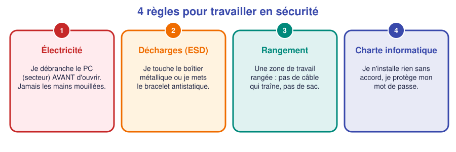
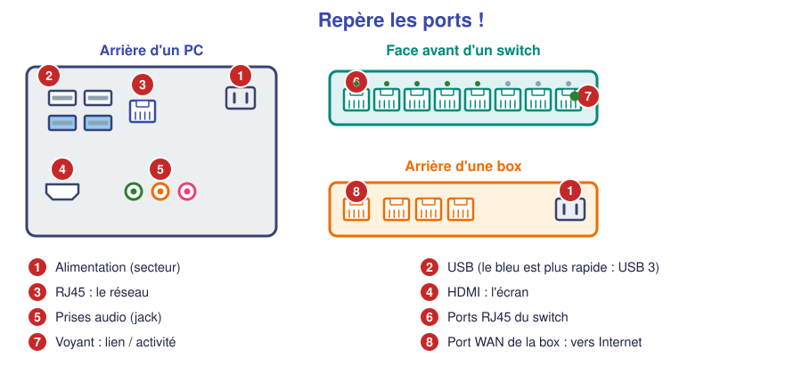

# 📖 Cours – Bienvenue dans le métier

*Bac Pro CIEL – Seconde – E31 – S01*

## 1. Le métier et le module

### 🤔 À ton avis ?

Quand tu envoies un message à un ami, **qu'est-ce qui permet qu'il arrive** ? Cite tout ce que tu penses nécessaire.

Voir une réponse possible

Ton téléphone, une **antenne** ou une **borne Wi-Fi**, une **box**, des **câbles**, des **serveurs**, des **adresses**, des **règles de communication**… Tout ce que **tu ne vois pas** est installé et entretenu par des **techniciens réseau**.

### 💡 Ce que fait un technicien

| Il **installe** | Il **configure** | Il **dépanne** | Il **sécurise** |
|---|---|---|---|
| des postes, des câbles, des prises, des switchs | des adresses, des routeurs, le Wi-Fi | une panne : « je n'ai plus Internet » | des mots de passe, des mises à jour |

**Le module E31** (réseaux informatiques) sert à apprendre ces gestes, **progressivement**, sur **trois ans** :

| Année | Idée |
|---|---|
| **Seconde** | Je deviens **autonome** sur le matériel et le réseau de base |
| **Première** | Je **comprends** ce qui circule et je configure des équipements |
| **Terminale** | Je réalise un **chantier complet** et je rends compte au client |

### Le Passeport d'autonomie

C'est **ta** feuille de route : pour chaque savoir-faire, tu passes de **« vu »** à **« je sais »** puis à **« autonome »** (voir le [Passeport](../../ressources/passeport-autonomie.md)). **On ne te demande pas de savoir tout de suite** : on te demande de **progresser**.

---

## 2. Les règles du plateau technique

### ⚡ Électricité

Un PC branché reste sous tension, même éteint. **Je débranche le câble secteur avant d'ouvrir un boîtier.** Je ne touche jamais des fils dénudés. Je ne branche jamais un équipement avec les mains mouillées.

### ✋ Décharges électrostatiques (ESD)

Tu as déjà reçu une petite décharge en touchant une poignée de porte. Pour toi c'est désagréable ; pour une **carte mère**, c'est **mortel** et **invisible**.

- Je touche **le boîtier métallique** du PC avant de manipuler les composants, ou je porte un **bracelet antistatique** relié à la masse.
- Je tiens les cartes **par les bords**, jamais par les composants ou les contacts dorés.
- Je range les composants dans leur **sachet antistatique** (le sachet argenté).

### 🧹 Rangement

Une zone de travail propre évite les erreurs et les accidents : **pas de sac au sol, pas de câble qui traîne** (risque de chute et de câble arraché), outils **rangés** après usage.

### 📜 Charte informatique

C'est un contrat entre toi et l'établissement : **je n'installe rien sans accord, je ne consulte pas les données des autres, je garde mon mot de passe secret.**

### ✅ Vérifie que tu as compris

**Q1.** Pourquoi doit-on débrancher le PC du secteur **et pas seulement l'éteindre** avant de l'ouvrir ?

Réponse

Parce qu'un PC éteint reste **alimenté en veille** (la carte mère reste sous tension). Une manipulation dedans peut **abîmer** les composants ou **blesser**.

**Q2.** Un élève marche sur de la moquette puis attrape une carte mère. Quel est le risque ?

Réponse

Une **décharge électrostatique** peut **détruire** un composant sans qu'on voie rien. Il fallait toucher le boîtier métallique ou porter un bracelet antistatique.

---

## 3. Les prises et les ports

Un technicien **reconnaît les connecteurs** comme un mécanicien reconnaît les outils. Voici ceux que l'on croise le plus :

| Connecteur | À quoi il sert | À retenir |
|---|---|---|
| **RJ45** | Le **réseau** (câble Ethernet) | Il ressemble à une grosse prise de téléphone, avec un clip |
| **USB** | Clavier, souris, clé, disque… | Bleu = USB 3 (plus rapide) |
| **HDMI** | Image + son vers l'écran | |
| **Prise secteur** | Le courant | |
| **Jack audio** | Casque, micro, haut-parleurs | Vert : sortie ; rose : micro |

**Les voyants d'un port RJ45** (switch ou PC) :

- un voyant **fixe** = le **lien** est établi (câble branché des deux côtés, les deux équipements sont allumés) ;
- un voyant qui **clignote** = des données **circulent**.

### ✅ Vérifie que tu as compris

**Q3.** Sur un switch, un port a son voyant éteint alors qu'un PC y est « branché ». Cite deux causes possibles.

Réponse

Le **câble** est débranché ou **défectueux**, le PC est **éteint**, ou le port est **abîmé**. On commence toujours par vérifier **le câble et les voyants**.

---

## 4. Ce qu'il faut retenir

> [!TIP]
> 1. Un technicien réseau **installe, configure, dépanne et sécurise**.
> 2. Pendant trois ans, tu progresses de **guidé** à **autonome**, avec un **Passeport**.
> 3. **Sécurité d'abord** : je débranche, je décharge l'électricité statique, je range, je respecte la charte.
> 4. Je reconnais les **ports** (RJ45, USB, HDMI, secteur) et je lis les **voyants**.

➡️ **Suite :** les [🛠️ activités](02-tp.md).
