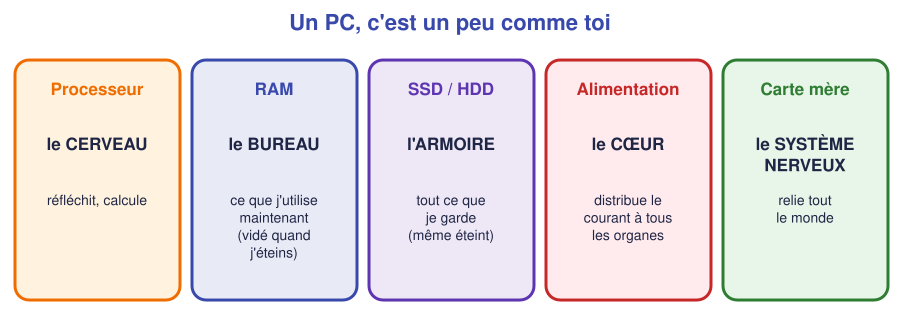
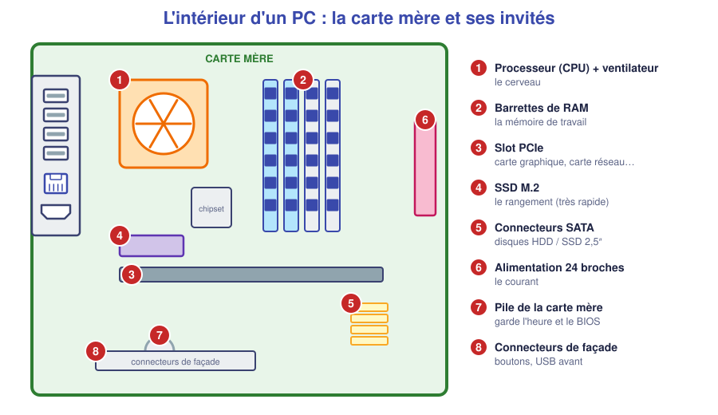
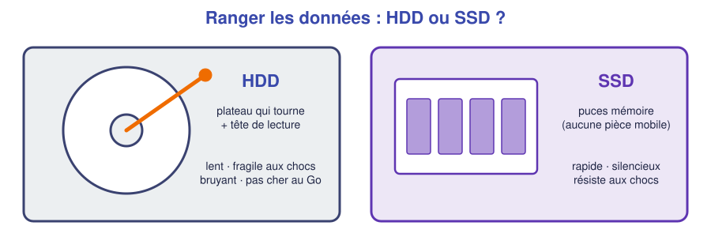

# 📖 Cours – Le PC de l'intérieur

*Bac Pro CIEL – Seconde – E31 – S02*

## 🎯 À la fin de ce cours, tu sauras

- [ ] nommer les 6 pièces principales d'un PC et dire **à quoi elles servent** ;
- [ ] faire la différence entre **RAM** et **stockage** ;
- [ ] expliquer pourquoi un PC a besoin d'une **alimentation** et d'un **ventilateur** ;
- [ ] ouvrir un PC **sans le casser**.

---

## 1. À quoi sert chaque pièce ?

### 🤔 À ton avis ?

Tu écris un devoir sur ton PC. Tu l'**enregistres**, puis tu **éteins brutalement** le PC avant d'avoir enregistré les 5 dernières lignes. **Qu'est-ce qui est perdu, et pourquoi pas le reste ?**

Voir la réponse

Les **5 dernières lignes** sont perdues, car elles n'étaient que dans la **RAM** (mémoire de travail, vidée à l'extinction). Le reste a été **enregistré sur le disque** (SSD/HDD) qui conserve les données **même éteint**.

### 💡 L'idée : un PC par analogie

| Pièce | Rôle | Analogie |
|---|---|---|
| **Processeur (CPU)** | Il **exécute** les instructions et fait les calculs | Le **cerveau** |
| **RAM** | Elle garde ce que l'on **utilise en ce moment** ; **vidée** à l'extinction | Le **bureau** où l'on pose ses dossiers |
| **Stockage (SSD/HDD)** | Il garde les données **durablement** | L'**armoire** |
| **Alimentation** | Elle transforme le courant du secteur en courant adapté | Le **cœur** |
| **Carte mère** | Elle **relie** toutes les pièces entre elles | Le **système nerveux** |
| **Carte réseau** | Elle permet de se **connecter** à un réseau (RJ45 ou Wi-Fi) | La **porte d'entrée** |

> [!TIP]
> **Bureau et armoire :** plus le bureau (RAM) est grand, plus je peux ouvrir de dossiers **à la fois**. Plus l'armoire (SSD) est grande, plus je peux **garder** de dossiers.

### ✅ Vérifie que tu as compris

**Q1.** Un PC est lent quand on ouvre beaucoup d'onglets. Quelle pièce est probablement trop petite ?

Réponse

La **RAM** (le bureau est trop petit pour tout poser).

**Q2.** Un PC est plein : « plus d'espace pour enregistrer des photos ». Quelle pièce est en cause ?

Réponse

Le **stockage** (SSD/HDD) : l'armoire est pleine.

---

## 2. La carte mère et ses « invités »

Tu dois pouvoir retrouver sur une vraie carte mère :

1. **Le processeur** sous son ventilateur (ou radiateur).
2. **La RAM** : barrettes verticales, en général **2 ou 4 emplacements**.
3. **Le slot PCIe** : pour une carte graphique ou une carte réseau supplémentaire.
4. **Le SSD M.2** : petite barrette à plat, vissée.
5. **Les connecteurs SATA** : pour les disques 2,5″ / 3,5″.
6. **L'alimentation** : gros connecteur **24 broches** + connecteur **processeur**.
7. **La pile** (ronde, type CR2032) : elle **garde l'heure** et les réglages du BIOS.
8. **Les connecteurs de façade** : bouton power, voyants, USB avant.

### HDD ou SSD ?

> [!NOTE]
> Un **SSD** n'a **aucune pièce mobile** : il est rapide, silencieux et résiste mieux aux chocs. Un **HDD** coûte moins cher au Go mais est plus lent et plus fragile.

### La ventilation

Un processeur **chauffe**. Sans refroidissement, il ralentit puis s'arrête pour se protéger. Le **ventilateur** et le **radiateur** (avec de la pâte thermique) évacuent la chaleur. **Une poussière accumulée = un PC qui chauffe.**

### ✅ Vérifie que tu as compris

**Q3.** À quoi sert la pile de la carte mère ?

Réponse

À **garder l'heure** et les réglages du BIOS quand le PC est éteint et débranché.

**Q4.** Un PC s'éteint tout seul après 10 minutes d'utilisation, et le ventilateur est couvert de poussière. Quelle est ta piste ?

Réponse

**Surchauffe** : le processeur se protège en coupant le PC. On **nettoie** le ventilateur/radiateur et on vérifie la pâte thermique.

---

## 3. Ouvrir un PC en sécurité

1. **Éteindre** puis **débrancher** le câble secteur (et appuyer sur le bouton power pour vider les condensateurs).
2. Se **décharger** : toucher le boîtier métallique ou mettre le **bracelet antistatique**.
3. Retirer **le panneau latéral** (vis à main ou cruciforme).
4. **Ranger les vis** dans un bac (une vis perdue peut court-circuiter une carte).
5. **Jamais** ouvrir le bloc d'alimentation.
6. Remettre le panneau, rebrancher : **seulement à la fin**.

---

## 4. Ce qu'il faut retenir

> [!TIP]
> 1. **Processeur** (cerveau), **RAM** (bureau, mémoire de travail), **stockage** (armoire), **alimentation** (cœur), **carte mère** (système nerveux).
> 2. RAM = **temporaire** ; SSD/HDD = **durable**.
> 3. **Débrancher et se décharger** avant d'ouvrir.
> 4. La **chaleur** est l'ennemi : ventilation et poussière.

### 📖 Vocabulaire

| Mot | Définition |
|---|---|
| **Carte mère** | Circuit principal sur lequel tout se branche |
| **CPU** | Processeur |
| **RAM** | Mémoire vive, temporaire |
| **SSD / HDD** | Stockage rapide sans pièce mobile / stockage à plateaux |
| **PCIe** | Connecteur pour cartes d'extension |
| **Alimentation** | Bloc qui fournit le courant adapté |

➡️ **Suite :** le [🛠️ TP autopsie d'un PC](02-tp.md).
