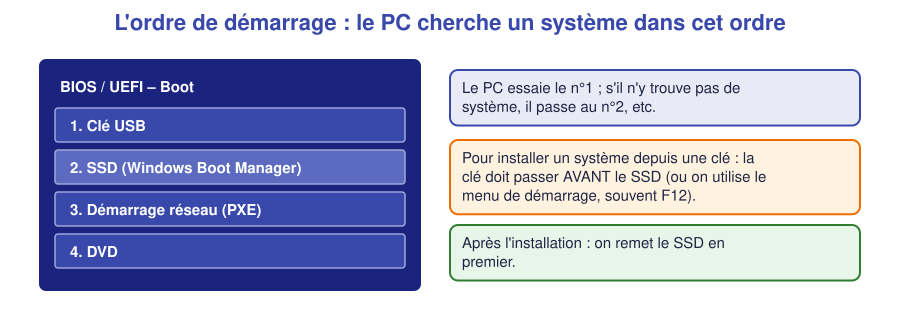
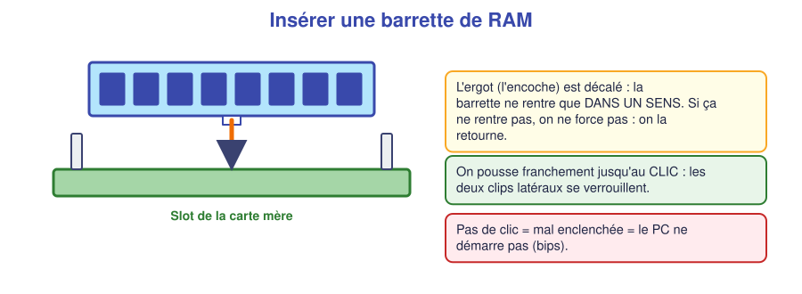
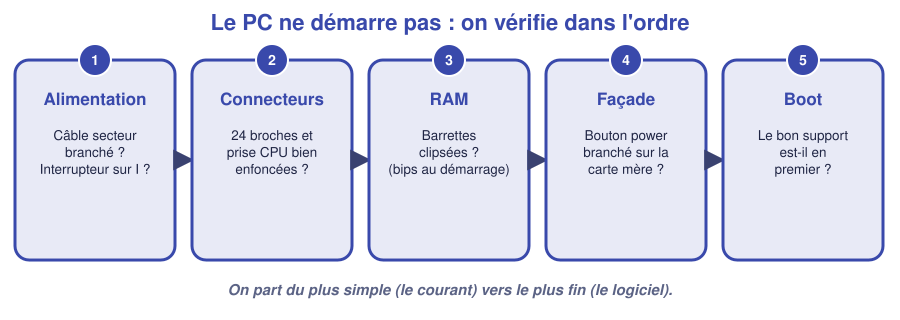

# 📖 Cours – Faire démarrer un PC

*Bac Pro CIEL – Seconde – E31 – S03*

## 🎯 À la fin de ce cours, tu sauras

- [ ] décrire ce qui se passe entre « j'appuie sur le bouton » et « Windows s'affiche » ;
- [ ] expliquer ce qu'est le **BIOS / UEFI** et à quoi il sert ;
- [ ] changer l'**ordre de démarrage** et **régler la date** ;
- [ ] **diagnostiquer** un PC qui ne démarre pas, dans l'ordre.

---

## 1. Que se passe-t-il quand on appuie sur le bouton ?

### 🤔 À ton avis ?

Le PC est **éteint**, le disque contient Windows. Tu appuies sur le bouton. **Qui lance Windows ?** Windows ne peut pas se lancer **lui-même** : il n'est pas encore démarré.

Voir la réponse

C'est un **petit programme gravé sur la carte mère** qui s'exécute en premier : le **BIOS** (ou son successeur, l'**UEFI**). Il vérifie le matériel puis **cherche un système** à lancer.

### 💡 L'idée : le démarrage en 5 temps

> *Analogie :* le BIOS est le **concierge** qui ouvre l'immeuble, allume les lumières et vérifie que tout est en place, **avant** que les locataires (Windows, programmes) n'arrivent.

### 🧠 Retiens

> [!TIP]
> **BIOS / UEFI** = premier programme du PC. Il **teste** le matériel, **garde** quelques réglages (heure, ordre de démarrage) grâce à la **pile**, et **lance** le système.

### ✅ Vérifie que tu as compris

**Q1.** Pourquoi la date du PC se remet à zéro quand la pile est vide ?

Réponse

Parce que la **pile** alimente la petite mémoire qui garde l'heure et les réglages du BIOS quand le PC est débranché.

**Q2.** Un PC affiche « No operating system found ». Que sais-tu déjà ?

Réponse

Le **BIOS fonctionne** (il affiche un message), mais il **ne trouve pas de système** : mauvais ordre de démarrage, disque non branché, ou pas de système installé.

---

## 2. Entrer dans le BIOS / UEFI

Au tout début du démarrage, **avant** Windows, il faut **taper plusieurs fois** sur une touche : souvent `Suppr`, `F2`, `F10`, `F12` ou `Échap` selon la marque. Elle s'affiche à l'écran **pendant 1-2 secondes**.

| Je veux… | Je cherche dans le BIOS… |
|---|---|
| Lire les caractéristiques | Page **Main / Information** : processeur, RAM, stockage, version |
| Régler l'heure | **Date / Time** |
| Changer ce qui démarre en premier | Page **Boot** (Ordre de démarrage / Boot priority) |
| Enregistrer et sortir | **Save and Exit** (souvent `F10`) |

> [!WARNING]
> **On ne change pas au hasard** les réglages du BIOS : une mauvaise valeur peut empêcher le PC de démarrer. **On note** ce qu'on change pour pouvoir **revenir en arrière**.

### ✅ Vérifie que tu as compris

**Q3.** Pour installer un système depuis une clé USB, que faut-il changer ?

Réponse

L'**ordre de démarrage**, pour que la **clé USB** passe **avant** le disque (ou utiliser le menu de démarrage rapide).

---

## 3. Remonter un PC sans rien oublier

### 📸 Avant de démonter

**Prends une photo** de l'intérieur. Tu pourras la consulter si tu hésites au remontage.

### 🔧 Les gestes

| Élément | Geste | Piège à éviter |
|---|---|---|
| **RAM** | Aligner l'**encoche**, pousser **jusqu'au clic** des deux clips | Mal enclenchée : bips, pas d'image |
| **SSD M.2** | Insérer **en biais**, rabattre, **visser** | Oublier la vis : la barrette se soulève |
| **Alimentation** | **24 broches** + connecteur **CPU** + SATA | Connecteur CPU oublié : pas de démarrage |
| **Façade** | Bouton power, voyants, USB | Mauvaise polarité : voyant éteint |
| **Ventilateur** | Branché sur le connecteur **FAN** | Non branché : surchauffe |

---

## 4. Le PC ne démarre pas : on vérifie dans l'ordre

1. **Alimentation** : câble secteur branché ? interrupteur de l'alimentation sur **I** ?
2. **Connecteurs** : 24 broches et connecteur CPU bien enfoncés ?
3. **RAM** : barrettes clipsées ? (des **bips** au démarrage peuvent l'indiquer)
4. **Façade** : le bouton power est-il branché sur la carte mère ?
5. **Boot** : le bon support est-il en **premier** ?

> [!TIP]
> **Méthode du technicien :** on part du **plus simple** (le courant) vers le **plus fin** (le logiciel). On change **une seule chose à la fois** et on **teste après chaque changement**.

### ✅ Vérifie que tu as compris

**Q4.** Le PC ne montre aucun signe de vie (aucun voyant, aucun ventilateur). Quelles sont les **deux premières** vérifications ?

Réponse

1) Le **câble secteur** est-il branché et la prise alimentée ? 2) L'**interrupteur de l'alimentation** est-il sur « I » ?

**Q5.** Pourquoi ne change-t-on qu'**une seule chose à la fois** pendant un dépannage ?

Réponse

Pour **savoir ce qui a corrigé** (ou **aggravé**) le problème. Si on change trois choses et que ça marche, on ne sait pas laquelle était la cause.

---

## 5. Ce qu'il faut retenir

> [!TIP]
> 1. **BIOS / UEFI** : premier programme, il teste le matériel et lance le système.
> 2. On y règle **l'heure** et **l'ordre de démarrage** ; on **note** chaque changement.
> 3. Remontage : **photo avant**, **clic** pour la RAM, **tous les connecteurs** d'alimentation.
> 4. Panne : du **simple** au **fin**, **une chose à la fois**.

### 📖 Vocabulaire

| Mot | Définition |
|---|---|
| **BIOS / UEFI** | Programme de démarrage de la carte mère |
| **Boot / ordre de démarrage** | Liste des supports où chercher un système |
| **POST** | Test du matériel fait au démarrage (les bips) |
| **Pile CMOS** | Pile qui garde l'heure et les réglages |

➡️ **Suite :** le [🛠️ TP démonter, remonter, démarrer](02-tp.md).
