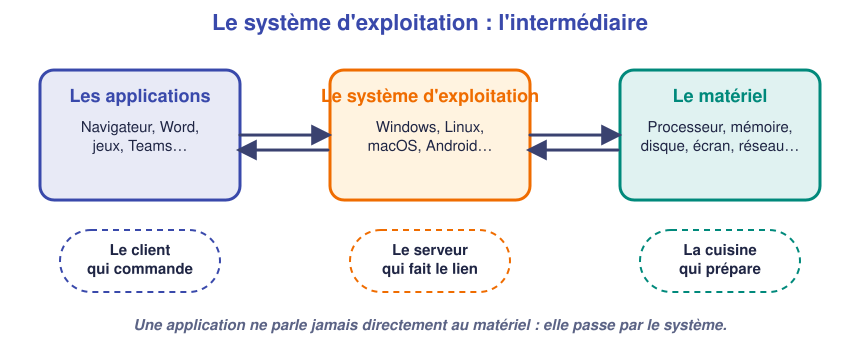
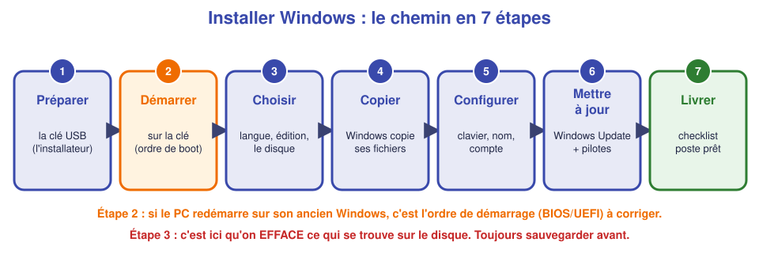
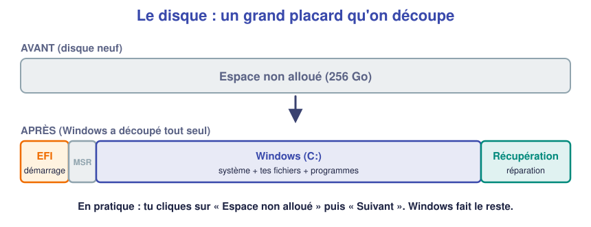
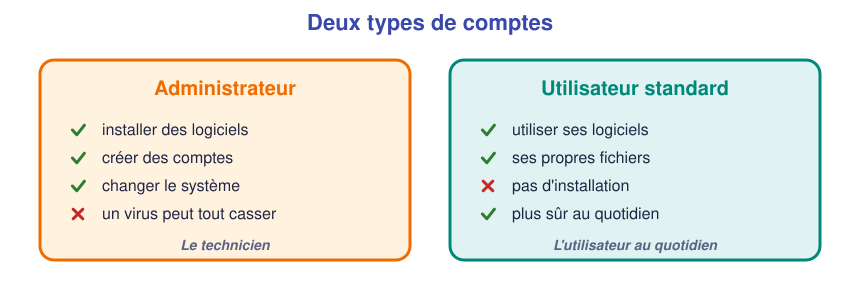
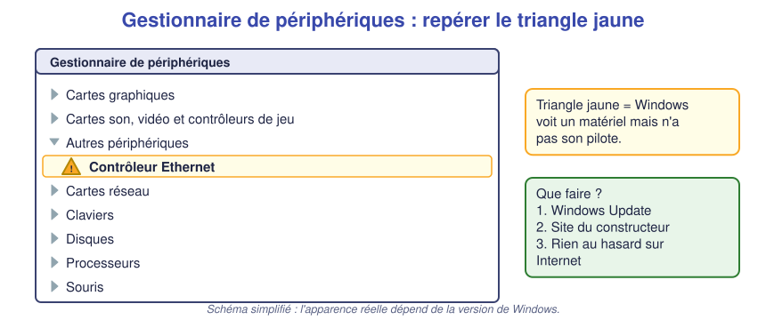
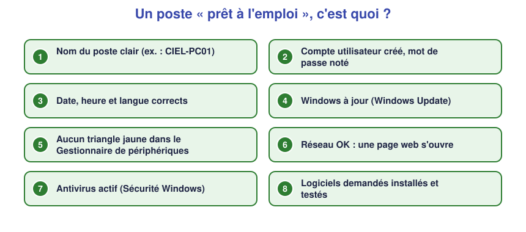

# 📖 Cours – Le système d'exploitation et l'installation de Windows

*Bac Pro CIEL – Seconde – E31 – S04*

> [!IMPORTANT]
> **Comment utiliser ce cours ?** Tu ne le lis pas d'une traite. Tu avances **une idée à la fois** : tu lis, tu essaies de répondre à la question **avant** de déplier la réponse, puis tu passes à la suite. Si tu ne sais pas répondre, c'est normal : c'est justement là que tu apprends.

## 🎯 À la fin de ce cours, tu sauras

- [ ] dire à quoi sert un système d'exploitation, **avec tes mots** ;
- [ ] citer dans l'ordre les grandes étapes d'une installation de Windows ;
- [ ] expliquer pourquoi l'installation **efface** le disque ;
- [ ] distinguer un compte administrateur d'un compte utilisateur ;
- [ ] expliquer ce qu'est un **pilote** et ce que veut dire un triangle jaune ;
- [ ] énumérer ce qu'on vérifie avant de rendre un poste.

---

## 1. À quoi sert un système d'exploitation ?

### 🤔 Avant de lire : à ton avis ?

Tu as un PC avec un processeur, de la mémoire, un disque, un écran, un clavier. Tout est branché, tout est neuf. Tu l'allumes.

**Question :** que s'affiche-t-il à l'écran, et pourquoi ?

Voir la réponse

Presque rien d'utile : un message du BIOS / UEFI, puis « *No operating system found* » (aucun système trouvé). Le matériel sait **faire** des choses (calculer, stocker, afficher), mais **personne ne lui dit quoi faire**. Il manque le chef d'orchestre : le **système d'exploitation**.

### 💡 L'idée

Le **système d'exploitation** (en anglais *operating system*, **OS**) est le logiciel principal de l'ordinateur. Il fait le **lien** entre les programmes que tu utilises (navigateur, traitement de texte…) et le matériel (processeur, mémoire, disque…).

**L'analogie du restaurant** :

| Au restaurant | Dans l'ordinateur |
|---|---|
| Le **client** commande un plat | L'**application** demande « enregistre ce fichier » |
| Le **serveur** prend la commande, la transmet, rapporte le plat | Le **système d'exploitation** transmet la demande et rapporte le résultat |
| La **cuisine** prépare le plat | Le **matériel** (disque, processeur) fait le travail |

Un client n'entre jamais dans la cuisine. De la même façon, un programme ne parle **jamais directement** au disque ou à la carte réseau : il passe par le système.

### 🧠 Retiens

> [!TIP]
> Un système d'exploitation **fait fonctionner le matériel** et **permet aux programmes de s'en servir**. Exemples : **Windows**, **Linux**, **macOS** (ordinateurs), **Android**, **iOS** (téléphones).

### ✅ Vérifie que tu as compris

**Q1.** Ton téléphone est-il un ordinateur avec un système d'exploitation ?

Réponse

Oui. Il tourne sous **Android** ou **iOS**. Mêmes principes : applications au-dessus, système au milieu, matériel (écran tactile, batterie, antenne) en dessous.

**Q2.** Complète : « Word demande au ______ d'enregistrer le fichier sur le ______. »

Réponse

« Word demande au **système d'exploitation** d'enregistrer le fichier sur le **disque** (SSD). »

**Q3.** Explique avec tes mots, à quelqu'un qui n'y connaît rien : *« À quoi sert Windows ? »* Écris ta phrase ici : ______________________________

---

## 2. Avant d'installer : ce qu'il faut préparer

### 🤔 Avant de lire : à ton avis ?

Pour installer Windows sur un PC vide, il faut apporter Windows d'une façon ou d'une autre. **Comment le faire entrer dans la machine, alors que la machine n'a encore aucun système pour lire quoi que ce soit ?**

Voir la réponse

On **démarre l'ordinateur directement depuis une clé USB** (ou un DVD) qui contient un petit programme d'installation. Ce n'est pas le système d'exploitation qui lit la clé : c'est le **BIOS / UEFI** (le tout premier programme du PC, vu en S03) qui sait démarrer sur un autre support que le disque.

### 💡 L'idée : trois choses à préparer

| Quoi | Pourquoi | Qui s'en occupe |
|---|---|---|
| **Une clé d'installation** (ou un fichier ISO) | C'est le « Windows livré dans une boîte » | Fournie / préparée avec l'outil de Microsoft |
| **L'ordre de démarrage** (BIOS / UEFI) | Le PC doit regarder **la clé USB avant le disque** | Toi, avec la touche du constructeur (souvent `F12`, `F2`, `Échap` ou `Suppr`) |
| **Une sauvegarde** de ce qui compte | L'installation **efface** le disque (voir plus bas) | Toi, **avant** de commencer |

> [!WARNING]
> **Règle d'or du technicien :** *on ne touche jamais au disque d'un client sans avoir vérifié qu'il a sauvegardé ses données.* Quand tu choisis le disque dans l'installateur, tu décides ce qui est effacé.

### 🧠 Retiens

> [!TIP]
> Pour installer : **clé prête → ordre de démarrage sur la clé → installateur → sauvegarde faite avant**.

### ✅ Vérifie que tu as compris

**Q4.** Le PC redémarre et réaffiche son ancien Windows au lieu de l'installateur. Quelle est la cause la plus probable, et que fais-tu ?

Réponse

Le PC démarre toujours sur le **disque** en premier. On retourne dans le **BIOS / UEFI** (ou on ouvre le menu de démarrage rapide) pour choisir la **clé USB** en premier.

**Q5.** Pourquoi doit-on sauvegarder **avant** et pas après l'installation ?

Réponse

Parce que l'installateur peut **effacer** la partition qui contenait les fichiers. Après, il est trop tard (ou très compliqué).

---

## 3. Les étapes de l'installation

**Le film en quelques mots :**

1. **Préparer** la clé d'installation.
2. **Démarrer** le PC sur la clé (ordre de démarrage).
3. **Choisir** la langue, le clavier, l'édition (par exemple *Pro*) et **le disque** où installer.
4. **Copier** : Windows copie ses fichiers et redémarre plusieurs fois, tout seul. **On n'éteint pas le PC.** C'est long, c'est normal.
5. **Configurer** : région, clavier, nom du poste, compte utilisateur.
6. **Mettre à jour** : Windows Update, pilotes.
7. **Livrer** : on vérifie tout avec une checklist.

### 🧩 Le disque et les partitions

Avant d'installer, tu choisis **où** Windows va s'installer. Un disque se découpe en **partitions**, un peu comme on cloisonne un grand placard en plusieurs compartiments.

- Sur un disque **neuf**, l'installateur affiche *« Espace non alloué »* : tu le sélectionnes et tu cliques sur **Suivant**. Windows crée ses compartiments tout seul.
- Sur un disque **déjà utilisé**, tu verras plusieurs partitions. **Supprimer** une partition = **effacer** son contenu.

### ✅ Vérifie que tu as compris

**Q6.** Pendant la copie des fichiers, l'écran reste noir pendant 2 minutes. Que fais-tu ?

Réponse

**Rien.** On attend. Couper l'alimentation en pleine installation peut laisser un Windows à moitié installé, à recommencer entièrement. Un technicien patient est un bon technicien.

**Q7.** Remets dans l'ordre : *Copier les fichiers – Démarrer sur la clé – Mettre à jour – Choisir le disque.*

Réponse

1. Démarrer sur la clé → 2. Choisir le disque → 3. Copier les fichiers → 4. Mettre à jour.

---

## 4. Après l'installation : comptes, pilotes, mises à jour

### 4.1 Les comptes

- Le **compte administrateur** peut **tout** modifier (installer, supprimer, changer les réglages).
- Le **compte standard** peut **utiliser** le poste, mais pas changer le système.

**Pourquoi ne pas donner à tout le monde un compte administrateur ?** Réfléchis une minute.

Voir la réponse

Parce qu'un **virus** ou une **mauvaise manipulation** peut alors tout casser : un programme lancé par un compte administrateur a **tous les droits**. Avec un compte standard, les dégâts restent limités. C'est le principe du **moindre privilège** : donner à chacun **juste** ce dont il a besoin.

> [!NOTE]
> Un **mot de passe** se choisit long (12 caractères et plus), unique, et se **note dans un endroit sûr** (gestionnaire de mots de passe, ou feuille remise au responsable). Un compte sans mot de passe est une porte ouverte.

### 4.2 Les pilotes

Un **pilote** (*driver* en anglais) est un petit logiciel qui **explique au système comment parler à un matériel précis** : carte réseau, carte graphique, imprimante…

> *Analogie :* le système d'exploitation parle français ; la carte réseau parle sa propre langue. Le **pilote est l'interprète**.

Sans pilote, le matériel est **vu** mais **inutilisable** (par exemple : pas d'Internet parce que la carte réseau n'est pas reconnue).

Dans Windows, l'outil pour les surveiller est le **Gestionnaire de périphériques** (clic droit sur le bouton **Démarrer** → *Gestionnaire de périphériques*).

**Comment réparer un triangle jaune, dans l'ordre :**

1. Lancer **Windows Update** (il trouve souvent le bon pilote).
2. Sinon, aller sur le **site du constructeur** du PC ou du composant, avec le **modèle exact**.
3. **Jamais** de site « pilote gratuit » trouvé au hasard : c'est une porte d'entrée pour les virus.

### 4.3 Les mises à jour

Un Windows **non mis à jour** contient des failles de sécurité connues de tous. Les mises à jour :

- **corrigent** des failles et des bugs ;
- **ajoutent** des pilotes et des fonctions ;
- demandent parfois **un redémarrage** : on le fait.

### ✅ Vérifie que tu as compris

**Q8.** Un PC neuf n'a pas Internet après l'installation. Dans le Gestionnaire de périphériques, tu vois « Contrôleur Ethernet » avec un triangle jaune. Explique ce qui se passe, puis dis comment tu pourrais régler le problème **sans Internet**.

Réponse

Windows **voit** la carte réseau mais n'a **pas son pilote** : sans pilote, pas de connexion. Sans Internet, on **télécharge le pilote sur un autre ordinateur** (site du constructeur, modèle exact), on le met sur **une clé USB**, puis on l'installe sur le PC. Puis Windows Update pourra faire le reste.

**Q9.** Un utilisateur te demande « le mot de passe administrateur du poste pour installer un jeu ». Que réponds-tu ?

Réponse

Qu'on **ne donne pas** l'accès administrateur à un utilisateur standard : c'est le technicien (ou le responsable) qui installe les logiciels **autorisés**. On explique poliment que c'est pour **protéger son poste et ceux de l'entreprise**.

---

## 5. Connaître sa machine : l'identité du poste

Un technicien doit pouvoir répondre en 30 secondes à : *« Quel Windows ? Quel processeur ? Combien de mémoire ? »*

| Je veux savoir… | Où le trouver ? |
|---|---|
| La version de Windows | `Windows` + `R`, taper `winver`, `Entrée` |
| Processeur, mémoire, nom du PC | **Paramètres → Système → À propos de** |
| Tout le détail (matériel, système) | `Windows` + `R`, taper `msinfo32`, `Entrée` |
| L'espace disque | **Explorateur de fichiers → Ce PC** |
| Le détail complet en **une commande** | `systeminfo` dans l'invite de commandes |

> [!EXAMPLE]+ 🚀 Pour aller plus loin : réparer les fichiers système
> Un Windows qui plante ou qui affiche des erreurs étranges a parfois des **fichiers système abîmés**. En invite de commandes **administrateur**, `sfc /scannow` les **vérifie** et répare ceux qu'il peut. Compte une dizaine de minutes.

---

## 6. Livrer un poste « prêt à l'emploi »

Un poste n'est **pas prêt** parce qu'il démarre. Il est prêt quand **les 8 points** sont cochés. C'est la **checklist** : elle évite d'oublier quelque chose et prouve ton travail.

---

## 7. Ce qu'il faut retenir

> [!TIP]
> 1. Le **système d'exploitation** relie les applications au matériel (serveur de restaurant).
> 2. On installe en **démarrant sur une clé** ; l'installation **efface** ce qu'on choisit d'effacer : **sauvegarde d'abord**.
> 3. Après l'installation : **comptes** (admin ≠ standard), **pilotes** (triangle jaune), **mises à jour**.
> 4. On **livre** un poste avec une **checklist**.

### 📖 Vocabulaire

| Mot | Définition simple |
|---|---|
| **Système d'exploitation (OS)** | Logiciel principal qui fait fonctionner le matériel et les programmes |
| **BIOS / UEFI** | Premier programme du PC, lancé avant le système ; règle l'ordre de démarrage |
| **ISO** | Fichier qui contient une copie complète d'un disque d'installation |
| **Partition** | Compartiment d'un disque |
| **Pilote (driver)** | Logiciel qui permet au système d'utiliser un matériel précis |
| **Compte administrateur** | Compte qui peut tout modifier sur le poste |
| **Windows Update** | Service qui télécharge les mises à jour de Windows |

### 🧪 Auto-évaluation (réponds sans regarder)

| Je sais… | 😟 | 🙂 | 😀 |
|---|---|---|---|
| expliquer le rôle d'un OS avec mes mots | | | |
| citer les étapes d'une installation | | | |
| dire pourquoi on sauvegarde avant | | | |
| expliquer un triangle jaune | | | |
| dire pourquoi on évite un compte admin au quotidien | | | |

---

➡️ **Suite :** passe au [🛠️ TP guidé](02-tp.md) pour installer Windows pour de vrai.
