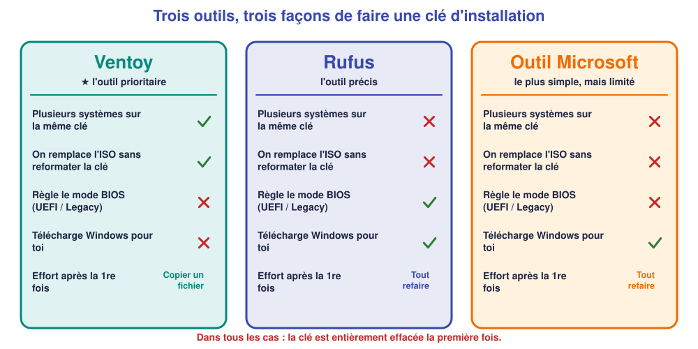
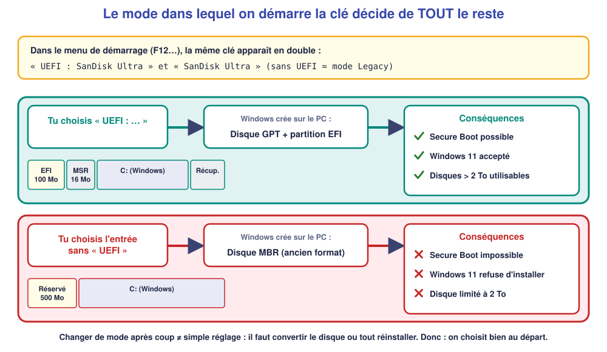
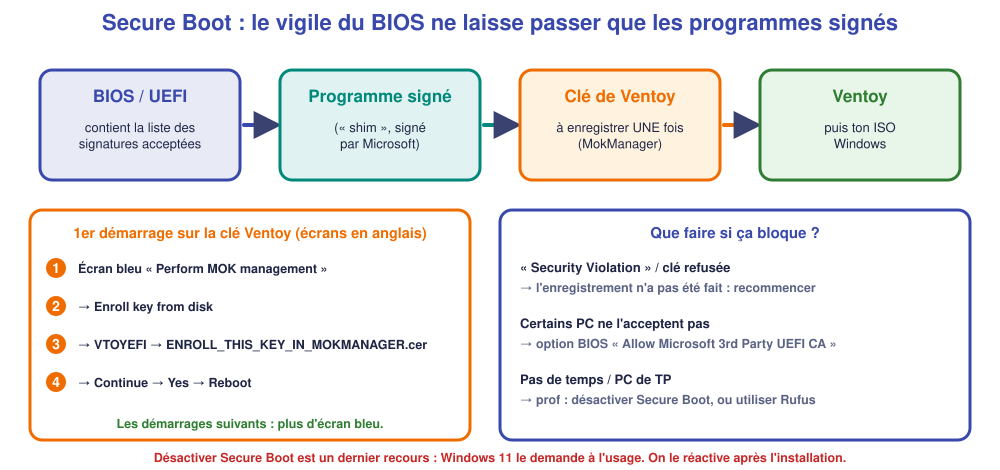

# 💾 Fiche – Créer une clé USB d'installation : choisir son outil et comprendre le BIOS

*Bac Pro CIEL – Seconde – S04 – fiche de référence (à lire **avant** les fiches [Ventoy](05-fiche-ventoy.md), [Rufus](06-fiche-rufus.md) et [outil Microsoft](07-fiche-microsoft.md))*

> [!NOTE]
> **Versions de référence (vérifiées le 2 novembre 2026)** : Ventoy **1.1.18** (9 octobre 2026) · Rufus **4.15** (juin 2026) · Windows **11 25H2** via l'outil de création de média Microsoft. Les numéros changent souvent : sur le site de chaque outil, **prends toujours la dernière version** et note celle que tu as utilisée dans ta fiche d'identité du PC.

## 1. Pourquoi une « clé bootable » ?

Un fichier **ISO** est une « photocopie » d'un DVD d'installation. On ne peut pas simplement **copier** un ISO sur une clé et espérer que le PC démarre dessus : le BIOS / UEFI cherche sur la clé un **secteur de démarrage** et une **structure de dossiers** bien précise. Un **outil** prépare la clé pour qu'elle soit reconnue : c'est ce qu'on appelle rendre la clé **bootable** (*to boot* = démarrer).

> [!WARNING]
> **Tous les outils effacent la clé au moment de la préparer.** Avant de cliquer : vérifier qu'il n'y a **rien à garder** dessus, et que le périphérique choisi est bien **la clé** (lettre **et** taille), jamais le disque du PC.

## 2. Quel outil choisir ?

| Question | **Ventoy** ★ | **Rufus** | **Outil Microsoft** |
|---|---|---|---|
| Je veux **plusieurs systèmes** sur la même clé (Windows, Linux, outils de dépannage) | ✅ | ❌ | ❌ |
| Je veux **changer d'ISO** sans reformater | ✅ (copier / supprimer un fichier) | ❌ (tout refaire) | ❌ |
| Je veux **choisir précisément le mode BIOS** (GPT/MBR, UEFI/Legacy) | Partiellement (à l'installation de Ventoy) | ✅ | ❌ |
| Je n'ai **pas encore l'ISO** | ❌ (il faut le télécharger) | ✅ (peut le télécharger) | ✅ (télécharge pour toi) |
| Il faut **Windows 11 officiel, sans réglage** | ✅ | ✅ | ✅ |
| Je dois **installer sur un vieux PC** non compatible Windows 11 | ✅ (avec un autre système ou Windows 10) | ✅ (réglages possibles) | ❌ |
| Il faut **Secure Boot** activé | ✅ mais **enregistrer la clé** au 1er démarrage | ✅ (FAT32) | ✅ |

**En atelier, on retient :**

1. **Ventoy** : l'outil à connaître en priorité. On le prépare **une seule fois**, ensuite on **dépose** les ISO comme des fichiers.
2. **Rufus** : quand on veut **maîtriser** le mode BIOS ou **personnaliser** l'installation de Windows.
3. **Outil Microsoft** : le plus simple pour **un seul Windows 11**, sans rien régler.

## 3. Ce que le BIOS / UEFI fait de ta clé

C'est **la partie la plus importante** : un mauvais choix ne se voit pas à la création de la clé, mais **à l'installation**, ou même **après**.

### 3.1 UEFI ou Legacy (CSM) : deux façons de démarrer

| | **UEFI** (moderne, depuis ~2012) | **Legacy / CSM** (ancien « BIOS ») |
|---|---|---|
| Disque du PC | **GPT** | **MBR** |
| Secure Boot | ✅ possible | ❌ impossible |
| Windows 11 | ✅ exigé | ❌ refusé |
| Taille maximale d'un disque | > 2 To | **2 To** |
| Où le voit-on ? | Menu de démarrage : « **UEFI : SanDisk…** » | Menu de démarrage : « SanDisk… » (sans UEFI) |

> [!IMPORTANT]
> **La règle à retenir.** *Le mode dans lequel tu démarres la clé est le mode dans lequel Windows s'installe.* Si tu démarres la clé en **Legacy**, Windows crée un disque **MBR** : **sans Secure Boot, et incompatible Windows 11**. Pour passer ensuite à UEFI, il faut **convertir le disque** (outil `mbr2gpt`) ou **réinstaller**. Donc : **dans le menu de démarrage, on choisit toujours l'entrée qui commence par « UEFI : »**.

### 3.2 GPT ou MBR : le choix à faire dans Rufus (ou Ventoy)

C'est le **plan du disque de la clé**. Règle simple, pour un PC d'atelier :

| Le PC de destination… | Schéma de la clé | Système cible |
|---|---|---|
| est **récent** (≥ 2015) et démarre en **UEFI** | **GPT** | UEFI (non CSM) |
| est **ancien** ou on ne sait pas | **MBR** | BIOS (ou UEFI-CSM) – démarre en UEFI **et** en Legacy |

> [!TIP]
> **Dans le doute : MBR avec Ventoy**, car la clé démarre dans les **deux** modes. C'est ensuite **ton choix dans le menu de démarrage** (entrée « UEFI : … ») qui décide du mode d'installation.

### 3.3 Secure Boot : le vigile du démarrage

**Secure Boot** est une option de l'UEFI qui **n'accepte de démarrer que des programmes signés** par une autorité reconnue (Microsoft, constructeurs…). Cela empêche un virus de se glisser au démarrage.

| Situation | Conséquence |
|---|---|
| Secure Boot **activé** + clé **Rufus FAT32** ou **outil Microsoft** | ✅ démarre sans rien faire (fichiers signés par Microsoft) |
| Secure Boot activé + clé **Ventoy** | ✅ mais **1er démarrage** : enregistrer la clé de Ventoy (écran bleu *MOK management*) |
| Secure Boot activé + clé **Rufus NTFS** (partition UEFI:NTFS) | ⚠️ peut être **refusée** (« Security Violation ») |
| Secure Boot **désactivé** | ✅ tout démarre, mais **Windows 11** le demande pour fonctionner normalement : **le réactiver après l'installation** |

> [!NOTE]
> **Certificats Secure Boot 2011 → 2023.** Les certificats Microsoft d'origine (2011) arrivent en fin de vie à partir de **juin 2026** et sont remplacés par de nouveaux (2023), via **Windows Update** et les mises à jour du **BIOS**. Un PC **ancien et jamais mis à jour** continue de démarrer normalement avec ses certificats actuels. Si un PC **récent** refuse une clé d'installation récente : **mettre à jour le BIOS**, vérifier **Windows Update**, et **prévenir l'enseignant** plutôt que de désactiver Secure Boot sans réfléchir.

### 3.4 Le système de fichiers de la clé : FAT32, exFAT ou NTFS

| Système de fichiers | Taille max. d'un fichier | Démarre en UEFI ? | Avec qui |
|---|---|---|---|
| **FAT32** | **4 Go** | ✅ directement (tous les PC UEFI) | Outil Microsoft, Rufus (par défaut) |
| **NTFS** | illimitée | ⚠️ seulement avec une petite partition d'aide **UEFI:NTFS** | Rufus (au choix) |
| **exFAT** | illimitée | ⚠️ via le programme de démarrage propre à **Ventoy** | Ventoy (par défaut) |

> [!NOTE]
> **Pourquoi 4 Go compte.** Le fichier `install.wim` de Windows 11 dépasse **4 Go** : il ne tient pas **tel quel** sur du FAT32. Rufus et l'outil Microsoft le **découpent automatiquement** en morceaux (`install.swm`) ; Ventoy, lui, utilise de l'exFAT et n'a pas ce problème.

### 3.5 Le menu de démarrage et l'ordre de démarrage

| Réglage | Effet | À utiliser quand |
|---|---|---|
| **Menu de démarrage ponctuel** (`F12`, `F11`, `Échap`, `F9`…) | Démarre **une fois** sur la clé, sans rien modifier | ✅ **Cas normal** en atelier |
| **Ordre de démarrage** (dans le BIOS : `F2`, `Suppr`…) | Change l'ordre **pour toujours** | Quand le menu ponctuel n'existe pas |

> [!TIP]
> **Touches courantes** : Dell `F12` · HP `F9` (ou `Échap`) · Lenovo `F12` (ou `Entrée` puis `F12`) · Acer `F12` · ASUS `F8` / `Échap` · MSI `F11`. Sur un PC **récent avec démarrage rapide** de Windows, il faut parfois **redémarrer depuis Windows en maintenant `Maj`** (Redémarrer + `Maj`) → *Utiliser un périphérique*.

## 4. ✅ Check-list « avant de créer la clé »

- [ ] J'ai une clé **≥ 8 Go** (≥ 16 Go pour Ventoy avec plusieurs ISO) **sans données à garder**.
- [ ] Je sais sur **quel PC** je vais installer : **UEFI** ou ancien ? Windows **11** ou 10 ?
- [ ] J'ai choisi mon outil : Ventoy ★, Rufus ou outil Microsoft.
- [ ] Je note **la version** de l'outil et de Windows utilisée.

## 5. 🧩 Questions pour vérifier

**Q1.** Pourquoi ne peut-on pas simplement copier le fichier ISO sur une clé pour installer ?

Voir la réponse

Le BIOS / UEFI a besoin d'un **secteur de démarrage** et d'une **structure de fichiers** précise sur la clé. L'outil prépare cela ; une simple copie ne suffit pas.

**Q2.** Dans le menu de démarrage, ta clé apparaît deux fois : « UEFI : SanDisk » et « SanDisk ». Laquelle choisis-tu pour installer Windows 11 et pourquoi ?

Voir la réponse

**« UEFI : SanDisk »**. Windows s'installe **dans le mode** où l'installateur a démarré : UEFI donne un disque **GPT**, indispensable pour **Secure Boot** et **Windows 11**. L'autre entrée (Legacy) donnerait un disque MBR.

**Q3.** Un collègue a installé Windows en Legacy sur un PC récent. Que se passe-t-il quand il veut passer à Windows 11 ?

Voir la réponse

Windows 11 exige **UEFI + Secure Boot** donc un disque **GPT**. Le disque étant en MBR, il faut **le convertir** (outil `mbr2gpt`) puis changer le mode du BIOS, ou **réinstaller** proprement.

**Q4.** Pourquoi Windows 11 ne tient pas « tel quel » sur une clé FAT32 ?

Voir la réponse

Le fichier `install.wim` dépasse **4 Go**, la taille maximale d'un fichier en **FAT32**. Il faut le **découper** (Rufus, outil Microsoft) ou utiliser un autre système de fichiers (Ventoy : exFAT).

**Q5.** Ton PC refuse de démarrer sur ta clé Ventoy et affiche « Security Violation ». Quelle est la cause la plus probable ?

Voir la réponse

**Secure Boot** est activé et la **clé de Ventoy n'a pas été enregistrée** (étape *MOK management* du premier démarrage). On recommence l'enregistrement, ou on **demande à l'enseignant**.

---

**Suite :** [Fiche Ventoy ★](05-fiche-ventoy.md) · [Fiche Rufus](06-fiche-rufus.md) · [Fiche outil Microsoft](07-fiche-microsoft.md) · retour au [TP](02-tp.md)

*Sources : [ventoy.net](https://www.ventoy.net/en/index.html) · [Rufus](https://rufus.ie/) · [Microsoft – Télécharger Windows 11](https://www.microsoft.com/fr-fr/software-download/windows11).*
