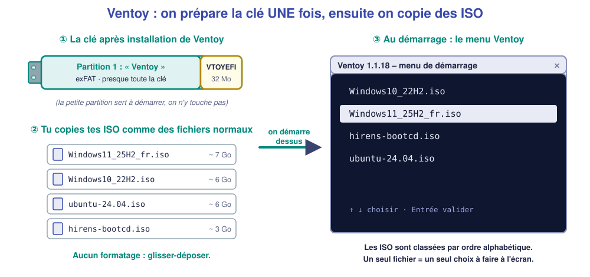
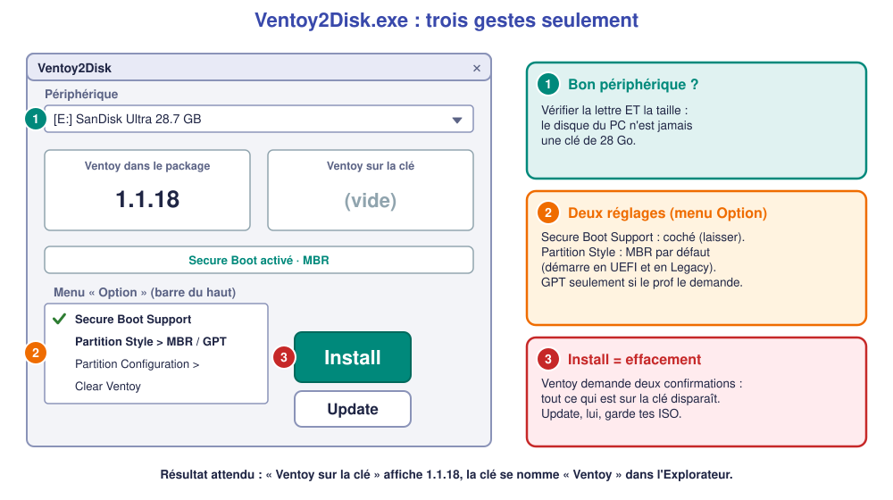

# ★ Fiche – Créer une clé bootable avec **Ventoy** (méthode prioritaire)

*Bac Pro CIEL – Seconde – S04 – à lire avec la [fiche « choisir son outil et comprendre le BIOS »](04-fiche-cle-bootable.md)*

> [!NOTE]
> **Version de référence : Ventoy 1.1.18 (9 octobre 2026)**, vérifiée le 2 novembre 2026. Gratuit, libre, **sans installation** sur le PC. Site officiel : [ventoy.net](https://www.ventoy.net/en/download.html) (téléchargement aussi sur [GitHub : ventoy/Ventoy](https://github.com/ventoy/Ventoy/releases)). Les textes entre « guillemets » sont ceux de l'écran (souvent **en anglais**).

## 1. L'idée en une image

Avec Ventoy, **on prépare la clé une seule fois**. Ensuite, **chaque ISO** (Windows 11, Windows 10, Linux, outils de dépannage…) se **copie comme un fichier**. Au démarrage, Ventoy affiche **un menu** pour choisir lequel lancer.

**Pourquoi c'est la méthode prioritaire en atelier ?**

- ✅ **Un seul outil** pour tous les systèmes : plus de clé à refaire pour chaque ISO.
- ✅ **Rapide** : mettre à jour Windows = remplacer un fichier (copier-coller de 2 minutes, pas de formatage).
- ✅ **Sans limite de 4 Go** par fichier (partition exFAT).
- ⚠️ **Contrepartie** : avec Secure Boot, il faut **enregistrer la clé de Ventoy** au premier démarrage (§ 5).

## 2. Ce qu'il faut

- Un PC Windows pour **préparer** la clé, avec les **droits administrateur**.
- Une clé USB **de 16 Go minimum** (une ISO de Windows 11 fait environ 7 Go). **Elle sera entièrement effacée.**
- Un fichier **ISO** de Windows (voir [fiche outil Microsoft](07-fiche-microsoft.md) § « Télécharger l'ISO »).

## 3. Étape 1 – Installer Ventoy sur la clé (une seule fois)

1. **Télécharger** `ventoy-1.1.18-windows.zip` depuis le site officiel.
2. **Extraire** tout le contenu du ZIP (clic droit → *Extraire tout…*). **Ne pas lancer le programme depuis l'intérieur du ZIP.**
3. **Brancher la clé USB.**
4. Lancer `Ventoy2Disk.exe` (clic droit → *Exécuter en tant qu'administrateur* si Windows le demande).
5. **① Périphérique** : vérifier que la **lettre et la taille** correspondent à **ta clé**.
6. **② Menu « Option »** :
    - **Secure Boot Support** : **coché** (laisser).
    - **Partition Style** : **MBR** (défaut) → la clé démarre en **UEFI et en Legacy**. Choisir **GPT** seulement si la fiche du PC l'impose (UEFI uniquement).
7. **③ Cliquer sur « Install »** → **deux confirmations** « les données seront perdues » → cliquer **Oui** deux fois.
8. Message **« Install Ventoy to device successfully »** : la clé s'appelle maintenant **Ventoy** dans l'Explorateur.

✅ **Point de contrôle :** dans Ventoy2Disk, la zone « Ventoy sur la clé / In Device » affiche **1.1.18**.

> [!WARNING]
> **Ne jamais choisir le disque du PC.** Une clé fait 8 à 64 Go ; le disque du PC fait 250 Go ou plus. En cas de doute : **débrancher la clé, regarder la liste, la rebrancher** : le périphérique qui apparaît, c'est elle.

### Les conséquences des choix de l'installation

| Choix | Conséquence |
|---|---|
| **Secure Boot Support coché** | La clé démarre avec Secure Boot, mais au **1er démarrage** il faut **enregistrer la clé** (§ 5). Décoché : démarre seulement **Secure Boot désactivé**. |
| **MBR** | Démarre **en UEFI et en Legacy**. Disque de la clé limité à 2 To (sans importance ici). |
| **GPT** | Démarre **seulement en UEFI** sur la plupart des PC ; indispensable pour certains PC très récents. |
| **Install** | **Efface toute la clé.** |
| **Update** (plus tard) | Met à jour Ventoy **sans toucher** à tes ISO : c'est le bouton à utiliser quand une nouvelle version sort. |

## 4. Étape 2 – Copier les ISO

1. Ouvrir la clé **« Ventoy »** dans l'Explorateur.
2. **Copier** le fichier `.iso` dedans (glisser-déposer). Pas besoin de dossier spécial (on peut en créer pour s'organiser).
3. **Attendre** la fin de la copie (plusieurs minutes), puis **éjecter la clé** proprement (*Éjecter* dans la barre des tâches).

✅ **Point de contrôle :** le fichier `.iso` est visible **à la racine** (ou dans un dossier) de la clé, sa taille est correcte (≈ 6 à 8 Go pour Windows 11).

> [!TIP]
> **Plusieurs ISO ?** Aucun problème : tant qu'il reste de la place. Le menu les classe par **ordre alphabétique** : un nom clair (`Windows11_25H2_fr.iso`) facilite le choix. Ne **renomme pas** l'extension `.iso`.

## 5. Étape 3 – Démarrer sur la clé

1. Brancher la clé sur le PC à installer, **allumer**, taper sur la touche du **menu de démarrage** (`F12`, `F11`, `Échap`, `F9`… voir [fiche BIOS § 3.5](04-fiche-cle-bootable.md)).
2. Choisir **« UEFI : nom de la clé »** (⚠️ pas l'entrée sans « UEFI » : voir [fiche BIOS § 3.1](04-fiche-cle-bootable.md)).
3. **Si Secure Boot est activé** : au **premier démarrage seulement**, un **écran bleu** apparaît (« *Verifying shim SBAT data failed* » ou « *Perform MOK management* ») :

    1. Choisir **« Enroll key from disk »**.
    2. Ouvrir la partition **VTOYEFI** → fichier **`ENROLL_THIS_KEY_IN_MOKMANAGER.cer`**.
    3. **Continue** → **Yes** (enregistrer la clé) → **Reboot**.
    4. Rebrancher / redémarrer **sur la clé** (menu de démarrage).

4. Le **menu Ventoy** apparaît : **flèches ↑ ↓** pour choisir l'ISO, **Entrée** pour valider.
5. Si on demande le **mode de démarrage** (« *Boot in normal mode* ») : choisir **normal**.

✅ **Point de contrôle :** l'écran « Installation de Windows » (choix de la langue) s'affiche → on continue avec le [TP](02-tp.md) (A2).

> [!NOTE]
> **À vérifier sur le PC du lycée** (marques de BIOS différentes) : le libellé exact de l'écran bleu peut varier d'une version à l'autre. Si l'écran bleu n'apparaît pas ou affiche une erreur, **ne pas insister** : demander à l'enseignant (il peut désactiver Secure Boot le temps du TP ou activer le réglage « *Allow Microsoft 3rd Party UEFI CA* » du BIOS).

### Conséquences des choix au démarrage

| Choix | Conséquence |
|---|---|
| Entrée « **UEFI : …** » | Windows s'installe en **GPT** → Secure Boot et Windows 11 possibles. |
| Entrée **sans « UEFI »** | Windows s'installe en **MBR** → ni Secure Boot ni Windows 11. |
| Secure Boot **désactivé** « pour que ça marche » | La clé démarre, mais **réactiver Secure Boot après l'installation** (sinon Windows 11 / certains logiciels se plaignent). |

## 6. Mettre à jour plus tard

- **Une nouvelle ISO de Windows** : supprimer l'ancienne, copier la nouvelle. **Rien d'autre.**
- **Une nouvelle version de Ventoy** : relancer `Ventoy2Disk.exe` (nouvelle version) → bouton **Update** (et **non** Install) : les ISO sont **conservées**.

## 7. 🛠️ Si ça ne marche pas

| Symptôme | Cause probable | Que faire |
|---|---|---|
| La clé **n'apparaît pas** dans le menu de démarrage | Mauvais port USB / démarrage USB désactivé dans le BIOS | Essayer un **port USB arrière** (2.0), vérifier « *USB Boot* » dans le BIOS |
| Écran bleu « *Security Violation* » / « *Access Denied* » | Secure Boot : **clé non enregistrée** | Refaire l'enregistrement (§ 5) ou demander à l'enseignant |
| Le menu Ventoy est vide | ISO **pas à la racine** ou **mal copiée** | Vérifier le **nom** (.iso) et la **taille** du fichier |
| L'installation échoue au bout de quelques minutes | ISO **corrompue** | Re-télécharger l'ISO et **comparer l'empreinte SHA-256** donnée par Microsoft |
| Windows **refuse** d'installer (« ce PC ne peut pas exécuter Windows 11 ») | PC **non compatible** (TPM 2.0, Secure Boot) ou démarrage en **Legacy** | Redémarrer et choisir **« UEFI : … »** ; vérifier TPM / Secure Boot dans le BIOS |

## 8. 🧩 Questions pour vérifier

**Q1.** Quel est l'avantage principal de Ventoy sur Rufus ou l'outil Microsoft ?

Voir la réponse

On prépare la clé **une fois**, puis on **copie plusieurs ISO** (ou on en remplace une) **sans reformater** ; au démarrage un menu permet de choisir.

**Q2.** Pourquoi coche-t-on « Secure Boot Support » alors que ça oblige à enregistrer une clé au 1er démarrage ?

Voir la réponse

Pour que la clé démarre **avec Secure Boot activé** (cas normal sur un PC Windows 11). Sans cela, il faudrait **désactiver** Secure Boot sur chaque PC, ce qui affaiblit la protection.

**Q3.** J'ai cliqué sur « Install » alors que la clé contenait déjà 3 ISO. Que va-t-il se passer ?

Voir la réponse

**Tout est effacé**, ISO comprises. Pour **garder** les ISO, il fallait utiliser **« Update »**.

**Q4.** Tu choisis l'entrée du menu de démarrage sans « UEFI » pour installer Windows 11. Que se passe-t-il ?

Voir la réponse

Le PC démarre en **Legacy** → disque **MBR** → l'installateur **refuse Windows 11** (ou l'installe sans Secure Boot sur Windows 10). On recommence en choisissant **« UEFI : … »**.

---

**Autres méthodes :** [Rufus](06-fiche-rufus.md) · [outil Microsoft](07-fiche-microsoft.md) · retour à la [fiche BIOS](04-fiche-cle-bootable.md) · [TP](02-tp.md)

*Sources : [ventoy.net – Install](https://www.ventoy.net/en/doc_start.html) · [Ventoy – Secure Boot](https://www.ventoy.net/en/doc_secure.html).*
