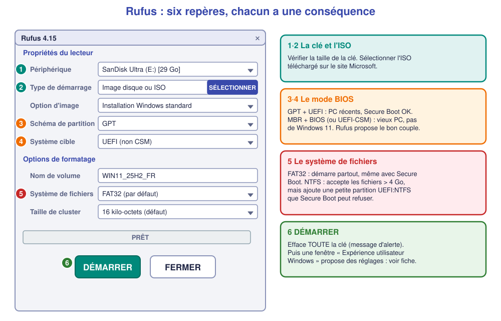

# 🔧 Fiche – Créer une clé bootable avec **Rufus**

*Bac Pro CIEL – Seconde – S04 – à lire avec la [fiche « choisir son outil et comprendre le BIOS »](04-fiche-cle-bootable.md)*

> [!NOTE]
> **Version de référence : Rufus 4.15 (juin 2026)**, vérifiée le 2 novembre 2026. Gratuit, **portable** (un seul `.exe`, rien à installer). Site officiel : [rufus.ie](https://rufus.ie/fr/). Sur le site, prendre la ligne **« Rufus 4.x »** (version standard) et **non** une version « BETA ». Les libellés ci-dessous sont ceux de l'interface **en français**.

## 1. L'idée

Rufus **écrit un seul ISO** sur la clé, en réglant **précisément** le mode BIOS (GPT ou MBR, UEFI ou Legacy) et le **système de fichiers**. Contrairement à Ventoy, **pour changer d'ISO il faut tout refaire** (et la clé est **effacée** à chaque fois).

**Quand l'utiliser ?**

- ✅ Pour **maîtriser le mode BIOS** (vieux PC en Legacy, PC récent en UEFI).
- ✅ Pour **personnaliser** l'installation de Windows (compte local, contourner certaines exigences).
- ✅ Pour **télécharger l'ISO** directement depuis Rufus.
- ⚠️ **Un seul système par clé.**

## 2. Ce qu'il faut

- Une clé USB **de 8 Go minimum** (sera **entièrement effacée**).
- Un fichier **ISO** de Windows (voir [fiche outil Microsoft](07-fiche-microsoft.md)), ou le télécharger depuis Rufus (§ 4, option du bouton « SÉLECTIONNER »).
- Un PC Windows, droits **administrateur**.

## 3. Pas à pas

1. **Télécharger** `rufus-4.15.exe` (version « standard » ou « portable ») sur [rufus.ie](https://rufus.ie/fr/), puis le lancer (accepter la demande **Contrôle de compte d'utilisateur**). Au premier lancement, Rufus demande s'il peut **chercher des mises à jour** : **Non** (ou **Oui** si l'enseignant l'accepte).
2. **① Périphérique** : choisir **la clé** (vérifier la **taille**).
3. **② Type de démarrage** : « **Image disque ou ISO** » → bouton **SÉLECTIONNER** → choisir le fichier `.iso`.
    - Rufus peut aussi **télécharger** l'ISO : flèche ▾ à côté de SÉLECTIONNER → **TÉLÉCHARGER**.
4. **Option d'image** : « **Installation Windows standard** » (sur certaines versions : « Windows To Go » existe aussi, **ne pas le choisir**).
5. **③ Schéma de partition** et **④ Système cible** : voir le tableau ci-dessous. Rufus **choisit un couple cohérent** : ne le change que si tu sais pourquoi.
6. **Nom de volume** : laisser (ou `WIN11_25H2_FR`).
7. **⑤ Système de fichiers** : **FAT32** (par défaut) → laisser.
8. **⑥ Cliquer sur « DÉMARRER »**.
9. **Fenêtre « Expérience utilisateur Windows »** (Windows 11 seulement) : voir § 4.
10. Message « **ATTENTION : TOUTES LES DONNÉES SUR LE PÉRIPHÉRIQUE SERONT DÉTRUITES** » → **OK**. Barre de progression (5 à 15 minutes), puis **PRÊT** en vert.
11. Cliquer sur **FERMER**, puis **éjecter** la clé.

✅ **Point de contrôle :** la barre est **verte** avec « PRÊT » ; la clé porte le nom choisi et contient les dossiers `boot`, `efi`, `sources`.

### Les conséquences de chaque choix

| Choix dans Rufus | Conséquence |
|---|---|
| **GPT + UEFI (non CSM)** | PC **récents** : Secure Boot ✅, Windows 11 ✅. **Ne démarre pas** sur un PC en Legacy pur. ← *Choix recommandé en atelier.* |
| **MBR + BIOS (ou UEFI-CSM)** | PC **anciens** : démarre en Legacy **et** en UEFI-CSM. Disque **MBR** : **pas de Secure Boot**, **pas de Windows 11**. |
| **FAT32** | Démarre sur **tous** les PC UEFI, **même avec Secure Boot**. Rufus **découpe** `install.wim` en morceaux (limite de 4 Go). |
| **NTFS** | Fichiers sans limite de taille, mais Rufus ajoute une **partition d'aide « UEFI:NTFS »** qui est **refusée** par **Secure Boot** (« Security Violation ») sauf si on **enregistre** la clé de Rufus (*Secure Boot violation* → *Enroll key*). **Pour un TP : FAT32.** |
| **Taille de cluster** | Laisser la valeur par défaut. Aucun impact pour toi. |

## 4. Personnaliser Windows (fenêtre « Expérience utilisateur Windows »)

Après **DÉMARRER**, pour une ISO Windows 11, Rufus propose des cases à cocher. **Chacune a une conséquence :**

| Case (libellé approximatif) | Ce que ça fait | Conséquence à connaître |
|---|---|---|
| « Supprimer l'obligation de 4 Go+ de RAM, Secure Boot et TPM 2.0 » | L'installateur **ne vérifie plus** ces exigences | Installe Windows 11 sur un PC **non compatible** : **non conseillé en production** (mises à jour non garanties). **En atelier : décoché**, sauf consigne. |
| « Supprimer l'obligation d'un compte Microsoft en ligne » | Permet un **compte local** | Utile si le PC n'a **pas Internet** à l'installation. |
| « Créer un compte local avec le nom : … » | Crée le compte **sans question** | Gain de temps ; **ne pas oublier de définir un mot de passe** ensuite. |
| « Définir les options régionales sur les mêmes valeurs que cet utilisateur » | Reprend **langue et clavier** de **ton** PC | Évite de choisir « Français (France) » à la main. |
| « Désactiver la collecte de données (ignorer les questions de confidentialité) » | Saute l'écran de **confidentialité** | Réglages **par défaut** : à vérifier ensuite. |
| « Désactiver le chiffrement automatique BitLocker » | Évite le **chiffrement** automatique du disque | Sans BitLocker, **disque non chiffré** : à décider selon le **cahier des charges**. |

> [!WARNING]
> **Ces options ne sont pas « neutres ».** Contourner TPM / Secure Boot sur un PC de client, c'est livrer un poste **hors des conditions Microsoft** : il faut le **dire** au client et **le noter** dans la fiche d'intervention.

> [!NOTE]
> **Windows 11 25H2 et certificats Secure Boot 2023.** Rufus **4.10 et suivants** savent préparer un média pour les PC qui ne font confiance qu'aux **nouveaux certificats Secure Boot (2023)** : ils demandent une ISO **récente (25H2)**. Pour un PC **ancien**, rien à changer. Rufus 4.14 / 4.15 ajoutent surtout du confort (installation silencieuse, corrections de l'interface). *Détails à vérifier sur la page des versions de Rufus au moment d'utiliser l'outil.*

## 5. Démarrer sur la clé

Identique à Ventoy : touche du **menu de démarrage**, entrée **« UEFI : nom de la clé »** (voir [fiche BIOS](04-fiche-cle-bootable.md) § 3.1 et 3.5). **Pas de menu intermédiaire** : l'installateur Windows s'affiche **directement**.

## 6. 🛠️ Si ça ne marche pas

| Symptôme | Cause probable | Que faire |
|---|---|---|
| « **Cette ISO est trop grosse pour FAT32** » ou fichier découpé | `install.wim` > 4 Go | Laisser faire Rufus (découpe auto) ; sinon **NTFS** (+ Secure Boot désactivé) |
| « *Security Violation* » au démarrage | Clé en **NTFS** + **Secure Boot** | Refaire en **FAT32** |
| La clé **n'apparaît pas** dans le menu de démarrage | Mode **Legacy** vs UEFI incohérent | Refaire avec **MBR + BIOS (ou UEFI-CSM)** si le PC est ancien |
| Rufus **bloque** à « formatage » | Clé protégée en écriture / défectueuse | Changer de **clé** ou de **port USB** |
| L'installation s'arrête sur « Windows ne peut pas être installé sur ce disque » | **Mode** incohérent (UEFI mais disque MBR) | Choisir « UEFI : … » dans le **menu de démarrage** et **supprimer** les partitions du disque pour laisser Windows créer un **GPT** (ne pas oublier la **sauvegarde**) |

## 7. 🧩 Questions pour vérifier

**Q1.** Tu veux installer Windows 11 sur un PC récent avec Secure Boot. Quels réglages Rufus choisis-tu ?

Voir la réponse

**GPT**, **UEFI (non CSM)**, **FAT32**. Cette combinaison démarre avec Secure Boot et donne un disque **GPT** compatible Windows 11.

**Q2.** Pourquoi choisir **FAT32** plutôt que **NTFS** en TP ?

Voir la réponse

FAT32 est reconnu **directement** par l'UEFI, **même avec Secure Boot**. NTFS demande une petite partition d'aide « UEFI:NTFS » que Secure Boot peut **refuser**.

**Q3.** Un client a un PC de 2012 sans Secure Boot ni TPM. Quel couple choisis-tu pour installer **Windows 10** ?

Voir la réponse

**MBR + BIOS (ou UEFI-CSM)** : la clé démarre sur un PC ancien. Windows **11** serait refusé sur ce PC (TPM / Secure Boot absents).

**Q4.** Pourquoi faut-il être prudent avec la case « Supprimer l'obligation de TPM 2.0 et Secure Boot » ?

Voir la réponse

Elle installe Windows 11 sur un PC **non compatible** : Microsoft **ne garantit pas** les mises à jour sur ce PC. Il faut **prévenir le client** et **le noter** dans la fiche d'intervention.

---

**Autres méthodes :** [Ventoy ★](05-fiche-ventoy.md) · [outil Microsoft](07-fiche-microsoft.md) · retour à la [fiche BIOS](04-fiche-cle-bootable.md) · [TP](02-tp.md)

*Sources : [rufus.ie](https://rufus.ie/fr/) · [Rufus sur GitHub (versions)](https://github.com/pbatard/rufus/releases).*
