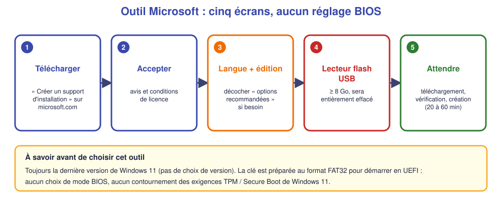

# 🪟 Fiche – Créer une clé d'installation avec l'**outil Microsoft** (« Media Creation Tool »)

*Bac Pro CIEL – Seconde – S04 – à lire avec la [fiche « choisir son outil et comprendre le BIOS »](04-fiche-cle-bootable.md)*

> [!NOTE]
> **Version de référence : Windows 11 25H2**, la version proposée par l'outil au moment de la rédaction (vérifié le 2 novembre 2026). Page officielle : [microsoft.com – Télécharger Windows 11](https://www.microsoft.com/fr-fr/software-download/windows11) → section **« Créer un support d'installation de Windows 11 »**. L'outil **télécharge toujours la dernière version** : le numéro de version peut donc être plus récent quand tu l'utilises. **Note-le.**

## 1. L'idée

L'outil officiel de Microsoft **télécharge Windows 11 pour toi** et **prépare la clé**, avec **presque aucun choix à faire**. C'est le plus simple… mais aussi **le plus limité** :

- ✅ Aucune ISO à trouver : l'outil la télécharge.
- ✅ **Officiel** : fichiers **signés par Microsoft** → **Secure Boot** accepté sans rien faire.
- ❌ **Un seul Windows 11** par clé, **toujours la dernière version** (pas de choix d'édition ancienne).
- ❌ **Aucun réglage BIOS** (GPT / MBR) et **aucun contournement** TPM / Secure Boot.
- ❌ **Pas de version ARM** (PC à processeur ARM) avec cet outil.

## 2. Ce qu'il faut

- Un PC Windows **avec Internet** (le téléchargement fait **plus de 5 Go**).
- Une clé USB **de 8 Go minimum**, **vide** (elle sera **entièrement effacée**).
- Les droits **administrateur** sur ce PC.

## 3. Pas à pas

1. Aller sur la page officielle ([lien ci-dessus](https://www.microsoft.com/fr-fr/software-download/windows11)) et chercher **« Créer un support d'installation de Windows 11 »** → bouton **« Télécharger maintenant »** → enregistrer `MediaCreationTool_….exe`.
2. **Lancer** le fichier (accepter le **Contrôle de compte d'utilisateur**).
3. **Écran « Avis et conditions de licence applicables »** → **Accepter**.
4. **Écran « Sélectionner la langue et l'édition »** : par défaut l'outil choisit **« Utiliser les options recommandées pour ce PC »** (langue et édition **de ton PC**). Pour installer sur **un autre PC** : **décocher**, puis choisir **Langue : Français (France)** et **Édition : Windows 11**.
5. **Écran « Choisir le média à utiliser »** :
    - **Lecteur flash USB** (≥ 8 Go) → **c'est notre choix**.
    - **Fichier ISO** → télécharge juste l'ISO (utile pour **Ventoy** ou **Rufus**, voir encadré ci-dessous).
6. **Écran « Sélectionner un lecteur flash USB »** : choisir **la clé** (**Actualiser la liste** si elle n'y est pas).
7. **Attendre** : « Téléchargement de Windows 11 » → « Vérification du téléchargement » → « Création du média Windows 11 » (**20 à 60 minutes** selon la connexion).
8. Message **« Votre lecteur flash USB est prêt »** → **Terminer**, puis **éjecter** la clé.

✅ **Point de contrôle :** la clé porte le nom **ESD-USB**, et contient `setup.exe`, `sources` et `boot`.

> [!TIP]
> **L'outil Microsoft au service de Ventoy.** On peut choisir **« Fichier ISO »** à l'étape 5 : l'outil télécharge un **ISO officiel** de Windows 11 sur le PC. On **copie ensuite cet ISO** sur la clé Ventoy ([fiche Ventoy](05-fiche-ventoy.md) § 4). **C'est la combinaison à retenir en atelier.**

## 4. Les conséquences des choix (peu nombreux)

| Choix | Conséquence |
|---|---|
| **Langue / édition « recommandées »** (case cochée) | Windows dans la langue du PC **de préparation** : **vérifier** que c'est bien du **français** si on prépare sur un PC en anglais. |
| **Lecteur flash USB** | La clé est **entièrement effacée** et **dédiée** à Windows 11. Elle redevient une clé ordinaire avec **Gestion des disques → Formater**. |
| **Fichier ISO** | **Rien n'est écrit sur une clé** : on obtient un fichier à utiliser avec **Ventoy**, **Rufus**, ou une **machine virtuelle**. |
| Mode BIOS | **Imposé** : clé au format **FAT32** qui **démarre en UEFI** (et en général aussi en Legacy sur les PC qui l'acceptent). **Windows 11 exige UEFI + Secure Boot + TPM 2.0**, même avec cet outil. |

## 5. Démarrer sur la clé

Identique aux autres : touche du **menu de démarrage**, entrée **« UEFI : nom de la clé »** (voir [fiche BIOS](04-fiche-cle-bootable.md) § 3.1 et 3.5).

## 6. 🛠️ Si ça ne marche pas

| Symptôme | Cause probable | Que faire |
|---|---|---|
| « **Cet outil ne peut pas être exécuté** » | Autorisations ou PC trop ancien | Relancer en **administrateur** ; essayer **Fichier ISO** |
| Erreur **0x80042405 – 0xA001A** | La clé est **trop petite** ou a un format inattendu | Utiliser une clé **≥ 8 Go**, et **supprimer toutes les partitions** de la clé dans **Gestion des disques** |
| La clé **n'apparaît pas** dans la liste | Clé non reconnue | **Actualiser la liste**, essayer **un autre port USB** |
| **Très long** (> 1 h) | Connexion lente | Laisser faire ; **ne pas débrancher** la clé |
| À l'installation : « Ce PC ne peut pas exécuter Windows 11 » | **TPM 2.0 / Secure Boot / UEFI** non satisfaits | Ce PC **n'est pas compatible** : **Windows 10** (fin de support en octobre 2025) ou **Rufus** avec l'option de contournement, **avec l'accord de l'enseignant** |

## 7. 🧩 Questions pour vérifier

**Q1.** Quel avantage a l'outil Microsoft sur Ventoy et Rufus ? Quel inconvénient ?

Voir la réponse

**Avantage** : il **télécharge** Windows 11 lui-même, **sans réglage** ; fichiers **officiels**. **Inconvénient** : **un seul Windows 11**, **aucun réglage BIOS**, la clé est **dédiée**.

**Q2.** Pourquoi choisir « Fichier ISO » plutôt que « Lecteur flash USB » si tu utilises Ventoy ?

Voir la réponse

Ventoy **n'a pas besoin** que la clé soit préparée par Microsoft : il lui faut **un fichier ISO** à **copier**. On évite aussi de **reformater** la clé Ventoy.

**Q3.** Le PC d'un client a un processeur de 2014 sans TPM 2.0. L'outil Microsoft permettra-t-il d'installer Windows 11 ?

Voir la réponse

**Non** : l'outil **ne contourne pas** les exigences. Il faut proposer **Windows 10** ou **Linux** (selon les besoins du client), ou utiliser **Rufus** avec contournement **en prévenant le client**.

---

**Autres méthodes :** [Ventoy ★](05-fiche-ventoy.md) · [Rufus](06-fiche-rufus.md) · retour à la [fiche BIOS](04-fiche-cle-bootable.md) · [TP](02-tp.md)

*Sources : [Microsoft – Télécharger Windows 11](https://www.microsoft.com/fr-fr/software-download/windows11).*
