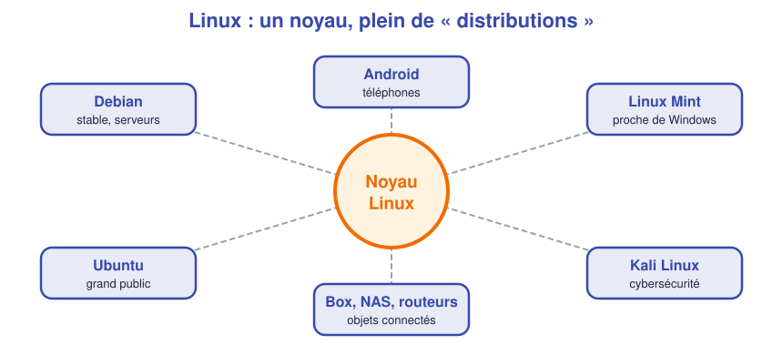
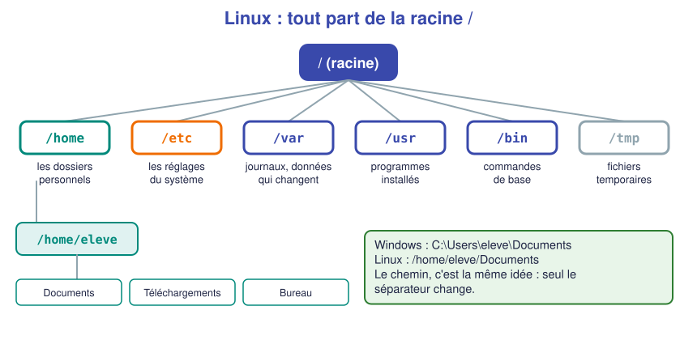
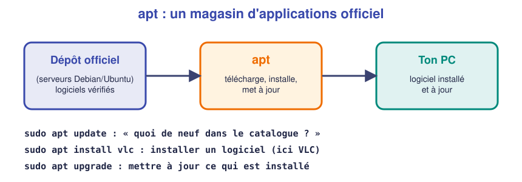

# 📖 Cours – Découvrir Linux

*Bac Pro CIEL – Seconde – E31 – S05*

> [!IMPORTANT]
> Même méthode que la séance précédente : **une idée à la fois**. Tu essaies de répondre à la question **avant** de déplier la réponse.

## 🎯 À la fin de ce cours, tu sauras

- [ ] expliquer ce que sont un **noyau** et une **distribution** ;
- [ ] citer des endroits où on utilise Linux sans le savoir ;
- [ ] te repérer dans l'**arborescence** (`/`, `/home`, `/etc`…) ;
- [ ] expliquer pourquoi on utilise `sudo` ;
- [ ] installer un logiciel et mettre à jour avec **apt**.

---

## 1. Linux, c'est quoi ?

### 🤔 Avant de lire : à ton avis ?

Cite **trois appareils ou services** autour de toi qui, selon toi, pourraient fonctionner avec Linux.

<details markdown="1">
<summary>Voir des réponses possibles</summary>

Ta **box Internet**, ton **téléphone Android**, la plupart des **sites web** que tu consultes, les **supercalculateurs**, les **NAS**, beaucoup de **caméras**, de **télévisions connectées**, de **voitures**… Linux fait tourner l'immense majorité des serveurs d'Internet.

</details>

### 💡 L'idée

**Linux** est un **système d'exploitation** (comme Windows), mais :

- il est **libre** : son code est public, on peut l'utiliser, le modifier et le redistribuer gratuitement ;
- il est **modulaire** : on installe seulement ce dont on a besoin ;
- il est **très stable** : un serveur Linux peut tourner des mois sans redémarrer ;
- on le contrôle beaucoup **en lignes de commande** (nous verrons ça en S06).

À proprement parler, **Linux** désigne le **noyau** : le cœur du système, qui parle au matériel. Autour du noyau, des équipes ajoutent un bureau, des logiciels, un installateur : cela s'appelle une **distribution**.



> *Analogie :* le noyau est le **moteur** ; une distribution est une **voiture complète** construite autour de ce moteur. Plusieurs marques utilisent le même moteur.

### 🧠 Retiens

> [!TIP]
> **Linux = noyau libre.** **Distribution = noyau + bureau + logiciels** (Debian, Ubuntu, Mint, Kali…). Ce que tu installes est toujours une **distribution**.

### ✅ Vérifie que tu as compris

**Q1.** « Linux et Ubuntu, c'est la même chose ? » Que réponds-tu ?

<details markdown="1">
<summary>Réponse</summary>

Pas exactement. **Linux** est le **noyau**. **Ubuntu** est une **distribution** qui utilise ce noyau, avec un bureau, des logiciels et un installateur.

</details>

**Q2.** Pourquoi les entreprises mettent-elles souvent **Linux** sur leurs serveurs ?

<details markdown="1">
<summary>Réponse</summary>

Il est **gratuit**, **stable**, **sécurisé**, **léger** et on peut **tout automatiser** en lignes de commande. Pas de licence par serveur à payer.

</details>

---

## 2. Le bureau Linux : on ne se perd pas

Quand tu installes Ubuntu, tu obtiens un **bureau** (l'interface graphique) qui ressemble à ce que tu connais : fenêtres, icônes, menus, navigateur, gestionnaire de fichiers.

| Sous Windows | Sous Ubuntu (GNOME) |
|---|---|
| Menu **Démarrer** | Bouton **Afficher les applications** (en bas à gauche) ou touche `Windows` |
| **Explorateur de fichiers** | Application **Fichiers** |
| **Paramètres** | Application **Paramètres** |
| **Microsoft Store** | **Logiciels** (*App Center*) |
| **Invite de commandes** | **Terminal** (touches `Ctrl` + `Alt` + `T`) |

> [!NOTE]
> Linux n'est pas « plus difficile » : c'est **un autre chemin pour faire la même chose**. À toi de trouver tes repères.

---

## 3. L'arborescence : où est rangé quoi ?

### 🤔 Avant de lire : à ton avis ?

Sous Windows, on trouve `C:\Users\toi\Documents`. Il y a des **lettres** de lecteur : `C:`, `D:`. **Sous Linux, il n'y a pas de lettres de lecteur.** Comment peut-on alors tout ranger ?

<details markdown="1">
<summary>Voir la réponse</summary>

Tout est rangé dans **un seul grand arbre**, qui part d'une **racine** notée `/`. Une clé USB branchée **apparaît à l'intérieur de l'arbre** (par exemple dans `/media/ton-nom/CLE`) au lieu d'avoir sa propre lettre.

</details>

### 💡 L'idée



| Dossier | Sert à | Exemple |
|---|---|---|
| `/` | La **racine** : tout part d'ici | |
| `/home` | Les **dossiers personnels** des utilisateurs | `/home/eleve/Documents` |
| `/etc` | Les **réglages** du système (fichiers de configuration) | `/etc/hostname` |
| `/var` | Les données qui **changent** : journaux, sites web | `/var/log` |
| `/usr` | Les **programmes** installés | `/usr/bin` |
| `/tmp` | Fichiers **temporaires** | |

> [!TIP]
> **Chemin (path)** = l'adresse d'un fichier dans l'arbre. Sous Linux on utilise des **/** (barres obliques) et pas des `\`. Les noms sont **sensibles à la casse** : `Photo.jpg` et `photo.jpg` sont **deux fichiers différents**.

### 🛠️ Surveiller sa machine

| Commande | Ce qu'elle montre |
|---|---|
| `df -h` | L'**espace disque** utilisé et libre (`-h` : tailles lisibles) |
| `free -h` | La **mémoire** (RAM) utilisée et libre |

Un technicien qui entend « l'ordinateur est lent » commence souvent par ces deux commandes : disque plein ? mémoire saturée ?

### 👥 Les utilisateurs et `sudo`

- Chaque personne a son **compte** et son **dossier personnel** dans `/home`.
- Un compte très spécial existe : **`root`**, l'administrateur tout-puissant.
- Pour **éviter** de travailler en `root` (trop dangereux), on utilise `sudo` (*« super user do »*) **devant une commande** : on emprunte les droits d'administrateur **juste pour cette commande**, après avoir tapé son mot de passe.

> *Analogie :* `root` est le **trousseau de clés du gardien** ; `sudo`, c'est **demander poliment le trousseau** pour une seule porte, puis le rendre.

### ✅ Vérifie que tu as compris

**Q3.** Où se trouve le dossier **Documents** de l'utilisateur `lea` ?

<details markdown="1">
<summary>Réponse</summary>

`/home/lea/Documents`

</details>

**Q4.** Tu veux changer un réglage système. Dans quel dossier ira-t-on probablement le chercher ?

<details markdown="1">
<summary>Réponse</summary>

Dans **`/etc`** (les fichiers de configuration).

</details>

**Q5.** Pourquoi demande-t-on le mot de passe quand on utilise `sudo` ?

<details markdown="1">
<summary>Réponse</summary>

Pour **vérifier que c'est bien la bonne personne** qui demande des droits d'administrateur, comme le contrôle de l'UAC de Windows. Cela évite qu'un programme ou une personne fasse n'importe quoi sans autorisation.

</details>

---

## 4. Installer et mettre à jour : `apt`

### 🤔 Avant de lire : à ton avis ?

Sous Windows, tu télécharges souvent un fichier `.exe` sur un site. **Quel est le risque ?**

<details markdown="1">
<summary>Voir la réponse</summary>

On peut télécharger un **faux site** ou un **logiciel piégé**. Rien ne **garantit** qu'il est authentique.

</details>

### 💡 L'idée

Sous Linux, on installe la plupart des logiciels depuis des **dépôts officiels** : des serveurs gérés par la distribution. Le programme qui s'en occupe s'appelle un **gestionnaire de paquets**. Sur Debian et Ubuntu : **`apt`**.



Les trois commandes à connaître :

```bash
sudo apt update          # 1) mettre à jour le CATALOGUE (la liste des logiciels disponibles)
sudo apt install tree    # 2) INSTALLER un logiciel (ici : tree)
sudo apt upgrade         # 3) METTRE À JOUR les logiciels déjà installés
```

> [!IMPORTANT]
> **`update` ne met pas à jour tes logiciels :** il met à jour **la liste** de ce qui est disponible. C'est `upgrade` qui met les logiciels à jour. Ordre habituel : **`update` puis `upgrade`**.

> *Analogie :* `update`, c'est **consulter le catalogue** du magasin ; `install`, c'est **acheter** un produit ; `upgrade`, c'est **remplacer** les produits par leurs versions plus récentes.

### ✅ Vérifie que tu as compris

**Q6.** Quelle commande installe le logiciel **vlc** ?

<details markdown="1">
<summary>Réponse</summary>

`sudo apt install vlc`

</details>

**Q7.** Tu viens d'allumer ta VM, tu veux tout mettre à jour. Quelles commandes, dans quel ordre ?

<details markdown="1">
<summary>Réponse</summary>

`sudo apt update` puis `sudo apt upgrade`.

</details>

**Q8.** Pourquoi est-ce plus sûr qu'un `.exe` trouvé sur Internet ?

<details markdown="1">
<summary>Réponse</summary>

Les paquets viennent de **dépôts officiels** de la distribution, **signés** (vérifiés). Le risque d'un faux logiciel est beaucoup plus faible.

</details>

---

## 5. Windows ou Linux ? À toi de comparer

Tu construiras **toi-même** un [tableau comparatif](03-comparatif.md) pendant le TP. L'objectif n'est pas de choisir un « gagnant » : un technicien doit savoir **quand utiliser quoi**.

---

## 6. Ce qu'il faut retenir

> [!TIP]
> 1. **Linux** est un **noyau libre** ; une **distribution** (Debian, Ubuntu…) est un système complet construit autour.
> 2. Tout est rangé dans **un seul arbre** qui part de `/` ; les dossiers personnels sont dans `/home`, les réglages dans `/etc`.
> 3. On travaille avec un compte normal ; **`sudo`** donne ponctuellement les droits d'administrateur.
> 4. On installe avec **`apt`** depuis des dépôts officiels : **`update` puis `upgrade`**.

### 📖 Vocabulaire

| Mot | Définition simple |
|---|---|
| **Noyau** | Cœur du système qui parle au matériel |
| **Distribution** | Système complet : noyau + bureau + logiciels |
| **Libre** | Dont le code est public et réutilisable |
| **Arborescence** | L'arbre de tous les dossiers, depuis la racine `/` |
| **root** | Compte administrateur de Linux |
| **sudo** | Commande qui prête les droits d'administrateur pour une commande |
| **Paquet** | Logiciel prêt à être installé par `apt` |
| **Dépôt** | Serveur officiel qui contient les paquets |

➡️ **Suite :** le [🛠️ TP guidé](02-tp.md).
