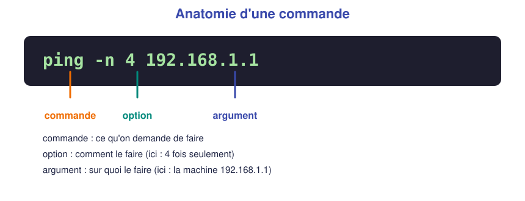
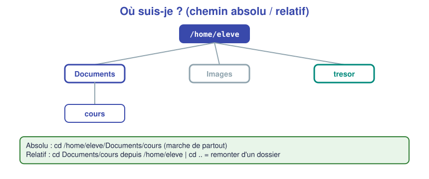

# 📖 Cours – Le terminal : premiers pas

*Bac Pro CIEL – Seconde – E31 – S06*

> [!IMPORTANT]
> Ici, **tu apprends en tapant**. Garde un terminal ouvert à côté de ce cours : chaque fois que tu vois `$` ou `C:\>`, **essaie vraiment**.

## 🎯 À la fin de ce cours, tu sauras

- [ ] lire un **prompt** et savoir **où tu es** ;
- [ ] décomposer une commande en **commande / option / argument** ;
- [ ] te déplacer, lister, créer, copier, déplacer, supprimer ;
- [ ] expliquer la différence entre un chemin **absolu** et **relatif** ;
- [ ] **demander de l'aide** au terminal ;
- [ ] afficher ton **nom de machine** et ton **adresse IP**.

---

## 1. Pourquoi un terminal ?

### 🤔 Avant de lire : à ton avis ?

Tu dois **renommer 500 photos** de `IMG_001` à `IMG_500`. Qu'est-ce qui est le plus rapide : le faire à la souris ou écrire **une seule ligne** de texte ?

<details markdown="1">
<summary>Voir la réponse</summary>

Une seule ligne de texte. Le **terminal** permet de **répéter** et d'**automatiser**. Aussi, beaucoup d'équipements (serveurs, switchs, routeurs) **n'ont même pas d'écran graphique** : on ne peut leur parler **qu'en texte**.

</details>

### 💡 L'idée

Le **terminal** (ou **console**, **invite de commandes**) est une fenêtre où tu **tapes des ordres** à l'ordinateur et où il **répond par du texte**.

| Système | Programme | Langage |
|---|---|---|
| Windows | **Invite de commandes** (`cmd`) | commandes Windows |
| Linux | **Terminal** | **bash** |

**Ouvrir un terminal :** sous Windows `Windows` + `R`, taper `cmd`, `Entrée` ; sous Ubuntu `Ctrl` + `Alt` + `T`.

### Le prompt : « où suis-je ? »

Avant que tu tapes quoi que ce soit, le terminal affiche **un prompt** : il t'attend et te dit **qui** et **où** tu es.

| | Exemple | Lecture |
|---|---|---|
| Windows | `C:\Users\eleve>` | Je suis dans le dossier `C:\Users\eleve` |
| Linux | `eleve@ubuntu-ciel:~/Documents$` | Utilisateur **eleve**, machine **ubuntu-ciel**, dossier `~/Documents` (`~` = mon dossier personnel `/home/eleve`) |

> [!TIP]
> **Premier réflexe :** regarder le prompt avant d'agir. Beaucoup d'erreurs viennent d'une commande lancée **au mauvais endroit**.

### Une commande, c'est une phrase



- la **commande** dit *quoi faire* ;
- l'**option** dit *comment* (`-n 4`, `-c 4`, `/a`…) ;
- l'**argument** dit *sur quoi*.

### ✅ Vérifie que tu as compris

**Q1.** Dans `eleve@pc01:/etc$`, dans quel dossier es-tu ?

<details markdown="1"><summary>Réponse</summary>

Dans **`/etc`** (le dossier des réglages du système).

</details>

**Q2.** Dans `ping -c 3 8.8.8.8`, que sont `-c 3` et `8.8.8.8` ?

<details markdown="1"><summary>Réponse</summary>

`-c 3` est une **option** (envoyer 3 requêtes) ; `8.8.8.8` est l'**argument** (la machine visée). `ping` est la **commande**.

</details>

---

## 2. Où suis-je ? Comment me déplacer ?

### 🤔 Avant de lire : à ton avis ?

Tu es dans `/home/eleve`. Tu veux aller dans `Documents/cours`. Tu peux taper **deux phrases différentes** qui aboutissent au même endroit. Lesquelles ?

<details markdown="1"><summary>Voir la réponse</summary>

`cd /home/eleve/Documents/cours` (chemin **absolu**) et `cd Documents/cours` (chemin **relatif** : à partir d'**où je suis**).

</details>



| | **Absolu** | **Relatif** |
|---|---|---|
| Part de… | la **racine** (`/` ou `C:\`) | du dossier **où je suis** |
| Exemple | `cd /home/eleve/Documents` | `cd Documents` |
| Marche de partout ? | Oui | Non (dépend d'où je suis) |

**Deux raccourcis qui sauvent :**

- `.` = **ici** ; `..` = le **dossier au-dessus** (`cd ..` pour remonter).
- Touche **`Tab`** : complète le nom d'un dossier ou d'un fichier. **Tape le début, appuie sur `Tab`.**

### Table de traduction Windows ↔ Linux

| Je veux… | Windows (`cmd`) | Linux (`bash`) |
|---|---|---|
| Savoir où je suis | `cd` (sans rien) | `pwd` |
| Lister le contenu | `dir` | `ls` (`ls -l` détail, `ls -a` cachés) |
| Entrer dans un dossier | `cd dossier` | `cd dossier` |
| Remonter | `cd ..` | `cd ..` |
| Créer un dossier | `mkdir nom` | `mkdir nom` |
| Afficher un fichier | `type fichier.txt` | `cat fichier.txt` |
| Créer / écrire un texte | `echo Salut> a.txt` | `echo Salut > a.txt` |
| Copier | `copy a.txt dossier\` | `cp a.txt dossier/` |
| Déplacer / renommer | `move a.txt dossier\` | `mv a.txt dossier/` |
| Supprimer un fichier | `del a.txt` | `rm a.txt` |
| Effacer l'écran | `cls` | `clear` |

> [!WARNING]
> **Pas de corbeille dans le terminal !** `del` et `rm` suppriment **définitivement**. Avant de supprimer : regarde où tu es, relis ta commande.

### ✅ Vérifie que tu as compris

**Q3.** Tu es dans `/home/eleve/Documents/cours`. Comment remontes-tu dans `Documents` ?

<details markdown="1"><summary>Réponse</summary>

`cd ..`

</details>

**Q4.** Tu es dans `/home/eleve`. Écris **une commande** qui copie `rapport.txt` dans le dossier `sauvegarde`.

<details markdown="1"><summary>Réponse</summary>

Sous Linux : `cp rapport.txt sauvegarde/`. Sous Windows : `copy rapport.txt sauvegarde\`.

</details>

**Q5.** Pourquoi `rm` est-il plus dangereux que « Supprimer » dans l'explorateur ?

<details markdown="1"><summary>Réponse</summary>

Il n'y a **pas de corbeille** : le fichier est effacé **immédiatement**, sans demande de confirmation.

</details>

---

## 3. Demander de l'aide

Un technicien n'apprend pas toutes les commandes par cœur. Il sait **où chercher**.

| Besoin | Windows | Linux |
|---|---|---|
| Liste des commandes | `help` | `compgen -c` (très long) |
| Aide d'une commande | `ping /?` ou `help dir` | `ping --help` ou `man ping` (quitter : `q`) |

> [!TIP]
> Un bon réflexe en cas de blocage : **1)** lis le message d'erreur en entier, **2)** tape la commande avec `--help` (ou `/?`), **3)** demande à ton binôme, **4)** appelle l'enseignant.

---

## 4. Premières commandes « système » et « réseau »

Ces trois commandes répondent à : **qui suis-je, et comment suis-je relié ?**

| Question | Windows | Linux |
|---|---|---|
| Quel est le **nom** de la machine ? | `hostname` | `hostname` |
| Quel est **mon** utilisateur ? | `whoami` | `whoami` |
| Quelle est **mon adresse IP** ? | `ipconfig` | `ip a` |
| Puis-je **joindre** une autre machine ? | `ping adresse` | `ping -c 4 adresse` |

Exemple réel (simulateur), sous Windows :

```text
C:\>ipconfig
Carte Ethernet Ethernet0 :
   Adresse IPv4 . . . . . . . . . . . . : 192.168.10.11
   Masque de sous-réseau . . . . . . . . : 255.255.255.0
   Passerelle par défaut . . . . . . . . :
```

Et sous Linux :

```text
$ ip a
2: ens33: <BROADCAST,MULTICAST,UP,LOWER_UP> ...
    link/ether 54:ee:75:00:00:0d ...
    inet 192.168.10.12/24 ... scope global ens33
```

On y lit : l'**adresse IP** (`192.168.10.12`), le **masque** (`/24`), la **carte** (`ens33`). **Nous apprendrons à les comprendre en S11.** Pour l'instant, on sait **où les trouver**.

**Et `ping` ?** C'est comme **frapper à la porte** d'une autre machine pour savoir si elle répond :

```text
$ ping -c 2 192.168.10.11
64 bytes from 192.168.10.11: icmp_seq=1 ttl=128 time=0.204 ms
```

« **Une réponse** » = la machine est **joignable**. « **Pas de réponse** » ne veut pas dire « panne » à coup sûr : il faudra chercher pourquoi (S15).

### ✅ Vérifie que tu as compris

**Q6.** Quelle commande te donne l'adresse IP de ta machine sous Windows ? Sous Linux ?

<details markdown="1"><summary>Réponse</summary>

`ipconfig` sous Windows ; `ip a` sous Linux.

</details>

**Q7.** `ping` répond avec « Réponse de 192.168.10.12 ». Qu'est-ce que ça te prouve ?

<details markdown="1"><summary>Réponse</summary>

Que ta machine **peut joindre** 192.168.10.12 : câble, carte réseau et adresses sont (au moins en partie) corrects.

</details>

---

## 5. Ce qu'il faut retenir

> [!TIP]
> 1. Le **prompt** dit **qui** et **où** tu es. Regarde-le avant d'agir.
> 2. Une commande : **commande + option + argument**.
> 3. **Chemin absolu** (depuis la racine) / **relatif** (depuis ici) ; `..` remonte, `Tab` complète.
> 4. **`del` / `rm` : définitif**, pas de corbeille.
> 5. En cas de blocage : message d'erreur, `--help` ou `/?`, binôme, enseignant.
> 6. `hostname`, `ipconfig` / `ip a`, `ping` : **qui suis-je, comment suis-je relié, qui répond ?**

### 📖 Vocabulaire

| Mot | Définition |
|---|---|
| **Terminal / console** | Fenêtre où l'on tape des commandes |
| **Prompt** | Début de ligne qui indique l'utilisateur et le dossier courant |
| **Commande** | Ordre donné à l'ordinateur |
| **Option** | Précision sur *comment* exécuter la commande |
| **Argument** | Ce sur quoi la commande agit |
| **Chemin absolu / relatif** | Adresse d'un fichier depuis la racine / depuis le dossier courant |
| **ping** | Test pour savoir si une autre machine répond |

➡️ **Suite :** le [🛠️ TP chasse au trésor](02-tp.md).
