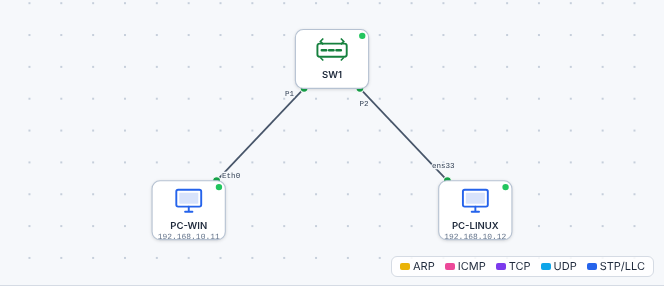

# 🌐 TP simulateur – Qui suis-je sur le réseau ?

*Bac Pro CIEL – Seconde – E31 – S06 – binôme – 35 min*

> [!NOTE]
> **Mission.** Deux ordinateurs sont reliés à un switch dans le **simulateur réseau** (hors ligne). Tu vas utiliser le terminal de chacun pour **te présenter** et **t'adresser à l'autre**.

## 🧰 Préparation

1. Ouvre le [simulateur réseau](../../simulateur/simulateur-reseau.html) dans ton navigateur (fonctionne **sans Internet**).
2. Clique sur **Ouvrir** et choisis le fichier [`tp/s06-terminal-reseau.json`](tp/s06-terminal-reseau.json).
3. Tu vois :

**Double-clique** sur un poste pour ouvrir son **terminal**.

## 🔎 Partie 1 – Qui suis-je ?

Dans le terminal de **PC-WIN** (Windows) puis de **PC-LINUX** (Linux), tape les commandes et complète :

| Commande | Windows (PC-WIN) | Linux (PC-LINUX) |
|---|---|---|
| `hostname` | | |
| `ipconfig` (Windows) / `ip a` (Linux) → adresse IP | | |
| Masque (Windows) / `/24` (Linux) | | |
| Carte réseau (nom) | | |

❓ **Les deux postes ont-ils la même adresse IP ? Pourquoi serait-ce un problème ?**

Aide

Non : **chaque machine doit avoir une adresse unique** sur le réseau, comme chaque maison a son numéro dans une rue. Deux machines avec la même adresse se « perdent » mutuellement le courrier (on le verra en S11).

## 🔎 Partie 2 – Qui répond ?

1. Depuis **PC-WIN** : `ping 192.168.10.12`. Que lit-on ? ______________________
2. Depuis **PC-LINUX** : `ping -c 4 192.168.10.11`. ______________________
3. Combien de paquets **envoyés** ? **reçus** ? **perdus** ? ______________________

✅ **Point de contrôle :** les deux `ping` répondent.

## 🔎 Partie 3 – Et si le câble est débranché ?

1. Dans le simulateur, **clique sur le câble** entre PC-LINUX et SW1, puis **supprime-le** (bouton *Supprimer*).
2. Relance `ping 192.168.10.12` depuis PC-WIN. Que se passe-t-il ? ______________________
3. **Rebranche** : bouton *Câble*, relie PC-LINUX (`ens33`) au switch. Refais le `ping`.

❓ **Que viens-tu de comprendre sur le lien entre câble et `ping` ?** ______________________

Aide

Sans câble, la machine **ne peut plus recevoir ni répondre** : le `ping` échoue (« Délai d'attente dépassé » ou « Hôte de destination inaccessible »). **Le ping vérifie toute la chaîne** : câble, carte réseau, adresses. C'est le premier test d'un dépannage.

## 🏁 Bilan

| Mon auto-évaluation | 😟 | 🙂 | 😀 |
|---|---|---|---|
| Je sais ouvrir un terminal et lire le prompt | | | |
| Je sais afficher mon adresse IP (Windows et Linux) | | | |
| Je sais utiliser `ping` et lire le résultat | | | |

➡️ Termine par ta [fiche mémo](04-fiche-memo.md).
