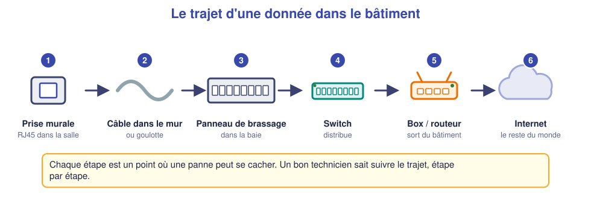
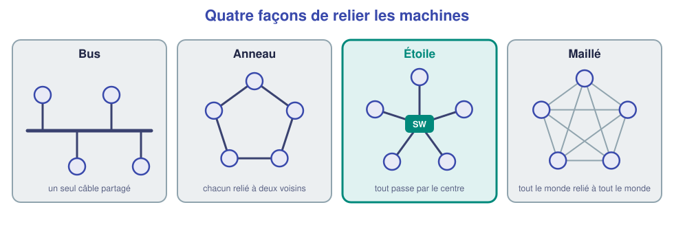
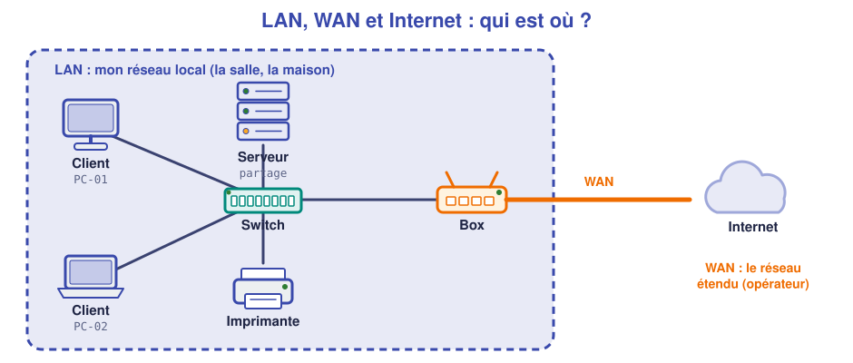
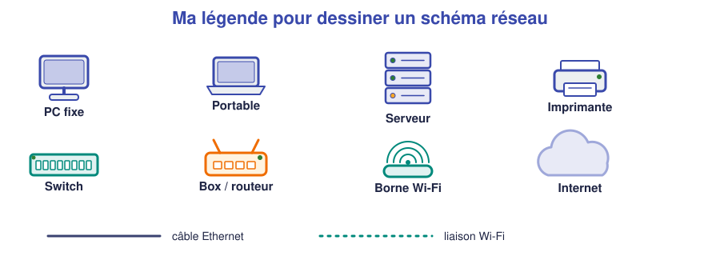

# 📖 Cours – Qu'est-ce qu'un réseau ?

*Bac Pro CIEL – Seconde – E31 – S08*

## 🎯 À la fin de ce cours, tu sauras

- [ ] expliquer ce qu'est un réseau informatique **avec tes mots** ;
- [ ] suivre le trajet **physique** d'une donnée dans un bâtiment ;
- [ ] distinguer **client / serveur**, **switch / routeur / box**, **LAN / WAN / Internet** ;
- [ ] reconnaître une **topologie** (bus, anneau, étoile, maillé) et dire laquelle on utilise aujourd'hui ;
- [ ] **lire** puis **dessiner** un schéma de réseau simple.

---

## 1. Un réseau, c'est quoi ?

### 🤔 À ton avis ?

Tu es dans une salle avec 12 PC et **une seule imprimante**. Tout le monde peut imprimer dessus. **Comment est-ce possible**, alors que l'imprimante est branchée à un seul endroit ?

Voir la réponse

Tous les PC et l'imprimante sont **reliés entre eux par un réseau** : ils s'envoient des données. L'imprimante reçoit les demandes d'impression **par le réseau** et non par un câble direct avec chaque PC.

### 💡 L'idée

> [!TIP]
> Un **réseau informatique** est un ensemble d'**équipements reliés** (par câble ou par ondes) qui **échangent des données**.

**Pourquoi relier des machines ?**

| On partage… | Exemple |
|---|---|
| des **ressources** | une imprimante, un dossier, un serveur |
| une **connexion** | un seul accès Internet pour toute la salle |
| des **services** | messagerie, site web, téléphonie |

### Le trajet physique : on suit le câble

Quand tu ouvres un site depuis un PC de la salle, la donnée traverse **un chemin réel** :

1. **Prise murale** (RJ45) : l'entrée du réseau dans la salle.
2. **Câble dans le mur / la goulotte** : il rejoint un local technique.
3. **Panneau de brassage** (dans la baie) : chaque prise murale arrive sur un **port numéroté**.
4. **Switch** : il **distribue** les données aux machines du réseau.
5. **Box ou routeur** : il fait **sortir** les données du bâtiment.
6. **Internet** : le réseau des réseaux.

### ✅ Vérifie que tu as compris

**Q1.** Un PC n'a plus de réseau. Cite **trois endroits** du trajet où chercher.

Réponse

Le **cordon** entre le PC et la prise, la **prise murale / le câble**, le **panneau de brassage** (cordon débranché), le **port du switch**, le **switch** lui-même (éteint ?), la **box**… On suit le trajet **pas à pas**.

---

## 2. Le vocabulaire du métier

### Qui demande, qui répond ? Client et serveur

- **Client** : il **demande** quelque chose (ton PC qui demande une page web).
- **Serveur** : il **répond** (la machine qui héberge le site).

> *Analogie :* au restaurant, le client **demande** un plat, le serveur (la cuisine) **le prépare**. Une même machine peut être client **et** serveur selon le moment.

### Les équipements : qui fait quoi ?

| Équipement | Son rôle | Règle simple |
|---|---|---|
| **Switch** (commutateur) | Relier les machines d'**un même réseau** | « la multiprise du réseau » |
| **Routeur** | Relier **des réseaux différents** (par ex. ton réseau et Internet) | « le carrefour » |
| **Box** | Un routeur + un switch + le Wi-Fi + d'autres fonctions, dans un seul boîtier | « le tout-en-un » |
| **Borne Wi-Fi** | Relier des appareils **sans fil** au réseau | « la prise sans fil » |
| **Serveur** | Offrir un service (fichiers, web…) | « le fournisseur » |

### Comment sont reliées les machines ? La topologie

### 🤔 À ton avis ?

Cinq PC doivent communiquer. Tu as un câble par PC et un boîtier. **Comment les relier** pour que, si un câble est débranché, **les autres continuent de fonctionner** ?

Réponse

On branche **chaque PC sur le boîtier central** (le switch) : si un câble est débranché, **seul ce PC** perd le réseau. C'est la topologie **en étoile**.

La **topologie** décrit **la façon dont les équipements sont reliés**. On en distingue deux :

- **physique** : comment les **câbles** sont réellement tirés (ce que tu vois dans la baie) ;
- **logique** : comment les **données** circulent (ce que montre un schéma réseau).

| Topologie | Principe | Avantage | Limite |
|---|---|---|---|
| **Bus** | Un seul câble partagé par toutes les machines | Peu de câble | Une coupure arrête **tout** ; ancienne |
| **Anneau** | Chaque machine reliée à deux voisines | Organisé | Une rupture peut bloquer l'anneau ; très rare |
| **Étoile** | Chaque machine reliée à un **point central** (switch) | Une panne ne touche qu'**une** machine ; facile à dépanner | Si le **centre** tombe, tout tombe |
| **Maillé** | Chaque machine reliée à plusieurs autres | Très fiable (plusieurs chemins) | Beaucoup de câbles ; coûteux |

> [!NOTE]
> Aujourd'hui, un réseau local d'entreprise ou de maison est **en étoile** : les prises murales arrivent au **panneau de brassage**, puis au **switch**. Le **maillé** se retrouve sur **Internet** (de nombreux chemins entre les réseaux) et dans certains Wi-Fi maillés.

### LAN, WAN, Internet

| Terme | Signification | Exemple |
|---|---|---|
| **LAN** (*Local Area Network*) | Réseau **local**, dans un lieu limité | La salle de classe, ta maison |
| **WAN** (*Wide Area Network*) | Réseau **étendu**, entre sites éloignés (loué à un opérateur) | La liaison entre la box et le FAI |
| **Internet** | Ensemble de **millions de réseaux** reliés entre eux | Tout ce que tu atteins en ligne |

### Le débit

Le **débit** est la quantité de données transmises **par seconde**. On le compte en **bits par seconde** :

| Unité | Valeur | Exemple |
|---|---|---|
| Mb/s (mégabit par seconde) | 1 million de bits/s | Câble « Fast Ethernet » = 100 Mb/s |
| Gb/s (gigabit par seconde) | 1 milliard de bits/s | Câble « Gigabit » = 1 Gb/s = 1000 Mb/s |

> [!NOTE]
> Attention : **bit** (b) et **octet** (o ou B) ne sont pas la même chose. **1 octet = 8 bits**. Un débit se compte en **bits** ; la taille d'un fichier en **octets**. Un lien à 1 Gb/s transfère au mieux environ 125 Mo par seconde.

### ✅ Vérifie que tu as compris

**Q2.** Ton téléphone ouvre un site : client ou serveur ? Et le site ?

Réponse

Le téléphone est le **client** (il demande) ; la machine qui héberge le site est le **serveur** (il répond).

**Q3.** Complète : « Le ______ relie les machines d'un même réseau ; le ______ relie des réseaux différents. »

Réponse

« Le **switch** relie les machines d'un même réseau ; le **routeur** relie des réseaux différents. »

**Q4.** Dans la salle, tous les PC sont reliés à un switch au centre. Quelle est la topologie ? Que se passe-t-il si le câble d'un PC est débranché ? Et si le switch tombe en panne ?

Réponse

Topologie **en étoile**. Câble débranché : **seul ce PC** perd le réseau. Switch en panne : **tout le réseau** de la salle s'arrête (le centre est le point sensible).

**Q5.** Un lien annonce 100 Mb/s. Combien fait-il en Gb/s ?

Réponse

0,1 Gb/s (1 Gb/s = 1000 Mb/s).

---

## 3. Lire et dessiner un schéma réseau

Un schéma est **la carte** du réseau : il sert à **comprendre**, **dépanner** et **expliquer** sans retourner dans la baie.

### 5 règles pour un bon schéma

1. **Un titre** et **une date**.
2. **Chaque équipement** avec son **nom** (PC-01, SW1…).
3. **Chaque câble** relie **deux équipements** ; on note le **port** si possible.
4. **Une légende** des symboles.
5. **Le sens de lecture** : de l'utilisateur (à gauche) vers Internet (à droite).

> [!TIP]
> **Méthode :** on dessine **d'abord** les équipements, **puis** les câbles, **puis** on légende. Un schéma qui ne **colle pas à la réalité** est pire que pas de schéma : on le **vérifie en suivant les câbles**.

### ✅ Vérifie que tu as compris

**Q6.** Ton schéma montre un PC relié directement à la box, mais en réalité il passe par un switch. Quelle est la conséquence ?

Réponse

Au moment d'une panne, on cherchera au **mauvais endroit** (on ne pensera pas à vérifier le switch). Un schéma **faux** fait perdre du temps.

---

## 4. Ce qu'il faut retenir

> [!TIP]
> 1. Un **réseau** relie des équipements pour **partager** ressources, connexion, services.
> 2. Trajet : **prise → panneau de brassage → switch → routeur/box → Internet**.
> 3. **Topologie** = façon de relier les machines (bus, anneau, **étoile**, maillé) ; aujourd'hui : **en étoile** autour d'un switch.
> 4. **Client** demande, **serveur** répond ; **switch** relie un réseau, **routeur** relie des réseaux.
> 5. **LAN** local, **WAN** étendu, **Internet** = réseaux de réseaux.
> 6. Un bon **schéma** : titre, noms, câbles, légende, **fidèle à la réalité**.

### 📖 Vocabulaire

| Mot | Définition |
|---|---|
| **Réseau** | Équipements reliés qui échangent des données |
| **Client / serveur** | Qui demande / qui répond |
| **Switch / routeur / box** | Relier un réseau / relier des réseaux / tout-en-un |
| **LAN / WAN** | Réseau local / réseau étendu |
| **Topologie** | Façon dont les équipements sont reliés (bus, anneau, étoile, maillé) |
| **Débit** | Quantité de données par seconde (bits/s) |
| **Panneau de brassage** | Panneau qui regroupe les arrivées des prises murales |

➡️ **Suite :** le [🛠️ TP suivre les câbles et dessiner](02-tp.md).
