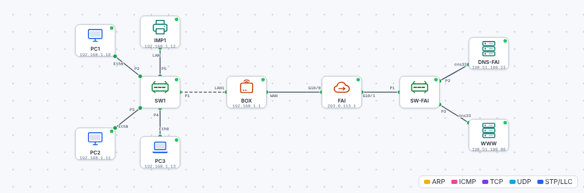

# 🛠️ TP – Suivre les câbles et dessiner le réseau

*Bac Pro CIEL – Seconde – E31 – S08 – binôme*

> [!NOTE]
> **Mission.** Le responsable de l'établissement n'a **aucun schéma** du réseau de votre salle. Vous menez l'enquête, vous dessinez le schéma, puis vous le comparez à un modèle dans le simulateur.

**Binôme :** ____________ / ____________

## A. Enquête : suivre le câble (≈ 45 min)

1. **Choisissez un PC** de la salle. Notez son nom : ______
2. **Suivez** son câble : du PC jusqu'à la prise murale (ou directement jusqu'au switch ?).
3. **Allez à la baie** avec l'enseignant. Relevez :

| Question | Ce que je vois |
|---|---|
| Le numéro de la prise murale du PC | |
| Le numéro du port correspondant sur le panneau de brassage | |
| Le port du switch où il est branché (numéro) | |
| Le nom / la marque du switch | |
| Le câble qui part du switch : vers quel équipement ? | |
| Le nom / la marque de la box ou du routeur | |

✅ **Point de contrôle :** vous savez dire, **sans regarder**, par où passe un PC pour atteindre Internet.
❓ **Pourquoi** y a-t-il un **panneau de brassage** entre les prises et le switch ? ______________________

<details markdown="1"><summary>Aide</summary>

Pour **ne jamais toucher aux câbles du mur** : on change de port avec un simple cordon. C'est **plus propre**, plus rapide et plus **fiable**.

</details>

## B. Schéma papier (≈ 40 min)

Sur une feuille, dessinez le réseau **de la salle** avec la méthode du cours : équipements → câbles → légende.

**Grille de contrôle du schéma :**

| Critère | ✅ |
|---|:---:|
| Titre et date | ☐ |
| Tous les équipements nommés | ☐ |
| Chaque câble relie deux équipements | ☐ |
| Un lien vers Internet | ☐ |
| La **topologie** est indiquée (ex. « en étoile autour de SW1 ») | ☐ |
| Une légende | ☐ |
| Fidèle à ce que j'ai vu en baie | ☐ |

## C. Schéma numérique (≈ 45 min)

Reprenez votre schéma dans **draw.io** (ou LibreOffice Draw). Respectez la **légende** du cours. Exportez en **PNG** et nommez le fichier `schema-salle-prenom.png`.

## D. Retrouver le réseau dans le simulateur (≈ 35 min)

1. Ouvrez le [simulateur](../../simulateur/simulateur-reseau.html) → **Ouvrir** → [`tp/s08-reseau-salle.json`](tp/s08-reseau-salle.json).



2. **Comparez** avec votre schéma. Quels équipements reconnaissez-vous ? Lesquels sont différents ?
3. Double-cliquez sur **PC1** et tapez dans le terminal :

   ```text
   ipconfig
   ping 203.0.113.1
   ```

   Relevez : l'**adresse IP** de PC1 : ______ ; la **passerelle** : ______. Le `ping` répond-il ? ______
4. Ouvrez l'onglet **Navigateur** de **PC3** et allez sur `http://www.exemple.fr`. Que voyez-vous ? ______

❓ **Observe et réponds :**

| Question | Réponse |
|---|---|
| Quelle est la **topologie** du réseau de la salle ? Quel est son point central ? | |
| Quel équipement fait le lien entre le réseau de la salle et Internet ? | |
| Combien d'équipements sont **dans** le LAN ? | |
| Où se trouve le « WAN » sur ce schéma ? | |
| Quel est le **client**, quel est le **serveur** dans la consultation de `www.exemple.fr` ? | |

<details markdown="1"><summary>Éléments de réponse</summary>

La topologie est **en étoile** (point central : le **switch**) ; la **box** relie le LAN à Internet ; le LAN comprend le switch, 3 postes et l'imprimante ; le WAN est la liaison **BOX–FAI** ; PC3 est le **client**, `WWW` le **serveur**.

</details>

> [!NOTE]
> Les adresses (`192.168.1.x`, `203.0.113.x`, `198.51.100.x`) ne t'ont pas été expliquées : **c'est normal**. On les comprendra en S11. Pour l'instant, on **observe**.

## 🏁 Bilan

| Mon auto-évaluation | 😟 | 🙂 | 😀 |
|---|---|---|---|
| Je sais suivre le trajet d'une donnée dans le bâtiment | | | |
| Je distingue switch, routeur, box | | | |
| Je sais dessiner un schéma réseau lisible | | | |
| Je sais ce que sont LAN, WAN, Internet | | | |

> [!TIP]
> **Passeport :** « Dessiner le schéma d'un petit réseau » → *vu en guidé* ✔.

➡️ **Mission en entreprise :** faire un schéma, même approximatif, du réseau de l'entreprise (box, switch, postes, imprimantes).
