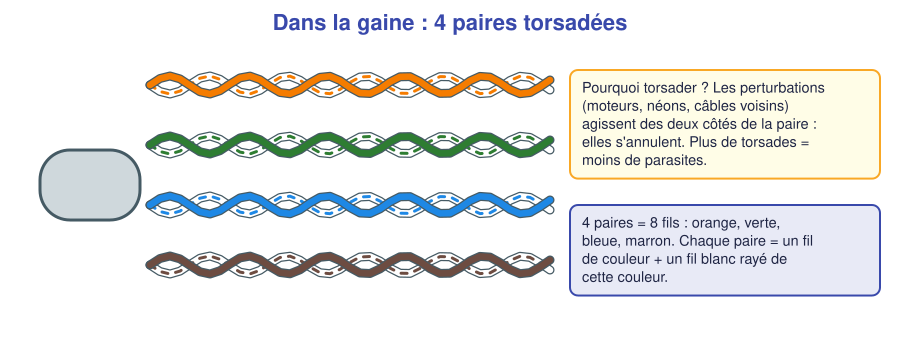
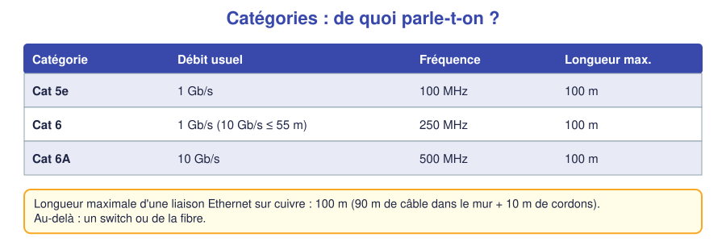
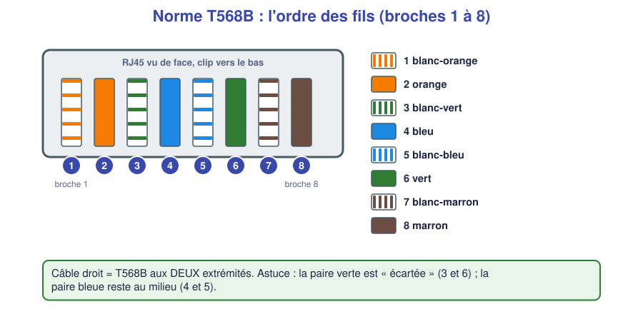
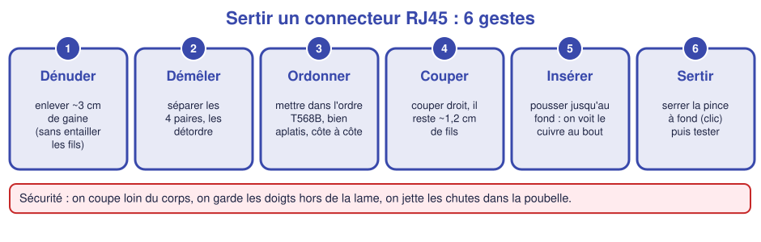
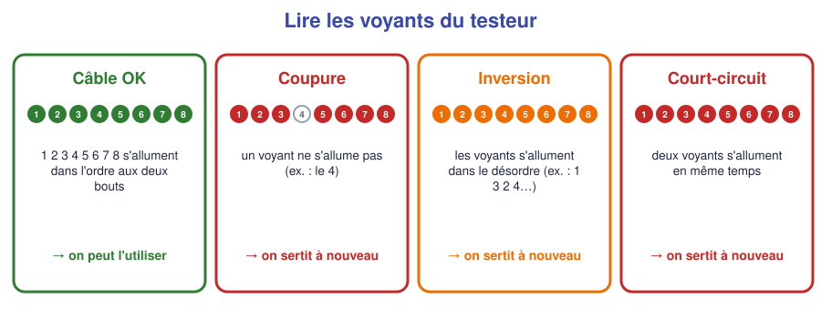

# 📖 Cours – Le câble réseau et le connecteur RJ45

*Bac Pro CIEL – Seconde – E31 – S09*

## 🎯 À la fin de ce cours, tu sauras

- [ ] décrire l'intérieur d'un câble réseau ;
- [ ] expliquer pourquoi les fils sont **torsadés** ;
- [ ] donner l'ordre des fils en **T568B** ;
- [ ] expliquer ce que signifient **Cat 5e / Cat 6** et la limite de **100 m** ;
- [ ] **lire** un testeur de câble.

---

## 1. Dans la gaine : 4 paires torsadées

### 🤔 À ton avis ?

Tu regardes un câble réseau coupé : tu y vois **8 fils colorés, tordus deux par deux**. **Pourquoi ne pas les laisser droits ?**

Voir la réponse

Un fil qui transporte un signal capte les **parasites** (moteurs, néons, câbles voisins). En **tordant deux fils ensemble**, le parasite agit **de la même façon sur les deux** et il **s'annule** à l'arrivée, car on regarde la **différence** entre eux. Plus la torsade est serrée, plus le câble est protégé.

Il y a **4 paires** : **orange**, **verte**, **bleue**, **marron**. Dans chaque paire, un fil est **de couleur unie**, l'autre est **blanc rayé** de la même couleur.

### Les catégories

> [!TIP]
> **Retiens :** le câble le plus courant est **Cat 5e** ou **Cat 6**, utilisable à **1 Gb/s**. **Maximum 100 m** entre deux équipements actifs.

**UTP / FTP / STP :** *U* = non blindé (le plus courant), *F* = écran en feuille d'aluminium, *S* = tresse métallique : plus de protection contre les parasites, mais plus cher et plus raide.

### ✅ Vérifie que tu as compris

**Q1.** À quoi servent les torsades ?

Réponse

À **limiter les parasites** : les perturbations s'annulent entre les deux fils d'une paire.

**Q2.** Tu dois relier deux bâtiments distants de 150 m avec un câble cuivre. Est-ce possible ?

Réponse

**Non**, au-delà de 100 m le signal est trop affaibli. Il faut un **switch intermédiaire** ou une **fibre optique**.

---

## 2. La norme T568B : l'ordre des fils

| Broche | Couleur |
|---|---|
| 1 | blanc-orange |
| 2 | orange |
| 3 | blanc-vert |
| 4 | bleu |
| 5 | blanc-bleu |
| 6 | vert |
| 7 | blanc-marron |
| 8 | marron |

> [!IMPORTANT]
> **Une norme, c'est un accord.** Si tout le monde range les fils dans le même ordre, **tous les câbles et toutes les prises sont compatibles**. Un câble **droit** se fait avec la **même norme (T568B) aux deux bouts**.

**Moyen mnémotechnique :** *« Orange – Vert – Bleu – Marron »* (les paires, dans l'ordre), avec **la paire verte écartée** (3 et 6) autour de la paire bleue (4-5).

**Comment tenir le connecteur ?** Clip **vers le bas**, ouverture **vers toi** : la broche **1 est à gauche**.

### ✅ Vérifie que tu as compris

**Q3.** Cite l'ordre de gauche à droite des 4 premières couleurs en T568B.

Réponse

Blanc-orange, orange, blanc-vert, bleu.

**Q4.** Pourquoi est-ce gênant d'utiliser des ordres différents à chaque bout du câble ?

Réponse

Les paires ne correspondent plus : le signal n'arrive pas sur les bons contacts. Le câble sera **mal fonctionnel ou inutilisable**.

---

## 3. Sertir un RJ45 en 6 gestes

> [!WARNING]
> **Sécurité :** la lame de la pince **coupe**. Coupe **loin du corps**, doigts **hors** de la lame, lunettes si les chutes volent. Les chutes de câble vont **à la poubelle** (pas par terre).

**Les erreurs classiques et leur cause :**

| Symptôme | Cause |
|---|---|
| Le câble ressort du connecteur | La **gaine** n'est pas assez engagée (on doit voir la gaine **sous le serre-câble**) |
| Un fil n'est pas au bout | Fils **trop courts** ou pas **poussés jusqu'au fond** |
| Le connecteur ne rentre pas dans le port | Fils **trop longs** ou pas **aplatis** |
| Test partiellement faux | Fils **mal ordonnés** ou **croisés** |

---

## 4. Tester un câble

Un **testeur de câble** envoie un signal sur chaque fil, **l'un après l'autre**. Il allume **les voyants 1 à 8** :

| Ce que je vois | Ce que ça signifie | Que faire ? |
|---|---|---|
| **1 → 8** dans l'ordre | Câble correct | On l'utilise |
| Un voyant **ne s'allume pas** | **Coupure** (fil mal serti, pas au bout) | Recouper et sertir à nouveau |
| Ordre **différent** | **Inversion** de fils | Refaire le sertissage |
| Deux voyants **ensemble** | **Court-circuit** | Refaire le sertissage |

> [!NOTE]
> Un testeur de base vérifie la **continuité** (le câble relie-t-il bien chaque fil ?). Il ne mesure ni la **vitesse** ni la **qualité** : cela demande un **certificateur** (vu en Terminale).

### ✅ Vérifie que tu as compris

**Q5.** Le testeur allume 1, 2, 3, 5, 6, 7, 8 mais pas le 4. Quel est le diagnostic ?

Réponse

**Coupure** sur le fil 4 (bleu) : il n'est probablement pas bien en contact. On **recoupe et on resertit**.

**Q6.** Pourquoi teste-t-on un câble **même s'il a l'air bien serti** ?

Réponse

Parce qu'un défaut **ne se voit pas à l'œil nu** (un fil peut manquer le contact). Le test **prouve** que le câble est bon.

---

## 5. Ce qu'il faut retenir

> [!TIP]
> 1. Un câble réseau = **4 paires torsadées** (orange, verte, bleue, marron) ; les torsades **limitent les parasites**.
> 2. **Cat 5e / Cat 6**, **1 Gb/s**, **100 m maximum**.
> 3. **T568B** : blanc-orange, orange, blanc-vert, bleu, blanc-bleu, vert, blanc-marron, marron. Câble **droit** = T568B **aux deux bouts**.
> 4. **6 gestes** : dénuder, démêler, ordonner, couper, insérer, sertir. **Toujours tester.**
> 5. Testeur : 1→8 dans l'ordre = OK ; sinon coupure, inversion ou court-circuit.

### 📖 Vocabulaire

| Mot | Définition |
|---|---|
| **Paire torsadée** | Deux fils enroulés ensemble pour limiter les parasites |
| **UTP** | Câble non blindé |
| **T568B** | Norme d'ordre des fils pour un RJ45 |
| **Câble droit** | Même ordre aux deux extrémités |
| **Sertir** | Fixer le connecteur au câble avec une pince |
| **Testeur de câble** | Appareil qui vérifie la continuité fil par fil |

➡️ **Suite :** le [🛠️ TP fabriquer et tester un câble](02-tp.md).
