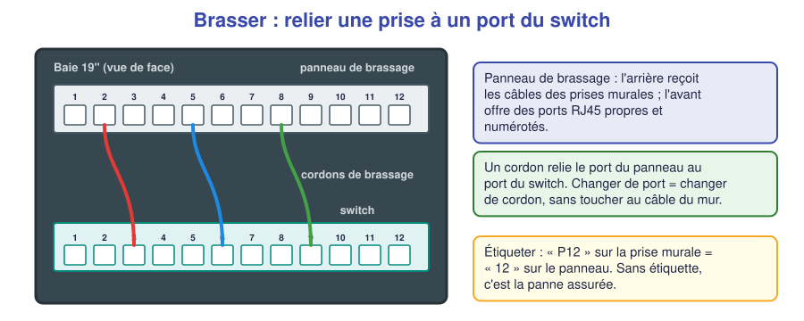
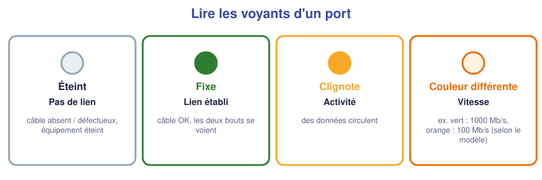
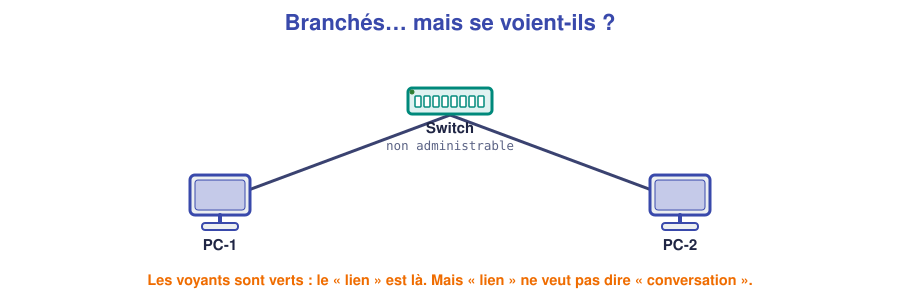

# 📖 Cours – Raccorder, brasser, étiqueter

*Bac Pro CIEL – Seconde – E31 – S10*

## 🎯 À la fin de ce cours, tu sauras

- [ ] expliquer à quoi sert une **prise murale RJ45** et un **panneau de brassage** ;
- [ ] décrire comment **brasser** (relier un port du panneau à un port du switch) ;
- [ ] **étiqueter** correctement ;
- [ ] **lire les voyants** d'un port réseau ;
- [ ] expliquer la différence entre **« lien établi »** et **« les machines se parlent »**.

---

## 1. La prise murale et le câble d'installation

### 🤔 À ton avis ?

Pourquoi ne branche-t-on pas directement le câble qui sort du mur sur le PC, en y sertissant un RJ45 ?

Voir la réponse

Un câble **dans le mur** est **rigide** (un seul fil dur par conducteur) et **ne doit pas être plié ni déplacé** : il casserait. On le termine donc dans un **module** fixe (la prise), et l'utilisateur branche un **cordon souple** (fils multibrins) entre la prise et le PC.

### 💡 L'idée

| Pièce | Rôle | Particularité |
|---|---|---|
| **Câble d'installation** (dans le mur) | Relie la prise au local technique | Fils **rigides** : on ne le plie pas |
| **Module keystone** (la prise) | Termine le câble ; offre un port RJ45 | Fils **insérés par un outil à 110** ou sans outil |
| **Cordon** (poste de travail) | Relie la prise au PC | Fils **souples**, connecteurs **sertis** |
| **Panneau de brassage** | Regroupe **toutes les arrivées** dans la baie | Un port = une prise murale |
| **Cordon de brassage** | Relie le panneau au switch | Court, souple |

### Brancher un module keystone

1. **Dénuder** la gaine (~3 cm), **ne pas entailler** les fils.
2. **Séparer** les paires, **les détordre au minimum** (le plus proche possible du module).
3. **Placer chaque fil** dans sa fente selon le **code couleur** imprimé sur le module (T568B).
4. **Enfoncer** avec l'outil de pose (il coupe l'excédent) ou fermer le capot du module.
5. **Clipser** le module dans la plaque, puis la plaque au mur.
6. **Tester** la continuité.

> [!WARNING]
> **Ne détords pas trop les paires** : une paire détordue sur plus de 1,3 cm perd sa protection contre les parasites et le débit peut s'effondrer. C'est un défaut très courant.

### ✅ Vérifie que tu as compris

**Q1.** Pourquoi le câble du mur est-il rigide et le cordon souple ?

Réponse

Le câble du mur est **posé une fois** (rigide, plus stable) ; le cordon **bouge** tous les jours (souple, résiste aux manipulations).

---

## 2. Brasser et étiqueter

**Brasser**, c'est **relier avec un cordon** un port du panneau (donc **une prise murale**) à un port du **switch**. Pour changer de port ou de poste, on **change juste le cordon**, sans toucher aux câbles du mur.

> [!NOTE]
> **Rappel (S08) :** le panneau de brassage est le **centre de l'étoile** : toutes les prises du bâtiment y arrivent, et le switch les relie entre elles. C'est la **topologie en étoile** vue en S08, mais **câblée** dans le mur.

### Pourquoi étiqueter ?

Une baie sans étiquette est **un plat de spaghettis**. Quand un utilisateur appelle pour dire « ma prise ne marche plus », il faut savoir **en 30 secondes** à quel port correspond cette prise.

| Où ? | Que mettre ? | Exemple |
|---|---|---|
| **Prise murale** | Le **numéro** de la prise | `B2-14` (bureau 2, prise 14) |
| **Panneau de brassage** | **Le même** numéro | `B2-14` au port 14 |
| **Cordon de brassage** | Origine → destination | `P14 → SW1/12` |
| **Switch** | Nom du switch | `SW1` |

> [!TIP]
> **Règle d'or :** la même **étiquette** à **chaque bout** du chemin. Une étiquette est utile **si** elle est **lisible**, **durable** et **à jour**.

### ✅ Vérifie que tu as compris

**Q2.** La prise « B2-14 » est branchée sur le port 14 du panneau. Quel cordon la relie au switch ?

Réponse

Un **cordon de brassage** entre le **port 14 du panneau** et un **port du switch** (par exemple 12). On note `P14 → SW1/12` sur le cordon.

---

## 3. Le switch et ses voyants

Un **switch non administrable** n'a **aucun réglage** : on le branche et il fonctionne. Chaque port a **des voyants** qui parlent :

| Voyant | Signification |
|---|---|
| **Éteint** | **Pas de lien** : câble absent ou défectueux, équipement éteint |
| **Fixe** | **Lien établi** : les deux bouts sont branchés et allumés |
| **Clignotant** | **Activité** : des données circulent |
| **Couleur différente** | Souvent la **vitesse** (ex. 1000 Mb/s ou 100 Mb/s selon le modèle) |

> [!NOTE]
> **Vitesse :** un câble mal serti ou une paire abîmée peut faire passer un lien de **1000 Mb/s à 100 Mb/s**, voire 10. Un lien lent est **un indice** de câble défectueux.

### « Lien » ne veut pas dire « conversation »

Des voyants **verts** prouvent que le **câble** et les **cartes réseau** se voient. Cela **ne prouve pas** que les PC **peuvent se parler**. Il manque quelque chose d'autre… nous le découvrirons en **S11**.

### ✅ Vérifie que tu as compris

**Q3.** Un voyant est éteint sur le port du switch alors que le PC est branché et allumé. Quelles sont tes hypothèses, dans l'ordre ?

Réponse

1) Le **cordon** n'est pas bien enclenché. 2) Le **câble** est défectueux. 3) Le **port** du switch ou la **carte réseau** du PC est en cause. On teste avec **un autre cordon** puis **un autre port**.

**Q4.** Les voyants sont verts mais les deux PC ne se voient pas. Le câble est-il en cause ?

Réponse

Probablement **pas** : les voyants montrent que le lien physique est établi. La cause est **ailleurs** (nous la trouverons en S11).

---

## 4. Ce qu'il faut retenir

> [!TIP]
> 1. **Câble du mur** (rigide) → **prise** (module) → **cordon** (souple) → PC.
> 2. **Panneau de brassage** + **cordon de brassage** → switch. On **brasse** sans toucher au mur.
> 3. **Étiqueter** à chaque bout, avec les **mêmes** noms.
> 4. **Voyants** : éteint = pas de lien ; fixe = lien ; clignotant = activité.
> 5. **Lien établi ≠ conversation** : il faudra autre chose (S11).

### 📖 Vocabulaire

| Mot | Définition |
|---|---|
| **Keystone** | Module de prise RJ45 qui se clipse dans une plaque |
| **Brasser** | Relier un port du panneau à un port du switch avec un cordon |
| **Panneau de brassage** | Panneau regroupant les arrivées des prises murales |
| **Cordon** | Câble souple court avec connecteurs sertis |
| **Lien (link)** | Connexion physique établie entre deux équipements |

➡️ **Suite :** le [🛠️ TP raccorder, brasser, étiqueter](02-tp.md).
