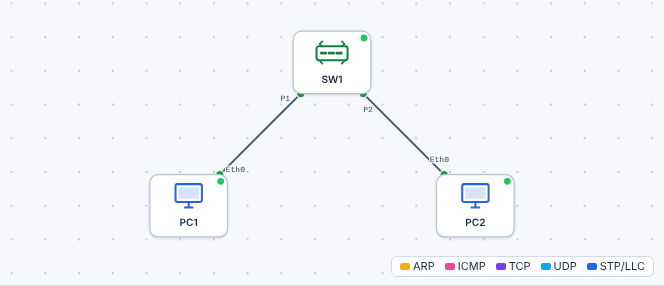

# 🛠️ TP – Raccorder, brasser, étiqueter

*Bac Pro CIEL – Seconde – E31 – S10 – binôme*

> [!NOTE]
> **Mission.** Un nouveau bureau est équipé de **deux postes**. Vous montez la prise, vous brassez, vous étiquetez, vous testez, puis vous raccordez deux PC à un switch. À la fin, **une énigme** vous attend.

> [!NOTE]
> **Comment ce TP fonctionne.** Les parties A à C sont **guidées** (gestes techniques). La partie D est une **énigme** : tu écris tes hypothèses avant de tester. Le **bilan final** t'aide à remplir ton **passeport d'autonomie**.

**Binôme :** ____________ / ____________ **Poste n° :** ____

## A. Monter une prise murale (≈ 50 min)

1. Récupérer un **module keystone**, un morceau de **câble d'installation** (~1 m), un **outil de pose**.
2. Suivre le [cours §1](01-cours.md) :

| Étape | Je fais… | ✅ |
|---|---|:---:|
| 1 | Dénuder ~3 cm de gaine | ☐ |
| 2 | Séparer les paires, **détordre au minimum** | ☐ |
| 3 | Placer chaque fil selon le **code couleur du module** (T568B) | ☐ |
| 4 | Enfoncer avec l'outil / fermer le capot | ☐ |
| 5 | Clipser le module dans la plaque | ☐ |
| 6 | Tester avec le testeur de câble | ☐ |

**Résultat du test :** __________________ ✅ / ❌

🔍 **Si le testeur indique une erreur :** que signifie-t-elle (fil inversé, coupé, croisé) et comment la corriges-tu ? ______________________

❓ **Pourquoi** ne faut-il pas détordre les paires sur plus de 1,3 cm ? ______________________

Aide

Une paire détordue **perd sa protection** : les parasites pénètrent, le débit chute.

## B. Brasser et étiqueter (≈ 40 min)

Sur la maquette de baie :

1. **Repérer** le port du panneau qui correspond à votre prise : n° ____
2. **Choisir** un **cordon** de brassage et **relier** le port du panneau à un port libre du switch : n° ____
3. **Étiqueter.** 🤔 *Imagine qu'un collègue reprenne la baie dans un an : quelle information doit-il pouvoir lire sans te poser de question ?* ______________________

| Où ? | Étiquette que j'ai posée |
|---|---|
| Prise murale | |
| Port du panneau | |
| Cordon (2 bouts) | |

**Grille de contrôle :**

| Critère | ✅ |
|---|:---:|
| La même référence sur la prise et le panneau | ☐ |
| Étiquettes lisibles | ☐ |
| Cordon de longueur adaptée (ni trop long, ni tendu) | ☐ |
| Aucun câble qui traîne | ☐ |

## C. Relier deux PC au switch et lire les voyants (≈ 40 min)

1. Brancher **PC1** et **PC2** à un **switch non administrable** avec **deux cordons**.
2. Compléter :

| Observation | PC1 | PC2 |
|---|---|---|
| Voyant du port du switch | | |
| Voyant de la carte réseau du PC | | |
| Le voyant clignote-t-il quand j'ouvre le navigateur ? | | |
| Vitesse du lien (indiquée dans *Paramètres → Réseau* ou par la couleur) | | |

✅ **Point de contrôle :** **les voyants sont allumés des deux côtés** pour les deux PC.

❓ **Que feriez-vous si le voyant restait éteint sur PC2 ?** (3 actions dans l'ordre) ______________________

## D. 🕵️ L'énigme : « les deux PC se voient-ils ? » (≈ 40 min)

### D1. Sur le matériel (20 min)

Les deux PC sont branchés, les voyants sont verts.

1. **Hypothèse (avant de tester) :** à votre avis, vont-ils se joindre ? ______________________
2. Sur PC1, ouvrez un terminal et **tentez** : `ping` vers l'autre PC (adresse fournie par l'enseignant ou affichée par `ipconfig`).
3. **Résultat :** ______________________
4. **Hypothèses sur la cause** (au moins trois, même fausses) :

| Hypothèse | Pourquoi je le pense | Comment je pourrais la vérifier |
|---|---|---|
| | | |
| | | |
| | | |

> [!TIP]
> **Pas de bonne ou de mauvaise réponse aujourd'hui.** On note vos hypothèses, on les **ressortira en S11** pour voir qui avait raison !

### D2. Dans le simulateur (20 min)

1. Ouvrez le simulateur → **Ouvrir** → [`tp/s10-deux-pc-switch.json`](tp/s10-deux-pc-switch.json).

2. Double-cliquez sur **PC1** : `ipconfig`. Que remarquez-vous à la ligne « Adresse IPv4 » ? ______________________
3. Faites la même chose sur PC2.
4. **Qu'est-ce qui manque**, à votre avis, pour que les PC se parlent ? ______________________

Indice (à ne déplier qu'après avoir réfléchi)

Pour que des courriers arrivent, **chaque maison doit avoir une adresse**. Que vous dit `ipconfig` à la ligne « Adresse IPv4 » ?

## 🏁 Bilan

### 📒 Mon bilan pour le passeport d'autonomie (écrit, individuel)

| Question | Ma réponse |
|---|---|
| Ce qui m'a **posé problème** pendant la pose de la prise, et comment j'ai réglé | |
| Pourquoi on **étiquette** (une raison concrète) | |
| Ce que je saurais **refaire seul(e)**, sans fiche | |
| Ma **preuve** (résultat du testeur, grille de contrôle, hypothèses de l'énigme) | |

| Mon auto-évaluation | 😟 | 🙂 | 😀 |
|---|---|---|---|
| Je sais monter une prise RJ45 | | | |
| Je sais brasser et étiqueter | | | |
| Je lis les voyants d'un port | | | |
| Je comprends que « lien » ≠ « conversation » | | | |

> [!TIP]
> **Passeport :** « Monter une prise, brasser, étiqueter » → *vu en guidé* ✔.

➡️ **Mission en entreprise :** repérer le panneau de brassage ou la baie, lire les étiquettes (photo si autorisée).
