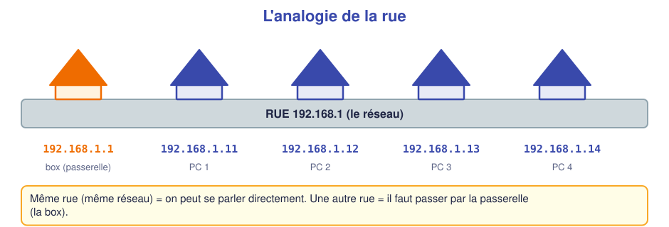
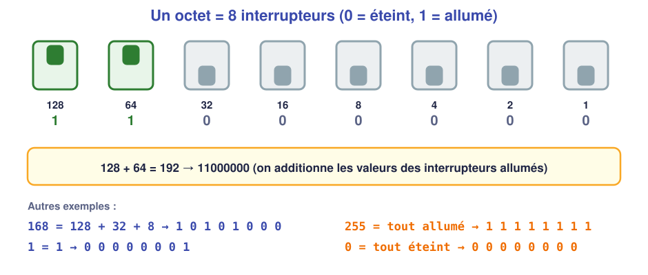
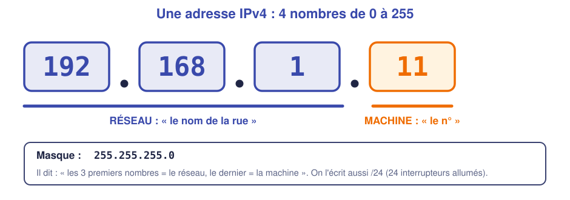
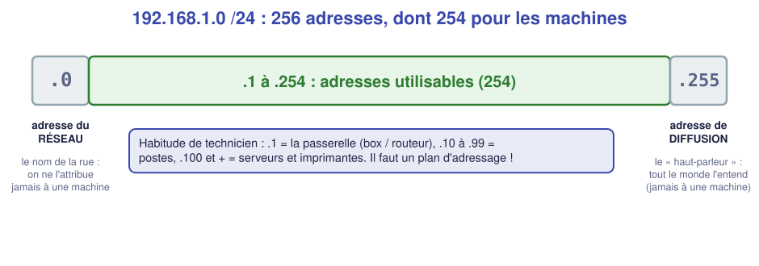
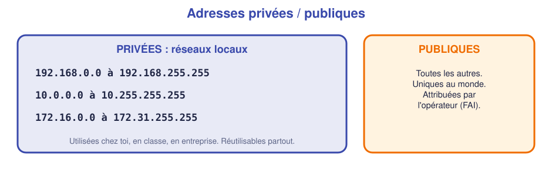
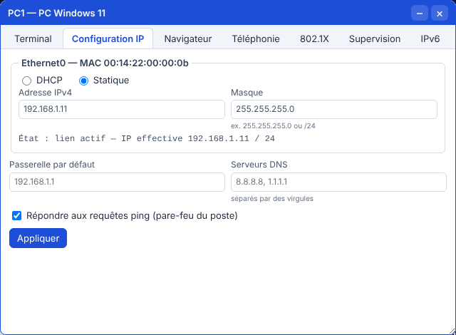
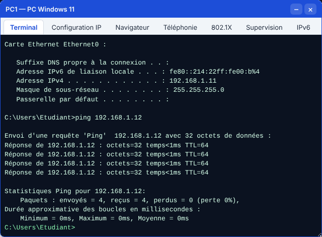
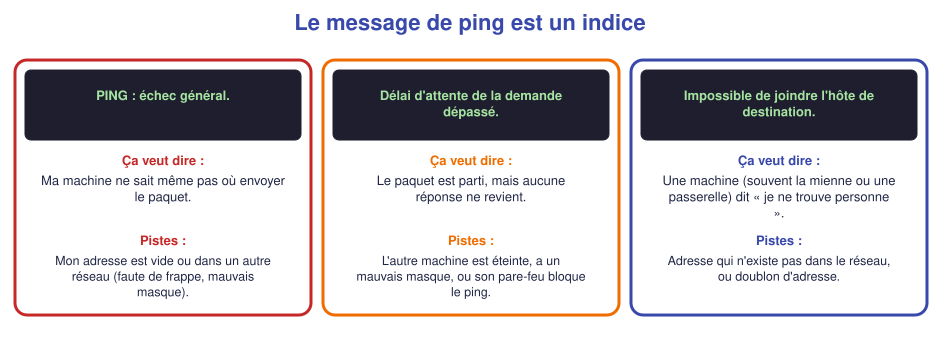
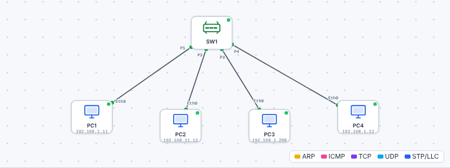

# 📖 Cours – Les adresses IP

*Bac Pro CIEL – Seconde – E31 – S11*

## 🎯 À la fin de ce cours, tu sauras

- [ ] expliquer **pourquoi** une machine a besoin d'une adresse IP ;
- [ ] lire un **octet** (8 interrupteurs) et le convertir ;
- [ ] lire une adresse **192.168.1.11** et un masque **255.255.255.0 (/24)** ;
- [ ] dire quelle est **l'adresse du réseau**, **de diffusion** et **la plage utilisable** ;
- [ ] reconnaître une adresse **privée** ;
- [ ] **configurer** une IP statique et **tester** ;
- [ ] **trouver** une erreur d'adressage avec le message du `ping`.

---

## 1. Pourquoi une adresse ?

### 🤔 Retour sur l'énigme de S10

Deux PC reliés par un switch, voyants verts… et **ils ne se parlaient pas**. Qu'avait-on vu avec `ipconfig` ? **Une adresse IPv4 vide.**

**Question :** pourquoi cette absence d'adresse suffit-elle à les empêcher de se parler ?

<details markdown="1"><summary>Voir la réponse</summary>

Sur un réseau, les données voyagent sous forme de **paquets**, comme des **lettres**. Une lettre **sans adresse** d'expéditeur ni de destinataire **ne peut pas être livrée** : le switch ne sait pas à qui la remettre, et le destinataire ne sait pas à qui répondre. Chaque machine doit avoir **une adresse unique**.

</details>

### 💡 L'idée : la rue et le numéro



- Le **nom de la rue** est le **réseau** : toutes les maisons de la rue le partagent.
- Le **numéro** est la **machine** : il est **différent** pour chaque maison.
- Deux maisons de **la même rue** peuvent se parler **directement**. Pour une **autre rue**, il faut passer par un **carrefour** (la **passerelle** : la box, le routeur).

> [!TIP]
> **Adresse IP** = **réseau** + **machine**. Deux machines **doivent être dans le même réseau** (même « rue ») pour se parler directement.

---

## 2. Un octet, c'est 8 interrupteurs

### 🤔 À ton avis ?

Un ordinateur ne comprend que **deux états** : le courant passe (**1**) ou ne passe pas (**0**). Comment peut-il représenter le nombre **192** avec seulement des 0 et des 1 ?

<details markdown="1"><summary>Voir la réponse</summary>

En utilisant **plusieurs interrupteurs côte à côte** (8 pour un octet), chacun ayant **une valeur** : 128, 64, 32, 16, 8, 4, 2, 1. On **additionne** les valeurs des interrupteurs **allumés**.

</details>



**Méthode pour passer du décimal au binaire :** on part de **128** et on se demande à chaque fois : *« est-ce que ça rentre ? »*

Exemple pour **168** :

| Valeur | 128 | 64 | 32 | 16 | 8 | 4 | 2 | 1 |
|---|---|---|---|---|---|---|---|---|
| Reste avant | 168 | 40 | 40 | 8 | 8 | 0 | 0 | 0 |
| Ça rentre ? | oui (168 ≥ 128) | non (40 < 64) | oui (40 ≥ 32) | non (8 < 16) | oui (8 ≥ 8) | non | non | non |
| Interrupteur | **1** | **0** | **1** | **0** | **1** | **0** | **0** | **0** |

Donc **168 = 10101000**.

**Dans l'autre sens** (binaire → décimal) : on additionne les valeurs des interrupteurs allumés. `11000000` = 128 + 64 = **192**.

> [!NOTE]
> **Pourquoi 255 maximum ?** Quand les 8 interrupteurs sont allumés : 128+64+32+16+8+4+2+1 = **255**. Donc un octet va de **0 à 255** (256 valeurs).

### ✅ Vérifie que tu as compris

**Q1.** Quelle valeur représente `00001010` ?

<details markdown="1"><summary>Réponse</summary>

8 + 2 = **10**.

</details>

**Q2.** Écris **255** et **0** en binaire.

<details markdown="1"><summary>Réponse</summary>

255 = `11111111` ; 0 = `00000000`.

</details>

**Q3.** Pourquoi une adresse IP ne contient-elle jamais le nombre 256 ?

<details markdown="1"><summary>Réponse</summary>

Parce qu'un octet ne peut pas dépasser **255** (tous les interrupteurs allumés).

</details>

---

## 3. L'adresse IPv4 et le masque /24



Une **adresse IPv4** = **4 octets** (4 nombres de 0 à 255) séparés par des points : `192.168.1.11`.

### Le masque : où coupe-t-on ?

Le **masque de sous-réseau** dit **où se situe la coupure** entre « la rue » et « le numéro » :

| Masque | Notation courte | Lecture |
|---|---|---|
| `255.255.255.0` | **/24** | Les **3 premiers octets** = réseau ; le **dernier** = machine |

> [!IMPORTANT]
> **Cette année, on utilise uniquement le masque `255.255.255.0` (/24).** Le « /24 » veut dire : **24 interrupteurs allumés** au début (3 octets de 8). On étudiera d'autres masques en Première.

**Deux machines sont dans le même réseau si leurs trois premiers nombres sont identiques** (avec un /24) :

| Machine 1 | Machine 2 | Même réseau ? |
|---|---|---|
| 192.168.**1**.11 | 192.168.**1**.12 | ✅ oui |
| 192.168.**1**.11 | 192.168.**2**.12 | ❌ non (3ᵉ nombre différent) |
| 192.168.**1**.11 | 192.168.**11**.12 | ❌ non (3ᵉ nombre différent) |

### Les adresses spéciales d'un réseau /24



Dans le réseau **192.168.1.0/24** :

| Adresse | Nom | Rôle | Attribuable à une machine ? |
|---|---|---|---|
| `192.168.1.0` | **Adresse du réseau** | Le « nom de la rue » | ❌ non |
| `192.168.1.1` à `192.168.1.254` | **Plage utilisable** (254 adresses) | Les machines | ✅ oui |
| `192.168.1.255` | **Adresse de diffusion** (*broadcast*) | « À tout le monde de la rue » | ❌ non |

### Adresses privées et publiques



Les adresses **privées** servent dans les réseaux locaux. **Beaucoup de réseaux utilisent les mêmes** (la plupart des box sont en `192.168.1.0/24` !) : ça ne pose pas de problème, car elles **ne sortent jamais sur Internet** telles quelles (la box les remplace, nous le verrons en S13).

### ✅ Vérifie que tu as compris

**Q4.** Dans `192.168.1.0/24`, combien de machines peut-on brancher ?

<details markdown="1"><summary>Réponse</summary>

**254** (de `.1` à `.254`) ; `.0` et `.255` sont réservées.

</details>

**Q5.** 192.168.5.20 et 192.168.5.200 sont-elles dans le même réseau ? Et 192.168.5.20 et 192.168.50.20 ?

<details markdown="1"><summary>Réponse</summary>

Oui pour la première paire (`192.168.5` identique). **Non** pour la seconde (`192.168.5` ≠ `192.168.50`).

</details>

**Q6.** L'adresse `192.168.1.255` peut-elle être donnée à un PC ? Pourquoi ?

<details markdown="1"><summary>Réponse</summary>

**Non** : c'est l'adresse de **diffusion** du réseau (message destiné à toutes les machines). L'attribuer à un PC créerait la confusion.

</details>

**Q7.** `172.20.4.5` est-elle une adresse privée ? Et `8.8.8.8` ?

<details markdown="1"><summary>Réponse</summary>

`172.20.4.5` : **oui** (plage 172.16 à 172.31). `8.8.8.8` : **non** (publique).

</details>

---

## 4. Configurer une adresse IP statique

**Statique** = on **choisit nous-mêmes** l'adresse (par opposition à **dynamique** : la machine l'obtient automatiquement, c'est le **DHCP**, vu en S12).

### Un plan d'adressage avant de commencer

> [!TIP]
> **Avant de configurer, on écrit un plan.** C'est un tableau qui dit **qui a quelle adresse**. Sans plan, on fait des **doublons**.

| Machine | Rôle | Adresse IP | Masque |
|---|---|---|---|
| PC1 | Poste Windows | 192.168.1.11 | 255.255.255.0 |
| PC2 | Poste Linux | 192.168.1.12 | 255.255.255.0 |
| PC3 | Portable | 192.168.1.13 | 255.255.255.0 |

### Sous Windows

*Paramètres → Réseau et Internet → Ethernet → Modification des paramètres IP → Manuel* (ou `Windows` + `R`, `ncpa.cpl`, propriétés *IPv4*) :

- **Adresse IP** : `192.168.1.11` ; **masque** : `255.255.255.0` ; **passerelle** : vide pour l'instant.

### Sous Linux (bureau Ubuntu)

*Paramètres → Réseau → ⚙ de la carte filaire → onglet IPv4 → Manuel* : adresse, masque (`255.255.255.0`), passerelle vide.

### Dans le simulateur



Double-clic sur le PC → onglet **Configuration IP** → **Statique** → adresse et masque → **Appliquer**.

### Vérifier

```text
C:\> ipconfig             (Windows)
C:\> ipconfig /all         (Windows : plus de détails, dont l'adresse MAC)
C:\> getmac                (Windows : seulement l'adresse MAC)
$ ip a                    (Linux)
```

puis `ping` d'une autre machine. Si ça marche :



---

## 5. Quand ça ne marche pas : le message du ping est un indice



Dans le simulateur, voici **trois erreurs d'adressage** courantes (TP : chasse aux erreurs) :



| Erreur | Exemple | Ce qu'on observe |
|---|---|---|
| **Faute de frappe** dans l'adresse | `192.168.11.12` au lieu de `192.168.1.12` | « échec général » : l'autre machine est dans **un autre réseau** |
| **Mauvais masque** | `255.255.255.128` (/25) au lieu de `/24` | Un côté **envoie** mais l'autre **ne sait pas répondre** : « délai dépassé » |
| **Doublon** | Deux machines en `192.168.1.11` | Comportement **incohérent** (réponses perdues, conflit signalé) |

### Le pare-feu qui bloque le ping

**Piège classique :** sous **Windows**, par défaut, le **pare-feu** bloque les **requêtes de ping entrantes**. Résultat : un PC Windows **peut pinguer les autres** mais **ne répond pas** quand on le pingue.

> [!WARNING]
> **Ping qui échoue ≠ panne.** Avant de dire « le câble est cassé », vérifie que **le pare-feu de l'autre poste** n'est pas en cause. Dans le simulateur, la case **« Répondre aux requêtes ping »** reproduit ce réglage ; sur Windows, la règle à activer s'appelle *Partage de fichiers et d'imprimantes (Demande d'écho – ICMPv4 entrant)*.

### ✅ Vérifie que tu as compris

**Q8.** PC1 (`192.168.1.11`) pingue PC2 configuré `192.168.11.12` : message « échec général ». Pourquoi ?

<details markdown="1"><summary>Réponse</summary>

PC2 est dans **un autre réseau** (`192.168.11.x`, alors que PC1 est en `192.168.1.x`). PC1 ne sait pas où envoyer le paquet : il n'a pas de passerelle.

</details>

**Q9.** PC1 ne peut pas pinguer PC2 (Windows), mais PC2 pingue PC1 sans problème. Quelle est la cause la plus probable ?

<details markdown="1"><summary>Réponse</summary>

Le **pare-feu de PC2** bloque les pings entrants. Le chemin physique et l'adressage sont corrects (puisque PC2 → PC1 fonctionne).

</details>

---

## 6. Ce qu'il faut retenir

> [!TIP]
> 1. Une **adresse IP** identifie une machine sur un réseau : **réseau + machine**.
> 2. Un **octet** = 8 interrupteurs (128, 64, 32, 16, 8, 4, 2, 1) → de **0 à 255**.
> 3. **/24** = `255.255.255.0` : les 3 premiers nombres = réseau ; **.0** = réseau ; **.255** = diffusion ; **.1 à .254** = machines.
> 4. **Même réseau** (3 premiers nombres identiques) = on se parle directement.
> 5. On **écrit un plan d'adressage** avant de configurer.
> 6. Un `ping` qui échoue : **lire le message**, penser **adresse / masque / doublon / pare-feu**.

### 📖 Vocabulaire

| Mot | Définition |
|---|---|
| **Adresse IP** | Numéro qui identifie une machine sur un réseau |
| **Octet** | 8 bits (de 0 à 255) |
| **Masque de sous-réseau** | Dit quelle partie de l'adresse est le réseau |
| **Adresse de réseau** | Première adresse (`.0`) : le nom du réseau |
| **Adresse de diffusion** | Dernière adresse (`.255`) : « à tout le monde » |
| **Statique / dynamique** | Choisie à la main / donnée automatiquement |
| **Plan d'adressage** | Tableau qui dit qui a quelle adresse |
| **Pare-feu** | Filtre qui autorise ou bloque des échanges |

➡️ **Suite :** le [🛠️ TP l'adressage](02-tp.md).
