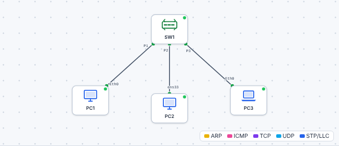

# 🛠️ TP – L'adressage : donner une adresse à chaque machine

*Bac Pro CIEL – Seconde – E31 – S11 – binôme, on **échange les rôles** à chaque partie*

> [!NOTE]
> **Mission.** Un petit bureau vient d'être câblé : trois postes sont branchés sur un switch, mais **aucun n'a d'adresse**. Tu établis un **plan d'adressage**, tu configures les postes, tu **prouves** avec des pings que tout communique, puis tu **retrouves des erreurs** laissées par un collègue.
>
> **Temps prévu :** 3 h 15. **Prérequis :** [cours S11](01-cours.md) lu (§1 à §5).

> [!NOTE]
> **Comment ce TP fonctionne.** En Seconde, on avance **guidé**, mais tu écris ta **prévision avant** chaque test (🤔) : se tromper puis comprendre, c'est ça qui compte. Le **bilan final** t'aide à remplir ton **passeport d'autonomie**.

**Binôme :** ____________ / ____________

---

## Partie A – Les 8 interrupteurs (≈ 25 min)

*Pas d'ordinateur : des cartes et du bon sens.*

L'enseignant distribue **8 cartes** : `128` `64` `32` `16` `8` `4` `2` `1`. Face visible = interrupteur **allumé** (le nombre compte), face cachée = **éteint** (0).

1. Pose les cartes dans l'ordre, de gauche à droite. Pour obtenir **11** : quelles cartes retournes-tu face visible ? ______________________
2. Même exercice pour chaque nombre, **sans calculatrice** :

| Nombre | Cartes visibles | Écriture binaire (8 chiffres) |
|---|---|---|
| 1 | | |
| 12 | | |
| 13 | | |
| 168 | | |
| 255 | | |

3. Ton binôme pose des cartes au hasard : tu **lis** le nombre. Faites 3 tours chacun.

✅ **Point de contrôle :** tu sais dire pourquoi un nombre d'une adresse IP **ne dépasse jamais 255**.
❓ **Pourquoi** ? ______________________

Aide

Avec 8 interrupteurs, la valeur maximale est tout allumé : 128 + 64 + 32 + 16 + 8 + 4 + 2 + 1 = **255**.

**🔁 Échange des rôles.**

---

## Partie B – Le plan d'adressage (≈ 20 min)

Avant de toucher à un ordinateur, un technicien **écrit son plan**. C'est la partie la plus importante de la séance.

Réseau du bureau : **192.168.1.0/24**. Équipements : PC1 (Windows), PC2 (Linux), PC3 (portable).

Complète le [tableau d'adressage](03-tableau-adressage.md) **sur papier** avant de passer à la suite. Règles :

- pas d'adresse **.0** ni **.255** (pourquoi ? cours §3) ;
- **une adresse différente** par machine ;
- toutes dans le **même réseau** ;
- on garde des numéros simples : **.11, .12, .13**.

✅ **Point de contrôle :** l'enseignant valide ton tableau **avant** que tu ouvres le simulateur.
❓ **Explique** : pourquoi ne pas mettre `192.168.2.12` pour PC2 ? ______________________

Aide

Le 3ᵉ nombre serait différent (`2` au lieu de `1`) : PC2 serait dans **un autre réseau** et PC1 ne saurait pas lui parler (il n'y a pas de passerelle).

---

## Partie C – Configurer dans le simulateur (≈ 55 min)

1. Ouvre le [simulateur réseau](../../simulateur/simulateur-reseau.html).
2. Charge le fichier [`s11-adressage-vierge.json`](tp/s11-adressage-vierge.json) (bouton d'ouverture de fichier). Tu vois 3 postes reliés à un switch : **câblage fait, aucune adresse**.

### C1. Constater que rien ne marche

🤔 **Je prévois :** les 3 postes sont câblés mais n'ont pas d'adresse. Le ping va-t-il marcher ? ______________

Sur **PC1**, ouvre le terminal et tape : `ping 192.168.1.12`

Message obtenu : ______________________

❓ **Pourquoi** ? ______________________

Aide

PC1 n'a **pas d'adresse IP** (vérifie avec `ipconfig`). Il ne peut rien envoyer. Le câblage est bon, mais l'adressage manque.

### C2. Configurer les trois postes

Pour chaque poste : double-clic → onglet **Configuration IP** → adresse, masque (selon **ton plan**) → valider.

Vérifie ensuite avec `ipconfig` (ou `ip a` sur PC2). 

### C3. Matrice de ping

Remplis avec ✅ (réponse) ou ❌ (échec). Chaque ping est lancé **depuis le poste de la ligne** vers celui de la colonne.

| Depuis \ Vers | PC1 | PC2 | PC3 |
|---|---|---|---|
| **PC1** | – | | |
| **PC2** | | – | |
| **PC3** | | | – |

✅ **Point de contrôle :** les **6** cases sont ✅.
❓ **Explique** : pourquoi un ping vers **soi-même** (`ping 192.168.1.11` sur PC1) est-il toujours réussi, même sans câble ? ______________________

Aide

La machine se répond à elle-même sans passer par le câble : cela prouve seulement que **sa propre carte réseau est configurée**, pas que le réseau marche.

### C4. Casser pour comprendre

🤔 **Je prévois :** si je change le 3ᵉ nombre de l'adresse de PC2 (`192.168.2.12`), PC1 pourra-t-il encore lui parler ? Et si je ne change que le masque ? ______________

Change **volontairement** l'adresse de PC2 en `192.168.2.12`, puis relance un ping depuis PC1. Ma prévision était-elle juste ? ______________

| Ce que j'ai changé | Message obtenu | Ce que ça m'apprend |
|---|---|---|
| PC2 en 192.168.2.12 | | |
| PC2 masque 255.255.255.128 | | |

Remets ensuite la bonne configuration.

**🔁 Échange des rôles.**

---

## Partie D – Sur de vrais postes (≈ 40 min)

*On reprend le même plan, avec du vrai matériel : 2 ou 3 postes du labo reliés à un switch (sans box, sans Internet).*

1. Note la configuration actuelle (`ipconfig` sous Windows, `ip a` sous Linux) pour pouvoir **revenir en arrière** : ______________________
2. Passe la carte réseau en **adresse fixe**, avec les valeurs de ton plan (méthodes : cours §4).
3. Pingue le poste du binôme.

| Test | Résultat |
|---|---|
| Mon poste → poste du binôme | |
| Poste du binôme → mon poste | |

> [!WARNING]
> **Si Windows ne répond pas au ping** alors que l'adresse et le câble sont bons : c'est le **pare-feu**. Il bloque les pings entrants par défaut. Demande à l'enseignant de l'autoriser, ou teste dans l'autre sens. Ce n'est **pas** une erreur d'adressage.

✅ **Point de contrôle :** le ping fonctionne **dans les deux sens** entre deux vrais postes.
❓ **Rends** le poste dans son état d'origine (adresse automatique). Où as-tu cliqué ? ______________________

---

## Partie E – La chasse aux erreurs (≈ 35 min)

Un collègue a configuré **4 postes**, mais certains ne se joignent pas. **Trouve pourquoi.**

1. Charge [`s11-erreurs.json`](tp/s11-erreurs.json).

2. Sur chaque poste, relève la configuration (`ipconfig`) et complète :

| Poste | Adresse IP | Masque | Ping vers PC1 | Diagnostic |
|---|---|---|---|---|
| PC1 | | | – | (référence) |
| PC2 | | | | |
| PC3 | | | | |
| PC4 | | | | |

3. **Corrige** chaque poste. Les adresses correctes à utiliser : .12, .13 et .14 dans `192.168.1.0/24`.
4. Relance les pings : **4 postes qui se joignent tous**.

> [!TIP]
> Méthode : pour chaque poste, pose-toi **trois questions dans l'ordre** : *Est-il dans le même réseau que PC1 ? Son masque est-il le bon ? Son adresse est-elle unique ?*

✅ **Point de contrôle :** tu sais nommer **les trois types d'erreur** (adresse hors réseau, mauvais masque, doublon) et le message qu'on obtient pour chacun.

Aide – si tu bloques sur un poste

Compare **chaque nombre** de l'adresse à celle de PC1 : un seul nombre diffère-t-il ? Regarde aussi la dernière ligne : le masque doit être `255.255.255.0` pour tous.

---

## 🏁 Bilan

### Oral (2 min par élève)

1. Pourquoi une adresse IP ne dépasse-t-elle jamais 255 ?
2. Donne un exemple d'adresse **valide** et un d'**invalide** dans `192.168.1.0/24` (et pourquoi).
3. PC1 ne joint pas PC2 : quelles sont les 3 causes à vérifier ?
4. Que veut dire « masque /24 » ?

### 📒 Mon bilan pour le passeport d'autonomie (écrit, individuel)

| Question | Ma réponse |
|---|---|
| Une erreur que j'ai faite (ou vue) et **ce qu'elle m'a appris** | |
| Ma méthode quand un ping échoue (dans quel ordre je vérifie ?) | |
| Ce que je saurais **refaire seul(e)**, sans fiche | |
| Ma **preuve** (matrice de ping, tableau de la partie E) | |

### Validation formative

| Compétence | Preuve | ✔ |
|---|---|---|
| Établir un plan d'adressage cohérent | Tableau validé avant la manip | |
| Configurer 3 postes | Matrice de ping : 6 ✅ | |
| Diagnostiquer 3 erreurs d'adressage | Tableau de la partie E | |
| Expliquer l'adresse et le masque | Bilan oral | |

| Mon auto-évaluation | 😟 | 🙂 | 😀 |
|---|---|---|---|
| Je sais lire une adresse IP et un masque /24 | | | |
| Je sais configurer une adresse fixe (Windows / Linux / simulateur) | | | |
| Je sais prouver qu'un poste communique avec un autre | | | |
| Je sais trouver pourquoi un ping échoue | | | |

## 🔍 Dépannage

| Symptôme | Cause probable | Que faire |
|---|---|---|
| Le ping échoue sur toute la ligne | Câble non branché / port éteint | Revoir S10 : voyants, câbles |
| « échec général » | Autre réseau ou pas d'adresse | Comparer les 3 premiers nombres |
| « Délai d'attente dépassé » | Mauvais masque ou poste muet (pare-feu) | Vérifier le masque, puis le pare-feu |
| Réponses étranges, intermittentes | Doublon d'adresse | Chercher deux postes identiques |
| Le simulateur ne charge pas le fichier | Mauvais fichier | Vérifier que c'est un `.json` |

> [!TIP]
> **Passeport d'autonomie :** lignes « Lire et attribuer une adresse IP » et « Tester une liaison avec ping » → *vu en guidé* ✔.

➡️ **Mission en entreprise :** relever l'adresse IP et le masque d'un poste (`ipconfig`), et repérer si les adresses de l'entreprise commencent par `192.168.`, `10.` ou `172.16` à `172.31`.
