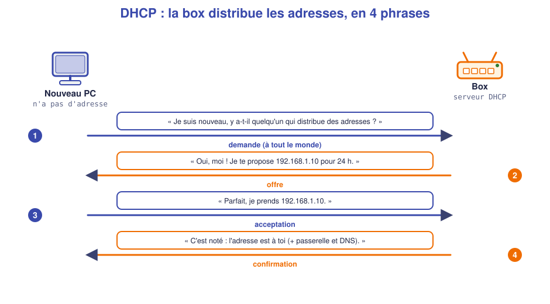
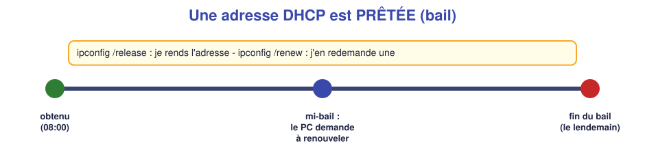
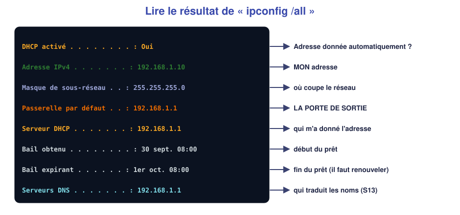
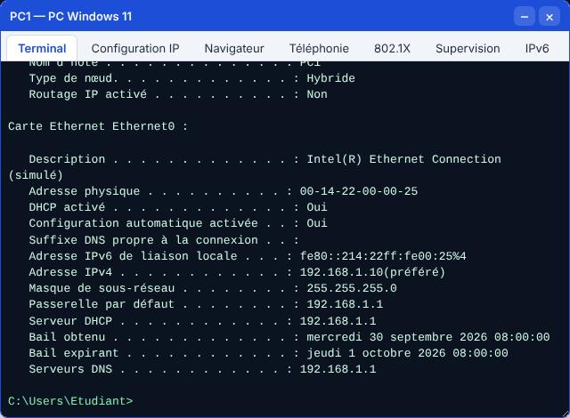
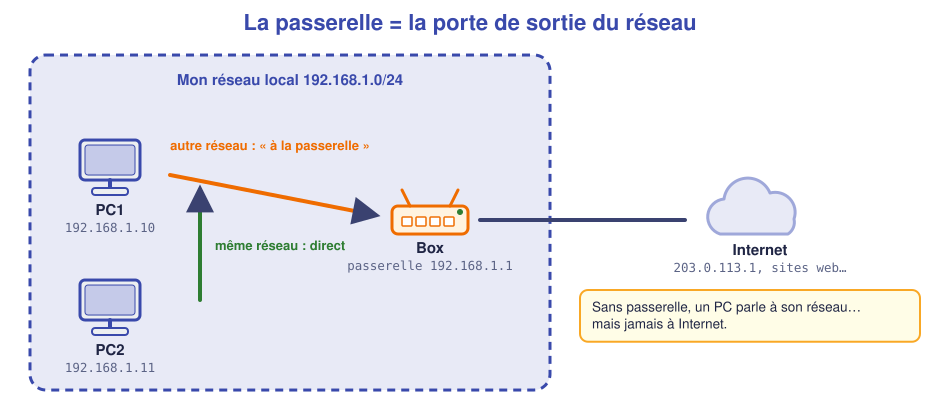
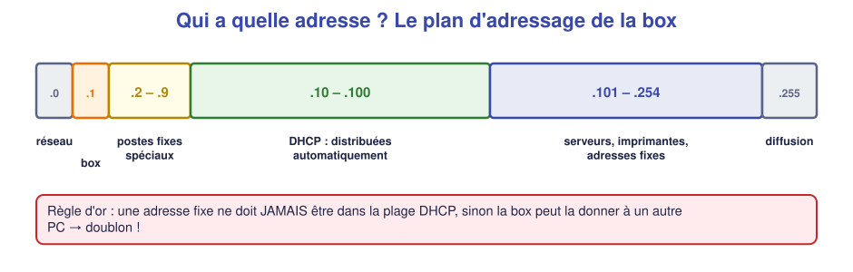
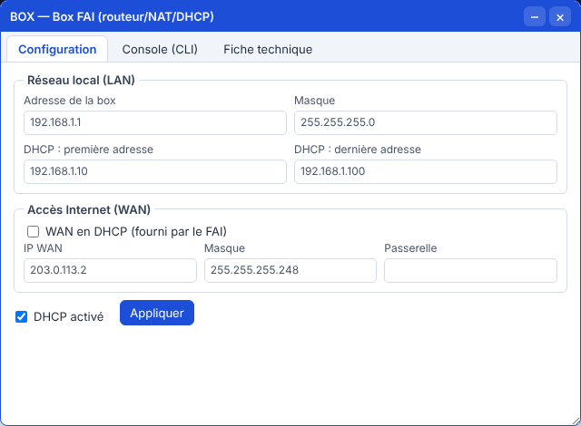

# 📖 Cours – Le DHCP, la box et la passerelle

*Bac Pro CIEL – Seconde – E31 – S12*

> [!IMPORTANT]
> Même méthode : **une idée à la fois**. Tu essaies de répondre à la question **avant** de déplier la réponse.

## 🎯 À la fin de ce cours, tu sauras

- [ ] expliquer pourquoi on **automatise** les adresses et ce que fait le **DHCP** ;
- [ ] raconter la **conversation DHCP** en 4 phrases ;
- [ ] lire `ipconfig /all` et dire à quoi sert chaque ligne ;
- [ ] expliquer ce qu'est un **bail** et ce que font `release` / `renew` ;
- [ ] reconnaître une adresse **169.254.x.x** ;
- [ ] expliquer le rôle de la **passerelle par défaut** ;
- [ ] organiser les adresses d'une box (**plan d'adressage**).

---

## 1. Pourquoi automatiser l'adressage ?

### 🤔 Avant de lire : à ton avis ?

En S11, tu as donné les adresses **à la main** à 3 PC. Une entreprise a **40 postes**, des portables qui vont et viennent, des téléphones en Wi-Fi. **Quels problèmes** poserait l'adressage à la main partout ?

Voir des réponses possibles

Il faut **passer devant chaque poste** (long), **noter** qui a quelle adresse (sinon **doublons**), **refaire** la manip à chaque nouvel appareil, et **se tromper** facilement (S11 : fautes de frappe, mauvais masque…). Un invité qui arrive avec son téléphone n'aurait **aucun moyen** de se connecter.

### 💡 L'idée

Un équipement du réseau est chargé de **distribuer les adresses** à ceux qui en demandent. Il s'appelle un **serveur DHCP** (*Dynamic Host Configuration Protocol*). Chez toi, **c'est ta box**. En entreprise, c'est souvent la box, un routeur ou un serveur.

Il ne donne pas que l'adresse. Il donne **tout le paquet** pour être connecté :

| Ce qu'il donne | Exemple | Servira à… |
|---|---|---|
| Une **adresse IP** | 192.168.1.10 | Être joignable |
| Un **masque** | 255.255.255.0 | Savoir quel est mon réseau |
| Une **passerelle** | 192.168.1.1 | Sortir du réseau (§3) |
| Un **serveur DNS** | 192.168.1.1 | Traduire les noms en adresses (S13) |

> *Analogie :* à l'**accueil d'un hôtel**, on ne choisit pas sa chambre : la réception en **attribue une**, donne la **clé**, le **code Wi-Fi**, l'heure du petit-déjeuner. Le DHCP, c'est la réception du réseau.

### 🧠 Retiens

> [!TIP]
> **DHCP = distribution automatique** de l'adresse, du masque, de la passerelle et du DNS. Le poste est en **« Obtenir une adresse IP automatiquement »**.

### ✅ Vérifie que tu as compris

**Q1.** Quel équipement fait le DHCP chez toi ?

Réponse

**La box Internet.** (En entreprise : un routeur ou un serveur.)

**Q2.** Un invité arrive avec son téléphone. Pourquoi le DHCP est-il pratique ?

Réponse

Le téléphone **demande** et reçoit **tout seul** une adresse libre. Personne n'a à le configurer ni à noter quoi que ce soit.

---

## 2. La conversation DHCP

### 🤔 Avant de lire : à ton avis ?

Un PC vient d'être branché. Il **n'a pas d'adresse**. Il ne connaît pas l'adresse de la box. **Comment peut-il lui parler ?**

Voir la réponse

Il **crie** sa demande à **tout le monde** sur le réseau (« broadcast », comme un haut-parleur dans la rue). La box, qui est à l'écoute, répond.

### 💡 L'idée : 4 phrases

1. **Demande :** « Je suis nouveau, y a-t-il quelqu'un qui distribue des adresses ? » (à tout le monde)
2. **Offre :** « Oui ! Je te propose 192.168.1.10. »
3. **Acceptation :** « Parfait, je la prends. »
4. **Confirmation :** « C'est noté. Elle est à toi, voici passerelle et DNS. »

> [!NOTE]
> Tu retrouveras ces 4 messages avec leurs vrais noms (*Discover, Offer, Request, Ack*) en **Première**, quand tu observeras les trames.

### ⏳ Le bail : une adresse prêtée

L'adresse n'est pas **donnée**, elle est **prêtée** pour une durée : le **bail**.

- Si le poste s'éteint longtemps, la box **reprend** l'adresse et peut la redonner.
- `ipconfig /release` : **je rends** mon adresse. `ipconfig /renew` : **j'en redemande** une.

### 🔍 Lire `ipconfig /all`

Voici la vraie sortie dans le simulateur :

> [!TIP]
> Sous **Linux** : `ip a` (adresse), `ip route` (passerelle : la ligne `default via …`).

### 🆘 169.254 : « personne n'a répondu »

Si un poste est en DHCP mais que **personne ne répond** (box éteinte, câble débranché, DHCP désactivé), Windows se donne **lui-même** une adresse du type **169.254.x.x** (masque 255.255.0.0, **pas de passerelle**).

> [!IMPORTANT]
> **169.254.x.x = le poste n'a pas trouvé de serveur DHCP.** Ce n'est **pas** une vraie adresse de ton réseau. Réflexe : *« la box répond-elle ? le câble est-il branché ? le DHCP est-il activé ? »*

### ✅ Vérifie que tu as compris

**Q3.** Dans quel ordre se passent les 4 étapes ?

Réponse

**Demande → offre → acceptation → confirmation.**

**Q4.** Un PC affiche `169.254.12.7`. Que conclus-tu ? Que vérifies-tu en premier ?

Réponse

Le PC **n'a pas obtenu d'adresse DHCP**. On vérifie : le **câble** (voyants), la **box allumée**, le **DHCP activé** sur la box.

**Q5.** Pourquoi la box ne doit-elle pas donner la même adresse à deux PC ?

Réponse

Un **doublon** casse la communication (S11 : réponses perdues). La box **note** les adresses prêtées pour ne jamais les redonner tant que le bail court.

---

## 3. La passerelle : la porte de sortie

### 🤔 Avant de lire : à ton avis ?

PC1 (`192.168.1.10`) veut joindre un site web dont l'adresse est `203.0.113.1`. Cette adresse est-elle dans le **même réseau** que PC1 ? Alors, **à qui PC1 envoie-t-il** son message ?

Voir la réponse

**Non** : `203.0.113.x` ≠ `192.168.1.x`. PC1 ne sait pas atteindre ce réseau directement. Il envoie donc tout à **quelqu'un qui connaît la sortie** : la **passerelle**.

### 💡 L'idée

Pour chaque message, le PC se pose **une seule question** : *« le destinataire est-il dans mon réseau ? »*

| Destinataire | Le PC… |
|---|---|
| **Même réseau** (mêmes 3 premiers nombres en /24) | l'envoie **directement** |
| **Autre réseau** | l'envoie à la **passerelle par défaut** (la box), qui se charge de la suite |

> *Analogie :* pour un courrier **dans ta rue**, tu le déposes toi-même. Pour **une autre ville**, tu le donnes à **la poste** : la passerelle.

> [!IMPORTANT]
> **Un PC sans passerelle** peut parler à tout son réseau, **mais jamais à Internet.** C'est la panne classique : *« j'ai un réseau, mais pas d'Internet »*.

### ✅ Vérifie que tu as compris

**Q6.** PC1 (`192.168.1.10`, passerelle `192.168.1.1`) pingue `192.168.1.11`, puis `8.8.8.8`. Qui reçoit le message dans chaque cas ?

Réponse

`192.168.1.11` : **PC2 directement** (même réseau). `8.8.8.8` : **la box** (`192.168.1.1`), qui le fait sortir sur Internet.

**Q7.** Un PC en adresse fixe `192.168.1.50` avec masque `255.255.255.0` mais **sans passerelle** : avec qui peut-il communiquer ?

Réponse

Avec **toutes les machines du réseau 192.168.1.0/24** (y compris la box). **Pas avec Internet.**

**Q8.** Quelle est l'adresse de la passerelle dans la plupart des réseaux de box ?

Réponse

Souvent **`192.168.1.1`** : c'est l'adresse de **la box elle-même**.

---

## 4. Régler une box : le plan d'adressage

### 🤔 Avant de lire : à ton avis ?

La box distribue des adresses de **.10 à .100**. Tu veux donner l'adresse **fixe `.20`** à l'imprimante. **Quel est le problème ?**

Voir la réponse

`.20` est **dans la plage DHCP** : la box peut la donner à un PC. **Doublon** avec l'imprimante ! Il faut mettre l'imprimante **en dehors** de la plage (ex. `.150`), ou **réserver** `.20` pour elle dans la box.

### 💡 L'idée

Dans une box, on règle surtout :

| Réglage | Exemple | Pourquoi |
|---|---|---|
| **Adresse de la box** (LAN) | 192.168.1.1 | C'est la passerelle |
| **Masque** | 255.255.255.0 | Taille du réseau |
| **Plage DHCP** (1ʳᵉ et dernière adresse) | .10 à .100 | Adresses distribuées |
| **DHCP activé** | oui | Sans ça, 169.254 |
| **Mot de passe administrateur** | **à changer** | Sinon n'importe qui peut régler la box |
| **Réservation d'adresse** | imprimante = .150 | Une adresse stable donnée *par le DHCP* |

> [!WARNING]
> **Le mot de passe d'usine d'une box** est souvent écrit **sous la box** : n'importe qui chez qui la box est visible peut l'utiliser. **On le change toujours** à l'installation et on le **note à un endroit sûr** (dans le dossier technique, pas sur un post-it collé dessus).

> [!TIP]
> **Réservation d'adresse (DHCP statique) :** la box **reconnaît** l'appareil (grâce à son adresse MAC, vue en S08) et lui donne **toujours la même adresse**. Pratique pour une imprimante ou un serveur : on gère tout à **un seul endroit**.

### ✅ Vérifie que tu as compris

**Q9.** Plage DHCP : `.10` à `.100`. Parmi `.5`, `.50`, `.150`, lesquelles sont sûres pour une imprimante en adresse fixe ?

Réponse

`.5` et `.150` (hors plage). **`.50` est dans la plage** : risque de doublon. (`.5` convient si on se réserve une zone pour les équipements spéciaux.)

**Q10.** Pourquoi change-t-on le mot de passe administrateur de la box ?

Réponse

Celui d'usine est **connu et lisible** sur l'étiquette. Quelqu'un pourrait **modifier la box** (ouvrir des accès, changer le DNS…).

---

## 5. Ce qu'il faut retenir

> [!TIP]
> 1. Le **DHCP** distribue **adresse, masque, passerelle, DNS** : demande → offre → acceptation → confirmation.
> 2. L'adresse est **prêtée** (bail) : `ipconfig /release`, `/renew`.
> 3. **169.254.x.x** = « pas de serveur DHCP trouvé ».
> 4. La **passerelle** est la porte de sortie : sans elle, **pas d'Internet**.
> 5. On garde la **plage DHCP** et les **adresses fixes** bien séparées. On **change le mot de passe** de la box.

### 📖 Vocabulaire

| Mot | Définition simple |
|---|---|
| **DHCP** | Service qui distribue les adresses automatiquement |
| **Serveur DHCP** | L'équipement qui distribue (souvent la box) |
| **Bail** | Durée pendant laquelle l'adresse est prêtée |
| **Plage DHCP** | Les adresses que la box a le droit de distribuer |
| **Passerelle** | Équipement qui fait sortir du réseau (la box) |
| **169.254.x.x** | Adresse que se donne un poste quand aucun DHCP ne répond |
| **Réservation** | Adresse DHCP toujours la même pour un appareil donné |
| **Plan d'adressage** | Tableau qui dit qui a quelle adresse |

➡️ **Suite :** le [🛠️ TP](02-tp.md).
