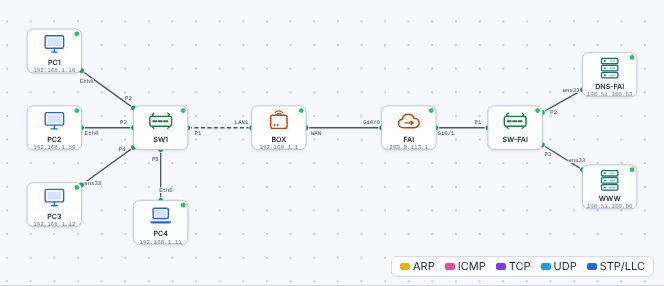

# 🛠️ TP – Le DHCP, la box et la passerelle

*Bac Pro CIEL – Seconde – E31 – S12 – binôme, on **échange les rôles** à chaque partie*

> [!NOTE]
> **Mission.** Une petite entreprise vient d'installer une **box** qui distribue les adresses. Tu **observes** comment les postes reçoivent leur configuration, tu **répares** un poste qui n'a pas Internet, tu **provoques** une panne DHCP pour la reconnaître, puis tu **règles une vraie box** et tu documentes tes réglages.
>
> **Temps prévu :** 3 h 15. **Prérequis :** [cours S12](01-cours.md) lu (§1 à §4).

**Binôme :** ____________ / ____________

---

> [!NOTE]
> **Comment ce TP fonctionne.** Les **commandes et réglages sont donnés** quand on ne peut pas les deviner : ton travail est de les **comprendre** (que fait chaque ligne, pourquoi, comment je le vérifie). Écris tes réponses aux ❓ **avant** de tester. Le **bilan final** nourrit ton **passeport d'autonomie**.

## Partie A – Observer le DHCP (≈ 30 min)

1. Ouvre le [simulateur](../../simulateur/simulateur-reseau.html), puis charge [`s12-dhcp-box.json`](tp/s12-dhcp-box.json).
2. Observe le schéma : 4 postes → switch → **box** → **Internet (FAI)**.

3. Sur chaque poste, ouvre le **terminal** : `ipconfig /all` (Windows : PC1, PC2, PC4) ou `ip a` puis `ip route` (Linux : PC3). Complète :

| Poste | DHCP activé ? | Adresse IP | Masque | Passerelle | Serveur DHCP |
|---|---|---|---|---|---|
| PC1 | | | | | |
| PC2 | | | | | |
| PC3 (Linux) | (`dynamic` dans `ip a` ?) | | | | – |
| PC4 | | | | | |

✅ **Point de contrôle :** tu repères **un poste différent des autres**. Lequel ? Pourquoi ? ______________________

❓ **Pourquoi** les adresses reçues par PC1, PC3 et PC4 sont-elles **toutes différentes** et dans le **même réseau** ? ______________________

Aide

La **box** garde la liste des adresses déjà prêtées et en donne **une libre** à chaque nouveau poste, dans **sa plage DHCP**, avec le même masque. Le poste différent a **« DHCP activé : Non »** : il a été réglé **à la main**.

**🔁 Échange des rôles.**

---

## Partie B – Rendre et redemander une adresse (≈ 20 min)

Sur **PC1** :

| Étape | Commande | Ce que je constate |
|---|---|---|
| 1 | `ipconfig` | Adresse actuelle : |
| 2 | `ipconfig /release` | |
| 3 | `ipconfig` | Adresse maintenant : |
| 4 | `ping 192.168.1.1` (la box) | Message : |
| 5 | `ipconfig /renew` | |
| 6 | `ipconfig`, puis `ping 192.168.1.1` | |

✅ **Point de contrôle :** tu sais dire **pourquoi** le ping de l'étape 4 échoue.
❓ **Explique** : pourquoi le message est-il « échec général » ? (Pense à S11.) ______________________

Aide

PC1 **n'a plus d'adresse** : il ne peut rien envoyer. Le câble et la box vont très bien : c'est **l'adressage** qui manque.

---

## Partie C – Le poste qui n'a pas Internet (≈ 40 min)

Le salarié du poste **PC2** dit : *« Je vois mes collègues, mais je n'ai pas Internet ! »* À toi de **dépanner**.

### C1. Constater

| Test depuis PC2 | Résultat |
|---|---|
| `ping` vers PC1 (son adresse relevée en A) | |
| `ping 192.168.1.1` (la box) | |
| `ping 203.0.113.1` (un serveur sur Internet) | |

### C2. Chercher la cause

Observe la configuration de PC2 (`ipconfig /all`) et compare avec PC1.

| Information | PC1 (fonctionne) | PC2 (ne sort pas) |
|---|---|---|
| Adresse IP | | |
| Masque | | |
| **Passerelle par défaut** | | |
| Serveur DNS | | |

❓ **Cause du problème :** ______________________

Aide

La **passerelle** de PC2 est **vide**. Il parle à son réseau (adresse + masque corrects) mais ne sait pas **à qui confier** les messages pour l'extérieur. (Cours §3.)

### C3. Réparer — **deux** façons

| Méthode | Comment faire | Résultat du `ping 203.0.113.1` |
|---|---|---|
| **1. Compléter à la main** | Fenêtre de PC2 → *Configuration IP* → passerelle `192.168.1.1` → valider | |
| **2. Repasser en automatique** | Fenêtre de PC2 → *Configuration IP* → **DHCP** coché | |

❓ **Laquelle est la meilleure en entreprise ?** Pourquoi ? ______________________

Aide

Le **DHCP** : moins d'erreurs, rien à retenir, et si on change la box, tout suit. On garde la configuration manuelle pour les **équipements fixes** (serveur, imprimante), avec un **plan d'adressage**.

✅ **Point de contrôle :** PC2 reçoit une **réponse** à `ping 203.0.113.1`.

**🔁 Échange des rôles.**

---

## Partie D – Quand le DHCP tombe en panne (≈ 25 min)

1. Double-clique sur la **BOX** : onglet *Configuration*. Décoche **DHCP activé**.
2. Sur **PC4** : `ipconfig /release`, puis `ipconfig /renew`, puis `ipconfig`.

| Ce que j'observe sur PC4 | |
|---|---|
| Adresse IP | |
| Masque | |
| Passerelle | |

3. PC4 peut-il pinguer la box (`192.168.1.1`) ? Un site (`203.0.113.1`) ? ______________________
4. **Recoche** « DHCP activé » sur la box, refais `ipconfig /renew` sur PC4 : que se passe-t-il ?

✅ **Point de contrôle :** tu sais **reconnaître** cette panne en 5 secondes.
❓ **Complète :** *« Si un poste affiche une adresse en ____________, c'est que ____________________________ »*

Aide

169.254.x.x → le poste **n'a trouvé aucun serveur DHCP** (box éteinte, câble débranché, DHCP désactivé).

> [!NOTE]
> **Remarque simulateur.** Si tu **changes la plage** de la box dans le simulateur, un poste qui fait `ipconfig /renew` **garde souvent son ancienne adresse** (il redemande la même). Sur une vraie box, une nouvelle plage s'applique aux **nouveaux** arrivants ou après la fin des baux.

---

## Partie E – Le plan d'adressage (sur papier, ≈ 15 min)

La box a l'adresse `192.168.1.1`. Sa plage DHCP va de **`.20` à `.120`**. Il faut y ajouter : 1 imprimante, 1 serveur de fichiers (NAS) et 2 bornes Wi-Fi, **toutes en adresse fixe**.

Remplis le tableau en respectant la **règle d'or** (aucune adresse fixe dans la plage DHCP) :

| Équipement | Adresse choisie | Dans la plage DHCP ? | Pourquoi ce choix ? |
|---|---|---|---|
| Box (passerelle) | 192.168.1.1 | non | |
| Imprimante | | | |
| NAS | | | |
| Borne Wi-Fi 1 | | | |
| Borne Wi-Fi 2 | | | |

❓ **Pourquoi** ne pas mettre l'imprimante en `.50` ? ______________________

---

## Partie F – Régler une vraie box (≈ 40 min)

*Sur le matériel de TP remis à zéro (box ou routeur de petite structure), avec un PC relié en Ethernet.*

> [!WARNING]
> On travaille sur du **matériel de TP**. On **note chaque réglage modifié** dans la [fiche de configuration](03-fiche-box.md) : un technicien doit pouvoir **revenir en arrière** et **expliquer** ce qu'il a fait.

1. **Relever** l'adresse de la box : c'est la **passerelle** du PC (`ipconfig`). Ouvrir un navigateur à cette adresse.
2. **Se connecter** (identifiants d'usine : étiquette sous la box).
3. **Changer le mot de passe administrateur.** Le noter dans la fiche (en classe : dans la fiche seulement, jamais sur la box).
4. **Régler la plage DHCP** : première et dernière adresse demandées par l'enseignant.
5. **Faire une réservation** pour un appareil (ex. imprimante du labo) : même adresse à chaque fois.
6. **Tester** : un autre PC en DHCP → adresse dans la plage ; le poste réservé → l'adresse réservée ; accès à Internet.
7. Compléter la fiche, puis la faire **valider** par l'enseignant.

✅ **Point de contrôle :** la fiche est remplie et les 3 tests de l'étape 6 sont ✅.

> [!NOTE]
> **Sans matériel réel**, fais les étapes 1, 4 et 6 dans le simulateur (fenêtre de la BOX : adresse, plage, DHCP) et regarde l'enseignant faire les étapes 3 et 5.

---

## 📒 Mon bilan pour le passeport d'autonomie (écrit)

| Question | Ma réponse |
|---|---|
| Une **décision** que j'ai prise, et **pourquoi** | |
| Ce qui m'a **surpris** ou ne s'est pas passé comme prévu | |
| Ce que je saurais **refaire seul(e)**, sans fiche | |
| Ma **preuve** (capture, sortie de commande) | |

> [!TIP]
> **Niveau 3 « Autonome » du passeport** : j'explique **ce que fait la box** pour donner une adresse à un poste.

## 🏁 Bilan

### Oral (2 min par élève)

1. À quoi sert le DHCP ? Raconte la conversation en 4 phrases.
2. Un PC affiche `169.254.7.9` : que fais-tu ?
3. Un PC pingue ses collègues mais pas Internet : quelle ligne regardes-tu en premier ?
4. Pourquoi change-t-on le mot de passe d'une box ?

### Validation formative

| Compétence | Preuve | ✔ |
|---|---|---|
| Lire une configuration DHCP complète | Tableau A | |
| Utiliser `release` / `renew` | Tableau B | |
| Diagnostiquer une passerelle manquante | Parties C | |
| Reconnaître une panne DHCP | Partie D | |
| Organiser les adresses d'une box | Partie E | |
| Configurer une box de TP et documenter | [Fiche de configuration](03-fiche-box.md) | |

| Mon auto-évaluation | 😟 | 🙂 | 😀 |
|---|---|---|---|
| Je sais expliquer le DHCP avec mes mots | | | |
| Je sais lire `ipconfig /all` | | | |
| Je sais trouver pourquoi un poste n'a pas Internet | | | |
| Je sais régler une plage DHCP et changer un mot de passe de box | | | |

## 🔍 Dépannage

| Symptôme | Cause probable | Que faire |
|---|---|---|
| Aucune adresse après `renew` | DHCP désactivé / box éteinte / câble | Voyants, box, case « DHCP activé » |
| `169.254.x.x` | Aucun serveur DHCP trouvé | Idem |
| Adresse correcte mais pas Internet | Passerelle vide ou fausse | `ipconfig /all`, ligne Passerelle |
| Deux postes avec la même adresse | Adresse fixe dans la plage DHCP | Sortir l'adresse fixe de la plage |
| Impossible d'ouvrir la page de la box | Mauvaise adresse, mauvais câble | Utiliser l'adresse de la **passerelle** du PC |
| Mot de passe de la box inconnu | Changé par un autre groupe | Remise à zéro (bouton *reset*) avec l'enseignant |

> [!TIP]
> **Passeport d'autonomie :** lignes « Configurer le DHCP d'une box » et « Dépanner une panne d'adressage » → *vu en guidé* ✔.

➡️ **Mission en entreprise :** demander au tuteur **quel équipement distribue les adresses** et **comment on y accède** ; relever la **passerelle** d'un poste (`ipconfig`).
