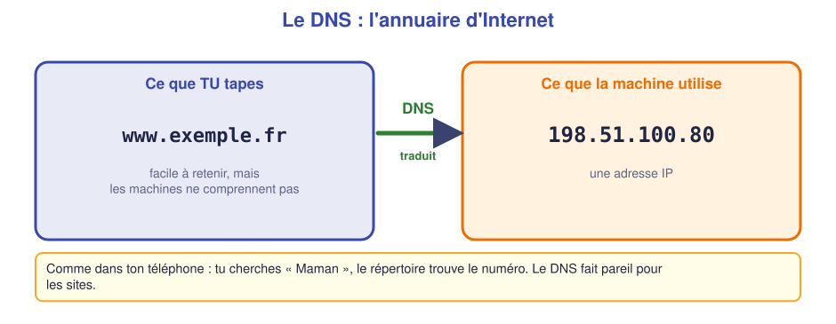
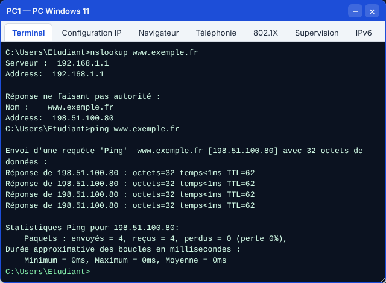
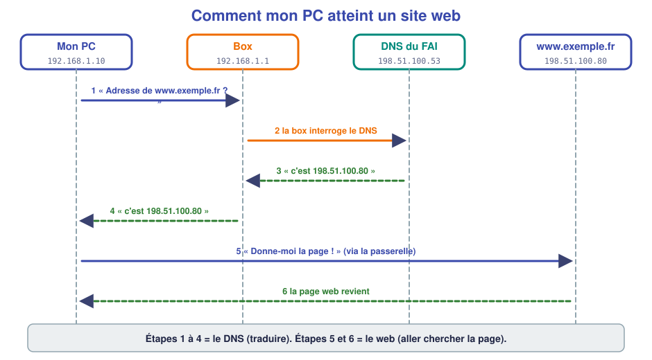
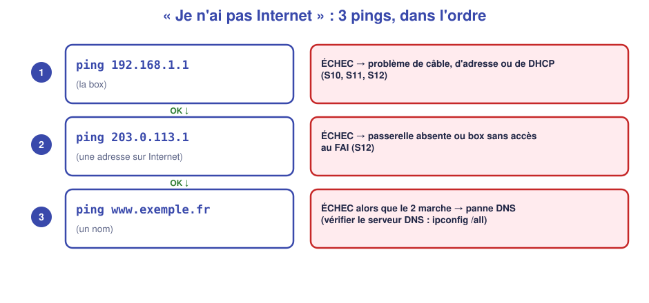
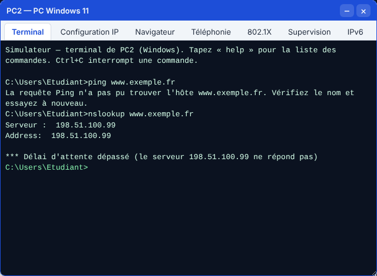
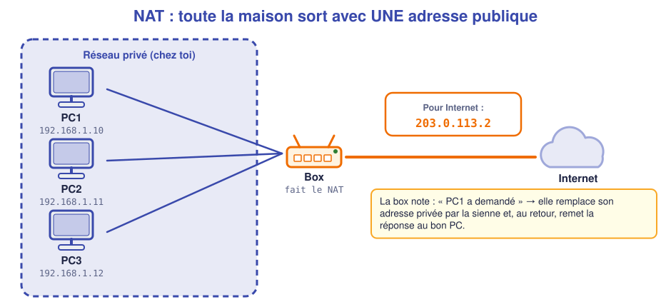

# 📖 Cours – Le DNS et l'accès à Internet

*Bac Pro CIEL – Seconde – E31 – S13*

> [!IMPORTANT]
> **Une idée à la fois.** Tu essaies de répondre à la question **avant** de déplier la réponse.

## 🎯 À la fin de ce cours, tu sauras

- [ ] expliquer ce que fait le **DNS** ;
- [ ] utiliser `nslookup` et `ping` sur un **nom** ;
- [ ] raconter les étapes pour atteindre un site web ;
- [ ] lire un `tracert` ;
- [ ] distinguer adresse **privée** et adresse **publique** ;
- [ ] diagnostiquer une **panne DNS**.

---

## 1. Le DNS : l'annuaire d'Internet

### 🤔 Avant de lire : à ton avis ?

Tu veux appeler un ami. Tu ne connais pas son numéro par cœur. **Que fais-tu ?** Et sur Internet, que doit faire ton PC pour aller sur `www.exemple.fr` ?

<details markdown="1"><summary>Voir la réponse</summary>

Tu cherches son **nom dans ton répertoire**, qui te donne le **numéro**. Ton PC fait pareil : il demande à un **annuaire** l'**adresse IP** correspondant au nom du site.

</details>

### 💡 L'idée



Les machines ne se parlent qu'avec des **adresses IP**. Les humains préfèrent les **noms**. Le **DNS** (*Domain Name System*) est l'annuaire qui traduit **nom → adresse**.

> *Analogie :* tu cherches « Maman » dans ton téléphone, il compose le numéro. Le **DNS**, c'est le répertoire du réseau.

Qui est le **serveur DNS** de ton PC ? C'est une des informations données par le **DHCP** (S12). Chez toi, c'est souvent **la box** (qui relaie vers le DNS de ton fournisseur d'accès).

### 🛠️ Les outils

| Commande | Ce qu'elle fait | Exemple |
|---|---|---|
| `nslookup nom` | Demande l'adresse d'un nom **et montre qui a répondu** | `nslookup www.exemple.fr` |
| `ping nom` | Traduit le nom, **puis** teste la liaison | `ping www.exemple.fr` |
| `ipconfig /flushdns` | **Vide la mémoire** des noms déjà traduits (Windows) | à faire après avoir corrigé le DNS |



> [!TIP]
> Dans la réponse de `ping www.exemple.fr`, tu vois **le nom et l'adresse** : preuve que le DNS a travaillé.

### ✅ Vérifie que tu as compris

**Q1.** Que fait le DNS ?

<details markdown="1"><summary>Réponse</summary>

Il **traduit un nom** (`www.exemple.fr`) **en adresse IP** (`198.51.100.80`).

</details>

**Q2.** Comment ton PC connaît-il son serveur DNS ?

<details markdown="1"><summary>Réponse</summary>

Par le **DHCP** (avec l'adresse, le masque et la passerelle) ; sinon, on l'écrit à la main dans la configuration.

</details>

**Q3.** `nslookup` répond « Serveur : 192.168.1.1 ». Que représente cette adresse ?

<details markdown="1"><summary>Réponse</summary>

Le **serveur DNS interrogé** : ici, la box de l'utilisateur.

</details>

---

## 2. Comment mon PC atteint un site web

### 🤔 Avant de lire : à ton avis ?

Tu tapes `www.exemple.fr` dans ton navigateur. **Combien d'équipements** interviennent, et **dans quel ordre** ?

<details markdown="1"><summary>Voir la réponse</summary>

Ton **PC**, la **box** (qui relaie le DNS et sert de passerelle), le **DNS du fournisseur** (qui connaît l'adresse), puis le **serveur web** du site. D'abord on cherche l'adresse, ensuite on demande la page.

</details>

### 💡 L'idée



1. Mon PC demande à son **DNS** (la box) l'adresse de `www.exemple.fr`.
2. La box interroge le **DNS du FAI**.
3. Il répond avec l'adresse : `198.51.100.80`.
4. La box transmet la réponse à mon PC.
5. Mon PC envoie la **demande de page** à cette adresse, **par la passerelle** (S12).
6. Le **serveur** renvoie la page : le navigateur l'affiche.

> [!IMPORTANT]
> **Deux services différents** : le **DNS** (trouver l'adresse) et le **web** (récupérer la page). Une panne du **premier** empêche d'ouvrir les sites **même si Internet fonctionne**.

### 🗺️ Voir le chemin : `tracert`

`tracert` (Windows) ou `traceroute` (Linux) liste les **équipements traversés**, un par ligne : on voit la **route** que prennent les paquets.

```text
tracert www.exemple.fr
  1    <1 ms   <1 ms   <1 ms  192.168.1.1     ← la box (passerelle)
  2        *       *       *  Délai d'attente… ← un équipement qui ne répond pas
  3    <1 ms   <1 ms   <1 ms  198.51.100.80    ← le serveur
```

> [!NOTE]
> Les lignes en `*` ne sont pas forcément une panne : certains équipements **ne répondent pas** à ce test. On regarde si on **arrive** à la destination.

### ✅ Vérifie que tu as compris

**Q4.** Dans quel ordre ? *demander la page / traduire le nom / recevoir la page.*

<details markdown="1"><summary>Réponse</summary>

**Traduire le nom → demander la page → recevoir la page.**

</details>

**Q5.** Dans un `tracert`, quel est toujours le 1ᵉʳ saut chez toi ?

<details markdown="1"><summary>Réponse</summary>

La **passerelle** : ta box (ex. `192.168.1.1`).

</details>

---

## 3. La panne DNS : « j'ai Internet mais pas les sites »

### 🤔 Avant de lire : à ton avis ?

Un collègue dit : *« Je ne peux ouvrir aucun site, mais Teams marche »*. Quelle piste te vient ? (Pense à la section 2.)

<details markdown="1"><summary>Voir la réponse</summary>

Le **réseau marche** (Teams utilise des adresses déjà connues). C'est la **traduction des noms** qui échoue : une **panne de DNS**.

</details>

### 💡 L'idée : le test en 3 pings



| Test | Résultat | Conclusion |
|---|---|---|
| `ping 192.168.1.1` (la box) | ÉCHEC | Problème **local** : câble, adresse, DHCP (S10–S12) |
| `ping 203.0.113.1` (adresse sur Internet) | ÉCHEC | **Passerelle** manquante ou box sans accès au FAI |
| `ping www.exemple.fr` (nom) | ÉCHEC mais le 2ᵉ marche | **Panne DNS** : mauvais serveur DNS configuré |



> [!TIP]
> **Réflexe :** `ipconfig /all` → regarde la ligne **Serveurs DNS**. Est-elle vide ? Est-ce **la bonne adresse** (souvent la box ou celle de l'entreprise) ? Après correction, tape `ipconfig /flushdns` : Windows garde en mémoire les anciennes réponses.

### ✅ Vérifie que tu as compris

**Q6.** `ping 8.8.8.8` répond, `ping www.exemple.fr` dit « impossible de trouver l'hôte ». Cause probable ?

<details markdown="1"><summary>Réponse</summary>

Le **DNS** : l'accès Internet fonctionne (ping par adresse), mais les noms ne sont pas traduits.

</details>

**Q7.** Comment répares-tu ?

<details markdown="1"><summary>Réponse</summary>

Mettre le **bon serveur DNS** (celui de la box, ou celui de l'entreprise), ou repasser en **DHCP** pour le recevoir automatiquement.

</details>

---

## 4. Adresses privées, adresses publiques, NAT

### 🤔 Avant de lire : à ton avis ?

En S11, tu as vu que **beaucoup de réseaux utilisent `192.168.1.x`**. Si ton PC `192.168.1.10` et celui d'un voisin `192.168.1.10` vont tous deux sur un site, **comment le site sait-il à qui répondre** ?

<details markdown="1"><summary>Voir la réponse</summary>

Le site **ne voit jamais** l'adresse privée. Ta **box** remplace l'adresse privée par **son adresse publique** (unique au monde) : c'est le **NAT**.

</details>

### 💡 L'idée



- **Adresse privée** (`192.168.x.x`, `10.x.x.x`, `172.16.x.x`…) : **utilisée localement**, jamais routée sur Internet.
- **Adresse publique** : **unique au monde**, fournie par l'opérateur. Ta box en a **une**.

> [!EXAMPLE]+ 🚀 Pour aller plus loin : le NAT, comment la box s'y prend
> - **NAT** : la box **remplace** l'adresse privée de chaque PC par **sa propre adresse publique** en sortant ; elle **note** qui a demandé quoi pour rendre la réponse au bon PC.
>
> *Analogie :* un **standard téléphonique** d'entreprise. Tous les appels sortants affichent **le même numéro** ; le standard sait à quel poste passer chaque réponse.
>
> La table de la box (dans le simulateur : *BOX → Console (CLI) → `show ip nat translations`*) :
>
> 
>
> On y lit : **PC1 (192.168.1.11)** et **PC3 (192.168.1.10)** sortent **tous deux** avec `203.0.113.2`.

### ✅ Vérifie que tu as compris

**Q8.** Trois PC d'une maison sortent sur Internet. Combien d'adresses publiques utilise-t-on ?

<details markdown="1"><summary>Réponse</summary>

**Une seule** : celle de la box (grâce au NAT).

</details>

**Q9.** Quelle adresse un site web voit-il quand tu le visites depuis chez toi : `192.168.1.10` ou celle de la box ?

<details markdown="1"><summary>Réponse</summary>

**Celle de la box** (adresse publique). L'adresse privée n'est jamais visible sur Internet.

</details>

**Q10.** Pourquoi un `ping` depuis Internet vers `192.168.1.10` ne peut-il pas fonctionner ?

<details markdown="1"><summary>Réponse</summary>

Cette adresse est **privée** : elle n'existe pas sur Internet et n'y est pas routée.

</details>

---

## 5. Ce qu'il faut retenir

> [!TIP]
> 1. Le **DNS** traduit un **nom** en **adresse IP**. `nslookup` montre qui répond.
> 2. Atteindre un site = **DNS** (trouver l'adresse) puis **passerelle** (aller le chercher).
> 3. `tracert` montre le **chemin** ; le 1ᵉʳ saut est la **passerelle**.
> 4. **Panne DNS** : `ping` par adresse marche, par nom non → vérifier le **serveur DNS**.
> 5. **NAT** : tout le réseau privé sort avec **une seule adresse publique**, celle de la box.

### 📖 Vocabulaire

| Mot | Définition simple |
|---|---|
| **DNS** | Annuaire qui traduit un nom en adresse IP |
| **Serveur DNS** | Machine qui répond aux demandes de traduction |
| **nslookup** | Commande pour interroger le DNS |
| **tracert / traceroute** | Commande qui affiche le chemin vers une destination |
| **Adresse publique** | Adresse unique sur Internet |
| **NAT** | Remplacement de l'adresse privée par l'adresse publique de la box |
| **FAI** | Fournisseur d'accès à Internet |

➡️ **Suite :** le [🛠️ TP](02-tp.md).
