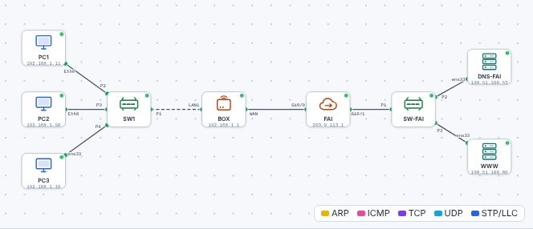
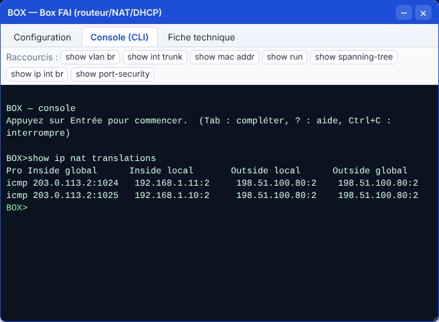

# 🛠️ TP – Du nom à la page : le DNS en pratique

*Bac Pro CIEL – Seconde – E31 – S13 – binôme, on **échange les rôles** à chaque partie*

> [!NOTE]
> **Mission.** Dans une petite entreprise, deux collègues ouvrent le site `www.exemple.fr` sans problème. Un troisième **n'y arrive pas**. Tu **observes** comment le nom est traduit, tu **trouves** pourquoi le poste en panne échoue, tu le **répares**, puis tu **expliques** par un schéma.
>
> **Temps prévu :** 3 h 10. **Prérequis :** [cours S13](01-cours.md) lu (§1 à §4).

**Binôme :** ____________ / ____________

---

> [!NOTE]
> **Comment ce TP fonctionne.** Les **commandes et réglages sont donnés** quand on ne peut pas les deviner : ton travail est de les **comprendre** (que fait chaque ligne, pourquoi, comment je le vérifie). Écris tes réponses aux ❓ **avant** de tester. Le **bilan final** nourrit ton **passeport d'autonomie**.

## Partie A – Traduire un nom (≈ 30 min)

1. Ouvre le [simulateur](../../simulateur/simulateur-reseau.html), puis charge [`s13-dns.json`](tp/s13-dns.json).

2. Sur **PC1** (terminal), tape : `ipconfig /all`. Relève la ligne **Serveurs DNS** : ______________________
3. Tape `nslookup www.exemple.fr` :

| Information | Valeur |
|---|---|
| Serveur DNS interrogé | |
| Nom demandé | |
| Adresse obtenue | |

4. Tape `ping www.exemple.fr`. Quelle adresse voit-on entre crochets ? ______________________

✅ **Point de contrôle :** l'adresse obtenue en 3 et celle du ping en 4 sont **identiques**.
❓ **Pourquoi** ? ______________________

Aide

Le `ping` commence par demander l'adresse au DNS (comme `nslookup`), **puis** envoie ses paquets à cette adresse.

5. Dans l'onglet **Navigateur** de PC1 : ouvre `http://www.exemple.fr`. Que lis-tu ? ______________________
6. Fais de même sur **PC3** (Linux) : `nslookup www.exemple.fr`, puis `ping -c 2 www.exemple.fr`.

**🔁 Échange des rôles.**

---

## Partie B – Le poste qui ne trouve pas le site (≈ 35 min)

Le salarié du poste **PC2** dit : *« Je n'arrive à ouvrir aucun site ! »*

### B1. Les 3 pings

Sur **PC2**, lance les 3 tests **dans l'ordre** :

| Test | Résultat | Conclusion |
|---|---|---|
| 1. `ping 192.168.1.1` (la box) | | |
| 2. `ping 198.51.100.80` (le site, **par son adresse**) | | |
| 3. `ping www.exemple.fr` (le site, **par son nom**) | | |

### B2. Chercher la cause

`ipconfig /all` sur PC2 et sur PC1 :

| Information | PC1 | PC2 |
|---|---|---|
| Adresse IP | | |
| Passerelle | | |
| **Serveur DNS** | | |

`nslookup www.exemple.fr` sur PC2 : message obtenu : ______________________

❓ **Cause du problème (une phrase) :** ______________________

Aide

Les pings **1 et 2 réussissent** : le réseau et la passerelle sont bons. Seul le **nom** échoue. Regarde l'adresse du **serveur DNS** de PC2 : elle ne correspond à aucun serveur du réseau.

### B3. Réparer

PC2 → onglet **Configuration IP** : mets le **DNS** à l'adresse de la box (`192.168.1.1`), valide. (Autre solution : repasser PC2 en **DHCP**.)

| Vérification | Résultat |
|---|---|
| `nslookup www.exemple.fr` | |
| `ping www.exemple.fr` | |
| Navigateur : `http://www.exemple.fr` | |

✅ **Point de contrôle :** la page « Bienvenue sur exemple.fr » s'affiche sur PC2.
❓ **Pourquoi** le ping par adresse marchait-il **avant** la réparation ? ______________________

**🔁 Échange des rôles.**

---

## Partie C – Voir le chemin avec `tracert` (≈ 20 min)

Sur **PC1** : `tracert www.exemple.fr` (laisse le temps de finir).

| Saut | Adresse | Qui est-ce, à ton avis ? |
|---|---|---|
| 1 | | |
| 2 | | |
| 3 | | |

❓ **Pourquoi** le premier saut est-il toujours la box ? ______________________

---

## Partie D – Le NAT : une adresse pour tous (≈ 25 min)

1. Sur **PC1**, puis sur **PC3** : `ping 198.51.100.80` (laisse finir).
2. Ouvre la **BOX** → onglet **Console (CLI)**, tape : `show ip nat translations`.

3. Complète à partir de **ta** table :

| Adresse privée de départ (*Inside local*) | Adresse vue par Internet (*Inside global*) |
|---|---|
| | |
| | |

❓ **Que remarques-tu** sur la colonne de droite ? ______________________
❓ **Pourquoi** est-ce utile pour l'entreprise ? ______________________

Aide

Toutes les lignes affichent **la même adresse** : celle de la box côté Internet (WAN). Une seule adresse publique suffit pour tout le réseau.

---

## Partie E – Sur un vrai poste (≈ 25 min, selon l'accès Internet)

Sur un vrai poste connecté à Internet :

| Commande | Résultat |
|---|---|
| `nslookup www.education.gouv.fr` | Serveur DNS utilisé : |
| | Adresse obtenue : |
| `ping www.education.gouv.fr` | Répond ? |
| `tracert www.education.gouv.fr` (Linux : `traceroute`) | Nombre de sauts : |

❓ **Compare** avec le simulateur : qu'y a-t-il en plus dans le vrai réseau ? ______________________

> [!NOTE]
> Certains sites **ne répondent pas au ping** (pare-feu) sans être en panne ; leur adresse apparaît quand même avec `nslookup`.

---

## Partie F – Schéma et mini-QCM (≈ 30 min, individuel)

Complète la fiche [Schéma + mini-QCM](03-schema-qcm.md). Elle est **évaluée** (formatif).

---

## 📒 Mon bilan pour le passeport d'autonomie (écrit)

| Question | Ma réponse |
|---|---|
| Une **décision** que j'ai prise, et **pourquoi** | |
| Ce qui m'a **surpris** ou ne s'est pas passé comme prévu | |
| Ce que je saurais **refaire seul(e)**, sans fiche | |
| Ma **preuve** (capture, sortie de commande) | |

> [!TIP]
> **Niveau 3 « Autonome » du passeport** : j'explique **comment un nom de site devient une adresse**.

## 🏁 Bilan

### Oral (2 min par élève)

1. C'est quoi le DNS ? Donne une image.
2. `ping 8.8.8.8` marche, `ping www.exemple.fr` non : que fais-tu ?
3. Pourquoi `192.168.1.10` n'apparaît-elle jamais sur Internet ?

| Mon auto-évaluation | 😟 | 🙂 | 😀 |
|---|---|---|---|
| Je sais ce que fait le DNS | | | |
| Je sais utiliser `nslookup`, `ping` et `tracert` | | | |
| Je sais trouver une panne DNS | | | |
| Je sais expliquer le NAT en une image | | | |

## 🔍 Dépannage

| Symptôme | Cause probable | Que faire |
|---|---|---|
| `nslookup` : délai d'attente dépassé | Serveur DNS erroné | `ipconfig /all`, corriger le DNS |
| Ping par adresse OK, par nom KO | DNS | Idem |
| Ping par adresse KO | Passerelle ou box | Revoir S12 |
| Page blanche dans le navigateur | URL sans `http://` ou serveur éteint | Retaper l'adresse en entier |
| `show ip nat translations` vide | Pas encore de trafic | Faire d'abord un ping vers `198.51.100.80` |

> [!TIP]
> **Passeport d'autonomie :** lignes « Tester le DNS (nslookup) » et « Expliquer l'accès à Internet » → *vu en guidé* ✔.

➡️ **Mission en entreprise :** avec l'accord du tuteur, `nslookup` sur un nom et noter le **serveur DNS** utilisé.
