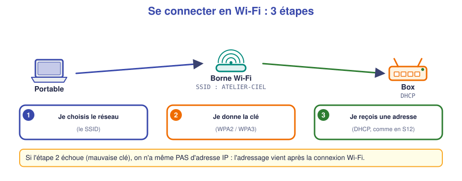
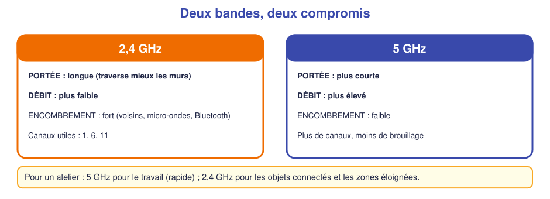
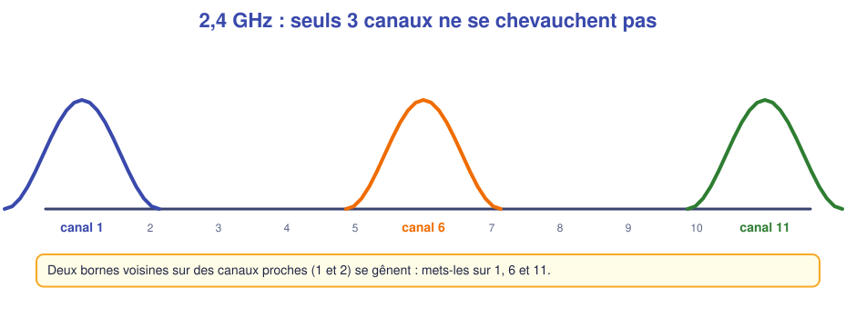
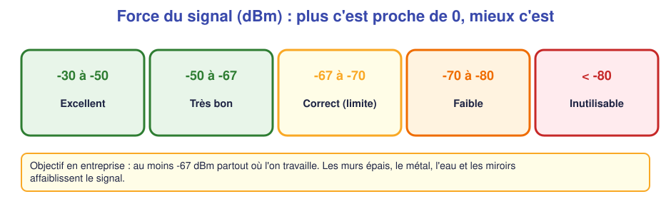
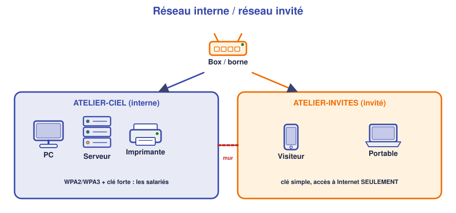

# 📖 Cours – Le Wi-Fi : installer et sécuriser

*Bac Pro CIEL – Seconde – E31 – S14*

> [!IMPORTANT]
> **Une idée à la fois.** Réponds à la question **avant** de déplier la réponse.

## 🎯 À la fin de ce cours, tu sauras

- [ ] expliquer **SSID**, **bande**, **canal**, **portée** ;
- [ ] lire un niveau de signal en **dBm** ;
- [ ] choisir une **sécurité** (WPA2/WPA3) et une **clé** solide ;
- [ ] expliquer le **réseau invité** et le **WPS** ;
- [ ] appliquer les **bons réflexes** de sécurité.

---

## 1. Le Wi-Fi : un réseau par les ondes

### 🤔 Avant de lire : à ton avis ?

En S10, un câble relie un PC au switch. En Wi-Fi, **il n'y a pas de câble**. Qu'est-ce qui le remplace ? Et quel **danger** supplémentaire cela crée-t-il ?

Voir la réponse

Ce sont des **ondes radio**. Le danger : **n'importe qui à portée** peut « écouter » ou essayer de se connecter, sans rien brancher.

### 💡 L'idée

Une **borne Wi-Fi** (*point d'accès*) relie les appareils sans fil au **réseau câblé**. Elle ne distribue pas d'adresses : c'est le **DHCP de la box** (S12) qui le fait.

| Mot | Ce que c'est |
|---|---|
| **SSID** | Le **nom** du réseau Wi-Fi (ex. `ATELIER-CIEL`) |
| **Clé** | Le mot de passe du Wi-Fi |
| **Sécurité** | La méthode qui protège les échanges : WPA2, WPA3… |
| **Association** | La connexion de l'appareil à la borne |

> [!IMPORTANT]
> **Ordre :** 1. choisir le SSID → 2. donner la clé → 3. **ensuite seulement** recevoir une adresse du DHCP. **Mauvaise clé = pas d'adresse IP**, et ce n'est **pas** un problème d'adressage.

### ✅ Vérifie que tu as compris

**Q1.** Un portable affiche « connecté » mais n'a pas d'adresse IP. Parmi *clé Wi-Fi fausse* / *DHCP en panne*, que suspectes-tu ?

Réponse

Si le portable **affiche connecté**, la clé est bonne : c'est le **DHCP** qu'on vérifie (S12). Avec une **clé fausse**, l'appareil ne se connecte même pas.

**Q2.** Qui donne l'adresse IP à un téléphone connecté en Wi-Fi ?

Réponse

Le **serveur DHCP** du réseau (souvent la box), pas la borne.

---

## 2. Bandes, canaux, portée et signal

### 🤔 Avant de lire : à ton avis ?

Dans une grande maison, le Wi-Fi est **fort près de la box** et **très faible** à l'étage. Cite **trois choses** qui peuvent affaiblir le Wi-Fi.

Voir des réponses possibles

La **distance**, les **murs** (béton, briques), le **métal** (armoires, frigo), l'**eau** (aquarium), les **miroirs**, les **autres appareils** (micro-ondes, voisins).

### 💡 L'idée : deux bandes

> *Analogie :* le **2,4 GHz**, c'est la **route nationale** : elle va loin, mais tout le monde l'emprunte et on roule lentement. Le **5 GHz**, c'est l'**autoroute** : rapide et peu encombrée, mais il y a moins de sorties (portée plus courte).

### 📡 Les canaux

Chaque borne émet sur un **canal**. Deux bornes **sur le même canal** (ou des canaux proches) se **gênent**.

### 📶 Mesurer le signal

On mesure la force du signal en **dBm** (nombres **négatifs**) : plus c'est **proche de 0**, **meilleur** c'est.

> [!TIP]
> Les applications d'analyse (*WiFiman*, *Wi-Fi Analyzer*…) affichent les **SSID voisins, la bande, le canal et le signal**. C'est l'outil du technicien pour **placer une borne**.

### ✅ Vérifie que tu as compris

**Q3.** Quelle bande choisir pour un objet connecté **loin** de la borne ? Pourquoi ?

Réponse

**2,4 GHz** : meilleure **portée** (traverse mieux les murs), même si le débit est plus faible.

**Q4.** Quel signal est le meilleur : `-45 dBm` ou `-78 dBm` ?

Réponse

**-45 dBm** (plus proche de 0). `-78` est faible.

**Q5.** Deux bornes voisines sont toutes deux sur le canal 6 et le Wi-Fi est lent. Que fais-tu ?

Réponse

Je mets l'une **sur un autre canal** (1 ou 11 en 2,4 GHz) ou je passe en **5 GHz**.

---

## 3. Sécuriser le Wi-Fi

### 🤔 Avant de lire : à ton avis ?

Un café propose un Wi-Fi **sans mot de passe** (réseau « ouvert »). Quel **risque** pour toi ?

Voir la réponse

Les échanges **ne sont pas chiffrés** : quelqu'un de proche peut **observer** ce que tu envoies. Un faux Wi-Fi au même nom peut aussi **piéger** les visiteurs.

### 💡 L'idée

| Sécurité | Verdict |
|---|---|
| **Ouvert** | ❌ Aucune protection (sauf cas précis, ex. portail invité) |
| **WEP** | ❌ Cassé depuis des années : à ne jamais utiliser |
| **WPA2** (personnel) | ✅ Bon, très répandu |
| **WPA3** (personnel) | ✅ Meilleur, si les appareils le gèrent |

> [!IMPORTANT]
> Il faut **chiffrer** le Wi-Fi (WPA2 ou WPA3) **et** utiliser une **clé solide**.

**Une clé solide :**
- au moins **12 caractères** ;
- une **phrase de passe** (ex. `Cafe-Velo-Pluie-42`) est plus simple à retenir et plus sûre que `P@ss1`;
- **différente** de tous tes autres mots de passe ;
- jamais écrite **sur la borne**.

### 🚪 Les autres réglages de sécurité

| Réglage | À faire | Pourquoi |
|---|---|---|
| **Mot de passe administrateur** de la borne | **Changer** (S12) | Sinon tout le monde peut régler la borne |
| **WPS** (bouton de connexion rapide) | **Désactiver** | Faille connue : un code à 8 chiffres peut être deviné |
| **Mises à jour** (micrologiciel) | **Faire** régulièrement | Corrige les failles |
| **Réseau invité** | **Créer** | Isoler les visiteurs du réseau de l'entreprise |

### 👥 Le réseau invité

Un visiteur ne doit pas pouvoir atteindre **tes ordinateurs, serveurs ou imprimantes**. On crée un **second Wi-Fi** : il donne **accès à Internet seulement**.

### ✅ Vérifie que tu as compris

**Q6.** Pourquoi WPA2 plutôt que « ouvert » ?

Réponse

WPA2 **chiffre** les échanges et **demande une clé** : un intrus ne peut ni lire ni se connecter facilement.

**Q7.** Donne un exemple de clé solide, et un exemple de clé à éviter.

Réponse

Solide : `Cafe-Velo-Pluie-42` (longue, phrase de passe). À éviter : `12345678`, le nom de l'entreprise, `azerty`, la date de naissance.

**Q8.** Pourquoi un réseau invité dans une entreprise ?

Réponse

Pour donner **Internet aux visiteurs** sans leur donner accès aux **machines et données** de l'entreprise.

---

## 4. Les bons réflexes (cyberhygiène)

| Réflexe | Exemple concret |
|---|---|
| **Mots de passe** différents et longs | Un gestionnaire de mots de passe aide |
| **Mises à jour** | Système, navigateur, micrologiciel des équipements |
| **Pare-feu** actif | Celui de Windows reste activé (S11 : il bloque le ping, c'est normal) |
| **Prudence en public** | Pas d'opérations sensibles sur un Wi-Fi ouvert |
| **Pas de réseau inconnu** | On ne se connecte jamais au Wi-Fi d'un tiers sans autorisation |
| **Sauvegarde** | Copie des fichiers importants |

> [!WARNING]
> **Cadre légal :** essayer de se connecter à un réseau Wi-Fi **sans autorisation**, ou d'en deviner la clé, est **interdit et puni par la loi**, même « pour voir ». Un technicien n'agit que sur les réseaux **dont il a la charge**.

---

## 5. Ce qu'il faut retenir

> [!TIP]
> 1. **SSID** = nom du réseau ; **clé** = mot de passe ; **mauvaise clé = pas d'adresse IP**.
> 2. **2,4 GHz** : portée ; **5 GHz** : débit. Canaux **1, 6, 11** en 2,4 GHz.
> 3. Signal en **dBm** : plus proche de 0, mieux c'est ; viser **mieux que -67**.
> 4. **WPA2/WPA3 + clé forte (12+ caractères)** ; **jamais** « ouvert » ou WEP.
> 5. **Changer le mot de passe admin, désactiver le WPS, mettre à jour, créer un réseau invité.**

### 📖 Vocabulaire

| Mot | Définition simple |
|---|---|
| **SSID** | Nom du réseau Wi-Fi |
| **Borne / point d'accès** | Équipement qui relie le Wi-Fi au réseau câblé |
| **Bande** | Gamme de fréquences : 2,4 ou 5 GHz |
| **Canal** | « Voie » de la bande utilisée par la borne |
| **dBm** | Unité de la force du signal (négatif) |
| **WPA2 / WPA3** | Protection chiffrée du Wi-Fi |
| **WPS** | Connexion rapide par bouton/code (à désactiver) |
| **Réseau invité** | Wi-Fi isolé donnant seulement accès à Internet |
| **Micrologiciel** | Logiciel intégré à un équipement (à mettre à jour) |

➡️ **Suite :** le [🛠️ TP](02-tp.md).
